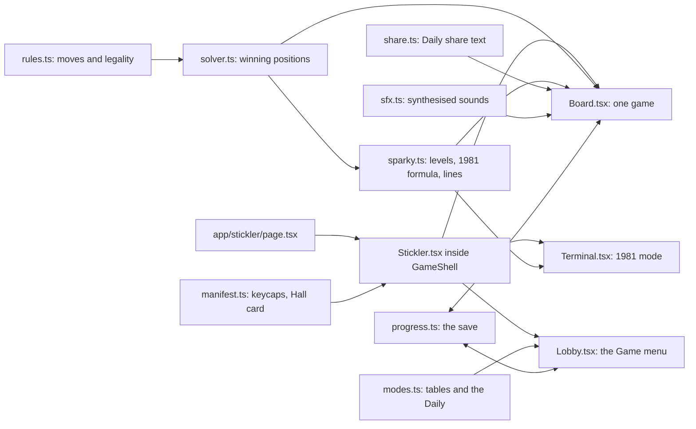
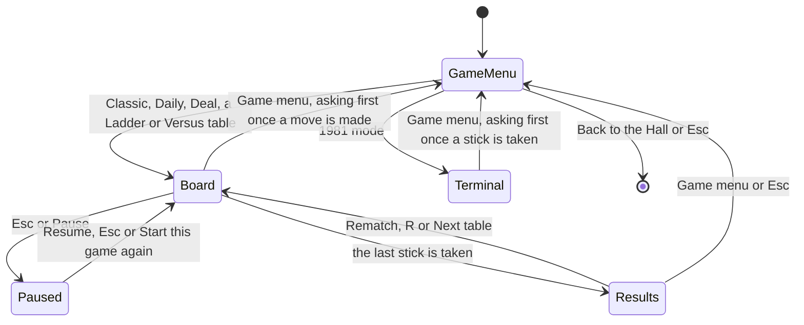
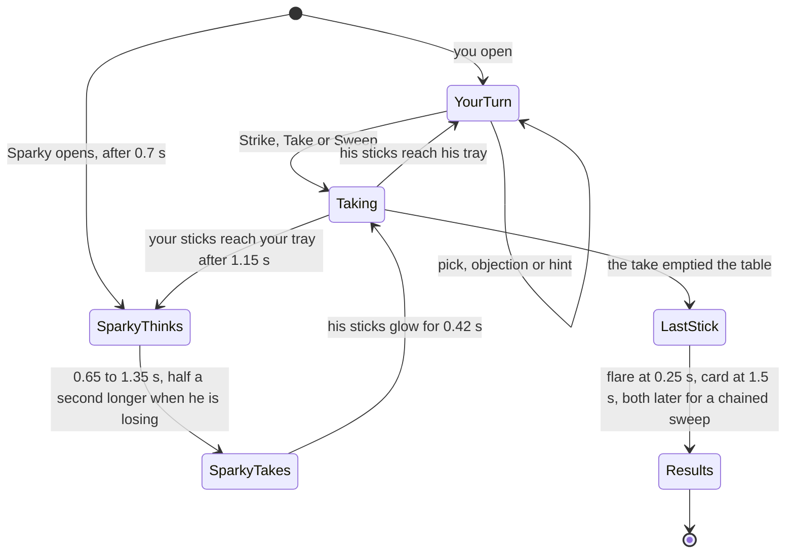
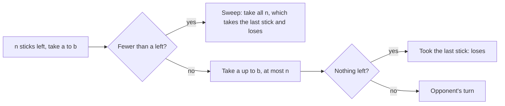

# Stickler: how the rebuild works

**Stickler** is the Any Key rebuild of *23 Matches* (Bob Albrecht, People's Computer Company; converted by David Ahl at DEC, 1973). In code it is a small pure-TypeScript engine in `lib/stickler/` (rules, a closed-form solver, the opponent, the tables and the Daily) under a React front end in `components/stickler/` (the Game menu, the board and the 1981 terminal), framed by the collection's kit: the shell, the results card, the save store and the Keyring. The original's game sits intact inside **Classic 23**; around it are an opponent with a personality, a coach, a ten-table ladder, a daily puzzle, **Handfuls** (every take is a real handful and the game ends in a sweep), two-player Versus, three stick styles, and a 1981 mode that plays exactly like the original on a PC.

What we kept from the original and what we changed is in [CHANGES-FROM-ORIGINAL.md](CHANGES-FROM-ORIGINAL.md). The original itself is in [ABOUT.md](ABOUT.md) and [ORIGINAL-ARCHITECTURE.md](ORIGINAL-ARCHITECTURE.md); the player's manual is [HOW-TO-PLAY.md](HOW-TO-PLAY.md).

## Provenance

- No listing text or program code is reused. The rules of take-away games are centuries-old mathematics. Every sentence Sparky and the 1981 terminal say was written for Stickler; the terminal only keeps BASIC's own `?Redo from start` reply.
- The 1981 mode's behaviour comes from the analysis in [ORIGINAL-ARCHITECTURE.md](ORIGINAL-ARCHITECTURE.md). That includes GW-BASIC's `RND(0)` returning the fixed seed value .3116351, which always gives a take of 1.
- Graphics are drawn in code (SVG and CSS) and sounds are synthesised with the Web Audio API: no image or audio files. The terminal's VT323 font is self-hosted through `next/font`.

## Module map

| Path | Job |
|---|---|
| `app/stickler/page.tsx` | The route. Loads the six chapters in `docs/23mtch/` at build time (`lib/docs.ts`) and renders `Stickler` |
| `lib/stickler/manifest.ts` | The game's contract with the collection: id `23mtch`, route, Hall card text, palette, accent, emblem, moons, trivia, the Daily epoch, and the 14 achievements with their tiers |
| `lib/stickler/rules.ts` | Game state as plain data: rows of sticks, the take floor (`minTake`, 1 unless Handfuls) and limit, whose turn, the history, who took the last stick |
| `lib/stickler/solver.ts` | Game theory: which positions are winning, which moves keep a win, how good each move was, the Coach's magic numbers and zones |
| `lib/stickler/sparky.ts` | Sparky's levels, the original's formula (`move1981`), and his lines |
| `lib/stickler/modes.ts` | Mode list, the ten Ladder tables, the Handfuls presets and surprise pile, the Daily generator, Versus presets |
| `lib/stickler/progress.ts` | What Stickler remembers in this browser: stats, stars, Daily results, Handfuls wins, chosen style, level and Handfuls setup. Built on the kit store and progress bridge |
| `lib/stickler/share.ts` | The Daily share text |
| `lib/stickler/sfx.ts` | Strike, snap, crunch, sweep, fwoosh, win, protest and Sparky's voice, all synthesised |
| `components/stickler/Stickler.tsx` | Picks the screen (Game menu, board or terminal), wraps it in `GameShell`, and lists Stickler's keys for the shortcuts sheet |
| `components/stickler/Lobby.tsx` | The Game menu: matchbox hero, Sparky's level, stick style, mode cards, the Handfuls, Ladder and Versus panels, keycaps and the record |
| `components/stickler/Board.tsx` | One game: the table, turns, input, the Coach, the endings, the results card and the key moment |
| `components/stickler/Terminal.tsx` | 1981 mode |
| `components/stickler/Sparky.tsx`, `Stick.tsx`, `ModeIcon.tsx` | Sparky's face, the three stick styles, the six mode icons: all SVG |
| `components/stickler/*.module.css` | Styles; `Stickler.module.css` holds the colour tokens per stick style and theme |
| `components/previews/SticklerPreview.tsx` | The looping match animation on the Hall card |
| `scripts/check-stickler.ts` | Plays thousands of games to prove the maths (see [Tests](ARCHITECTURE.md#tests)) |

## State machines

The screens. `Stickler.tsx` keeps them in component state; the shell mirrors "in a round" into the address (`#play`), and the Story tab is `#story`.

One game on the board. Every delay runs through `later()`, which holds the step back while the pause menu is open and runs it on Resume.

In Versus there is no `SparkyThinks`: `Taking` hands the turn to the other player.

## The engine

### Rules

`rules.ts` keeps a game as plain data (`Game`: rules, rows, turn, history, loser) and changes it only through `play`, which throws on an illegal move. `legalMoves` lists every move, smallest take first in each row; below the floor the only move is the sweep. `isLegal` agrees with it (the check script tests every count up to 60 for every Handfuls preset). `checkRules` throws for a floor above 1 on several rows or without a take limit, because no mode deals one. `describeRules` writes the chip under the title ("23 sticks · take 1–3", "rows 1-3-5 · take any from one row"); the Daily share text uses it too, so its wording is locked by the check script.

### The mathematics inside

All modes share one rule: **whoever takes the last stick loses** (misère play). `solver.ts` decides every position with a closed formula:

- **One row, take 1 to k:** the player to move is lost exactly when the count is **1 more than a multiple of k + 1**. With k = 3 those counts are 1, 5, 9, 13, 17, 21, which are the numbers the 1973 computer always left you. From 23 the first player takes 2, then answers every take *t* with 4 − *t*.
- **One row, take *a* to *b* (Handfuls):** you must take at least *a* sticks, unless fewer than *a* are left: then you must **sweep** them all, which takes the last stick and loses. Taking the whole pile when it holds *a* or more is legal too, and loses just the same. The player to move is lost exactly when the count, taken modulo *a* + *b*, is **1 to *a***. From 1..*a* every move takes the last stick; from *a*+1..*a*+*b* you can always leave 1..*a*; from *a*+*b*+1..2*a*+*b* every take lands in *a*+1..*a*+*b*; and it repeats with period *a* + *b*. So Classic's magic numbers become **magic zones**, each *a* wide: for take 2–3 they are 1–2, 6–7, 11–12, 16–17 and 21–22. With *a* = 1 the zone is a single number and the formula is the one above, so one function serves every mode. A minimum take is not new: BATNUM, the game after 23 MATCHES in the DEC book, let players set one too (see [ABOUT.md](ABOUT.md)).
- **Several rows, take any amount from one row (misère Nim):** play ordinary Nim, making the XOR of the row sizes zero, until every row holds at most one stick. From then on, leave an **odd** number of single sticks. The Ladder's final table uses rows 1-3-5-7, the layout from the 1961 film *Last Year at Marienbad*. Its XOR is 0, so whoever moves first there is lost: Sparky opens.

Several rows with a take limit are not used by any mode; `isWinning` falls back to a memoised search for them.

From those formulas come these tools:

- `winningMoves(rows)`: every move that leaves the opponent in a lost position, smallest take first. In Handfuls the first one lands highest inside the zone.
- `quality(turn)`: whether a move was **best** (kept a win), a **blunder** (threw one away) or **lost**, because no winning move existed.
- `magicNumbers(k)` and `magicZones(a, b)`: the numbers and zones the Coach points to; `zoneOf(n)` names the zone a count sits in.

Inside a zone the winner can choose where to land. Answering every take *t* with (*a* + *b*) − *t* keeps the same place in the zone, so whoever lands on the **top** of a zone (*a* − 1 above its start) forces the loser into a sweep of exactly *a* sticks at the end.

A brute-force search over small positions confirms the formulas in the check script, and the generic move search models the sweep too.

### Modes and tables

| Mode | Rules | Notes |
|---|---|---|
| Classic 23 | 23, take 1–3, you start | Sparky at the level chosen in the Game menu |
| Handfuls | One row, take 2–3 (23 sticks), 2–4 (27), 3–4 (32), 3–5 (36) or 4–6 (45); fewer than the minimum left means a sweep | Sparky at the chosen level. **Sparky starts** gives him the first move from a pile one stick shorter (22, 26, 31, 35, 44). That count sits on the top of a magic zone, so he opens on a lost position: answer correctly and you win even against Master, and he ends up sweeping the full minimum. **Surprise pile** draws a count from 3 to 6 times (*a* + *b*) that you can win, whoever opens. Every Handfuls table can be won by you; the last setup is remembered |
| Ladder | 10 tables: 11, 15 and 23 sticks; 21 with Sparky opening; up to 4, 5 and 6 per take; rows 3-5, 1-3-5; Marienbad 1-3-5-7 | Each table unlocks the next. Levels are fixed per table (Rookie, Rookie, Clever, Clever, Clever, Master, Master, Clever, Master, Master). The check script proves every table is winnable |
| Daily | Seeded from the date: 17–42 sticks, take up to 3, 4 or 5, always winnable for you, Master | The first result of the day is kept; the share text ends in a row of coloured squares, like Wordle |
| Versus | Six presets, including Handfuls 2–3 · 23 and Handfuls 3–5 · 36; two players on one screen | No Coach, no Sparky |
| 1981 mode | The original, exactly | A green IBM 5151-style screen in the VT323 font. You always start from 23, anything but 1–3 is "against the rules", text input gets BASIC's `?Redo from start`, the computer's losing move is always 1, and it concedes at one stick |

### The Daily and other seeds

`dailyPuzzle(date)` asks the kit for the day (`dailyDate` in `lib/kit/daily.ts`, counted from the manifest's epoch, `COLLECTION_EPOCH` = 2026-01-01, which is #1). It seeds `mulberry32(9000 + day)`: the first draw picks the take limit from 3, 4 and 5, the second a pile from 17 to 41, and the pile is then raised one stick at a time until the opener can win, so the dealt range is 17 to 42. The key is the player's local date, so the puzzle changes at their own midnight. `tests/unit/dailies.test.ts` pins 7 October 2026 (#280: 22 sticks, take 1–3).

Everything else random is seeded from the clock: a new board gets `Date.now() % 1,000,000`, which drives the stick colours and tilts and Sparky's choices, and a surprise pile is drawn from the same kind of seed (`surprisePile` lists every fair count in range and picks one evenly). Every game decision draws from the kit's `mulberry32`; only the noise buffers in `sfx.ts` use `Math.random`.

## AI

### Sparky

| Level | Behaviour |
|---|---|
| Rookie | A winning move half the time, otherwise any move that doesn't take the last stick |
| Clever | A winning move four times in five |
| Master | Always a winning move when one exists, like the original. When lost, a random move that avoids the last stick. In Handfuls a winning Master always takes the **smallest** winning handful: that leaves you as high in the zone as he can, so the game ends with you sweeping the full minimum whenever the zones allow it |

The levels differ only in `MISTAKE_RATE` in `sparky.ts` (0.5, 0.2 and 0). Classic and Handfuls use the level chosen in the Game menu; the Ladder fixes one per table and the Daily always uses Master.

Sparky's face is an SVG with eight moods: idle, happy, thinking, smug, worried, shocked, sad and cross. He thinks visibly longer when he is losing, and about one time in three, after a move that leaves you winning, he says so ("You've done this before, haven't you?"). When you give a win away he gloats more often than not. He speaks in blips, one per word, pitched by mood. In Versus he steps aside and the table shows whose turn it is.

Handfuls gives him new lines: a greeting that states the range, a smug one when he leaves you a sweep, a shocked one when you leave him one, and objections when you pick too few or try to pick and choose during a sweep. In Versus those objections appear, in plain words, on the turn card and next to the buttons.

### The 1981 formula

`move1981(sticks)` is the original's computer, move for move: with R = sticks mod 4 it takes (R + 3) mod 4, and when R = 1 it takes INT(3 × `RND0_ON_A_PC`) + 1 with `RND0_ON_A_PC` = 0.3116351, which is always 1. At one stick it returns `"concede"`. Only the terminal uses it.

### The Coach and the key moment

- **Hints** come in three steps. Step 1 asks you to watch how many sticks are left after Sparky's turns. Step 2 lists his favourite numbers and what they have in common. Step 3 gives the exact move and highlights the sticks to take. For rows, the hints explain pairing by 4, 2 and 1, then the endgame twist. When the position is already lost, the Coach says so honestly instead of pretending.
- **Handfuls hints** follow the same three steps with zones: step 1 points at the bands Sparky keeps leaving you in, step 2 lists the zones and their period (*a* + *b*), and step 3 gives the take that lands highest in the next zone, highlights the sticks and says how big the final sweep will be.
- **The step only goes up.** Each press of `H` moves one step deeper for the rest of the game, up to 3. That deepest step is what the stars and the Daily share text count.
- **After the game**, every one of your moves is marked with a square: green (kept a win), red (gave it away) or grey (no winning move existed). The first red one becomes the *key moment*, for example "with 14 left you took 3, leaving 11; taking 1 would have left 13, and Sparky couldn't have won." In Handfuls it names the zone: "with 24 left you took 3, leaving 21. Taking 5 would have left 19, inside the 17–19 zone, and Sparky couldn't have won."
- **Ladder stars:** 3 for a win without hints, 2 for a win that reached step 1 or 2, 1 when you needed step 3.

## Drawing

Everything is SVG and CSS; there are no image files.

- **Colour tokens** live in `Stickler.module.css`, one set per stick style and theme. `Stickler.tsx` passes the chosen style to `GameShell` as `data-skin`, so the whole game (lobby, board, results) recolours when the style changes, and the kit's `data-theme` on `<html>` switches light and dark live.
- **Sticks** (`Stick.tsx`) share one set of gradients and patterns (`StickDefs`, mounted once). Each stick is one SVG; its state (`selected`, `hinted`, `sparky`, `burning`, `flying`, `doomed`, `swept`) is a CSS class in `Stick.module.css`.
- **Sparky** (`Sparky.tsx`) is one SVG face whose colours follow the stick style and whose expression follows `data-mood`.
- **Mode icons** (`ModeIcon.tsx`) are six small line drawings on a 24 × 24 grid in `currentColor`: a lit match, a handful, the ladder, a calendar, two players and the 1981 screen. The lobby's other icons (bulb, star, crown) come from the kit's `components/kit/icons.tsx`.
- **The endings** are `Fwoosh` and `Confetti` in `Board.tsx`, positioned and animated by `Board.module.css`.

### Look and feel: "Midnight Matchbox"

- **The Game menu hero is a matchbox:** a red box, a cream label with a navy wordmark, and a brown striker strip on the side. The in-game **Strike** button uses the same striker texture.
- **The table** is light oak in the light theme and dark walnut under a warm lamp in the dark theme.
- **Three stick styles** are chosen in the Game menu and remembered. Each changes the sticks, the table, Sparky and the ending:
  - **Matches:** striking lights a flame that burns down to char before the stick flies to your tray.
  - **Glow sticks:** a neon grid on a table that stays dark in both themes. Sticks snap with a flash; the ending is a strobing blackout.
  - **Candy sticks:** striped sticks on a gingham cloth. They crunch and pop; the ending is a sprinkle burst.
- **Signature moment:** whoever takes the last stick sets it off, with a big flare, flying embers, soot and a screen shake. Then the result card slides in.
- **The Handfuls sweep** is the bigger version: every stick left goes up at once and grows as it rises. Matches flare together, glow sticks snap in a chain (90 ms apart) and candy sticks burst one after another (110 ms apart) with a ring of sprinkles each. The flare, the number and reach of the embers, and the shake all scale with the size of the sweep. The result card names it: "Sparky had to sweep 3."
- **Handfuls controls** show only the legal range (`Take 3`, `Take 4`, `Take 5`), or a single **Sweep** button when the only move left is the whole pile. A rule line under the pile reads "Take 3–5 · last stick loses" and turns into a warning when a sweep is due. Picking too few and pressing Strike gets Sparky's objection and a small shake of the Strike button, never a modal.
- **The pile always fits the table.** For one row, `Board` measures the table and picks the stick size and sticks per line (at most 12, or half a big pile) so the whole pile and the rule line fit; on a phone the table grows instead. This also keeps large Ladder piles such as Bonfire (45) on the table.
- **The 1981 screen** is an IBM 5151-style green phosphor with curved glass, drawn in `Terminal.module.css`.

### Motion

`app/globals.css` cuts every animation and transition short when the player chooses Less motion in Settings, or when the system asks for reduced motion and the player has not chosen Full motion. On top of that, `Board.module.css` and `Stick.module.css` have their own `prefers-reduced-motion` rules: no shake, no chained sweep, a classic-sized flare and no extra embers. Those extra rules follow the system setting only (see [Known limits](ARCHITECTURE.md#known-limits)).

## Sound

Every sound is made on the spot in `lib/stickler/sfx.ts`, from filtered noise bursts and short oscillator tones:

| Function | When | Sound |
|---|---|---|
| `take(skin, n)` | Any take | Per style: a strike and flare, a snap and rising shimmer, or a crunchy pop; one per stick, 90 ms apart |
| `select()` | Picking a stick | A small tick |
| `sweep(skin, n, step)` | A Handfuls sweep | Matches strike together; glow and candy chain at the sweep's step |
| `fwoosh(skin, n)` | The last stick goes up | A fire swell, a neon blow-out or a sugar crash, bigger for a bigger sweep |
| `win()` | You win | A rising five-note arpeggio |
| `protest()` | A refused pick | Two low square-wave buzzes |
| `voice(text, mood)` | Sparky speaks | One blip per word (up to ten), pitched by mood |

All of them run into the kit's shared effects bus (`effectsBus` in `lib/kit/sound.ts`), which holds the limiter and follows the collection's mute switch and volume. `Board` also checks the sound preference before calling them.

## Kit integration

### Manifest and the Hall

`lib/stickler/manifest.ts` is everything the collection reads about Stickler. `lib/catalog.ts` lists it second, after Bop Box. The Hall builds its card from it: title, tagline, blurb, the stats chips ("23 sticks", "6 modes", "14 badges"), the mode and style chips, palette and accent, the emblem (two matches standing, the third lit) and four trivia facts for the "Did you know?" tile. `components/previews/ProgramPreview.tsx` maps the id `23mtch` to `SticklerPreview`, the looping animation on the Wall's wide card and the Device hall's screen. The Orbit hall shows the ten Ladder tables as moons (`moons`, `moonsName`). The manifest's `daily.epoch` puts Stickler in the dailies strip on the Hall and the Keyring (`components/kit/TodayStrip.tsx`).

### The shell

`Stickler.tsx` renders inside `components/kit/GameShell.tsx`, which draws the top bar (Back to the Hall, the "inspired by" line, Play and Story, Pause, Keyring, sound, appearance), keeps the address (`/stickler`, `/stickler#play` during a round, `/stickler#story`) and owns `Esc`, `K` and `?`. `Board` and `Terminal` report their screen with `usePlayScreen`:

| Field | Board | Terminal |
|---|---|---|
| `screen` | `play`, or `results` once the card is up | `play` |
| `items` | "Start this game again" (a rematch) | none |
| `losesProgress` | true once a move is made and until the result | true once a stick is taken |
| `roundName` | "this game" | "this 1981 game" |
| `onPause`, `onResume` | Stops and restarts the delayed steps | Shows the menu; focus returns to the input |

So the pause menu reads Resume · Start this game again · How to play · Settings · Game menu · Back to the Hall, and leaving a round that has started asks "Leave this game?" with **Keep playing** and **Leave**, as `docs/NAVIGATION.md` requires. How to play opens [HOW-TO-PLAY.md](HOW-TO-PLAY.md). The board's own **Game menu** button and the terminal's call `shell.toMenu`, which asks the same question. `Board` ignores the keyboard while the results card or the pause menu is up, so `R`, `H` and `Esc` reach the shell and the results card.

### Results

`Board` uses `components/kit/Results.tsx`: kicker (the table's title), title ("You win!", "Burnt!" or "Player 1 wins!"), Sparky as the art, the result line, stars, move squares and key moment as the body, and the keycaps this game unlocked. The play-again button says "Rematch" (or "Play again (practice)" on the Daily) and keeps `R`. Stickler's extras, **Next table** after a Ladder win and **Share result** after a Daily, sit in their own row above the three standard actions.

### Progress, save and migration

- **Store.** `progress.ts` builds `sticklerStore` with `createStore` from `lib/kit/save.ts` under the key `anykey.23mtch.save`, as `{ version: 2, data }`. `normalise` fills in fields older saves lack (the Handfuls record and setup) and resets a preset id this build doesn't know.
- **Legacy save.** Before the kit, Stickler saved under `anykey.stickler.v1` (listed in `lib/kit/legacy.ts`). When the new key is empty, the store reads the old one once, treats it as version 1, runs migration 2 (which drops the achievements) and writes the new key. The old key is left untouched, so a rollback still finds it; "Forget my data" removes both.
- **Achievements.** Version 2 moved them out of the save. The Keyring (`lib/kit/keyring.ts`) is the single source of truth for unlocks and finished dailies; on its first load it imports the achievement ids and daily dates from every legacy save. `createProgress` from `lib/kit/progress.ts` merges the Keyring's unlocked ids back into `achievements`, so the game's rules still read `p.achievements`.
- **Updates.** `updateProgress(change)` saves everything but the achievements, unlocks any new ids through `unlock` in `lib/kit/achievements.ts` (which raises the keycap toast) and returns them for the results card. A new date in `daily` marks that day's daily done in the Keyring. A change in wins plus losses records a play in `lib/kit/stats.ts`, so Versus games and 1981 mode don't count. The first load seeds the stats once with the counters the v1 save had kept.
- **Forgetting.** The Game menu's **Forget my data** (`components/kit/ForgetButton.tsx`) calls `forgetGame("23mtch")` in `lib/kit/forget.ts`: the save, the legacy key, the game's stats and its Keyring entries.

### Achievements

The 14 achievements and their tiers (common, rare, legendary) are declared in the manifest. The Game menu draws them as keycaps with `BadgeCap`; Rule Bender is `secret` and shows as a blank cap until earned. Unlocks happen in `Board.finish` (most), in `Board.protest` (Rule Bender, on any refused pick, Versus included), in `Stickler.play` (Collector, once three styles have been picked) and in `Terminal` (Time Traveller). `tests/unit/manifest.test.ts` keeps every title and hint as it was before the kit.

### Shared helpers

- `lib/kit/rng.ts`: `mulberry32`, kept byte for byte as Stickler had it, so every Daily, board deal and surprise pile stays the same (`tests/unit/rng.test.ts`).
- `lib/kit/daily.ts`: `dailyDate` and `COLLECTION_EPOCH`.
- `lib/kit/share.ts` and `components/kit/ShareButton.tsx`: the share sheet on touch screens, the clipboard elsewhere, with "Copied" feedback. The board adds the page URL to the share text.
- `lib/kit/keys.ts`: `hasModifier` and `isTypingTarget`, so the board's keys never fire with Ctrl, Alt or Cmd held, or while typing.

## Tests

### The check script

`npm run check:stickler` (`tsx scripts/check-stickler.ts`, about 14 seconds) proves the maths. The numbers from the latest run are in [NOTES.md](NOTES.md#simulations).

- **The solver matches brute force** on every single-row position up to 30 sticks (take limits 3, 4 and 5) and on a set of multi-row positions.
- **Every Ladder table is winnable**, and a perfect player beats Sparky on it in 200 seeded games per table.
- **Classic is won** by perfect play against all three levels in 300 games each.
- **Master never gives away a won position** in 500 random games.
- **All 365 Daily puzzles of 2026 are winnable.**
- **The 1981 formula** never takes more than 3, never empties the pile, leaves a 1-more-than-a-multiple-of-4 count whenever possible, and concedes at 1.
- **Handfuls: the zone formula matches an independent brute force** for every floor *a* from 1 to 4, limit *b* from *a* to 7 and count up to 60 (1,320 positions), and so does the generic move search. With *a* = 1 it gives exactly the old answers. The Coach's zones for 2–3 are 1–2, 6–7, 11–12, 16–17 and 21–22.
- **The legal-move generator** never offers fewer than the floor unless it is the sweep, and `isLegal` agrees with it; building several rows with a floor above 1 throws.
- **You can win every Handfuls table.** Each preset pile is a win for the opener when you open, and the Sparky-starts pile is a loss for the opener; perfect play beats Master in 200 seeded games for every preset and both openers, and beats Rookie and Clever too. **Surprise pile** stays in range and winnable for you over 1,000 seeds per preset and opener.
- **No table starts lost for you.** An audit walks Classic, the ten Ladder tables, two years of Dailies and every Handfuls setup the Game menu can deal (2,751 tables) and checks that the player always has a winning line.
- **Master never gives away a won position in Handfuls** (over 4,000 of his turns in 1,000 random games), and whenever he can end the game he leaves exactly the floor: the biggest sweep.
- **Old tables are untouched:** Classic, every Ladder table, the old Versus presets and the Daily keep a floor of 1 and their old descriptions, so past Daily share texts stay the same.

### Unit tests

`npm run test` (Vitest):

- `tests/unit/dailies.test.ts` pins the Daily for 7 October 2026 to what it was before the kit's date maths.
- `tests/unit/daily.test.ts` checks the numbering (#1 on the epoch, #280 on 7 October 2026, the old formula on every day of two years at four hours each).
- `tests/unit/rng.test.ts` pins `mulberry32`'s output.
- `tests/unit/migration.test.ts` runs a real v1 save (`tests/fixtures/stickler.v1.json`) and one from before Handfuls through the store, and checks the Keyring, the stats, the untouched legacy key and forgetting.
- `tests/unit/manifest.test.ts` and `tests/unit/keyring.test.ts` cover the achievement list and unlocking.

### Browser tests

`npm run e2e` builds the app and runs Playwright:

- `tests/e2e/navigation.spec.ts`: browser Back mid-game asks first; `Esc` pauses with the fixed menu order and resumes; the results card's three actions are in order and `R` deals a fresh 23; `K` on the Game menu opens the Keyring.
- `tests/e2e/keyring.spec.ts`: pressing `4` in Classic unlocks Rule Bender, its toast shows, and the Keyring counts its XP; forgetting Stickler on the Keyring removes its keycaps only.
- `tests/e2e/story.spec.ts`: every chapter of this Story renders and every Mermaid diagram in it draws.
- `tests/e2e/appearance.spec.ts` and `first-visit.spec.ts` use `/stickler` for the shell's appearance switch and first-visit hint.
- `tests/shots/shots.spec.ts` (`npm run shots`) takes screenshots of the Game menu, the board, the pause menu and the results.

When Handfuls was built, one-off headless runs also played full games through the keyboard at human pace in every stick style, both themes, at 1440×900 and 390×844, with an illegal pick, all three Coach steps, a Sparky-starts table, a lost game ending in your own sweep, a surprise pile, reduced motion and a Versus objection, and a screencast checked the sweep's chain timing. Those runs are not part of the repo's test suites.

## Known limits

- Progress lives in the browser only; there are no accounts and no shared leaderboards.
- The Daily is the same for everyone because it depends only on the date. Nobody can check anyone else's claimed result.
- An unfinished Daily is not recorded, so restarting from the pause menu or leaving before the last stick lets a player try again until they win. The Share button on a practice replay also shares that replay under the same Daily number.
- The Game menu works out today's Daily when it opens, so a menu left open past midnight still offers yesterday's puzzle until it is reopened.
- Sparky's lines are few enough that you will hear repeats in a long session.
- The extra reduced-motion rules in `Board.module.css` and `Stick.module.css` follow the system setting only, not the Settings choice; the global rule in `app/globals.css` still cuts the motion short.
- `scripts/check-stickler.ts` prints its failures but never sets a non-zero exit code, so `npm run check` would pass with a failing Stickler check (the Outta Here and Don't Crater scripts do set one).
- The board's key handler claims `Enter` wherever focus is, so a focused button (a Take button, Hint, or Pause in the top bar) does not activate with `Enter` during a game; `Space` still works. Found by reading `Board.tsx`; not yet confirmed in a browser.
