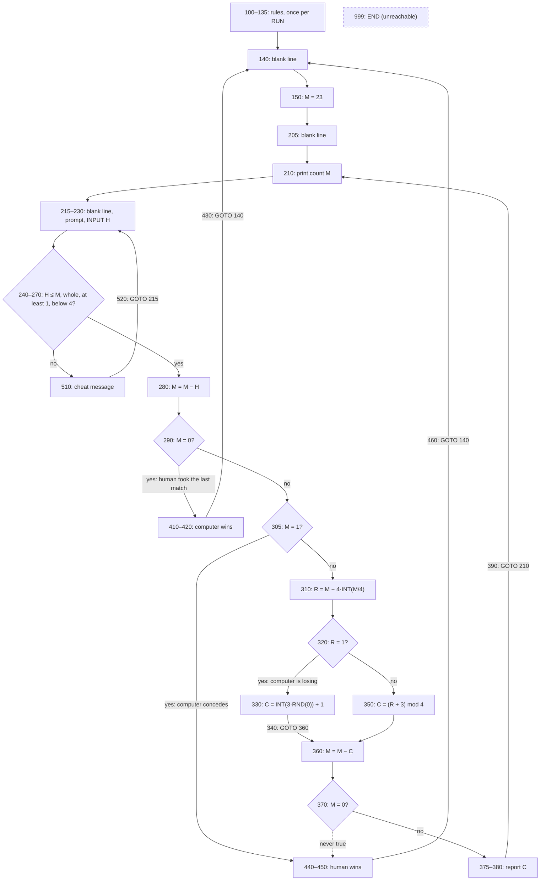
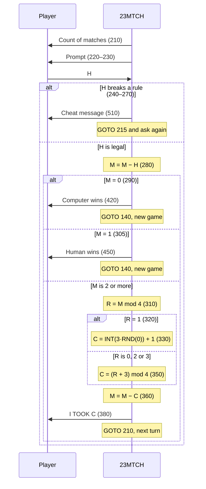

# 23 Matches (23MTCH.BAS): how the original works

`23mtch.bas` is a 46-line BASIC program from DEC's 1973 book *101 BASIC Computer Games*, written for DEC's time-sharing BASIC and stored in our copy as a tokenized GW-BASIC file for the IBM PC. This page walks through its control flow with line numbers, the validity checks, the computer's strategy, the unreachable code, what `RND(0)` really does, the file format, and finally how to run and play it today. Any Key rebuilds it as **Stickler**.

The listing is copyrighted, so the logic below is described in our own words and in paraphrased pseudo-code. Short expressions are quoted only where the analysis depends on them. For history see [ABOUT.md](ABOUT.md). For playing the original, jump to [Playing the original](ORIGINAL-ARCHITECTURE.md#playing-the-original). The verified facts and measurements are collected in [NOTES.md](NOTES.md).

## At a glance

| Property | Value |
|---|---|
| Size | 46 program lines, 1,164 bytes on disk |
| Dialect | DEC BASIC of the early 1970s (credited as converted to RSTS/E BASIC-PLUS); our copy is saved by GW-BASIC |
| Machine | PDP-11 time-sharing in the book; the book's sample run was made on a DEC EduSystem 30; our copy runs on an IBM PC |
| Input | One number per turn, through `INPUT` |
| Output | Plain text: the rules once, the count, the computer's take, one line per result |
| Statements used | `REM`, `PRINT`, `LET`, `INPUT`, `IF … THEN` (always with a line number), `GOTO`, `END` |
| Functions used | `INT`, `RND` |
| Structure | One statement per line, no subroutines, no arrays, no string variables |
| Variables | `M` matches left, `H` human's take, `R` remainder of M ÷ 4, `C` computer's take |

## Line map

| Lines | Role |
|---|---|
| 5, 10 | Credit `REM`s (Albrecht, and Ahl's RSTS/E conversion); present in DEC's machine-readable copy, absent from the printed book |
| 100–135 | Title `REM` and six `PRINT`s with the rules |
| 140–150 | New-game entry: blank line, `M` set to 23 |
| 200–230 | Human's move: show the count, prompt, `INPUT H` |
| 240–270 | Four validity checks, each jumping to 510 |
| 280–290 | Subtract the human's take; if nothing is left, jump to 410 |
| 300–350 | Computer's move: concession test, remainder, choice of `C` |
| 360–390 | Subtract the computer's take, dead win test, report, loop back to 210 |
| 400–460 | End-of-game messages, both going back to 140 |
| 500–520 | "Cheat" message, back to 215 |
| 999 | `END` (never reached) |

## Control flow



### In pseudo-code

```
show the rules once
new game:
    show a blank line; M ← 23; show a blank line
turn:
    show "there are now M matches"
ask:
    read H
    if H > M, or H is not whole, or H ≤ 0, or H ≥ 4:
        complain about cheating; go to ask
    M ← M − H
    if M = 0: announce the computer's win; go to new game
    if M = 1: announce the human's win; go to new game
    R ← M mod 4
    if R = 1: C ← random whole number 1..3
    else:     C ← (R + 3) mod 4
    M ← M − C
    if M = 0: announce the human's win; go to new game   (never happens)
    report C; go to turn
```

### One turn



## The interesting parts

### The intro (lines 100–150)

Lines 110–135 print the rules and a joke. Line 140 prints a blank line and line 150 sets `M` to 23. The end-of-game branches jump back to line 140, not line 100, so the rules appear only once per `RUN`.

### The human's move (lines 200–290)

Line 210 prints the count. Line 220 prints the prompt and ends with `;`, so `INPUT H` at line 230 puts its `? ` on the same line. Four tests follow, and any one of them sends control to the "cheat" branch at line 510:

| Line | Test | Rejects |
|---|---|---|
| 240 | `H > M` | Taking more than the pile |
| 250 | `H <> INT(H)` | Fractions |
| 260 | `H <= 0` | Zero and negatives (and an empty answer, which `INPUT` reads as 0) |
| 270 | `H >= 4` | Four or more |

Because line 240 guarantees `H ≤ M`, `M` can never go negative. Line 280 subtracts the take. If `M` is now 0, the human took the last match, and line 290 jumps to the computer's victory at 410. Input that is not a number never reaches these tests: GW-BASIC's `INPUT` answers it with `?Redo from start` and asks again.

### The computer's move (lines 300–390)

**Concession (305).** If exactly one match is left, the computer would have to take it and lose. The program declares the human the winner at once (line 440) and never actually takes the match.

**Remainder (310).** `R` is `M` mod 4, computed with the classic `M-4*INT(M/4)` idiom because the program uses no `MOD` operator. At this point `M` is at least 2.

**Perfect play (350).** When `R` is not 1, line 320 jumps to line 350, which computes `C = (R + 3) mod 4` with the same `INT` idiom. This equals `(M − 1) mod 4`, the take that leaves a pile of the form 4k + 1:

| M mod 4 | C | M − C mod 4 |
|---|---|---|
| 0 | 3 | 1 |
| 2 | 1 | 1 |
| 3 | 2 | 1 |
| 1 | none (a losing position) | — |

**Losing position (330).** When `R` is 1, every take hands the human a winning position, so the program intends to take a random 1 to 3 with `INT(3*RND(0))+1`. On a PC this is not random at all (see below).

**Dead code (370).** Line 370 checks whether the computer just took the last match. That can never happen. If `R ≠ 1`, then `M − C` is 1 more than a multiple of 4 and at least `M − 3 ≥ −1`, so it is at least 1. If `R = 1`, then `M` is at least 5 and `C` at most 3, so at least 2 matches remain. The `REM` at line 400 still lists line 370 as one of the three ways a game can end.

**Report (375–390).** The program prints a blank line and then `I TOOK` with `C`. Line 380 ends with `;`, so the count from line 210 continues on the same line, for example `I TOOK 1 ...THERE ARE NOW 20 MATCHES.` Line 390 jumps back to 210.

### End-of-game and cheat branches, and the endless loop (400–999)

Lines 410–430 print the computer's victory message and lines 440–460 print the human's. Both then jump back to 140 to start a new game. Lines 510–520 print the cheat message and jump back to 215, which re-prompts without showing the count again. There is no penalty and no limit on retries.

Every path ends in a `GOTO` (lines 390, 430, 460 and 520), so control never falls through to `END` at line 999. The program keeps no score, has no quit command and never asks whether to play again. Only a user break (Ctrl+Break) stops it.

### What `RND(0)` really does

#### GW-BASIC and PC-BASIC

- The GW-BASIC manual says that when the argument is zero, "the last number is repeated".
- The 1983 GW-BASIC source (`MATH2.ASM`) confirms this. Its `$RND` routine checks the argument's sign. Zero goes to `OLDRN`, which returns the stored value without advancing the generator. A positive argument advances a 24-bit linear congruential generator, x ← (214013·x + 2531011) mod 2²⁴, with the constants defined in `MATH1.ASM`. A negative argument reseeds it.
- The starting state is fixed. `GWDATA.ASM` initialises the seed `RNDX`, and its copy `RNDCOP`, to the 24-bit value **&H4FC752 = 5,228,370**. `CLEARC` in `BIMISC.ASM`, which `RUN`, `NEW` and `CLEAR` all go through, copies `RNDCOP` back into `RNDX` ("reset the random number generator"). PC-BASIC does the same: its seed is `5228370 # 0x4fc752`, `RND(0)` "returns last value", and the generator is cleared on RUN, LOAD, NEW and CLEAR.
- 23MTCH never calls `RANDOMIZE` and never calls `RND` with a non-zero argument, so the state never changes. **Every `RND(0)` returns 5,228,370 ÷ 16,777,216 = 0.3116351…** (`PRINT` shows `.3116351`).
- 3 × 0.3116351 = 0.93, `INT` gives 0, and adding 1 gives **C = 1**. **On a PC the computer takes exactly one match every time it is losing, in every game of the session.**
- The value is not the often-quoted `.7055475`. That is the first `RND(1)` of QBasic and QuickBASIC, which use a different generator (multiplier &HFD43FD, increment &HC39EC3). We reproduced it from those constants with a starting state of &H50000. It is a first `RND(1)`, not an `RND(0)`. GW-BASIC's own first `RND(1)` is `.1213501`: we computed it from the source constants, and a 1991 GW-BASIC tutorial prints the same value. The value is not 0 either, because the source comment says the stored number "must not be zero". Had it been `.7055475`, C would be 3; had it been 0, C would be 1.
- Not checked: IBM's BASICA (disk and ROM versions), and unusual starts that skip `RUN`, such as a direct-mode `GOTO` after using `RND`.

#### BASIC-PLUS on RSTS/E

- The BASIC-PLUS Language Manual (October 1972) says the argument of `RND(X)` "can be any number, as that value is ignored", and that a bare `RND` is equivalent. It says the numbers are "reproducible in the same order", and that `RANDOMIZE` is needed to get different numbers on each run. The manual's own example prints a column of different random numbers with `RND(0)`, which explains why DEC-era listings wrote `RND(0)`.
- On RSTS/E, therefore, each call produced a new value, and the losing computer took 1, 2 or 3. Without `RANDOMIZE`, the same sequence should have repeated on every `RUN`. The actual sequence on Ahl's system is **unverified**.
- There is supporting evidence. DEC's printed sample run, made on an EduSystem 30 rather than RSTS/E, shows the losing computer taking 1, 1, 2, 3 and 3 in one game. That is consistent with an `RND` that ignores its argument, as BASIC-PLUS's does.

#### Conclusion

| Platform | `RND(0)` in this program | Computer's take when losing |
|---|---|---|
| GW-BASIC / PC-BASIC | Always `.3116351` | Always 1 |
| BASIC-PLUS (RSTS/E) | New value each call, argument ignored | Varies 1–3; same sequence each run (unverified) |
| DEC EduSystem 30 (book's sample run) | Varies | 1, 1, 2, 3, 3 observed |
| IBM BASICA | Unverified | Unverified |

Moving the program from DEC BASIC to Microsoft BASIC silently turned the random move into a fixed one. A faithful rebuild has to choose which behaviour to reproduce. Stickler's 1981 mode follows the PC (see [CHANGES-FROM-ORIGINAL.md](CHANGES-FROM-ORIGINAL.md#faithful-modes)).

### The tokenized file format

The file is a GW-BASIC program saved without the `,A` option.

**Header.** Byte 0 is `FF`, which marks an unprotected tokenized program. A protected (encrypted) program would start with `FE`, and a plain-text one with the first digit of a line number.

**Line records.** Each line is stored as a record:

| Bytes | Content |
|---|---|
| 2 | Link: little-endian memory address of the next line |
| 2 | Line number, little-endian |
| n | Tokenized text |
| 1 | `00` end-of-line marker |

**Links.** The links are absolute addresses from the session that saved the file. All 46 links here are consistent with a first line at &H126E, which PC-BASIC's memory model gives as the base for GW-BASIC with default settings. Loaders ignore the links and rebuild them. Because a line-number constant can contain a `00` byte (140 is stored `0E 8C 00`), a reader cannot simply split lines at `00`. It has to follow the links or decode the tokens.

**End of program.** A `00 00` link marks the end of the program, and a final `1A` (Ctrl+Z) is an optional end-of-file byte. The total is 1 + 1,160 + 2 + 1 = 1,164 bytes.

**Keyword tokens.** Statements and operators are single bytes: `REM 8F`, `PRINT 91`, `LET 88`, `INPUT 85`, `IF 8B`, `THEN CD`, `GOTO 89`, `END 81`, `> E6`, `= E7`, `< E8`, `+ E9`, `- EA`, `* EB`, `/ EC`. Functions take two bytes: `INT FF 85`, `RND FF 88`. Compound operators are stored as pairs: `<=` is `E8 E7`, `<>` is `E8 E6`, `>=` is `E6 E7`. String literals, `REM` text, variable names and parentheses stay as plain ASCII.

**Numbers.**

| Form | Encoding | Example in this file |
|---|---|---|
| 0–10 | One byte, `11`–`1B` | 0 → `11`, 1 → `12`, 3 → `14`, 4 → `15` |
| 11–255 | `0F` followed by one byte | 23 → `0F 17` |
| Line-number reference | `0E` followed by a 16-bit little-endian number | 510 → `0E FE 01` |

**Decoded examples:**

```
line 150:  37 14 | 96 00 | 88 20 4D E7 0F 17                          | 00
           link    150     LET ␠ M  =  23
line 240:  B5 14 | F0 00 | 8B 20 48 E6 4D 20 CD 20 0E FE 01            | 00
           link    240     IF ␠ H  >  M  ␠ THEN ␠ 510
line 330:  6F 15 | 4A 01 | 88 20 43 E7 FF85 28 14 EB FF88 28 11 29 29 E9 12 | 00
           link    330     LET ␠ C = INT  (  3  *  RND  (  0  )  )  +  1
```

**Spacing.** In this file, the one space that separates each line number from its statement is not stored, but any extra spaces are kept. Line 5 therefore stores two spaces before `REM`, line 10 stores one, and line 100 stores none. These are the remains of the DEC text's `5   REM`, `10  REM`, `100 REM` alignment. The DEC text also spells `GO TO` with a space, and the tokenizer stored it as the single `GOTO` token (`89`).

## Quirks and bugs

- **The "random" move is fixed on a PC.** `RND(0)` never changes in GW-BASIC, so the losing computer always takes 1 (line 330).
- **A test that can never be true.** Line 370 checks for a computer win that the formula makes impossible, and the `REM` at line 400 still lists it.
- **The computer never takes the last match.** It concedes at line 305 instead.
- **Always plural.** The count line says "MATCHES" even when one is left (line 210).
- **No way out.** There is no quit command and no score; `END` at line 999 is unreachable.
- **Cheating costs nothing.** Every rule-breaking number gets the same message and another try (lines 510–520).

The evidence for each, and whether Stickler keeps it, is in [NOTES.md](NOTES.md#quirks-and-bugs).

## Playing the original

This section explains how to run and play the original program: getting it running today, what appears on screen, what the game accepts and rejects, how games end, how to stop the program, and how to win every time.

### The rules in one paragraph

A pile starts with 23 matches. You and the computer take turns, and on each turn you must take 1, 2 or 3 matches. **Whoever takes the last match loses.** You always move first.

### Running it today

`23mtch.bas` is a **tokenized** GW-BASIC file (see [the file format](ORIGINAL-ARCHITECTURE.md#the-tokenized-file-format)). A text editor, or DOS `TYPE`, shows mostly junk. You have to `LOAD` or run the file in a GW-BASIC-compatible interpreter. You can also convert it to plain text first, as described below.

#### Option 1: PC-BASIC (recommended)

PC-BASIC is a free, cross-platform interpreter that emulates GW-BASIC, BASICA, PCjr Cartridge BASIC and Tandy 1000 GW-BASIC.

1. Install it with a desktop installer from the project's GitHub releases page, or run `pip3 install pcbasic`.
2. Run the game directly:
   ```
   pcbasic --run=23MTCH.BAS
   ```
   Or start PC-BASIC and type `LOAD "23MTCH"` and then `RUN`.
3. To read the program as text:
   ```
   pcbasic --convert=A 23MTCH.BAS 23MTCH.TXT
   ```
   Or load it and type `LIST`.

By default PC-BASIC treats **Ctrl+C** like Ctrl+Break, which helps on keyboards that have no Break key.

#### Option 2: DOSBox with GW-BASIC

1. You need `GWBASIC.EXE`. Microsoft published the 1983 GW-BASIC source code under the MIT licence in 2020, but the repository has no binaries and no build scripts. Use a copy that came with MS-DOS software you are licensed to use.
2. Put `GWBASIC.EXE` and `23MTCH.BAS` in one folder, for example `C:\RETRO`, and mount it in DOSBox:
   ```
   MOUNT C C:\RETRO
   C:
   GWBASIC 23MTCH
   ```
   If you give GW-BASIC a file name on its command line, it loads the file and runs it as if you had typed `RUN`. It adds `.BAS` when you leave out the extension.

#### Option 3: PCjs in a web browser

PCjs emulates IBM PCs in the browser, with PC DOS and IBM's own BASIC and BASICA. Note that this is **not** GW-BASIC. To use the file, put it on a floppy disk image (PCjs's DiskImage tool can build an image from a folder), load the image into the virtual machine's drive, start `BASICA`, then type `LOAD "23MTCH"` and `RUN`. If BASICA will not accept the tokenized file, convert it to plain text with PC-BASIC first, because BASICA can also load plain-text programs. We have **not tested** this route. How IBM BASICA handles `RND(0)` is also **unverified**, so the computer's move when it is losing may differ from GW-BASIC's.

### What you will see

1. **The rules.** Six lines restate the rules and end with a joke that the best computer may win "(HA HA)". They appear only once per `RUN`.
2. **The count.** For example, `THERE ARE NOW 23 MATCHES.` (It still says "MATCHES" when there is only one.)
3. **The prompt.** `HOW MANY DO YOU TAKE?` The question mark and the space after it come from BASIC's `INPUT`. Type a number and press Enter.
4. **The computer's reply.** It appears on one line with the next count, and then you are prompted again:

```
I TOOK 1 ...THERE ARE NOW 20 MATCHES.

HOW MANY DO YOU TAKE?
```

The computer answers immediately. There is no delay and no "thinking" message.

### What you may type

| You type | Result |
|---|---|
| `1`, `2` or `3`, not more than the matches left | Accepted |
| A whole number written with a decimal point, such as `2.0` | Accepted as 2 |
| More than the matches left, such as `3` when 2 remain | "Cheating" message |
| A fraction, such as `1.5` | "Cheating" message |
| `0`, a negative number, or just Enter (PC-BASIC, following GW-BASIC, reads an empty answer as 0) | "Cheating" message |
| `4` or more | "Cheating" message |
| Letters or other non-numbers | Not checked by the game. BASIC's `INPUT` prints `?Redo from start` and shows a bare `?` prompt. Type a number. |

The program applies its checks in this order: more than the pile, not a whole number, zero or less, four or more. With one match left, the only legal move is 1, and it loses.

### "Cheating"

The program treats every rule-breaking number as cheating. It prints a short accusation ("YOU CHEATED!"), promises another chance, and asks again. Nothing else happens: you lose no turn, there is no penalty, the count is not shown again, and you can "cheat" as often as you like. DEC's own sample run shows a player typing 0 and getting the message.

### How a game ends and restarts

- **You take the last match.** The computer prints its victory message ("I WON!!!").
- **You leave exactly one match.** The computer concedes at once without taking it, and prints a grudging "O.K. SO YOU WON."

In both cases a new game begins immediately at 23 matches, and you move first again. The rules are not shown again. There is no score, no tally of wins and no replay prompt.

### How to quit

There is **no quit command**. The program loops forever, and its `END` statement at line 999 is never reached.

- Press **Ctrl+Break**. At the prompt, GW-BASIC's line editor also accepts **Ctrl+C**. BASIC prints a Break message that names the line it stopped on (usually the `INPUT` line, 230), followed by `Ok`.
- At `Ok`, type `SYSTEM` to leave GW-BASIC and return to DOS, or type `RUN` to start again with the rules.
- In PC-BASIC, Ctrl+C works by default. You can also close the window.

### How to win every time

The player to move **loses** from 1, 5, 9, 13, 17 or 21 matches: numbers that are one more than a multiple of 4. Your aim is to leave the computer on one of these "magic" numbers after each of your moves.

1. **First move: take 2.** That turns 23 into 21.
2. **After that, take 4 minus whatever the computer just took.**

| Computer took | You take |
|---|---|
| 1 | 3 |
| 2 | 2 |
| 3 | 1 |

Each round then removes exactly 4 matches, so after your moves the pile goes 21, 17, 13, 9, 5, 1. When the computer faces the last match, it concedes.

**Why it works.** From 1 the player to move must take the last match. From 5, any move leaves 2, 3 or 4, and from those you can always leave exactly 1. The same argument repeats every four matches up to 21.

**One slip loses.** If you ever leave a number that is not magic, the computer moves to a magic number itself. From then on it plays perfectly and you will end up taking the last match. For example, if you open by taking 1, 22 remain, the computer takes 1, and now you are the one facing 21.

**On a PC the game is fully predictable.** In GW-BASIC (and PC-BASIC), the computer always takes exactly **1** whenever it is losing, because its "random" choice uses `RND(0)`, which never changes in this program. A perfect game therefore always goes like this:

| You take | Left | Computer takes | Left |
|---|---|---|---|
| 2 | 21 | 1 | 20 |
| 3 | 17 | 1 | 16 |
| 3 | 13 | 1 | 12 |
| 3 | 9 | 1 | 8 |
| 3 | 5 | 1 | 4 |
| 3 | 1 | concedes | 1 |

On the original DEC systems, the losing computer's takes varied between 1 and 3. The strategy is the same either way: answer each take with 4 minus it.

## Sources

Reading the code:

- Microsoft GW-BASIC source, February 1983 (`MATH2.ASM` RND, `MATH1.ASM` constants, `GWDATA.ASM` seed, `BIMISC.ASM` CLEARC, `GWMAIN.ASM` RUN and tokenizer), MIT licence, no binaries: https://github.com/microsoft/GW-BASIC and https://devblogs.microsoft.com/commandline/microsoft-open-sources-gw-basic/
- GW-BASIC User's Guide, `RND`: http://www.antonis.de/qbebooks/gwbasman/rnd.html
- PC-BASIC `randomiser.py`: https://github.com/robhagemans/pcbasic/blob/master/pcbasic/basic/values/randomiser.py
- PC-BASIC `implementation.py` (generator reset; `INPUT`: an empty answer becomes 0, `?Redo from start`): https://github.com/robhagemans/pcbasic/blob/master/pcbasic/basic/implementation.py
- PC-BASIC `memory.py` (&H126E base): https://github.com/robhagemans/pcbasic/blob/master/pcbasic/basic/memory/memory.py
- PC-BASIC technical reference, tokenized file format: https://github.com/robhagemans/pcbasic/blob/master/docs/source/techref.html
- BASIC-PLUS Language Manual, October 1972: https://archive.org/details/bitsavers_decpdp11rsSICPLUSLangManOct72_10455777 (also http://www.bitsavers.org/pdf/dec/pdp11/rsts-11/V004/DEC-11-ORBPA-A-D_BASIC-PLUS_LangMan_Oct72.pdf)
- *Blast Off With BASIC*, chapter 5 (GW-BASIC `PRINT RND` output `.1213501`): https://gw-basic.netlify.app/files/tuts/blast-off-bw/chapter05.html
- Chris Wellons, "Improving on QBasic's Random Number Generator": https://nullprogram.com/blog/2020/11/17/
- Wikibooks, BASIC Programming / Random Number Generation (the `.7055475` example): https://en.wikibooks.org/wiki/BASIC_Programming/Random_Number_Generation
- *101 BASIC Computer Games*, DEC, March 1975 printing (listing, strategy write-up and EduSystem 30 sample run): https://archive.org/stream/bitsavers_decBooks10Mar75_26006648/101_BASIC_Computer_Games_Mar75_djvu.txt
- agn453/RSTS-E DECtape image (DEC text of 23MTCH): https://github.com/agn453/RSTS-E/blob/master/software/ahl_basic_games.dta

Playing it today:

- PC-BASIC README (installation, supported dialects): https://github.com/robhagemans/pcbasic
- PC-BASIC documentation source (running, converting, Ctrl+Break and Ctrl+C): https://github.com/robhagemans/pcbasic/blob/master/docs/source/documentation.html and https://github.com/robhagemans/pcbasic/blob/master/docs/source/options.html
- GW-BASIC User's Guide, Chapter 2 (command line, `SYSTEM`), Chapter 4 (Ctrl+Break and Ctrl+C), `INPUT`, `LOAD`, `SAVE`: http://www.antonis.de/qbebooks/gwbasman/Chapter%202.html, http://www.antonis.de/qbebooks/gwbasman/Chapter%204.html, http://www.antonis.de/qbebooks/gwbasman/input.html, http://www.antonis.de/qbebooks/gwbasman/load.html, http://www.antonis.de/qbebooks/gwbasman/save.html
- DOSBox wiki, `MOUNT`: https://www.dosbox.com/wiki/MOUNT
- PCjs, IBM PC DOS 1.00 BASIC programs: https://www.pcjs.org/software/pcx86/app/ibm/basic/1.00/
- PCjs DiskImage utility: https://www.pcjs.org/tools/diskimage/
- Wikipedia, "Nim" (misère subtraction game rule): https://en.wikipedia.org/wiki/Nim
