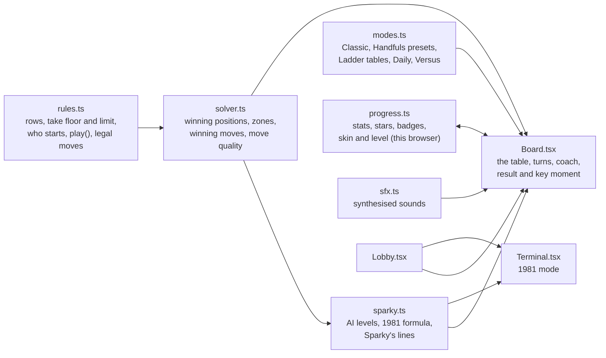
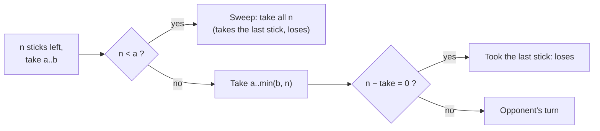

# Stickler: how the rebuild works

**Stickler** is the Any Key rebuild of *23 Matches* (Bob Albrecht, People's Computer Company; converted by David Ahl at DEC, 1973). The original is a 46-line text game: 23 matches, take 1 to 3, whoever takes the last one loses, and the computer plays a perfect formula. Stickler keeps that game intact and builds around it: an opponent with a personality, a coach who teaches the secret, a ten-table ladder, a daily puzzle, **Handfuls** (where every take is a real handful and the game ends in a sweep), two-player mode, three stick styles, and a 1981 mode that plays exactly like the original on a PC.

For the original program, see [ABOUT.md](ABOUT.md), [HOW-TO.md](HOW-TO.md) and [ORIGINAL-ARCHITECTURE.md](ORIGINAL-ARCHITECTURE.md).

## What we kept, what we changed

| The original | Stickler |
|---|---|
| 23 matches, take 1–3, last one loses | The same, as **Classic 23**. The same rule powers every mode |
| You always move first, from a count you can always win | Kept in Classic. The Ladder and Versus add other counts, other take limits, rows, and tables where the opponent opens |
| Every take is 1 to 3, so the loser is always left holding one match | Kept in Classic. **Handfuls** raises the floor (take 2–3, 3–5 and so on): fewer than the floor left means sweeping the whole pile, so the ending is a handful going up at once |
| A computer that is perfect when it can be | **Sparky** at three levels. *Master* plays the same formula; *Clever* slips one move in five; *Rookie* guesses half the time |
| When losing, a "random" take that on a PC is always 1 | Modern modes pick a real random move. **1981 mode** reproduces the always-1 behaviour exactly |
| Any bad input is "cheating" | Sparky is a *stickler for rules*. Pick a fourth stick and he objects (and you earn the *Rule Bender* badge) |
| Win or lose, you learn nothing | A **coach** with three hint levels, and an after-game **key moment** that shows exactly where the game was lost |
| Text only, no score, no way out | A table of sticks you click, a result card, stats, 14 achievements, Esc to the lobby |

## Provenance

- No listing text or program code is reused. The rules of take-away games are centuries-old mathematics. Every sentence Sparky and the 1981 terminal say was written for Stickler; the terminal only keeps BASIC's own `?Redo from start` reply.
- The 1981 mode's behaviour comes from the analysis in ORIGINAL-ARCHITECTURE.md. That includes GW-BASIC's `RND(0)` returning the fixed seed value .3116351, which always gives a take of 1.
- Graphics are drawn in code (SVG and CSS) and sounds are synthesised with the Web Audio API: no image or audio files.

## Architecture



| Path | Job |
|---|---|
| `lib/stickler/rules.ts` | Game state as plain data: rows of sticks, the take floor (`minTake`, 1 unless Handfuls) and limit, whose turn, the history, who took the last stick |
| `lib/stickler/solver.ts` | Game theory: which positions are winning, which moves keep a win, how good each move was, the Coach's magic numbers and zones |
| `lib/stickler/sparky.ts` | Sparky's levels, the original's formula (`move1981`), and his lines |
| `lib/stickler/modes.ts` | Mode list, the Handfuls presets and surprise pile, the ten Ladder tables, the Daily generator, Versus presets |
| `lib/stickler/progress.ts` | What Stickler remembers in this browser: stats, stars, Daily results, Handfuls wins, badges, chosen style, level and Handfuls setup |
| `lib/stickler/sfx.ts` | Strike, snap, crunch, sweep, fwoosh, win and Sparky's voice, all synthesised |
| `components/stickler/` | Shell, Lobby, Board, Terminal, Sparky, Stick (three styles) |
| `components/previews/SticklerPreview.tsx` | The looping match animation on the Hall card |
| `scripts/check-stickler.ts` | Plays thousands of games to prove the maths (see *Testing*) |

## The mathematics inside

All modes share one rule: **whoever takes the last stick loses** (misère play). `solver.ts` decides every position with a closed formula:

- **One row, take 1 to k:** the player to move is lost exactly when the count is **1 more than a multiple of k + 1**. With k = 3 those counts are 1, 5, 9, 13, 17, 21, which are the numbers the 1973 computer always left you. From 23 the first player takes 2, then answers every take *t* with 4 − *t*.
- **One row, take *a* to *b* (Handfuls):** you must take at least *a* sticks, unless fewer than *a* are left: then you must **sweep** them all, which takes the last stick and loses. Taking the whole pile when it holds *a* or more is legal too, and loses just the same. The player to move is lost exactly when the count, taken modulo *a* + *b*, is **1 to *a***. From 1..*a* every move takes the last stick; from *a*+1..*a*+*b* you can always leave 1..*a*; from *a*+*b*+1..2*a*+*b* every take lands in *a*+1..*a*+*b*; and it repeats with period *a* + *b*. So Classic's magic numbers become **magic zones**, each *a* wide: for take 2–3 they are 1–2, 6–7, 11–12, 16–17 and 21–22. With *a* = 1 the zone is a single number and the formula is the one above, so one function serves every mode. A minimum take is not new: BATNUM, the game after 23 MATCHES in the DEC book, let players set one too (see [ABOUT.md](ABOUT.md)).
- **Several rows, take any amount from one row (misère Nim):** play ordinary Nim, making the XOR of the row sizes zero, until every row holds at most one stick. From then on, leave an **odd** number of single sticks. The Ladder's final table uses rows 1-3-5-7, the layout from the 1961 film *Last Year at Marienbad*. Its XOR is 0, so whoever moves first there is lost: Sparky opens.

From those formulas come these tools:

- `winningMoves(rows)`: every move that leaves the opponent in a lost position, smallest take first. In Handfuls the first one lands highest inside the zone.
- `quality(turn)`: whether a move was **best** (kept a win), a **blunder** (threw one away) or neither, because no winning move existed.
- `magicNumbers(k)` and `magicZones(a, b)`: the numbers and zones the Coach points to; `zoneOf(n)` names the zone a count sits in.

Inside a zone the winner can choose where to land. Answering every take *t* with (*a* + *b*) − *t* keeps the same place in the zone, so whoever lands on the **top** of a zone (*a* above its start) forces the loser into a sweep of exactly *a* sticks at the end.



A brute-force search over small positions confirms the formulas in the test script, and the generic move search models the sweep too.

## Sparky

| Level | Behaviour |
|---|---|
| Rookie | A winning move half the time, otherwise any move that doesn't take the last stick |
| Clever | A winning move four times in five |
| Master | Always a winning move when one exists, like the original. When lost, a random move that avoids the last stick. In Handfuls a winning Master always takes the **smallest** winning handful: that leaves you as high in the zone as he can, so the game ends with you sweeping the full minimum whenever the zones allow it |

Sparky's face is an SVG with eight moods: idle, happy, thinking, smug, worried, shocked, sad and cross. He thinks for a visibly longer time when he is losing, and one time in three he admits it ("You've done this before, haven't you?"). He speaks in blips, one per word, pitched by mood. In Versus he steps aside and the table shows whose turn it is.

Handfuls gives him new lines: a greeting that states the range, a smug "4 left. Sweep them up!" when he leaves you a sweep, a shocked one when you leave him one, and objections when you pick too few ("Handfuls means at least 3.") or try to pick and choose during a sweep. In Versus those objections appear, in plain words, on the turn card and next to the buttons.

## The Coach and the key moment

- **Hints** come in three steps. Step 1 is *"Watch how many sticks are left after Sparky's turns"*. Step 2 lists his favourite numbers and what they have in common. Step 3 gives the exact move and highlights the sticks to take. For rows, the hints explain pairing by 4, 2 and 1, then the endgame twist. When the position is already lost, the Coach says so honestly instead of pretending.
- **Handfuls hints** follow the same three steps with zones: step 1 is *"Watch the gaps: Sparky keeps leaving you inside the same bands."* Step 2 lists the zones and their period (*a* + *b*). Step 3 gives the take that lands highest in the next zone, highlights the sticks and says how big the final sweep will be.
- **After the game**, every one of your moves is marked 🟩 (kept a win), 🟥 (gave it away) or ⬜ (no winning move existed). The first 🟥 becomes the *key moment*, for example: "with 14 left you took 3, leaving 11; taking 1 would have left 13, and Sparky couldn't have won." In Handfuls it names the zone: "with 24 left you took 3, leaving 21. Taking 5 would have left 19, inside the 17–19 zone, and Sparky couldn't have won."
- **Ladder stars:** 3 for a win without hints, 2 for a win with partial hints, 1 when you needed the full answer.

## Modes

| Mode | Rules | Notes |
|---|---|---|
| Classic 23 | 23, take 1–3, you start | Sparky at the level chosen in the lobby |
| Handfuls | One row, take 2–3 (23 sticks), 2–4 (27), 3–4 (32), 3–5 (36) or 4–6 (45); fewer than the minimum left means a sweep | Sparky at the lobby level. **Sparky starts** gives him the first move from a pile one stick shorter (22, 26, 31, 35, 44). That count sits on the top of a magic zone, so he opens on a lost position: answer correctly and you win even against Master, and he ends up sweeping the full minimum. **Surprise pile** draws a count from 3 to 6 times (*a* + *b*) that you can win, whoever opens. Every Handfuls table can be won by you; the last setup is remembered |
| Ladder | 10 tables: 11, 15 and 23 sticks; 21 with Sparky opening; up to 4, 5 and 6 per take; rows 3-5, 1-3-5; Marienbad 1-3-5-7 | Each table unlocks the next. The test script proves every table is winnable |
| Daily | Seeded from the date: 17–41 sticks, take up to 3, 4 or 5, always winnable for you | The first result of the day is kept; the share text is an emoji row, like Wordle |
| Versus | Six presets, including Handfuls 2–3 · 23 and Handfuls 3–5 · 36; two players on one screen | No coach, no Sparky |
| 1981 mode | The original, exactly | A green IBM 5151-style screen in the VT323 font. You always start from 23, anything but 1–3 is "against the rules", text input gets BASIC's `?Redo from start`, the computer's losing move is always 1, and it concedes at one stick |

## Look and feel: "Midnight Matchbox"

- **The lobby hero is a matchbox:** a red box, a cream label with a navy wordmark, and a brown striker strip on the side. The in-game **Strike** button uses the same striker texture.
- **The table** is light oak in the light theme and dark walnut under a warm lamp in the dark theme.
- **Three stick styles** are chosen in the lobby and remembered. Each changes the sticks, the table, Sparky and the ending:
  - **Matches:** striking lights a flame that burns down to char before the stick flies to your tray.
  - **Glow sticks:** a neon grid that is always dark. Sticks snap with a flash; the ending is a strobing blackout.
  - **Candy sticks:** striped sticks on a gingham cloth. They crunch and pop; the ending is a sprinkle burst.
- **Signature moment:** whoever takes the last stick sets it off, with a big flare, flying embers, soot and a screen shake. Then the result card slides in.
- **The Handfuls sweep** is the bigger version: every stick left goes up at once and grows as it rises. Matches flare together, glow sticks snap in a chain (90 ms apart) and candy sticks burst one after another (110 ms apart) with a ring of sprinkles each. The flare, the number and reach of the embers, and the shake all scale with the size of the sweep; with reduced motion there is no shake, no chain and no extra embers. The result card names it: "Sparky had to sweep 3."
- **Handfuls controls** show only the legal range (`Take 3`, `Take 4`, `Take 5`), or a single **Sweep** button when the only move left is the whole pile. A rule line under the pile reads "Take 3–5 · last stick loses" and turns into a warning when a sweep is due. Picking too few and pressing Strike gets Sparky's objection and a small shake of the Strike button, never a modal.
- **The pile always fits the table.** For one row, `Board` measures the table and picks the stick size and sticks per line (at most 12, or half a big pile) so the whole pile and the rule line fit; on a phone the table grows instead. This also keeps large Ladder piles such as Bonfire (45) on the table.
- Everything is keyboard-playable: `1`–`9` pick sticks (in Handfuls only the legal range; another number gets the same objection as a click), `Enter` strikes, `H` asks for a hint, `↑`/`↓` switch rows, `R` rematches (a surprise pile is drawn again), `Esc` leaves. Take buttons and row buttons give the same control without the mouse.

## Hall integration

Stickler is the second program in the catalog (`lib/catalog.ts`). The Wall gives every program after the first a wide card with its live preview on the right. The trivia tile rotates facts from all programs. The Orbit hall turns the ten Ladder tables into moons, and the Device hall adds a Stickler cartridge.

## Testing

```text
npx tsx scripts/check-stickler.ts
```

- **The solver matches brute force** on every single-row position up to 30 sticks (take limits 3, 4 and 5) and on a set of multi-row positions.
- **Handfuls: the zone formula matches an independent brute force** for every floor *a* from 1 to 4, limit *b* from *a* to 7 and count up to 60 (1,320 positions), and so does the generic move search. With *a* = 1 it gives exactly the old answers. The Coach's zones for 2–3 are 1–2, 6–7, 11–12, 16–17 and 21–22.
- **The legal-move generator** never offers fewer than the floor unless it is the sweep, and `isLegal` agrees with it; building several rows with a floor above 1 throws.
- **You can win every Handfuls table.** Each preset pile is a win for the opener when you open, and the Sparky-starts pile is a loss for the opener; perfect play beats Master in 200 seeded games for every preset and both openers, and beats Rookie and Clever too. **Surprise pile** stays in range and winnable for you over 1,000 seeds per preset and opener.
- **No table starts lost for you.** An audit walks Classic, the ten Ladder tables, two years of Dailies and every Handfuls setup the lobby can deal (2,751 tables) and checks that the player always has a winning line.
- **Master never gives away a won position in Handfuls** (over 4,000 of his turns in 1,000 random games), and whenever he can end the game he leaves exactly the floor: the biggest sweep.
- **Old tables are untouched:** Classic, every Ladder table, the old Versus presets and the Daily keep a floor of 1 and their old descriptions, so past Daily share texts stay the same.
- **Every Ladder table is winnable**, and a perfect player beats Sparky on it in 200 seeded games per table.
- **Classic is won** by perfect play against all three levels in 300 games each.
- **Master never gives away a won position** in 500 random games.
- **All 365 Daily puzzles of 2026 are winnable.**
- **The 1981 formula** never takes more than 3, leaves a 1-more-than-a-multiple-of-4 count whenever possible, and concedes at 1.

Headless-browser runs also play a full Classic game with the winning strategy, try every stick style in both themes, open the Ladder and the Marienbad table, and exercise the 1981 terminal, including a cheat attempt. For Handfuls they play full games through the keyboard at human pace in every stick style, both themes, at 1440×900 and 390×844, with an illegal pick, all three Coach steps, a Sparky-starts table, a lost game ending in your own sweep, a surprise pile, reduced motion and a Versus objection; a screencast checks the sweep's chain timing.

## Known limits

- Progress lives in the browser only; there are no accounts and no shared leaderboards.
- The Daily is the same for everyone because it depends only on the date. Nobody can check anyone else's claimed result.
- Sparky's lines are few enough that you will hear repeats in a long session.
