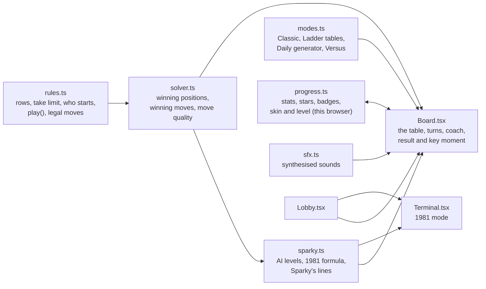

# Stickler: how the rebuild works

**Stickler** is the Any Key rebuild of *23 Matches* (Bob Albrecht, People's Computer Company; converted by David Ahl at DEC, 1973). The original is a 46-line text game: 23 matches, take 1 to 3, whoever takes the last one loses, and the computer plays a perfect formula. Stickler keeps that game intact and builds around it: an opponent with a personality, a coach who teaches the secret, a ten-table ladder, a daily puzzle, two-player mode, three stick styles, and a 1981 mode that plays exactly like the original on a PC.

For the original program, see [ABOUT.md](ABOUT.md), [HOW-TO.md](HOW-TO.md) and [ORIGINAL-ARCHITECTURE.md](ORIGINAL-ARCHITECTURE.md).

## What we kept, what we changed

| The original | Stickler |
|---|---|
| 23 matches, take 1–3, last one loses | The same, as **Classic 23**. The same rule powers every mode |
| You always move first, from a count you can always win | Kept in Classic. The Ladder and Versus add other counts, other take limits, rows, and tables where the opponent opens |
| A computer that is perfect when it can be | **Sparky** at three levels. *Master* plays the same formula; *Clever* slips one move in five; *Rookie* guesses half the time |
| When losing, a "random" take that on a PC is always 1 | Modern modes pick a real random move. **1981 mode** reproduces the always-1 behaviour exactly |
| Any bad input is "cheating" | Sparky is a *stickler for rules*. Pick a fourth stick and he objects (and you earn the *Rule Bender* badge) |
| Win or lose, you learn nothing | A **coach** with three hint levels, and an after-game **key moment** that shows exactly where the game was lost |
| Text only, no score, no way out | A table of sticks you click, a result card, stats, 12 achievements, Esc to the lobby |

## Provenance

- No listing text or program code is reused. The rules of take-away games are centuries-old mathematics. Every sentence Sparky and the 1981 terminal say was written for Stickler; the terminal only keeps BASIC's own `?Redo from start` reply.
- The 1981 mode's behaviour comes from the analysis in ORIGINAL-ARCHITECTURE.md. That includes GW-BASIC's `RND(0)` returning the fixed seed value .3116351, which always gives a take of 1.
- Graphics are drawn in code (SVG and CSS) and sounds are synthesised with the Web Audio API: no image or audio files.

## Architecture



| Path | Job |
|---|---|
| `lib/stickler/rules.ts` | Game state as plain data: rows of sticks, the take limit, whose turn, the history, who took the last stick |
| `lib/stickler/solver.ts` | Game theory: which positions are winning, which moves keep a win, how good each move was |
| `lib/stickler/sparky.ts` | Sparky's levels, the original's formula (`move1981`), and his lines |
| `lib/stickler/modes.ts` | Mode list, the ten Ladder tables, the Daily generator, Versus presets |
| `lib/stickler/progress.ts` | What Stickler remembers in this browser: stats, stars, Daily results, badges, chosen style and level |
| `lib/stickler/sfx.ts` | Strike, snap, crunch, fwoosh, win and Sparky's voice, all synthesised |
| `components/stickler/` | Shell, Lobby, Board, Terminal, Sparky, Stick (three styles) |
| `components/previews/SticklerPreview.tsx` | The looping match animation on the Hall card |
| `scripts/check-stickler.ts` | Plays thousands of games to prove the maths (see *Testing*) |

## The mathematics inside

All modes share one rule: **whoever takes the last stick loses** (misère play). `solver.ts` decides every position with a closed formula:

- **One row, take 1 to k:** the player to move is lost exactly when the count is **1 more than a multiple of k + 1**. With k = 3 those counts are 1, 5, 9, 13, 17, 21, which are the numbers the 1973 computer always left you. From 23 the first player takes 2, then answers every take *t* with 4 − *t*.
- **Several rows, take any amount from one row (misère Nim):** play ordinary Nim, making the XOR of the row sizes zero, until every row holds at most one stick. From then on, leave an **odd** number of single sticks. The Ladder's final table uses rows 1-3-5-7, the layout from the 1961 film *Last Year at Marienbad*. Its XOR is 0, so whoever moves first there is lost: Sparky opens.

From those formulas come three tools:

- `winningMoves(rows)`: every move that leaves the opponent in a lost position.
- `quality(turn)`: whether a move was **best** (kept a win), a **blunder** (threw one away) or neither, because no winning move existed.
- `magicNumbers(k)`: the numbers the Coach points to.

A brute-force search over small positions confirms the formulas in the test script.

## Sparky

| Level | Behaviour |
|---|---|
| Rookie | A winning move half the time, otherwise any move that doesn't take the last stick |
| Clever | A winning move four times in five |
| Master | Always a winning move when one exists, like the original. When lost, a random move that avoids the last stick |

Sparky's face is an SVG with eight moods: idle, happy, thinking, smug, worried, shocked, sad and cross. He thinks for a visibly longer time when he is losing, and one time in three he admits it ("You've done this before, haven't you?"). He speaks in blips, one per word, pitched by mood. In Versus he steps aside and the table shows whose turn it is.

## The Coach and the key moment

- **Hints** come in three steps. Step 1 is *"Watch how many sticks are left after Sparky's turns"*. Step 2 lists his favourite numbers and what they have in common. Step 3 gives the exact move and highlights the sticks to take. For rows, the hints explain pairing by 4, 2 and 1, then the endgame twist. When the position is already lost, the Coach says so honestly instead of pretending.
- **After the game**, every one of your moves is marked 🟩 (kept a win), 🟥 (gave it away) or ⬜ (no winning move existed). The first 🟥 becomes the *key moment*, for example: "with 14 left you took 3, leaving 11; taking 1 would have left 13, and Sparky couldn't have won."
- **Ladder stars:** 3 for a win without hints, 2 for a win with partial hints, 1 when you needed the full answer.

## Modes

| Mode | Rules | Notes |
|---|---|---|
| Classic 23 | 23, take 1–3, you start | Sparky at the level chosen in the lobby |
| Ladder | 10 tables: 11, 15 and 23 sticks; 21 with Sparky opening; up to 4, 5 and 6 per take; rows 3-5, 1-3-5; Marienbad 1-3-5-7 | Each table unlocks the next. The test script proves every table is winnable |
| Daily | Seeded from the date: 17–41 sticks, take up to 3, 4 or 5, always winnable for you | The first result of the day is kept; the share text is an emoji row, like Wordle |
| Versus | Four presets, two players on one screen | No coach, no Sparky |
| 1981 mode | The original, exactly | A green IBM 5151-style screen in the VT323 font. You always start from 23, anything but 1–3 is "against the rules", text input gets BASIC's `?Redo from start`, the computer's losing move is always 1, and it concedes at one stick |

## Look and feel: "Midnight Matchbox"

- **The lobby hero is a matchbox:** a red box, a cream label with a navy wordmark, and a brown striker strip on the side. The in-game **Strike** button uses the same striker texture.
- **The table** is light oak in the light theme and dark walnut under a warm lamp in the dark theme.
- **Three stick styles** are chosen in the lobby and remembered. Each changes the sticks, the table, Sparky and the ending:
  - **Matches:** striking lights a flame that burns down to char before the stick flies to your tray.
  - **Glow sticks:** a neon grid that is always dark. Sticks snap with a flash; the ending is a strobing blackout.
  - **Candy sticks:** striped sticks on a gingham cloth. They crunch and pop; the ending is a sprinkle burst.
- **Signature moment:** whoever takes the last stick sets it off, with a big flare, flying embers, soot and a screen shake. Then the result card slides in.
- Everything is keyboard-playable: `1`–`9` pick sticks, `Enter` strikes, `H` asks for a hint, `↑`/`↓` switch rows, `R` rematches, `Esc` leaves. Take buttons and row buttons give the same control without the mouse.

## Hall integration

Stickler is the second program in the catalog (`lib/catalog.ts`). The Wall gives every program after the first a wide card with its live preview on the right. The trivia tile rotates facts from all programs. The Orbit hall turns the ten Ladder tables into moons, and the Device hall adds a Stickler cartridge.

## Testing

```text
npx tsx scripts/check-stickler.ts
```

- **The solver matches brute force** on every single-row position up to 30 sticks (take limits 3, 4 and 5) and on a set of multi-row positions.
- **Every Ladder table is winnable**, and a perfect player beats Sparky on it in 200 seeded games per table.
- **Classic is won** by perfect play against all three levels in 300 games each.
- **Master never gives away a won position** in 500 random games.
- **All 365 Daily puzzles of 2026 are winnable.**
- **The 1981 formula** never takes more than 3, leaves a 1-more-than-a-multiple-of-4 count whenever possible, and concedes at 1.

Headless-browser runs also play a full Classic game with the winning strategy, try every stick style in both themes, open the Ladder and the Marienbad table, and exercise the 1981 terminal, including a cheat attempt.

## Known limits

- Progress lives in the browser only; there are no accounts and no shared leaderboards.
- The Daily is the same for everyone because it depends only on the date. Nobody can check anyone else's claimed result.
- Sparky's lines are few enough that you will hear repeats in a long session.
