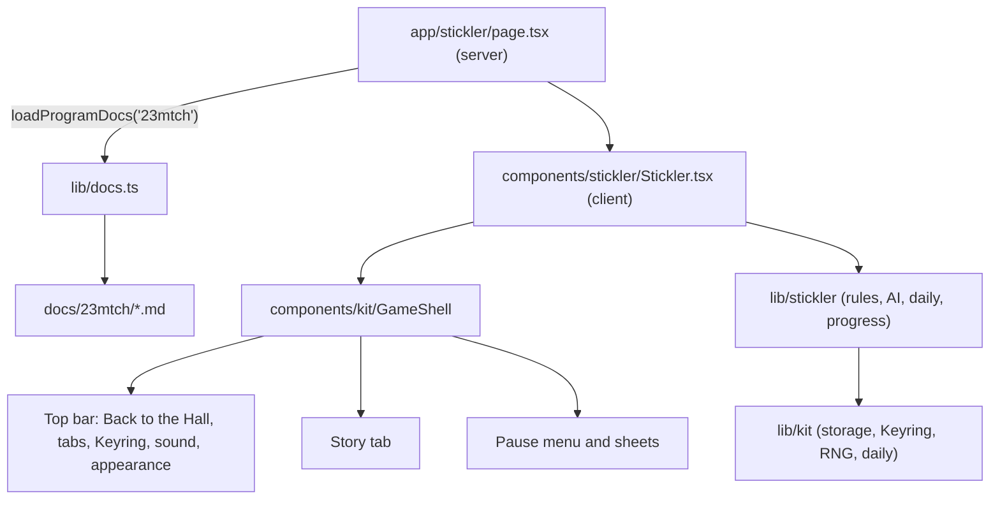
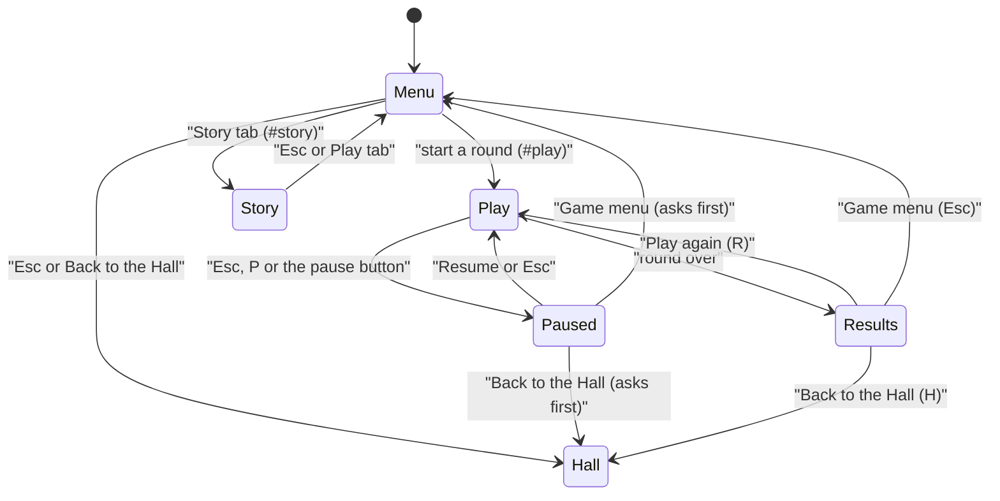
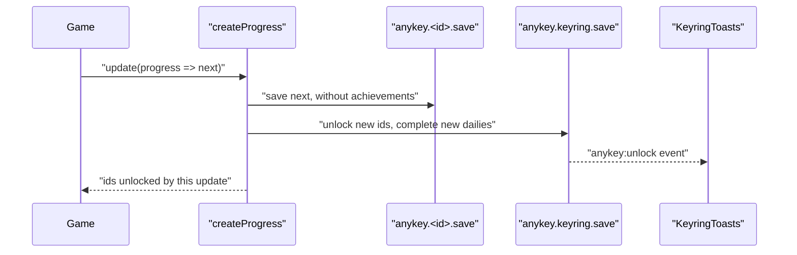

# Any Key: how the app is built

Any Key is one Next.js app: a Hall that shows the collection, one route per game, and the Keyring, where every
game's achievements and dailies end up. The games share a small kit (`lib/kit/` and `components/kit/`) that owns
everything a player meets in more than one game: the top bar, the pause menu, results, the Story tab, appearance,
sound, storage and the Keyring. A game owns its rules, its drawing and its own screens, and talks to the rest of
the collection through two things only: its manifest and the shell.

This page is for programmers. Players start at the Hall; each game's own docs live in `docs/<id>/`.

## Stack

| Part | Choice | Notes |
|---|---|---|
| Framework | Next.js 16, App Router, Turbopack | Every page is static. `AGENTS.md` warns that this Next differs from older ones: read `node_modules/next/dist/docs/` before using an API. |
| UI | React 19, CSS Modules, a few global tokens in `app/globals.css` | No state library. Shared state lives in small stores read with `useSyncExternalStore`. |
| Language | TypeScript, strict | ESLint (`eslint.config.mjs`) must be clean. |
| Drawing | SVG, Canvas 2D, CSS | Zero raster art (ADR 0002). |
| Docs in the app | `marked` at build time, `mermaid` loaded on demand | `lib/docs.ts` reads `docs/<id>/*.md`; `components/kit/Story.tsx` draws the diagrams. |
| Fonts | `next/font/google`, downloaded at build time and served by the app | No font request leaves the page at runtime. |
| Tests | Vitest (kit), tsx check scripts (games), Playwright (navigation, Keyring, appearance, Story, screenshots) | See [Tests and checks](#tests-and-checks). |

Decisions behind these choices are in `docs/adr/`.

## Routes

| Route | Page | What it is |
|---|---|---|
| `/` | `app/page.tsx` | The Hall: three styles (Wall, Orbit, Device), the Today strip, the top bar |
| `/keyring` | `app/keyring/page.tsx` | The Keyring: the ring of earned keycaps, level, streak, settings, Forget my data |
| `/music` | `app/music/page.tsx` | Bop Box |
| `/stickler` | `app/stickler/page.tsx` | Stickler |
| `/outta-here` | `app/outta-here/page.tsx` | Outta Here |
| `/dont-crater` | `app/dont-crater/page.tsx` | Don't Crater |
| `/two-humps` | `app/two-humps/page.tsx` | Two Humps |
| `/long-memory` | `app/long-memory/page.tsx` | Same Trick Twice |

Inside a game the hash says where you are: no hash is the game menu, `#play` is a round, `#story` is the Story
tab. `docs/NAVIGATION.md` is the standard every game follows.

A game page is a thin server component: it reads the game's docs at build time and renders the game's client
component with them.



## Layers

| Folder | Holds | May import |
|---|---|---|
| `lib/kit/` | The kit's logic: storage, migrations, Keyring, achievements, stats, RNG, dailies, appearance, sound, keys, share, colour. No React, so server components can import it. | Nothing outside `lib/kit/` except `lib/catalog.ts` types |
| `components/kit/` | The kit's React parts: `GameShell`, `PauseMenu`, `Results`, `Dialog`, `Story`, `Keycap`, `KeyringToasts`, `TodayStrip`, `SettingsPanel`, `BarTools`, `icons.tsx`, hooks | `lib/kit/`, `lib/catalog.ts` |
| `lib/<game>/` | A game's engine: rules, AI, daily generation, scoring, its manifest and its progress store. Pure TypeScript wherever it can be. | `lib/kit/` |
| `components/<game>/` | A game's screens and drawing | its own `lib/<game>/`, the kit |
| `components/hall/`, `components/previews/` | The Hall and the small animated previews on its cards | the catalog, the kit |
| `components/keyring/` | The Keyring page | the catalog, the kit |
| `app/` | Routes, the root layout, global CSS | everything |

Games never import each other.

## The manifest

`lib/kit/manifest.ts` defines `GameManifest`, the one description of a game the rest of the app reads. Each game
exports one from `lib/<game>/manifest.ts`, and `lib/catalog.ts` lists them in Hall order.

| Field | Used by |
|---|---|
| `id` | Storage keys (`anykey.<id>.save`), Keyring entries, the docs folder, the Story |
| `title`, `tagline`, `blurb`, `kind`, `category`, `players`, `sessionMinutes`, `stats`, `modes`, `moons`, `trivia` | The Hall's three styles and the cards |
| `status` | `"playable"` or `"coming-soon"`; a coming-soon game shows in the Hall but has no route yet |
| `route` | Links from the Hall, the Today strip and the Keyring |
| `inspiredBy` | The "inspired by" line (`inspiredByLine`): original title, file, author, publisher, year, `circa` |
| `palette` | Card gradients, the planet, the cartridge; `palette[0]` becomes the shell's `--shell-accent` |
| `accent` | The game's colour across the collection: its keycaps, emblem badge and Today chip |
| `emblem` | An SVG path on a 24×24 grid: the legend on its keycaps and cards |
| `daily` | `{ epoch }` when the game has a daily; numbering comes from `lib/kit/daily.ts` |
| `achievements` | `AchievementSpec[]`: `id`, `title`, `hint`, `tier` (common, rare, legendary), `secret` |

`tests/unit/manifest.test.ts` checks every manifest: achievement ids unique, tiers known, the emblem a valid path,
the route absolute. It also checks that the three older games kept every achievement title and hint they had
before the kit (`tests/fixtures/achievements.v1.json`).

## The shell

`components/kit/GameShell.tsx` wraps every game. It owns:

- **The top bar**: "← Back to the Hall", the game's title, the Play and Story tabs, the Keyring button with the
  player's level, the sound button and the appearance menu (`components/kit/BarTools.tsx`). A first-visit hint chip
  sits in the bar until the player dismisses it (stored in the Keyring's `hintsDismissed`).
- **Hash routing**: `#play` and `#story` are pushed with `history.pushState`, so the browser's Back button moves
  between them. Back from a round that would lose progress asks first ("Keep playing" / "Leave").
- **Keys**: Esc, `?` and K. A game claims a key by calling `preventDefault()` in its own listener; the shell acts
  on a key only if no one claimed it (`whenUnclaimed` in `lib/kit/keys.ts`). Behind the Story tab or an open sheet,
  a capture-phase guard stops keys from reaching the hidden game.
- **The pause menu** (`PauseMenu.tsx`) in the fixed order: Resume · the game's items · How to play · Settings ·
  Game menu · Back to the Hall.
- **Sheets**: How to play (the game's `HOW-TO-PLAY.md`), Settings (`SettingsPanel.tsx`) and Shortcuts.
- **The Story tab** (`Story.tsx`): the six docs as chapters.

A game tells the shell what is on screen with `usePlayScreen` (`components/kit/shell-context.ts`), called on every
render while a round or a results screen shows:

```ts
usePlayScreen(round ? {
  screen: finished ? "results" : "play",
  paused,
  onPause: () => setPaused(true),
  onResume: () => setPaused(false),
  items: [{ label: "Restart flight", onSelect: restart, shortcut: "R" }],
  losesProgress: !finished && started,
  roundName: "this flight",
  onMenu: () => setRound(null),
} : null);
```

In the game menu it passes `null`, and Esc goes back to the Hall. `useShell()` gives a game `toHall()`,
`toMenu()` (both ask first when needed) and the current `tab`, so a game can keep quiet while the Story shows.

Results screens use `components/kit/Results.tsx`: title, tone, the game's own art and details, then the three
standard actions, Play again (R) · Game menu · Back to the Hall (H). Unlocks earned in the round show on the card.



## The Keyring

The Keyring is the single source of truth for achievements and dailies across the collection. Its data lives in
one store, `anykey.keyring.save` (`lib/kit/keyring.ts`):

| Field | Meaning |
|---|---|
| `unlocked` | game id → achievement id → time of unlock |
| `dailies` | date key (`2026-10-07`, local time) → ids of the games whose daily was finished that day |
| `levelSeen` | the highest level whose ceremony the player has watched |
| `hintsDismissed` | game ids whose first-visit hint is gone |

**Unlocking.** A game calls `unlock(gameId, ids)` (`lib/kit/achievements.ts`). It records only ids that are new,
dispatches an `anykey:unlock` event for each, and returns them. `KeyringToasts` (mounted once in `app/layout.tsx`)
listens and drops a keycap onto a little ring in the corner. During a landing or a final move a game can call
`holdAnnouncements()` and release the toasts when its results appear, so nothing pops up mid-action.

**XP and levels.** A common keycap is worth 10 XP, a rare one 30, a legendary one 80; a finished daily adds 5.
Going from level n to n + 1 costs 40·n XP (`xpForLevel(n) = 20·n·(n − 1)` in total). The twelve level titles run
from Home Row to Escape Artist. When the level passes `levelSeen`, the Keyring page plays the level-up ceremony
once.

**Streaks.** `streakOf(dailies)` counts the days in a row on which any daily was finished, ending today, or
yesterday while today is still open. It also returns this week, Monday first, for the Keyring page.

**Stats.** `lib/kit/stats.ts` keeps plays, wins, streaks and best scores per game in `anykey.stats.save`
(`recordPlay`).

**The progress bridge.** The games kept their own progress shapes, with an `achievements` list and their own daily
records. `createProgress(gameId, store, options)` (`lib/kit/progress.ts`) sits between: a game still updates its
progress with a pure function, and the bridge works out what changed. New achievement ids go to `unlock`, new
daily dates to `completeDailyOn`, a finished round to `recordPlay`. The achievement list is stored only in the
Keyring and merged back in when the game reads its progress, so the game's rules read as before.



## Storage and migrations

All saved data goes through `lib/kit/save.ts`.

- **Keys.** One key per game, `anykey.<id>.save`, plus `anykey.keyring.save` and `anykey.stats.save`. Appearance
  and sound preferences are small plain keys (`anykey.theme`, `anykey.hall`, `anykey.sound`, `anykey.volume`,
  `anykey.motion`) because the inline script in `<head>` reads them before the first paint.
- **Envelope.** Every save is `{ version, data }`. `createStore(gameId, { version, defaults, migrations, legacy,
  normalise })` returns a store with `get`, `set`, `reset`, `forget`, `initialise` and `subscribe`.
- **Migrations.** `migrations[n]` turns version n − 1 data into version n; `migrate` runs them in order and
  the result is written back once. Every read also passes through the store's `normalise`, which fills in fields
  that older saves lack.
- **Legacy saves.** Before the kit, each game saved under its own key (`anykey.bopbox.v1`, `anykey.stickler.v1`,
  `anykey.outta.v1`, `anykey.dontcrater.v1`, listed in `lib/kit/legacy.ts`). The first read imports the legacy
  save as version 1, migrates it, writes the new key and leaves the old key untouched. The Keyring imports the
  achievements and dailies from all four in the same way.
- **When storage fails** (private windows, full quota), the store keeps working in memory for the session.
- **Other tabs.** A `storage` event reloads the store, so two open tabs agree.
- **Forget my data.** `forgetGame(id)` (`lib/kit/forget.ts`) removes the game's save, its legacy key, its stats
  and its entries in the Keyring. `forgetEverything` does it for every game and the Keyring. Both ask first in the
  UI (`components/kit/ForgetButton.tsx` and the Keyring's settings).

| Game | Key | Version | What the migrations do |
|---|---|---|---|
| Bop Box | `anykey.music.save` | 2 | v1 knew only the length switch; v2 adds the listening record behind the badges |
| Stickler | `anykey.23mtch.save` | 2 | v2: achievements move to the Keyring |
| Outta Here | `anykey.escape.save` | 2 | v2: achievements move to the Keyring |
| Don't Crater | `anykey.lander.save` | 3 | v2: achievements move to the Keyring; v3: flag emblems change from emoji to SVG emblem ids |
| Two Humps | `anykey.two-humps.save` | 1 | None yet: born on the kit |
| Same Trick Twice | `anykey.long-memory.save` | 1 | None yet: born on the kit |

`tests/unit/migration.test.ts` runs real version-1 saves (`tests/fixtures/*.v1.json`) through every migration.

## Randomness and dailies

`lib/kit/rng.ts` has two generators. `mulberry32(seed)` is kept byte for byte as the games had it, so every
existing daily and seeded level stays the same. `createRng(seed)` (sfc32, seeded from a number or a string) is for
new code and offers `float`, `int`, `pick`, `shuffle` and `fork`.

`lib/kit/daily.ts` numbers days from the collection's epoch, 1 January 2026, in the player's local time:
`dailyDate(date, epoch)` returns `{ key, day, number }`. A game may set its own epoch in its manifest.
`shareString` builds the plain-text share card (title, number, score, a grid of glyphs, the address), and
`lib/kit/share.ts` sends it to the share sheet on touch devices or the clipboard on desktop.
`tests/unit/dailies.test.ts` pins one day's daily for every game, so a change that would alter past dailies fails.

## Appearance, motion and sound

- **Appearance.** Light, dark or system. The inline `PREFS_SCRIPT` sets `data-theme` on `<html>` before the first
  paint, so there is no flash; `PrefsSync` keeps it current when the system theme changes. Both themes are designed;
  components read colour tokens, never invert.
- **Motion.** `prefersReducedMotion()` honours the system setting unless the player overrides it in Settings
  (`data-motion` on `<html>`). Every animation has a reduced form.
- **Sound.** `lib/kit/sound.ts` keeps one `AudioContext` with a limiter. `followMasterVolume` connects a game's
  audio to the master volume and mute, which the bar's sound button and Settings control.

## Tests and checks

| Command | What it runs |
|---|---|
| `npm run check` | Type-check, ESLint, Vitest, then every `check:*` script |
| `npm run typecheck` | `tsc --noEmit` |
| `npm run test` | Vitest: the kit (RNG, dailies, storage, migrations, Keyring, manifests) |
| `npm run check:guardrails` | `scripts/guardrails.ts`: no raster art outside `docs/` and the sound bank, no emoji in `app/` or `components/`, no network URLs in shipped code |
| `npm run check:music`, `check:audio`, `check:stickler`, `check:outta`, `check:lander`, `check:two-humps`, `check:long-memory` | Each game's own simulations and fixtures |
| `npm run e2e` | `next build`, then Playwright on port 3211 (`tests/e2e/`) |
| `npm run shots` | `next build`, then screenshots of every key screen into `docs/media/shots/` |

Playwright starts `next start -p 3211` itself (or reuses a server already there). It uses a production build
because `next dev` allows only one dev server per folder.

## Folder map

One row per game. New games use one id everywhere: `app/<id>/`, `lib/<id>/`, `components/<id>/`, `docs/<id>/`.
The first four games predate that rule and keep their folders.

| id | route | lib/ | components/ | docs/ | preview |
|---|---|---|---|---|---|
| `music` | `/music` | `lib/music` | `components/bopbox` | `docs/music` | `components/previews/MusicPreview.tsx` |
| `23mtch` | `/stickler` | `lib/stickler` | `components/stickler` | `docs/23mtch` | `components/previews/SticklerPreview.tsx` |
| `escape` | `/outta-here` | `lib/outta` | `components/outta` | `docs/escape` | `components/previews/OuttaPreview.tsx` |
| `lander` | `/dont-crater` | `lib/lander` | `components/dontcrater` | `docs/lander` | `components/previews/DontCraterPreview.tsx` |
| `two-humps` | `/two-humps` | `lib/two-humps` | `components/two-humps` | `docs/two-humps` | `components/previews/TwoHumpsPreview.tsx` |
| `long-memory` | `/long-memory` | `lib/long-memory` | `components/long-memory` | `docs/long-memory` | `components/previews/LongMemoryPreview.tsx` |

The rest of the tree:

| Folder | What lives there |
|---|---|
| `lib/kit/`, `components/kit/` | The kit |
| `components/hall/` | The Hall: `TopBar`, `WallView`, `OrbitView`, `DeviceView`, `Tile`, `Footer`, `AnyKeyToy` |
| `components/keyring/` | The Keyring page: `Ring` and its physics, `LevelPanel`, `KeycapGrid`, `KeyringSettings` |
| `lib/catalog.ts` | The list of manifests, in Hall order |
| `lib/docs.ts` | Reads a game's six docs for its Story tab |
| `docs/` | This page, `NAVIGATION.md`, `PROGRESS.md`, `adr/`, `templates/`, one folder per game, `media/` |
| `scripts/` | Check scripts and the guardrails |
| `tests/unit/`, `tests/e2e/`, `tests/shots/`, `tests/fixtures/` | Vitest, Playwright, screenshots, saved data from older versions |
| `prompts/` | The work orders, one per task (`prompts/README.md`) |
| `public/soundfont/` | Bop Box's sound bank, the one approved audio exception (ADR 0002) |

## Adding a game

1. Write the manifest in `lib/<id>/manifest.ts` with `status: "coming-soon"` and add it to `lib/catalog.ts`.
2. Build the engine in `lib/<id>/`, seeded with `createRng`, with its own check script and unit tests.
3. Build the screens in `components/<id>/` inside `GameShell`; report rounds with `usePlayScreen`; finish rounds on
   `Results`; keep progress with `createStore` and `createProgress`; unlock achievements through the bridge.
4. Add `app/<id>/page.tsx` that passes `loadProgramDocs("<id>")` to the game.
5. Write the six docs from `docs/templates/`, add a preview, add the game's screens to `tests/shots/shots.spec.ts`,
   and set `status: "playable"`.
6. Add the game's row to `docs/PROGRESS.md`.
