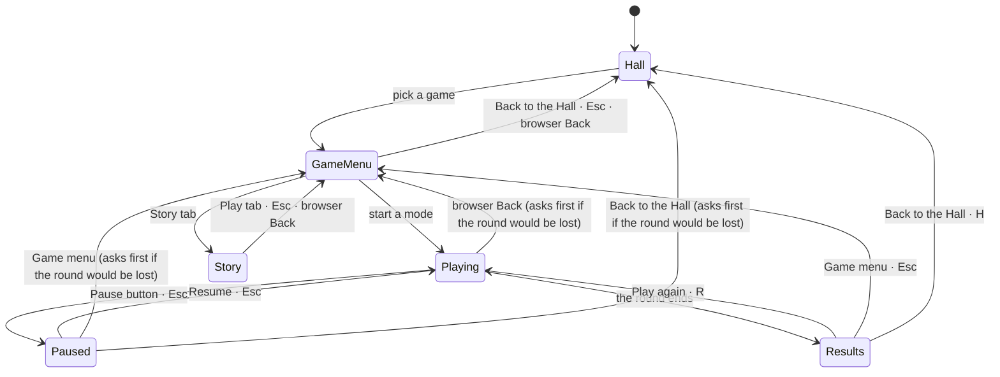

# Navigation standard

Every game in Any Key moves the same way, so a player who has learned one game knows them all. This page is the
contract; `components/kit/GameShell.tsx`, `PauseMenu.tsx` and `Results.tsx` implement it, and a game only
supplies its own items.

## Two destinations, two names

| Name | What it is | Never called |
|---|---|---|
| **Game menu** | The game's own start screen (its lobby): modes, settings, progress | Lobby, Home, Back, Menu |
| **Back to the Hall** | The collection's front page, `/` | any key, Home, Exit, Quit |

## Where a player can be

## The top bar

`GameShell` draws it on every game route, in this order from the left:

1. **← Back to the Hall**: a labelled button, always visible.
2. The game's title and its "inspired by" line.
3. The **Play / Story** switch.
4. **Pause** (only while playing), with its `Esc` hint.
5. **Keyring**, **sound** (mute; the volume is in Settings) and **appearance** (Light / Dark / System).

## The game menu

- `Esc` goes back to the Hall.
- A game that can keep a round when the player leaves (auto-save) offers **Continue** at the top of its menu.
  None of the first four games can yet; their rounds are short.
- On a player's first visit to each game, a small hint says "Esc — pause and menu". It goes away when dismissed
  or when the player presses `Esc` for the first time, and it does not come back.

## Playing

- A visible **Pause** button with an `Esc` hint sits in the top bar while a round is on.
- `Esc` pauses; `Esc` again resumes.
- Switching to the Story tab pauses the round; it is still there when the player comes back.

## The pause menu

Always this order. Games add their own items in the second slot and never reorder the rest.

| # | Item | Key |
|---|---|---|
| 1 | **Resume** | `Esc` |
| 2 | game items (for example "Restart flight") | the game's own |
| 3 | **How to play** (opens the game's manual over the menu) | |
| 4 | **Settings** (sound, volume, appearance, motion) | |
| 5 | **Game menu** | |
| 6 | **Back to the Hall** | |

## Results

Games that use the shared card render `Results`; games with their own results screen keep it but use the same three
actions, labels, keys and order:

| # | Action | Key |
|---|---|---|
| 1 | **Play again** (a game may say "Rematch" or "Fly again" in the label; the key stays R) | `R` |
| 2 | **Game menu** | `Esc` |
| 3 | **Back to the Hall** | `H` |

A game's extra actions ("Next table", "Share") sit in their own row above these three.

## Leaving mid-round

- Leaving asks for confirmation **only** when progress would be lost: a round in progress. The menu, a paused
  round that hasn't started, and the results screen never ask.
- The question is always the same two buttons: **Keep playing** (default, `Esc`) and **Leave**.
- Browser Back during a round asks the same question. The round is still there behind the dialog.

## The address

| Screen | URL |
|---|---|
| Game menu | `/<route>` |
| Playing, paused, results | `/<route>#play` |
| Story | `/<route>#story` |

So browser Back moves Play → Game menu → Hall, and the Hall's Story links open the Story directly. A reload on
`#play` lands on the game menu, because a round is not kept in the address.

## Keys

| Key | Where | Does |
|---|---|---|
| `Esc` | game menu | Back to the Hall |
| `Esc` | playing | pause / resume |
| `Esc` | results | Game menu |
| `Esc` | Story | back to the Play tab |
| `R` | results | Play again |
| `H` | results | Back to the Hall |
| `K` | game menu, results, and the pause menu while nothing would be lost | open the Keyring (mid-round, the Keyring button asks first; on the Hall every letter plays a note, so the button is the way there) |
| `?` | anywhere | the shortcuts sheet |

A key the game has used is the game's: a game that handles a key calls `event.preventDefault()`, and the shell
ignores that key press. None of the shell keys fire while the player types in a text field.

## Accessibility

- Every action has a visible button; keys are shortcuts, never the only way.
- The pause menu, the confirmation and the sheets are modal dialogs: focus moves in, `Tab` stays inside, `Esc`
  closes, and focus returns to where it was.
- Focus rings show for keyboard users only (`:focus-visible`).
