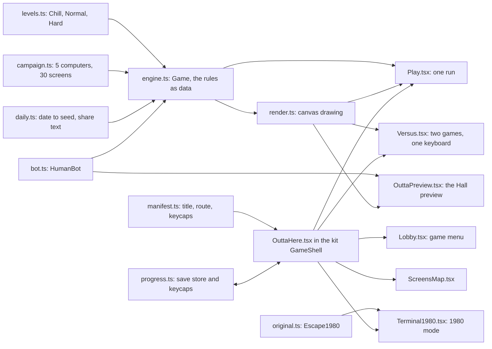
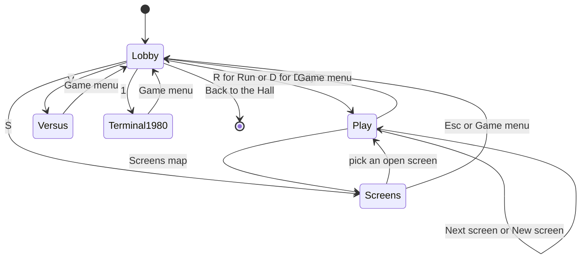
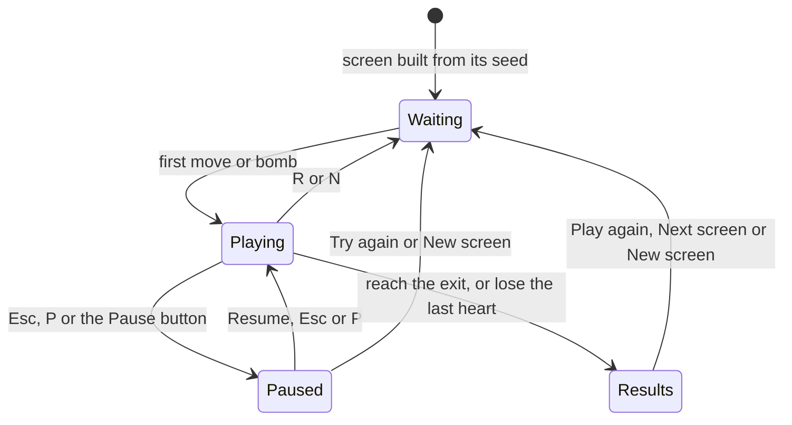
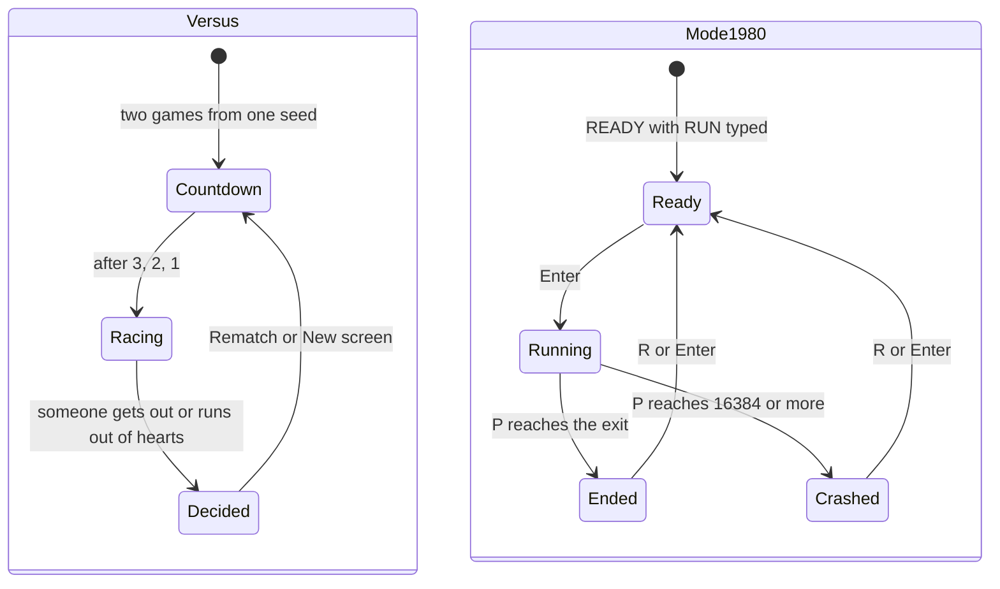
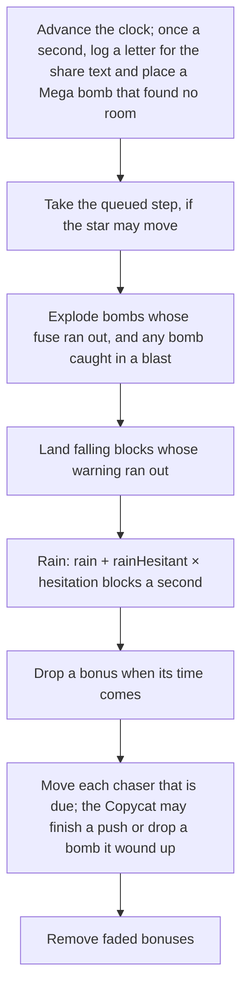
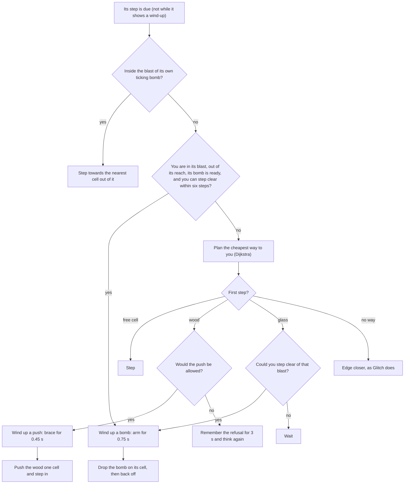

# Outta Here: how the rebuild works

**Outta Here** is the Any Key rebuild of *Escape* (`ESCAPE.BAS`, author unknown, TRS-80, c. 1980). The original is eleven lines: an asterisk, a plus sign, and blocks that fall whenever you stop pressing keys. Outta Here keeps that idea, *the walls grow while you hesitate*, and turns it into a game with choices in it: three kinds of block, bombs, a Mega bomb to find, bonuses, four chasers, the original's bugs as tricks you can use, thirty screens on five old computers, a daily screen, two-player Versus, and a 1980 mode that runs the original address by address. In code, `lib/outta/` holds everything that is plain rules and data (no DOM, so the checks can run it in Node), `components/outta/` holds the screens, and the Any Key kit (`lib/kit/`, `components/kit/`) supplies the shell, the saves, the Keyring and the daily maths.

What we kept from the original and what we changed is in [CHANGES-FROM-ORIGINAL.md](CHANGES-FROM-ORIGINAL.md). The original program itself is in [ABOUT.md](ABOUT.md) and [ORIGINAL-ARCHITECTURE.md](ORIGINAL-ARCHITECTURE.md).

## Module map

| File | What it owns |
|---|---|
| `app/outta-here/page.tsx` | The route: page metadata, the six chapters (`lib/docs.ts` reads them at build time) and `OuttaHere` |
| `lib/outta/manifest.ts` | The game's manifest: title, route, the "inspired by" line, palette, accent, emblem, modes, trivia, the Daily's epoch and the fourteen keycaps with their tiers |
| `lib/outta/levels.ts` | Chill, Normal and Hard: every number that shapes a run, in one place, the Copycat's and the Mega bomb's included |
| `lib/outta/campaign.ts` | The five computers and their thirty screens: settings ramps, seeds and pars |
| `lib/outta/daily.ts` | The Daily Escape: the date to a number, a key and a seed; the share text and its ten squares |
| `lib/outta/engine.ts` | `Game`: the grid, the rain, bombs and the Mega bomb, bonuses, chasers (the Copycat's route planner among them), tunnels, the keyboard row, stars and score; `MinHeap`, the priority queue both route planners use |
| `lib/outta/bot.ts` | `HumanBot`, the human-like player behind the balance checks and the Hall preview |
| `lib/outta/original.ts` | `Escape1980`, the 1980 program as addresses |
| `lib/outta/progress.ts` | The save store, the progress bridge to the Keyring, and `earnedBy` (which keycaps a run earned) |
| `lib/outta/sfx.ts` | Every sound, synthesised |
| `components/outta/OuttaHere.tsx` | The root: the `GameShell`, which screen is showing, the sessions, and `record` (what a finished run changes) |
| `components/outta/Lobby.tsx` | The game menu: the hero, the five mode cards and their keys, the difficulty, the stats and the keycaps |
| `components/outta/ScreensMap.tsx` | The map of five computers and thirty screens, and `isOpen` (the unlock rule) |
| `components/outta/Play.tsx` | One run: the canvas loop, keys, touch pad, HUD, results card, route map and legend |
| `components/outta/Versus.tsx` | Two games side by side, the countdown and the race result |
| `components/outta/Terminal1980.tsx` | 1980 mode: the TRS-80 screen, its keys, the readout and the crash |
| `components/outta/render.ts` | Canvas drawing: palettes, one frame of a game, the route map |
| `components/outta/shared.ts` | One player's keys, the "what got you" lines, events to sounds, the time format |
| `components/outta/Hearts.tsx` | Hearts as icons (one heart and ∞ on Chill) |
| `components/outta/*.module.css` | Styles; `OuttaHere.module.css` holds the colour tokens for light and dark |
| `components/previews/OuttaPreview.tsx` | The Hall's live preview |
| `scripts/check-outta.ts` | Rule checks (the Mega bomb's and the Copycat's too), Daily, 1980, balance and Screens checks (`npm run check:outta`) |

## State machines

The game's own screens are component state in `OuttaHere.tsx` (`View`): the game menu, the Screens map, a run, Versus and 1980 mode.

A run in `Play.tsx`. The clock waits for the first move, so the screen can be studied; only then does leaving ask first.

Versus and 1980 mode have their own small cycles.

## The engine

`Game` (in `engine.ts`) is the whole game as data: a `Uint8Array` grid of 64 × 16 cells (empty, wood, glass, stone), the star, items, falling blocks, bombs, chasers and your trail. All randomness comes from one seeded generator (`mulberry32` from `lib/kit/rng.ts`), so a seed and the same inputs replay the same run; the Daily, the Screens and Versus rely on that. The clock only advances through `update(dt)`, capped at 0.1 s a frame, and the star takes at most one step every 0.11 s.

What the public methods guarantee:

- `new Game(levelOrSettings, seed)` builds the same screen for the same seed, with a way out that bombs can open from the start (see *The way-out rule*).
- `move(dir)` queues one step; `update` takes it as soon as 0.11 s have passed since the last one. A held key or touch simply calls `move` again every frame.
- `bomb()` drops a bomb if the rules allow and says whether it did; `megaBomb()` does the same with the Mega bomb you carry. `bombsLeft()` counts the regular bombs you can still drop: neither a Mega bomb nor the Copycat's bombs use one up.
- `update(dt)` does nothing once the run is won or lost.
- `openPath()` says whether a way to the exit still exists through empty cells and glass.
- `stars()` and `score()` read the run at any time; `drainEvents()` hands the screens what happened since the last frame (steps, bumps, landings, blasts, pick-ups, hits), for sound and effects.

One frame of `update`:

### Moving

A step into empty space moves the star. A step into wood pushes it one cell if the cell beyond is free (not the exit, an item, a bomb or a chaser, and not the bottom row on Chill). Stone, glass and bombs stop you. Off the left or right edge is a tunnel, except left from the top row and right from the bottom row; wood can't be pushed through one. Off the top row is the keyboard row (`y = -1`), where only left, right and down work, and down only onto an empty cell.

The Copycat pushes with the same `push`, by the same rules, plus one: wood never slides onto your cell. For its pushes the way-out check runs from where you stand rather than from where the pusher will stand, so it can never box you in either. After every push, yours or its, and after every block lands, a Mega bomb you can no longer reach is moved (see *The Mega bomb*).

### The rain and hesitation

Blocks arrive as **falling** cells with a 0.55 s dashed warning that shows what is coming (wood, glass, stone or a bonus), then land. The rate is `rain` blocks a second while you keep moving, plus up to `rainHesitant` more as the **hesitation** meter fills: it starts after `hesitateAfter` seconds without a step and is full at `hesitateFull`. Until you have stood still for `trapAfter` seconds, nothing lands in the eight cells around you, and only when `rainHits` is set (Hard, and the last three screens of The Last Machine) can a block land on you. For the first three seconds nothing lands next to the exit.

On the Pocket LCD the rain is **sand** (`rainStyle: "sand"`): a block falls down its column, through gaps too, until something stops it.

### The way-out rule

The engine never lets the screen shut you in. `openPath()` searches from the star to the exit through empty cells and glass (glass counts as open, because a bomb can break it), through the edge tunnels and along the keyboard row, but only *into empty cells* across a tunnel or down from the keys, since no bomb can reach glass on the far side of those.

- When a block lands, the engine checks the way out. If wood or stone would cut it, the block lands as glass instead; if even glass would cut it, the block shatters as it lands.
- A push that would box you in leaves the wood where it is.
- When the screen is built, the cheapest route from the start to the exit (walls count one each, the keyboard row is free) has its walls turned into glass, so there is always a way that bombs can open.

### Building a screen

The screen starts as stone **floors**, walls across the screen at even spacing, each with a two-cell gap. The gaps alternate between the right third and the left third (or sit at the very ends with `gapStyle: "ends"` on the Amber Terminal), so the way down zigzags; with `gaps: 2` (Chill) each wall gets a second gap somewhere in the middle. A few loose stones fill the corridors (`prefill`), keeping the start and the exit clear. The exit goes on the bottom row on the far side from the last wall's gap, or in the bottom-left corner with `exitMode: "crash"`. The Home Micro adds stone **pillars** across the top corridor and closes the corridor's right end, so the only way past is under the keys. Then the way-out rule's glass, the six letters (one in each sixth of the screen, never on a wall row) and the chasers.

### Bombs, chains and bonuses

`bomb()` drops a bomb on your cell if the screen has room for one (`bombsOnScreen`), you are not under the keys, and there isn't one there already. It goes off after 2.5 s: glass in the 3 × 3 around it breaks, chasers in it are popped for six seconds (back to where they started), other bombs in it go off, and you are hit if you are in it. A chain bomb then floods on through every glass block touching one that broke.

Bonuses fall with the rain at intervals of 0.6 to 1.4 times `bonusEvery` (9 s on Chill, 12 on Normal, 15 on Hard) and fade 8 s after landing; `rushShare` of them are Chain Rush. **Chain ×3** sets your next three bombs to chain (picking up another refills to three; it doesn't stack). **Chain Rush** makes every bomb chain for 30 s; a bomb placed during the rush still chains if it goes off after.

Every bomb has an owner (`owner`: you or the Copycat). A blast hurts you and pops chasers whoever dropped the bomb, but only your bombs count for the score, for Chain Reaction and for Pop!; a hit from the Copycat's bomb is reported as `copycat-bomb`.

### The Mega bomb

On Normal and Hard (`megaBombs: 1`) one Mega bomb waits on the screen as an item of kind `mega`, with no fade time.

- **Where it goes.** `placeMega` picks at random among the cells you can reach on the way-out rule's terms (`stepsFromYou`: a walk through empty cells and glass, the edge tunnels and the keyboard row) that are empty, off the wall rows, not the exit, and free of items, bombs, chasers, warnings and you. The first one goes 40 to 90 steps from the start, so it can be seen before you set off and fetching it is a detour; each later one at least 30 steps from you and never where the last one was. If no cell is that far it settles for nearer, and if there is no room at all, the clock tries again every second.
- **Taking it.** Walking onto it adds it to `megas`, at most `MEGA_CARRY` (one); with your hands full it stays put. The moment you take it, the next one is placed.
- **Keeping it in reach.** After every landing and every push, `keepMegasInReach` moves a Mega bomb that is no longer reachable, by the same rules.
- **The blast.** `megaBomb()` drops a bomb with `mega: true` on your cell. It uses no `bombsOnScreen` slot and never chains. When it goes off it breaks every block in its 3 × 3, wood, glass and stone (`stoneBroken` counts the stone); the glass still counts for the score. Everything else is a bomb's: the fuse, setting off other bombs, popping chasers, hurting you.

The way-out rule doesn't count on Mega bombs: it still treats stone as closed, so a screen can always be finished without one.

The six letters E, S, C, A, P, E sit on the screen from the start. They are optional: all six give the third star.

### Stars and score

The three stars are *got out*, *under par*, and *all six letters* (the last one counts even on a lost run). The score adds 1,000 for getting out, 20 points for each second under twice the par, 100 a letter, 5 a broken glass block and 10 a block of your best chain, and takes 150 for each hit. A lost run scores its letters and glass only.

### The difficulties

All the numbers live in `levels.ts`:

| | Chill | Normal | Hard |
|---|---|---|---|
| Floors (stone walls) / gaps per wall | 3 / 2 | 4 / 1 | 4 / 1 |
| Rain (blocks a second, moving / extra when hesitating) | 1.6 / 3 | 3 / 6 | 3.3 / 8 |
| Hesitation starts / is full (seconds standing still) | 1.5 / 6 | 0.8 / 4 | 0.6 / 3 |
| Blocks may land next to you after standing still | never | 2.5 s | 1.5 s |
| Bottom row | stays clear | can close | can close |
| Blocks can land on you | no | no | yes |
| Hearts | unlimited | 3 | 2 |
| Bombs on screen | 2 | 1 | 1 |
| Bonus every (average) | 9 s | 12 s | 15 s |
| Chasers | none | 3 Bouncers, Eraser | 4 Bouncers, Eraser, Glitch, Copycat |
| Mega bombs on the screen | none | 1 | 1 |
| Par | 18 s | 45 s | 50 s |

### The Screens

`campaign.ts` builds thirty screens on five computers from Normal's settings with three hearts, two to five floors and a rain that ramps up through each computer's six screens. Each computer has its own look (its palette in `render.ts`) and one trick:

| Computer | Look | Trick |
|---|---|---|
| Green Screen | green phosphor | the rain and one to three Bouncers, on two to four floors; no Eraser |
| Amber Terminal | amber glow | gaps at the very ends of the walls, so the edge tunnels are the quick way down; the Eraser |
| Home Micro | blue screen, bright blocks | one to three stone pillars across the top corridor (and its right end closed), so the way past is under the keys; Glitch |
| Pocket LCD | grey-green LCD | sand rain; the Eraser |
| The Last Machine | magenta and cyan | no exit: get to the bottom-left corner, where the 1980 program crashed. Glitch from screen 3, blocks that land on you from screen 4, five floors from screen 4 |

No screen has a Mega bomb or the Copycat: `settingsFor` in `campaign.ts` turns both off, since the seeds were picked without them. A fingerprint in the check (40 Chill runs and the 300 Screens runs) proves the screens still play exactly as they did when they were picked.

A screen opens when the one before it is cleared (`isOpen` in `ScreensMap.tsx`). Each screen's seed was picked by the bots from a run of candidates: the first one that was winnable enough for its place, and on the Amber Terminal and the Home Micro, one that made the bots use the trick. Its par is the bots' median time plus a tenth, rounded up to five seconds. The seeds and pars are fixed in `PICKS`; changing the engine or the bot means re-running the check and, if a screen falls below five bots in ten, picking again.

### The Daily Escape

`dailyFor(date)` takes the day number from the kit (`dailyDate` in `lib/kit/daily.ts`, collection epoch 2026-01-01 = #1, on the player's local calendar) and makes the seed `70000 + (day × 7919 mod 99991)`. The rules are Normal's, with the id `daily` (so No Hesitation counts it, and the Mega bomb is there too). `shareText` builds three lines: the title and number, the time (or "caught") with stars and hits, and ten squares from `timelineSquares`. The engine logs one letter a second (`m` moving, `h` hesitating past 0.4, `k` under the keys, `b` a bomb went off, `x` hurt); each square shows the highest-ranked letter in its tenth of the run, in the order `x`, `b`, `k`, `h`, `m`.

### 1980 mode

`Escape1980` (in `original.ts`) simulates the listing as the TRS-80 ran it, with the star as an address `P`, not a cell:

- the screen is 1,024 character codes; writing below the screen does nothing (the keyboard's memory and the ROM), and writing past it (16384 or more) is the crash;
- each time round the main loop it either takes one key from the queue or drops a block at 15360 + 1 to 960;
- the four checks are the original's, wrong ones included, so the star can't step right from the first cell, vanishes two rows into the keyboard's memory, wraps at the row ends, and crashes off the bottom-left or bottom-right corner;
- reaching the exit ends the program with `READY` and `>` under the title.

`Terminal1980.tsx` runs it at sixty loops a second (`LOOPS_PER_SECOND`) and draws it (see *Drawing*). Keys don't repeat, as on the TRS-80. Under the screen, a line says where the star is, because the screen can't.

## AI

### The chasers

| Chaser | How it moves | From |
|---|---|---|
| **Bouncer** | Back and forth along a lane of up to eleven cells (mostly across, sometimes up and down), turning at its ends and at anything in the way | Normal (3), Hard (4), every Screens screen |
| **Eraser** | Waits a few seconds (`eraser.delay`), then heads for the nearest point of your trail from the middle of the screen and follows the trail step by step, wiping it, through edge tunnels too. When the trail is blocked, or broken where you came down from the keys, it finds it again further on. A catch knocks it 20 steps back | Normal, Hard, Amber Terminal, Pocket LCD, The Last Machine |
| **Glitch** | Waits, then hunts you by the shortest walk; if there is none, it still edges closer rather than waiting. Under the keys it loses you and goes to where it last saw you | Hard, Home Micro, The Last Machine from screen 3 |
| **Copycat** | Waits, then sets off from the corner where you started and hunts you with your tools: it pushes wood and bombs glass by your rules, showing each push and each bomb first (see below) | Hard |

Chasers move on their own clocks (`bouncerStep`, `eraser.step`, `glitch.step`, `copycat.step`: a step every 0.22 to 0.4 s). They never walk through blocks or bombs, never step onto the exit, and never use the keyboard row; the Bouncers, Glitch and the Copycat never use the tunnels. Being caught costs a heart, gives you two seconds of safety, and pauses the chaser for 1.5 s.

### The Copycat

The Copycat (`copycat` in `engine.ts`) is the chaser that plays by your rules. On Hard it waits 7 s (`copycat.delay`), shown as a faint cat in the start corner for the last six of them, then sets off from that corner and takes a step every 0.22 s. Starting behind you is what makes it fair: tried in front of you (low on the screen or in the middle), the bots got out of only 11 to 23% of Hard screens; from behind it punishes dawdling and long waits for a fuse without blocking the way (see NOTES.md).

Each step it decides in this order:

- **The plan.** `copycatRoute` costs a free cell 1, wood it could push 2, glass 7 when its bomb is ready, and a cell another chaser stands on 8 (it will most likely have moved on), except as the first step. Stone, bombs, the exit and the blast of its own ticking bomb are off limits. Cheap tools mean it would rather push or bomb than go a long way round.
- **The wind-up.** A push or a bomb is an `intent` with a start and an end time (`copycat.brace`, `copycat.arm`). While it lasts the Copycat stands still and the screen shows it; when it ends, `copycatAct` checks the rules again and acts. A catch or a pop cancels it.
- **Its bomb.** Exactly yours: the 2.5 s fuse, the 3 × 3, glass only, no chain. One at a time, and 5 s (`copycat.reload`) before the next. It never picks up a Mega bomb or a bonus.
- **Your bombs.** Like every chaser it can't walk onto a bomb, but it doesn't see a blast coming, so a bomb in its path can pop it.

### The human-like bot

`HumanBot` plays the way a person might, for balancing, for picking the campaign's seeds, and for the Hall's preview:

- it sees the screen 0.35 s late, and takes a step about every 0.16 s, with a short pause whenever it changes direction;
- it plans the cheapest walk to the exit on what it saw (Dijkstra): a step costs 1, pushing wood 3, glass 7 (it bombs it when it gets there), and cells near a chaser or a falling block cost more; it knows the edge tunnels and the keyboard row;
- it gets out of the way of bombs first: its own at once, the Copycat's (and a Copycat holding a bomb up) once it has seen them, 0.35 s late; and it remembers for a few seconds the moves that bumped, so it tries something else;
- it fetches a Mega bomb when the detour costs 14 or less (about as many steps), and while it carries one, stone in its way costs 8 instead of being a wall: it drops the Mega bomb against it and backs off.

With 120 runs a level (`npm run check:outta`, 10 October 2026), it gets out of **100%** of Chill screens (median 15.8 s), **84%** of Normal screens (median 49.3 s) and **33%** of Hard screens (median 38.3 s). The check fails if those rates leave their target bands (Chill 90–100%, Normal 55–90%, Hard 25–60%; Normal's top was 85% until the Mega bomb). Every campaign screen is won by at least five of ten bots; at present, by nine or ten. The full numbers are in [NOTES.md](NOTES.md).

## Drawing

Everything is drawn in code: the game on canvas, the menus in CSS and inline SVG.

- **`components/outta/render.ts`** draws one frame. `paint` sizes the canvas to its wrapper at the device's pixel ratio; `layout` picks a cell of at least 14 px, and when the board is wider than the space, the camera follows the star. `draw` paints, back to front: the keyboard strip you can hide under, the screen and its faint grid, the clear-floor tint on Chill, the dashed tunnel seams, your trail (the Eraser's road), the blocks, the exit (or the cracked corner), the warnings (a dashed outline with a growing square in the colour of what is coming), the letters, the bonuses (each with a ring that runs down as it fades) and the Mega bomb on its slowly turning dashed ring (faded while your hands are full), bombs with their fuse and the square they will reach (`drawBomb`), blasts and chain flashes with pieces of whatever broke, the chasers and the star, which blinks while it can't be hurt and carries a little red bomb on its shoulder while you hold a Mega bomb. `drawRoute` draws the results card's map of the way you went.
- **Palettes.** `LIGHT` and `DARK` in `render.ts` are the two designed themes; `WORLDS` holds the five computers, which keep their own screens whatever the theme. The theme is read from `data-theme` on `<html>` every frame, so switching is live. The page around the canvas uses the `--oh-*` tokens in `OuttaHere.module.css`, redefined under `:root[data-theme="dark"]`.
- **The look, "Inside the Glass".** The light theme is a beige computer by a window: cream screen, pastel blocks (peach wood, mint glass, grey stone), a coral star. The dark theme is phosphor at midnight: ink-blue screen, neon blocks, a gold star. Blocks are told apart by shape as well as colour: wood has grain, glass a crack and a glint, stone four rivets. Chasers are a bouncing blue ball, a pink rubber eraser, a jittering RGB blob and a cat (black with yellow-green eyes on the light screen, white with blue eyes on the dark, `copycat` and `copycatEyes`), so none of them looks like a mouse pointer; the pointer itself hides over the screen while you play.
- **The Copycat's wind-ups** (`drawCopycatAndWindUp`). Before a push the cat leans into the wood and two chevrons on the wood point the way it will slide, with a little shake. Before a bomb it holds the bomb over its head, fuse sparking, and its 3 × 3 is outlined with a dash and fills as the moment comes. Its bombs are drawn as yours with two small ears (`drawEars`) and a dashed fuse ring. With reduced motion the shake, the bob and the sway stop, and every wind-up is still drawn.
- **The Mega bomb** (`drawMegaBall`, `drawMegaPickup`) is a red ball with a crack across it (`mega`, `megaInk` in the palettes; `--oh-mega` in the CSS), and its blast is tinted red, so the stone it will break shows before it goes.
- **The game menu** (`Lobby.tsx`): the hero's little monitor is a fixed scatter of CSS cells, the star with a face is inline SVG beside the word SCAPE, with the E flying off, and the mode icons are inline SVG. The Screens map draws each computer's monitor the same way from its palette. Hearts and stars come from the kit's icons.
- **1980 mode** (`Terminal1980.tsx`) draws a 384 × 192 dot grid on a 4:3 canvas, 6 × 12 dots a character, so the cells are three times as tall as they are wide, as on the TRS-80. Codes 128 to 191 are drawn as the 2 × 3 block graphics; the few letters are our own 5 × 7 dot glyphs in `GLYPHS`. The phosphor is one colour (`PHOSPHOR`), the cursor blinks after the prompt, and the crash fills the screen with random blocks and letters after 0.7 s.
- **Reduced motion.** With reduced motion, the exit's pulse, the bombs' throb, the chasers' wobble and the stars' pop on the results card stop, and the Hall preview shows a still. The canvases read the operating system's setting when a round starts; the CSS follows the Settings sheet's Motion choice too (see *Known limits*).

To change a colour, edit the palette in `render.ts` and the matching token in `OuttaHere.module.css`; to change a computer's look, edit its entry in `WORLDS`; to change a 1980 letter, edit `GLYPHS`.

## Sound

Every sound is synthesised in `lib/outta/sfx.ts` with the Web Audio API (oscillators and filtered noise), into the kit's shared effects bus (`effectsBus` in `lib/kit/sound.ts`), so the top bar's mute and the Settings volume apply to it. `playSound` in `components/outta/shared.ts` maps engine events to sounds:

| Event | Sound |
|---|---|
| Bomb dropped | a short tick |
| Blast | a thump and a burst of noise, a glass tinkle per broken block (up to 3, or 10 in a chain), and a rising run for a chain |
| Pick-up | a two-note chime for a letter, three notes for a bonus |
| Hit | a falling buzz |
| Mega bomb dropped | a lower, two-note clunk |
| Mega blast | a deep thump and a rumble of falling stone, over the usual blast |
| The Copycat leans into wood | a short, low "mrr" |
| The Copycat holds a bomb up | a rising "mew" and the hiss of a fuse |
| The Copycat pushes, and drops its bomb | a scrape, and a softer tick |
| Bump | a soft click |
| Under the keys, and back | a falling and a rising sweep |
| Tunnel | a quick blip |
| Out | a four-note fanfare |
| Out of hearts | three falling notes |

Run, Screens, the Daily and Versus play sounds only while sound is on (`usePrefs().sound`). 1980 mode is silent, as the original was. To change a sound, edit its entry in the `sfx` table.

## Kit integration

### The manifest and the Hall

`lib/outta/manifest.ts` is the game's contract with the collection: id `escape` (the save key, the Keyring's game id and this docs folder), route `/outta-here`, title, tagline and blurb, the "inspired by" line (*Escape*, `ESCAPE.BAS`, unknown author, 1980 with `circa: true`, shown as "c. 1980"), palette and accent, the emblem (an asterisk heading for the way out, as SVG path data), the card's stats, modes and trivia, the five computers as the Orbit hall's moons, `daily: { epoch: COLLECTION_EPOCH }`, and the fourteen keycaps. `lib/catalog.ts` lists it with the other games. The Hall's card shows `components/previews/OuttaPreview.tsx`, picked by `ProgramPreview.tsx` for the id `escape`: the same `HumanBot` plays Normal screens one after another from seed 1003 in miniature, with the camera on its star. It only runs while it is on screen and the tab is visible; with reduced motion it shows one still, six seconds into a run.

### The shell

`OuttaHere` renders everything inside the kit's `GameShell` (`components/kit/GameShell.tsx`): the top bar with Back to the Hall, the Play and Story tabs, the Pause button, the pause menu, the leave question, the Settings and How to play sheets, and the shortcuts sheet (Outta Here adds its own lines through `shortcuts`). It also passes `dataset={{ screen: view.kind }}`, so the root carries `data-screen="lobby"`, `"screens"`, `"play"`, `"versus"` or `"1980"`. The attribute is `data-screen`, not `data-view`, because the Hall uses `[data-view]` in `app/globals.css` to show one Hall style and hide the others.

The address follows the navigation standard (`docs/NAVIGATION.md`): `/outta-here` is the game menu, the shell pushes `#play` when a round reports itself, and `#story` shows the six chapters. A reload on `#play` lands on the game menu.

Each round tells the shell what is on screen with `usePlayScreen`:

| Screen | Pause items (between Resume and How to play) | Round name | Asks before leaving |
|---|---|---|---|
| `Play.tsx` | Try again (`R`); New screen (`N`, Run only); Screens map (Screens only) | this escape | from the first move until the run ends |
| `Versus.tsx` | Start again (`R`), New screen (`N`) | this race | until the race is decided |
| `Terminal1980.tsx` | Run it again (`R`) | this run | while the program runs |

Each reports `screen: "results"` once it is over, so `Esc` goes to the game menu. The game claims its own keys with `preventDefault`, and the shell then leaves them alone (`lib/kit/keys.ts`): that is how every key, `?` and `K` included, reaches the 1980 program while it runs, and how `Esc` on the Screens map goes to the game menu rather than to the Hall.

### Results

Outta Here keeps its own results cards (in `Play.tsx`, `Versus.tsx` and `Terminal1980.tsx`) rather than the kit's `components/kit/Results.tsx`: the run's card sits over the canvas with the route map and the Daily's share text, and 1980 mode's result is a line of the terminal's readout. All three use the standard last row: Play again (Rematch in Versus, Switch it off and on after a crash) with `R`, Game menu with `Esc`, Back to the Hall with `H`, and the game's extras (Next screen, New screen, Screens map, Copy to share) in a row above. Unlock toasts come from the kit's `KeyringToasts`, mounted in `app/layout.tsx`.

### Progress and saves

`lib/outta/progress.ts` keeps Outta Here's data in a kit store (`createStore` in `lib/kit/save.ts`) under `anykey.escape.save`, as `{ version: 2, data }`:

| Field | What it holds |
|---|---|
| `runs`, `escapes` | Finished runs in Run, Screens and the Daily, and how many got out |
| `best` | Best time and score per difficulty, Run only |
| `screens` | Best stars (1 to 3) and best time per Screens screen, written only when you get out |
| `daily` | Local date → the first finished Daily's result, time and share text |
| `level` | The difficulty last picked for Run (and Versus) |

The achievements are not in the save. Before the kit (version 1), everything, achievements included, lived under `anykey.outta.v1`. On the first load with no new save, the store reads that legacy key once, migrates it to version 2 (dropping the achievements) and writes the new key; the old key is left untouched, so going back to an older build still finds the old progress (`lib/kit/legacy.ts` lists the legacy keys, to be removed in the first release after the retrofit). The Keyring imports the version 1 achievements and finished Daily dates from every legacy save on its own first load, once.

`createProgress` (`lib/kit/progress.ts`) is the bridge. `getProgress` merges the Keyring's unlocked ids back in as `achievements`, so `withAchievement` and the game menu read as they always did. `updateProgress` saves the rest and works out what changed: new achievement ids are unlocked in the Keyring (`unlock` in `lib/kit/achievements.ts`), a new date in `daily` marks the Daily done for the streak (`completeDailyOn` in `lib/kit/keyring.ts`), and a rise in `runs` records a finished round in the collection's stats (`recordPlay` in `lib/kit/stats.ts`, won or not; Outta Here reports no best scores there). Version 1's `runs` and `escapes` seed the stats once. Another tab's save is picked up through the `storage` event.

Forgetting the game (the Keyring page's "Forget my data") calls `forgetGame("escape")` in `lib/kit/forget.ts`: the save, the legacy key, the keycaps, the dailies and the stats. `resetProgress` in `progress.ts` wraps the same call.

### Keycaps and dailies through the Keyring

The Keyring (`/keyring`, `lib/kit/keyring.ts`) is the single source of truth for unlocked keycaps and finished dailies. The game's own `daily` record keeps each Daily's result and share text, which the Keyring doesn't need. Who unlocks what:

| Keycaps | Unlocked by |
|---|---|
| Under the Keys, Wraparound, Chain Reaction, Rush Hour, Spelled It, Pop!, No Hesitation, Untouched, Not Set in Stone, Copy That | `earnedBy` in `progress.ts`, when a run ends, out or caught. Pop! and Chain Reaction count your bombs only; Copy That counts the Copycat caught in any blast (`copycatPops`), Not Set in Stone any stone broken (`stoneBroken`) |
| Out of the Machine, Daily Driver | `record` in `OuttaHere.tsx`, after the screens or dailies it counts |
| \*SCAPE, Crash Test | `Terminal1980.tsx`, when the program ends or crashes |

Tiers decide the Keyring's XP: 10 for common, 30 for rare, 80 for legendary, and 5 for each finished daily.

### Daily, RNG and stats

- **Daily numbers** come from `dailyDate` in `lib/kit/daily.ts`, shared by every daily in the collection; only the seed formula is Outta Here's. The unit test `tests/unit/dailies.test.ts` pins 7 October 2026 to #280 and seed 79599, so no Daily changed when the game moved to the kit.
- **Randomness** is `mulberry32` from `lib/kit/rng.ts`, byte-identical to the copy the engine carried before the kit, so every campaign screen, Daily and Run number builds the same screen as before. `tests/unit/rng.test.ts` pins its first four numbers for seed 12345. Run and Versus seeds are drawn from 1 to 99,999; 1980 mode's from 1 to a billion.
- **Stats** for the Hall and the Keyring come from the progress bridge above; Versus and 1980 mode don't report rounds.

### The docs

`lib/docs.ts` reads these six chapters at build time and renders them for the Story tab, turning links between them into chapter links. `HOW-TO-PLAY.md` doubles as the pause menu's How to play sheet, where the HTML is shown as it is: no Mermaid is drawn there and chapter links don't navigate, so that chapter has neither.

## Tests

- **`npm run check:outta`** (`scripts/check-outta.ts`, about 35 seconds; an optional argument sets the runs per level, 120 by default):
  - **rules**: a way out exists at the start of 500 Normal screens; a seed replays exactly; tunnels; the keyboard row; wood pushing; plain and chain bomb reach; a push that would box you in is refused; the keyboard row counts as a way round;
  - **the Mega bomb**: a bomb breaks only glass and a Mega bomb every block in the same 3 × 3; it uses no regular bomb and its glass scores; taking one carries it and places the next elsewhere, and with one in hand the next stays put; one walled in by the rain moves where you can reach it; Chill has none;
  - **the Copycat**: it braces 0.45 s and pushes wood one cell; it won't lean into a push that would box you in; it arms for 0.75 s, bombs glass, breaks only glass and gets clear; it bombs you behind glass only when you can step clear;
  - **the Daily**: one seed per calendar day; ten squares in the share text;
  - **1980 mode**: `*SCAPE` and the exit at the start; no step right from the first cell; two rows into the keyboard's memory and back; the row wrap; both crashes; 20,000 blocks without one on the bottom row (bar its first cell) or the exit; any key clears a block on you; the exit ends at `READY`;
  - **balance**: the bots on each difficulty, within their bands, with the Mega bomb's and the Copycat's numbers; and in every bot run, once a second, one Mega bomb on an empty cell you can reach, every Copycat push and bomb shown first, its bombs breaking only glass, and no landing or Copycat push ever shutting the way out;
  - **screens**: thirty different seeds, and ten bots on each screen, at least half of them getting out, using the computer's trick where it has one; and the fingerprint that proves Chill and the Screens play exactly as before the Mega bomb and the Copycat.
- **Unit tests** (`npm test`, Vitest): `dailies.test.ts` (today's Daily seed), `daily.test.ts` (the kit's day numbering), `rng.test.ts` (mulberry32's numbers), `migration.test.ts` (a version 1 save survives the move, the old key stays, the Keyring imports its keycaps and dailies once, forgetting another game leaves Outta Here alone), `manifest.test.ts` (the twelve titles and hints from before the kit unchanged and still first, unique ids, known tiers), `keyring.test.ts` and `save.test.ts` (the kit underneath).
- **End-to-end tests** (Playwright, `npm run e2e`): `navigation.spec.ts` (Back mid-run asks first; `P` opens the pause menu with Resume, Try again, New screen, How to play, Settings, Game menu, Back to the Hall; after a 1980 crash `Esc` goes to the game menu), `keyring.spec.ts` (the Crash Test toast), `story.spec.ts` (every chapter of the Story renders and every Mermaid diagram draws).

What each check locks, and with what tolerance, is listed in [NOTES.md](NOTES.md).

## Provenance

- No code or text from the listing is reused. The only words the original shows are its one-word title, which survives as the `*SCAPE` joke on the game menu and in 1980 mode, and BASIC's `READY` prompt.
- The 1980 mode's behaviour comes from the analysis in [ORIGINAL-ARCHITECTURE.md](ORIGINAL-ARCHITECTURE.md). Its speed (sixty loops a second) is our estimate, and the crash animation is our impression, not a recording.
- Everything is drawn in code on canvas, in CSS and in inline SVG, and every sound is synthesised with the Web Audio API: no image or audio files.

## Known limits

- The 1980 mode's speed is an estimate, and its crash is a dramatisation.
- The bots are a stand-in for people: they don't panic, but they don't learn either. Real players will find some screens easier and some harder than the numbers say.
- Versus needs one physical keyboard; on a phone it isn't playable.
- The canvases follow the operating system's reduced-motion setting, read when a round starts. The Settings sheet's Motion choice reaches the CSS but not the canvas; reading `prefersReducedMotion` from `lib/kit/appearance.ts` (and listening with `subscribeMotion`) would fix it.
- The Screens map has no address of its own: `Esc` there goes to the game menu, but browser Back leaves for the Hall.
- Keycaps from a run are only handed out when it ends, so restarting a run throws away an Under the Keys or a Wraparound earned in it.
- The Daily's "first try" is the first *finished* run: leaving or restarting before the end doesn't use it up.
- The Daily's share text and the results card still use coloured-square and symbol characters from the emoji range; `shareString` in `lib/kit/daily.ts` has the same layout and could assemble it.
- Progress, stars, keycaps and Daily results live in this browser only.
- The Copycat never uses the edge tunnels or the keyboard row, and like every chaser it doesn't see your bombs coming. Both are choices, not oversights: it copies your tools, not your tricks, and a bomb in a corridor is the way to beat it.
- A Mega bomb walled in by the rain jumps to its new place without a warning on screen.
