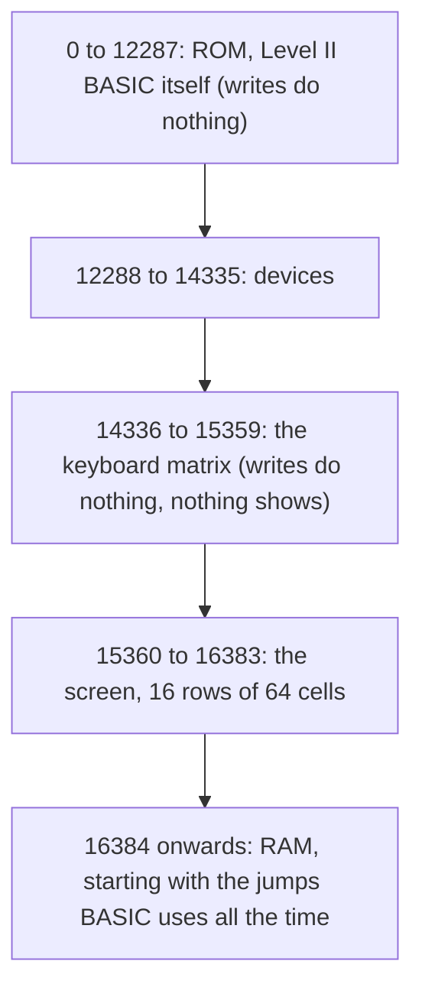
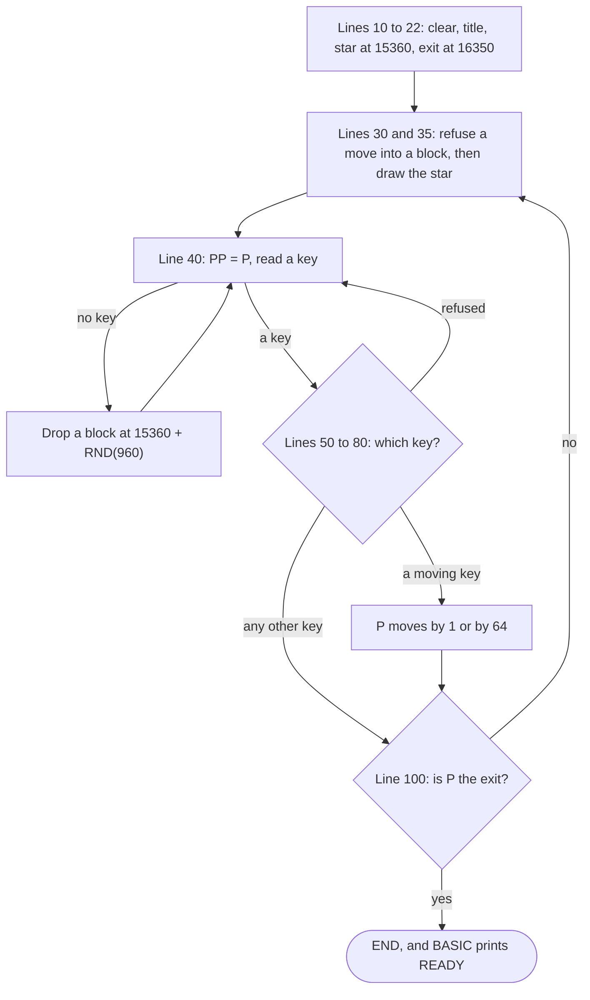

# Escape (ESCAPE.BAS): how the original works

*Escape* is eleven lines of TRS-80 Level II BASIC, 408 bytes with every optional space squeezed out, written for a Model I or Model III around 1980. It keeps no board of its own: the screen's memory is the board, and the player's asterisk is just an address. This page explains how those eleven lines behave, why they misbehave, and how to play the program today. For the program's background, see [ABOUT.md](ABOUT.md); for what Outta Here made of it, see [CHANGES-FROM-ORIGINAL.md](CHANGES-FROM-ORIGINAL.md). The listing is described here in our own words and pseudo-code rather than reproduced.

## At a glance

| | |
|---|---|
| Size | 11 lines, 408 bytes of plain text, every optional space removed |
| Dialect | TRS-80 Level II BASIC (Model I, 1978) or Model III BASIC |
| Machine | TRS-80 Model I or Model III: 64 × 16 text screen, white on black |
| Input | `INKEY$`, one key at a time: comma, full stop, the up arrow and the down arrow |
| Output | `POKE` straight into video memory; the only `PRINT` is the title |
| Variables | `P`, the star's address; `PP`, its previous address; `I$`, the key just pressed |
| Board | The screen itself: video memory from 15360 to 16383 (64 × 16 cells) |
| Characters used | 42 `*` (you), 43 `+` (the exit), 32 space, 191 a solid block |
| Ends | Only by reaching the exit (`END`), by BREAK, or by crashing |

## The memory it walks through

The program never stores a board. The star is an address, and moving it is arithmetic on that address, so it can go wherever the arithmetic leads, including places that aren't the screen.



Row *r*, column *c* of the screen is address 15360 + 64*r* + *c*. Moving left or right is −1 or +1; up or down is −64 or +64. Since the rows sit end to end in memory, the end of one row is next door to the start of the next. The row above the screen is the top of the keyboard's memory, and the row below it is BASIC's working memory.

## Line map

| Line | What it does |
|---|---|
| 10 | Clears the screen and prints the title, so the cursor is left at the start of the second row |
| 20 | Puts the star at the top-left cell, 15360 |
| 22 | Writes the exit, a `+`, at row 15, column 30 (16350) |
| 30 | If the cell at `P` holds a block, puts `P` back to `PP` (the move is refused) |
| 35 | Writes a space at `PP` and the star at `P` |
| 40 | The main loop: remembers `P` in `PP`, reads a key; with no key, writes a block at a random cell and goes round again |
| 50 | Comma: unless the star is at 15360, one step left, then on to line 100 |
| 60 | Full stop: unless the star is at 15360, one step right, then on to line 100 |
| 70 | Up arrow (read as `[`): unless `P` is below 15296, one step up, then on to line 100 |
| 80 | Down arrow (a line feed): unless `P` is greater than 16320, one step down |
| 100 | If the star is on the exit, `END`; otherwise back to line 30 |

## Control flow



The same thing as pseudo-code:

```text
clear the screen, print the title
P = top-left cell
write "+" at row 15, column 30

draw:
    if the cell at P is a block: P = PP          (refuse the move)
    write " " at PP, write "*" at P

loop:
    PP = P
    key = the key pressed just now, if any
    if there is no key:
        write a block at a random cell from 1 to 960 past the top-left
        go to loop
    if key is ",":  if P is the top-left cell go to loop, else P = P - 1, go to check
    if key is ".":  if P is the top-left cell go to loop, else P = P + 1, go to check
    if key is "[":  if P < 15296 go to loop, else P = P - 64, go to check
    if key is LF:   if P > 16320 go to loop, else P = P + 64

check:
    if P is the exit: END
    go to draw
```

Two things in this loop matter more than they look:

- **The rain only falls when no key is waiting.** Each time round, line 40 either takes a key or drops a block, never both. Pressing keys literally holds the rain back.
- **Any key redraws the star.** A key the program doesn't know falls through lines 50 to 80, passes line 100 and goes back to line 30. If a block has landed on the star, line 30 "refuses" a move that never happened (`P` is already `PP`), and line 35 then writes a space and the star over the block. That is why any key clears a block on top of you.

### How the nested IFs read

Lines 50 to 80 each hold two `IF`s and one `ELSE`, as in *if the key is a comma then if the star is at the corner go to 40, else step left*. Level II BASIC pairs an `ELSE` with the nearest `THEN` that has none, so the `ELSE` belongs to the inner test, and when the key is not a comma the whole line is skipped. If it had paired with the outer test instead, every key that wasn't a comma would move the star left, and the game wouldn't work at all. The program only makes sense with the inner reading, which is how we read it. (Checking it in an emulator is still on the list in [NOTES.md](NOTES.md).)

## The interesting parts

### The four checks, one by one

#### Left (line 50): right

A step left is refused only at 15360, the top-left cell. Everywhere else it is allowed, so from the first cell of any other row the star steps to the last cell of the row above. Nothing stops this wrap; it is the program's own "tunnel".

#### Right (line 60): copied

The right-hand line refuses a step only at 15360, the same address as the left-hand line. It was presumably copied from line 50 and never changed. So a step right is refused at the top-left cell, where it would have been perfectly fine, and allowed at the end of every row, where it wraps to the next row's start. From the bottom-right cell, 16383, it takes the star to 16384, off the screen (see *The crash* below).

#### Up (line 70): never true

The up check refuses a step when `P` is below 15296, one row's worth of addresses *above* the screen. The star starts on the screen, so the first step up from the top row is allowed, and lands between 15296 and 15359: the keyboard's memory. A second step up is allowed too (the star is now exactly in the row the check was aimed at), landing between 15232 and 15295. Only the third is refused.

In the keyboard's memory, line 35's writes do nothing, so **the star is invisible**, and line 30's read of the cell never sees a block, so nothing blocks it. Left and right still work there, and a step left from the start of the keyboard row is never refused at all, so in theory the star can wander further down into memory. A step down brings it back, as long as it is within reach of the screen.

#### Down (line 80): one cell too far

The down check refuses a step when `P` is greater than 16320. 16320 is the bottom row's *first* cell, so the other 63 cells of the bottom row are protected, but from the bottom-left corner the step is allowed and takes the star to 16384.

### The crash

Address 16384 is the first byte after the screen. On a Level II machine it is the start of BASIC's communication area in RAM, where the interpreter keeps jump instructions it calls constantly while running a program. Line 35 writes the star's code (42) over the first of them. The very next time BASIC goes through that jump, it runs garbage. What exactly happened next would depend on the machine and its memory; a frozen screen or a restart is the most likely. Either way, the program is over.

There are two ways to get there: down from 16320, or right from 16383.

### The rain

Line 40 picks a cell with `RND(1024-64)`. On Level II BASIC, `RND(n)` returns a whole number from 1 to *n*, so this is 1 to 960, and the block goes at 15360 plus that: from the second cell of the top row to 16320, **the first cell of the bottom row**. So:

- blocks can land anywhere in rows 0 to 14 except the top-left cell,
- the bottom row stays clear apart from its first cell,
- the exit (16350) is never covered,
- the title can be overwritten (every letter but the E, which the star sits on at the start),
- a block can land on the star.

The program does not check whether the cell is already a block; a block landing on a block changes nothing.

### How fast the blocks fall

The loop on line 40 is one line of interpreted BASIC: an assignment, an `INKEY$` (which scans the keyboard), a string comparison, a random number, a little arithmetic, a `POKE`, and a `GOTO` that has to search the program from its first line. Level II BASIC on a 1.77 MHz Z80 runs a few hundred simple statements a second, so we estimate the loop at **50 to 70 times a second**. Outta Here's 1980 mode uses 60. We have not timed it on real hardware.

At that rate, standing still for one second drops about sixty blocks onto 960 cells, and around fifteen seconds of doing nothing would cover most of the screen (fewer in practice, because some blocks land on blocks).

### The keys

The TRS-80's keyboard gives the up arrow code 91, which is the `[` character in ASCII (the TRS-80 shows it as an up arrow), and the down arrow code 10, a line feed. The left and right arrows give 8 and 9, which the program never checks, so it uses comma and full stop instead (on the TRS-80 they carry the `<` and `>` symbols, which is probably why).

`INKEY$` reports a key once, when it goes down. Holding a key moves the star one step.

### The ending

`END` stops the program. Level II BASIC then prints its `READY` prompt and a `>` on the next lines. Line 10's `PRINT` left the cursor at the start of the second row, so the prompt appears right under the title, on top of whatever blocks were there. The star is not drawn on the exit: the program ends before line 35 runs again, so the last asterisk stays one step short of the plus.

## Quirks and bugs

In short, three of the four movement checks are wrong, and the rain has a blind spot:

- rows wrap at both ends (line 50 and line 60 only guard the top-left cell);
- you can't step right from the very first cell (line 60 copies line 50's test);
- you can walk two rows up into the keyboard's memory and vanish (line 70 tests a row above the screen);
- you can step off the bottom-left or bottom-right corner into BASIC's working memory and crash the machine (lines 60 and 80);
- the bottom row stays clear apart from its first cell, and a block can land on the star (line 40).

Each one, with its evidence and what Outta Here does with it, is in [NOTES.md](NOTES.md).

## Playing the original

### The rules in one paragraph

You are the asterisk in the top-left corner. Get it to the plus sign on the bottom row. Every moment you are not pressing a key, a solid block appears somewhere on the screen, and you can't walk through blocks. There is nothing else: no score, no time limit, no enemies, no way to lose except getting stuck.

### Running it today

You need a **TRS-80 Model I or Model III with Level II BASIC**, or an emulator of one. Several free emulators exist, some of them in the browser; trs80gp is one that runs on a desktop. The program does not run in PC BASICs such as GW-BASIC, because it draws by writing to the TRS-80's video memory.

1. Start the emulator in Level II BASIC (Model I) or BASIC (Model III).
2. Type the program in, or paste it if the emulator allows.
3. **Fix line 80.** In our copy, the down-arrow character inside line 80's quotes has turned into a line break, so the line arrives in two pieces (see [ABOUT.md](ABOUT.md)). Retype line 80 on the TRS-80 itself, and when you reach the inside of the quotes press the **down arrow** once: on the TRS-80 that types a line feed into the line without ending it. Then finish the line and press ENTER.
4. Type `RUN` and press ENTER.

### What you will see

The screen clears. The word ESCAPE appears in the top-left corner, and at once its E turns into an asterisk: that's you. A plus sign appears in the middle of the bottom row. Then the blocks start, and they are quick: within a few seconds of doing nothing, a large part of the screen is solid white.

### The keys

| Key | What it does |
|---|---|
| `,` (comma) | One step left. At the left end of a row you come out at the right end of the row above |
| `.` (full stop) | One step right. At the right end of a row you come out at the left end of the row below. It doesn't work from the very first cell (top-left) |
| ↑ | One step up |
| ↓ | One step down |
| Any other key | Nothing, except that it wipes away a block that has landed on top of you |
| BREAK | Stops the program |

Keys don't repeat: hold one down and you move one step. Each key press also means one block fewer, because the program only drops a block when no key is waiting.

A step into a block is refused, and you stay where you are.

### How it ends

Step onto the plus sign and the program **stops**. There is no message. BASIC prints `READY` on the line under the title and waits for your next command. Type `RUN` to play again.

If you get boxed in, nothing ends the game. Press BREAK and `RUN` again.

### Tricks and bugs worth trying

- **Wrap round.** Walking off the right edge of a row takes you to the start of the next row down, which can be much quicker than going round a wall of blocks.
- **Vanish.** Press ↑ on the top row. The asterisk disappears: it is now in the keyboard's memory, where nothing can be drawn. Press ↑ again to go one row further; a third press does nothing. Press ↓ to come back. While you are away, blocks can still fill the cells you come back into.
- **Walk through the floor (don't).** Step down from the bottom-left corner, or step right from the bottom-right corner, and the asterisk is written into the computer's working memory. BASIC breaks at once; expect a frozen screen or a restart, and switch the machine off and on if needed. Save anything you care about first.
- **Get buried.** Stand still until a block lands on you. The asterisk is hidden under it. Press any key, say the space bar, and the block is wiped away as the asterisk is drawn again.

If you would rather not set up an emulator, Outta Here's **1980 mode** runs a step-for-step simulation of the program in the browser, bugs included. [HOW-TO-PLAY.md](HOW-TO-PLAY.md) has its keys, and [CHANGES-FROM-ORIGINAL.md](CHANGES-FROM-ORIGINAL.md) says what it reproduces exactly and where it has to guess.

## Sources

- Radio Shack, *TRS-80 Level II BASIC Reference Manual* (1978): `INKEY$`, `PEEK`, `POKE`, `RND(n)`, `IF … THEN … ELSE`, the graphics characters.
- Radio Shack, *TRS-80 Model III Operation and BASIC Language Reference Manual* (1980): the same video and keyboard memory layout on the Model III.
- Radio Shack, *TRS-80 Microcomputer Technical Reference Handbook* (Model I): the memory map (keyboard at 3800 hex, video at 3C00 hex, RAM from 4000 hex) and the keyboard's codes for the arrow keys.
- Our own reading of `escape.bas` and a byte-by-byte look at the file (408 bytes, CR LF line endings, the line break inside line 80).
