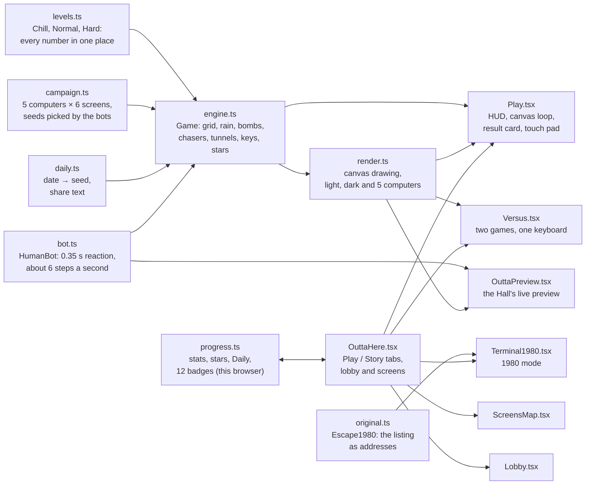
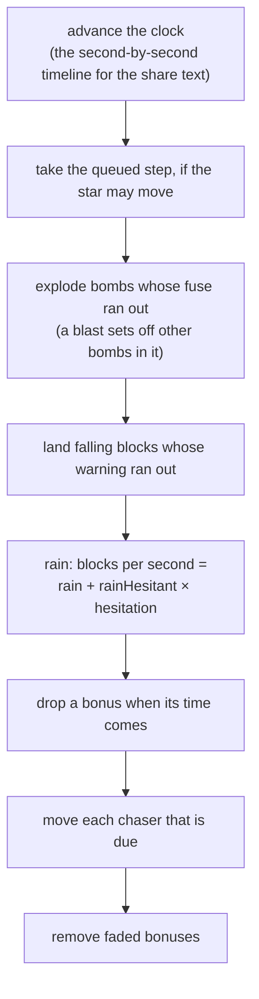

# Outta Here: how the rebuild works

**Outta Here** is the Any Key rebuild of *Escape* (`ESCAPE.BAS`, author unknown, TRS-80, c. 1980). The original is eleven lines: an asterisk, a plus sign, and blocks that fall whenever you stop pressing keys. Outta Here keeps that idea, *the walls grow while you hesitate*, and turns it into a game with choices in it: three kinds of block, bombs, bonuses, three chasers, the original's bugs as tricks you can use, thirty screens on five old computers, a daily screen, two-player Versus, and a 1980 mode that runs the original address by address.

For the original program, see [ABOUT.md](ABOUT.md), [HOW-TO.md](HOW-TO.md) and [ORIGINAL-ARCHITECTURE.md](ORIGINAL-ARCHITECTURE.md).

## What we kept, what we changed

| The original | Outta Here |
|---|---|
| A 64 × 16 screen, an asterisk in the top-left corner, a `+` on the bottom row | The same screen size and the same start and goal. The star is a friendly asterisk with a face |
| A block falls every time round the loop that no key is down, about sixty a second | The rain is measured in blocks per second and grows with **hesitation**: keep moving and it is light; stand still and a meter fills and the rain gets heavy. After a moment of standing still, blocks may land right next to you |
| One kind of block | **Wood** slides when you walk into it, **glass** breaks when a bomb goes off next to it, **stone** stays. Blocks fall at runtime; the screen starts with only stone walls and a few loose stones |
| Nothing to do but walk | **Bombs** (one on screen at a time, two on Chill) break the glass around them after 2.5 s and can hurt you. **Chain ×3** and **Chain Rush** bonuses fall with the rain and make bombs break every glass block touching the ones they break |
| No enemies | Three chasers, by difficulty: the **Bouncer** patrols a lane, the **Eraser** follows your trail and wipes it, **Glitch** hunts you by the shortest way. Being caught costs a heart; nobody is "killed" |
| Rows wrap at the edges (a bug) | **Edge tunnels**: off the right edge onto the next row's left, off the left edge onto the row above's right |
| Walking up off the screen makes the star vanish (a bug) | **Under the keys**: walk off the top row and you hide under a keyboard drawn above the screen, where nothing can reach you; walk along it and drop back in |
| Walking off the bottom-left corner crashes the computer (a bug) | The finale's screens have no exit: the way out is that corner |
| The bottom row stays clear | Kept on Chill. On Normal and Hard the bottom row can close too |
| Reaching the `+` just stops the program | A result card with three stars (got out, under par, all six letters E-S-C-A-P-E), a score and a map of your route |
| No way to lose | Hearts (unlimited on Chill, 3 on Normal, 2 on Hard) |
| Getting boxed in is possible | Never for good: the game keeps a way out open at all times (see *The way-out rule*) |

## Provenance

- No code or text from the listing is reused. The only words the original shows are its one-word title, which survives as the `*SCAPE` joke in the lobby and the 1980 mode, and BASIC's `READY` prompt.
- The 1980 mode's behaviour comes from the analysis in ORIGINAL-ARCHITECTURE.md. Its speed (sixty loops a second) is our estimate, and the crash animation is our impression, not a recording.
- Everything is drawn in code on canvas and in CSS, and every sound is synthesised with the Web Audio API: no image or audio files.

## Architecture

`lib/outta/` holds everything that is plain rules and data (no DOM, so the checks can run it in Node). `components/outta/` holds the screens.

## The engine

`Game` (in `engine.ts`) is the whole game as data: a `Uint8Array` grid of 64 × 16 cells (empty, wood, glass, stone), the star, items, falling blocks, bombs, chasers and your trail. All randomness comes from one seeded generator (mulberry32), so a seed and the same inputs replay the same run; the Daily and Versus rely on that. The clock only advances through `update(dt)`, capped at 0.1 s a frame, and the star takes at most one step every 0.11 s.

One frame of `update`:

### Moving

A step into empty space moves the star. A step into wood pushes it one cell if the cell beyond is free. Stone, glass and bombs stop you. Off the left or right edge is a tunnel; off the top row is the keyboard row (`y = -1`), where only left, right and down work, and down only onto an empty cell.

### The rain and hesitation

Blocks arrive as **falling** cells with a 0.55 s dashed warning that shows what is coming (wood, glass, stone or a bonus), then land. The rate is `rain` blocks a second while you keep moving, plus up to `rainHesitant` more as the **hesitation** meter fills: it starts after `hesitateAfter` seconds without a step and is full at `hesitateFull`. Until you have stood still for `trapAfter` seconds, nothing lands in the eight cells around you, and only on Hard can a block land on you.

On the Pocket LCD computer the rain is **sand**: a block falls down its column, through gaps too, until something stops it.

### The way-out rule

The engine never lets the screen shut you in. `openPath()` searches from the star to the exit through empty cells and glass (glass counts as open, because a bomb can break it), through the edge tunnels and along the keyboard row, but only *into empty cells* across a tunnel or down from the keys, since no bomb can reach glass on the far side of those.

- When a block lands, the engine checks the way out. If wood or stone would cut it, the block lands as glass instead; if even glass would cut it, the block shatters as it lands.
- A push that would box you in leaves the wood where it is.
- When the screen is built, the cheapest route from the start to the exit (walls count one each, the keyboard row is free) has its walls turned into glass, so there is always a way that bombs can open.

### Bombs, chains and bonuses

`bomb()` drops a bomb on your cell if the screen has room for one. It goes off after 2.5 s: glass in the 3 × 3 around it breaks, chasers in it are popped for six seconds, other bombs in it go off, and you are hit if you are in it. A chain bomb then floods on through every glass block touching one that broke.

Bonuses fall with the rain about every 9 to 15 seconds (by difficulty) and fade 8 s after landing. **Chain ×3** sets your next three bombs to chain (picking up another refills to three; it doesn't stack). **Chain Rush** makes every bomb chain for 30 s; a bomb placed during the rush still chains if it goes off after.

The six letters E, S, C, A, P, E sit on the screen from the start, spread across it. They are optional: all six give the third star.

### The chasers

| Chaser | How it moves | From |
|---|---|---|
| **Bouncer** | Back and forth along a lane of up to eleven cells, turning at its ends and at anything in the way | Normal (3), Hard (4) |
| **Eraser** | Waits a few seconds, then heads for the nearest point of your trail from the middle of the screen and follows the trail step by step, wiping it. When the trail is blocked it finds it again further on. A catch knocks it 20 steps back | Normal, Hard |
| **Glitch** | Hunts you by the shortest walk; if there is none, it still edges closer rather than waiting. Under the keys it loses you and goes to where it last saw you | Hard |

Chasers never use tunnels or the keyboard row, and never walk through blocks. Being caught costs a heart, gives you two seconds of safety, and pauses the chaser for a moment.

### Stars and score

The three stars are *got out*, *under par*, and *all six letters*. The score adds 1,000 for getting out, 20 points for each second under twice the par, 100 a letter, 5 a broken glass block and 10 a block of your best chain, and takes 150 for each hit.

## The difficulties

All the numbers live in `levels.ts`:

| | Chill | Normal | Hard |
|---|---|---|---|
| Floors (stone walls) / gaps per wall | 3 / 2 | 4 / 1 | 4 / 1 |
| Rain (blocks a second, moving / extra when hesitating) | 1.6 / 3 | 3 / 6 | 3.3 / 8 |
| Blocks may land next to you after standing still | never | 2.5 s | 1.5 s |
| Bottom row | stays clear | can close | can close |
| Blocks can land on you | no | no | yes |
| Hearts | unlimited | 3 | 2 |
| Bombs on screen | 2 | 1 | 1 |
| Chasers | none | 3 Bouncers, Eraser | 4 Bouncers, Eraser, Glitch |
| Par | 18 s | 45 s | 50 s |

## Modes

- **Run**: one screen on the difficulty picked in the lobby. Again (R) replays the same screen; New screen (N) rolls another.
- **Screens**: thirty fixed screens on five computers, each with its own look and one trick:

  | Computer | Look | Trick |
  |---|---|---|
  | Green Screen | green phosphor | the rain and the Bouncers, on two to four floors |
  | Amber Terminal | amber glow | gaps at the very ends of the walls, so the edge tunnels are the quick way down; the Eraser |
  | Home Micro | blue screen, bright blocks | stone pillars across the top corridor (and its right end closed), so the way past is under the keys; Glitch |
  | Pocket LCD | grey-green LCD | sand rain; the Eraser |
  | The Last Machine | magenta and cyan | no exit: get to the bottom-left corner, where the 1980 program crashed. Every chaser by the end, and blocks that can land on you |

  A screen opens when the one before it is cleared. Each screen's seed was picked by the bots from a run of candidates: the first one that was winnable enough for its place, and on the Amber Terminal and the Home Micro, one that made the bots use the trick. Its par is the bots' median time plus a tenth, rounded up to five seconds.
- **Daily Escape**: one Normal screen a day, the same for everyone, from a seed made from the date. Only the first try counts. The share text is the time, the stars and hits, and ten coloured squares, one per tenth of the run, showing its most eventful second (moving, hesitating, under the keys, bombing, hurt).
- **Versus**: two players on one keyboard (WASD and Space; arrows and Enter), each on their own copy of the same screen, so the rain and the chasers react to each player separately. First one out wins; get caught and the other one wins.
- **1980 mode**: see below.

## 1980 mode

`Escape1980` (in `original.ts`) simulates the listing as the TRS-80 ran it, with the star as an address `P`, not a cell:

- the screen is 1,024 character codes; writing below the screen does nothing (the keyboard's memory and the ROM), and writing past it (16384 or more) is the crash;
- each time round the main loop it either takes one key from the queue or drops a block at 15360 + 1 to 960;
- the four checks are the original's, wrong ones included, so the star can't step right from the first cell, vanishes two rows into the keyboard's memory, wraps at the row ends, and crashes off the bottom-left or bottom-right corner;
- reaching the exit ends the program with `READY` and `>` under the title.

`Terminal1980.tsx` runs it at sixty loops a second and draws it white on black at the TRS-80's proportions (cells three times as tall as they are wide), with the 2 × 3 block graphics and our own 5 × 7 dot letters. Keys don't repeat, as on the TRS-80. Under the screen, a line says where the star is, because the screen can't.

## The human-like bot

`HumanBot` plays the way a person might, for balancing, for picking the campaign's seeds, and for the Hall's preview:

- it sees the screen 0.35 s late, and takes a step about every 0.16 s, with a short pause whenever it changes direction;
- it plans the cheapest walk to the exit on what it saw (Dijkstra): a step costs 1, pushing wood 3, glass 7 (it bombs it when it gets there), and cells near a chaser or a falling block cost more; it knows the edge tunnels and the keyboard row;
- it gets out of the way of its own bombs first, and remembers for a few seconds the moves that bumped, so it tries something else.

With 120 runs a level (the latest `npm run check:outta`), it gets out of **100%** of Chill screens (median 15.8 s), **80%** of Normal screens (median 58.6 s) and **31%** of Hard screens (median 52.8 s). The check fails if those rates leave their target bands (Chill 90–100%, Normal 55–85%, Hard 25–60%). Every campaign screen is won by at least five of ten bots; at present, by nine or ten.

## Look and feel: "Inside the Glass"

The light theme is a beige computer by a window: cream screen, pastel blocks (peach wood, mint glass, grey stone), a coral star. The dark theme is phosphor at midnight: ink-blue screen, neon blocks, a gold star. The five campaign computers keep their own screens whatever the theme. Above every screen sits the keyboard you can hide under; dashed seams on the left and right edges show the tunnels.

Blocks are told apart by shape as well as colour: wood has grain, glass a crack and a glint, stone four rivets. Chasers are a bouncing blue ball, a pink rubber eraser and a jittering RGB blob, so none of them looks like a mouse pointer; the pointer itself hides over the screen while you play.

With reduced motion, the pulsing, throbbing, wobbling and star pops stop, and the Hall preview shows a still.

## Hall integration

The catalog entry `escape` (`/outta-here`) shows the original's year as "c. 1980", since the date is a guess. The Hall's preview (`OuttaPreview`) is a live game: the bot plays Normal screens one after another in miniature while the camera follows it, and it only runs while it is on screen.

## Testing

`npm run check:outta` runs:

- **rules**: a way out exists at the start of 500 Normal screens; a seed replays exactly; tunnels; the keyboard row; wood pushing; plain and chain bomb reach; a push that would box you in is refused; the keyboard row counts as a way round;
- **the Daily**: one seed per calendar day; ten squares in the share text;
- **1980 mode**: `*SCAPE` and the exit at the start; no step right from the first cell; two rows into the keyboard's memory and back; the row wrap; both crashes; 20,000 blocks without one on the bottom row (bar its first cell) or the exit; any key clears a block on you; the exit ends at `READY`;
- **balance**: the bots on each difficulty, within their bands;
- **screens**: ten bots on each of the thirty screens, at least half of them getting out, using the computer's trick where it has one.

## Known limits

- The 1980 mode's speed is an estimate, and its crash is a dramatisation.
- The bots are a stand-in for people: they don't panic, but they don't learn either. Real players will find some screens easier and some harder than the numbers say.
- Versus needs one physical keyboard; on a phone it isn't playable.
- Progress, stars, badges and Daily results live in this browser only.
