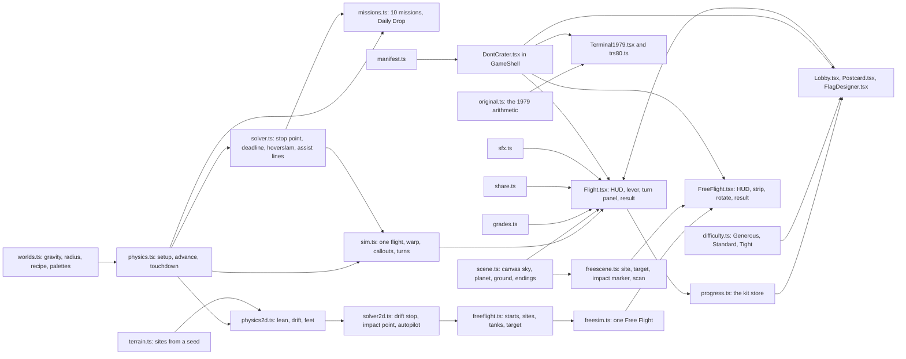
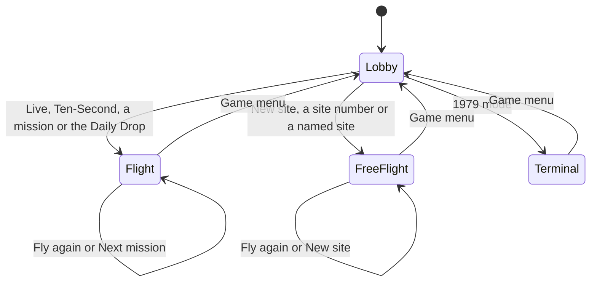
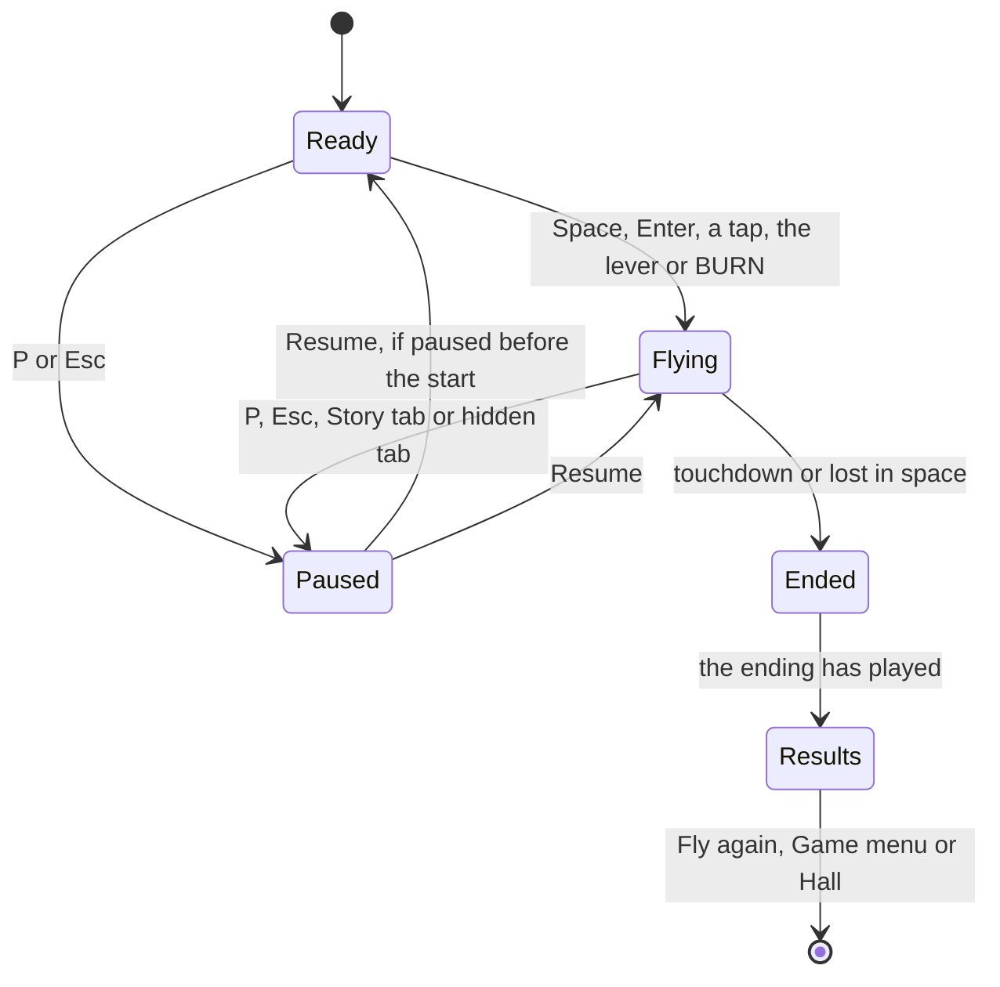
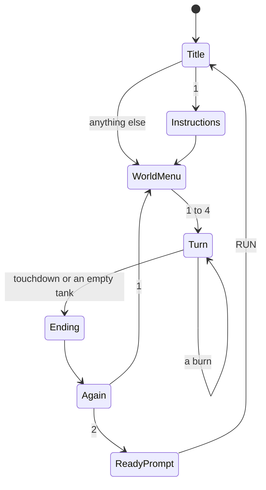

# Don't Crater: how the rebuild works

**Don't Crater** is the Any Key rebuild of *Lander* (Simutek, 1979, sold as *Space Landers*). The original is a 113-line TRS-80 game: fall towards one of four worlds at 5,000 km/h, type a burn rate every ten seconds, and touch down under 20 km/h. Don't Crater keeps that flight model and those worlds, and builds around them: a real-time throttle with time warp, a turn-based mode with a predicted path, a burn guide that teaches the "hoverslam", a landing assist, ten missions, a daily drop, a flag you design, a flight recorder that shows where you went wrong, a 1979 mode that plays exactly like the original, and **Free Flight**, where the lander leans, drifts and has to come down upright on rough ground.

In code, the rules live in `lib/lander/` as pure TypeScript with no DOM; one flight at a time is run by a small simulation class (`sim.ts`, `freesim.ts`) that the React screens step every frame; the scenes are drawn on a canvas by `scene.ts` and `freescene.ts`; and the game sits inside the collection's shell (`components/kit/GameShell.tsx`), which owns the top bar, the pause menu, the address and leaving.

What we kept from the original and what we changed is in [CHANGES-FROM-ORIGINAL.md](CHANGES-FROM-ORIGINAL.md). The original itself is in [ORIGINAL-ARCHITECTURE.md](ORIGINAL-ARCHITECTURE.md); the measurements behind every number here are in [NOTES.md](NOTES.md).

## Provenance

- No listing text, program code or picture data is reused. The flight equations and the world recipe are mathematics, re-derived from the analysis in ORIGINAL-ARCHITECTURE.md. All words on screen, including the 1979 mode's, were written for Don't Crater.
- The 1979 mode's sprites and ground are new drawings on a model of the same kind of screen.
- Graphics are drawn in code (canvas, SVG and CSS) and sounds are synthesised with the Web Audio API: no image or audio files. The flag's emblems are SVG paths, not emoji.
- Psyche's figures (surface gravity about 0.144 m/s², mean radius about 111 km) are public data.

## Module map



| Path | Job |
|---|---|
| `app/dont-crater/page.tsx` | The route `/dont-crater`: page metadata, and the six Story chapters loaded from `docs/lander/` by `lib/docs.ts` |
| `lib/lander/manifest.ts` | The game's contract with the collection: title, route, palette, accent, emblem, stats, modes, moons, trivia, the daily's epoch and the fifteen achievements with their tiers |
| `lib/lander/worlds.ts` | The four worlds: gravity, radius, the 1979 recipe for height, fuel and engine, a day and a night palette each, and a share glyph |
| `lib/lander/physics.ts` | Flight setup (entry speed, fuel factor, cargo), `advance()` in small steps, the exact touchdown moment, "lost in space" |
| `lib/lander/solver.ts` | Where a full burn would stop you, how long you can still fall before you must burn, the perfect hoverslam, the landing assist's lines and the final-approach advice |
| `lib/lander/grades.ts` | The ending for each impact speed, its stars, whether the flag goes up, and its share glyph |
| `lib/lander/missions.ts` | Ten missions and the Daily Drop generator |
| `lib/lander/difficulty.ts` | The fuel setting: Generous, Standard and Tight tanks for the straight-down modes |
| `lib/lander/original.ts` | 1979 mode: the original's turn arithmetic, endings and verdicts, quirks included |
| `lib/lander/flags.ts` | Flag shapes, patterns and colours, and `flagSvg`, one SVG builder for the page and the canvas |
| `lib/lander/emblems.ts` | The nineteen flag emblems as SVG paths, which achievement unlocks which, and `EMBLEM_FROM_EMOJI` for the save migration |
| `lib/lander/progress.ts` | What Don't Crater remembers in this browser: the kit store `anykey.lander.save`, its migrations, and the bridge to the Keyring and the stats |
| `lib/lander/share.ts` | The share texts for a descent and for a Free Flight |
| `lib/lander/format.ts` | How heights, speeds and distances are written on the instruments and cards |
| `lib/lander/sfx.ts` | Engine, callouts, touchdown, crashes, the oil gusher, the flag; for Free Flight the thrusters' hiss, the tip-over and the splash |
| `lib/lander/terrain.ts` | Free Flight sites: the ground built from a seed, `heightAt` and `slopeAt`, flats, boulders, barges |
| `lib/lander/physics2d.ts` | The 1979 model in two dimensions, the feet and the engine bell, and the standing rules |
| `lib/lander/solver2d.ts` | The stop point for a leaning lander, where the drift dies, where the path meets the ground, and an autopilot that knows the whole site |
| `lib/lander/freeflight.ts` | Starts, drift, tanks per difficulty, the six named sites, the target and the fairness planner |
| `components/dontcrater/DontCrater.tsx` | The game inside `GameShell`: which screen is showing (game menu, flight, Free Flight, 1979 mode), and the keys for the shortcuts sheet |
| `components/dontcrater/Lobby.tsx` | The game menu: hero, worlds, modes, fuel and helper switches, the Missions and Free Flight panels, keycaps, flight log, Forget my data |
| `components/dontcrater/Postcard.tsx` | The SVG travel postcards and `MiniLander`, which the Hall preview borrows |
| `components/dontcrater/FlagDesigner.tsx` | The flag designer and the inline waving `Flag` |
| `components/dontcrater/Flight.tsx`, `sim.ts`, `scene.ts`, `Recorder.tsx` | Live, Ten-Second, missions and the Daily Drop: the screen, one flight's simulation, the canvas, and the flight recorder |
| `components/dontcrater/FreeFlight.tsx`, `freesim.ts`, `freescene.ts`, `Recorder2D.tsx` | The same four parts for Free Flight |
| `components/dontcrater/Terminal1979.tsx`, `trs80.ts` | 1979 mode: the program as a sequential script, and the model of the 64 × 16 screen |
| `components/dontcrater/icons.tsx` | SVG icons for worlds, grades, modes, fuel settings and the helper buttons |
| `components/dontcrater/hooks.ts` | `useNight` (the dark theme is the night side) and `useReducedMotion` |
| `components/previews/DontCraterPreview.tsx` | The looping landing on the Hall card |
| `scripts/check-lander.ts` | Proves the numbers (see *Tests*) |

## State machines

The game menu and the three kinds of flight are screens inside `DontCrater.tsx`. A retry or a new site remounts the flight component with a fresh key, so every flight starts from a clean state.



`Flight.tsx` and `FreeFlight.tsx` share one set of phases. A flight can be paused before it starts, so `pausedFrom` remembers where Resume goes back to. In Ten-Second mode, "flying" alternates between waiting for a burn and playing a turn (`sim.turn`).



`Terminal1979.tsx` runs as an `async` script that waits on one answer at a time, like the BASIC program it copies:



## The engine

### The flight model

The equations are the original's (see ORIGINAL-ARCHITECTURE.md), including its unit slips, because they are what makes each world feel the way it does:

```text
acceleration = g × (1 − h / (2R)) − throttle × engine / (15000 + cargo + fuel)     km/h per second
height falls by speed / 3200 every second                                           km
fuel falls by throttle every second
```

Because of those slips the game's gravity is 77% of the real value (the Moon pulls at 4.5 km/h per second instead of 5.8, Earth at 27 instead of 35). All the balancing and every test use the 1979 figures; 1979 mode uses them too.

The engine acts at once: cut it and the push changes in the same instant, but the speed does not. A lander that full power has turned upwards keeps rising until gravity has used that speed up (18 seconds on the Moon from 80 km/h, 3 seconds on Earth), exactly like a ball thrown in the air. The HUD shows this directly: under the speed it says whether the speed is growing or shrinking and by how much ("faster · +4.5/s", "slower · −70/s"), and a chip beside a climbing lander says when and where the climb tops out ("rising · top in 18 s at 500 m").

`advance()` applies the equations in 20 ms steps, using the mass and the height in the middle of each step. When a step would go below the ground, it solves for the exact moment of contact and the impact speed.

A lander that climbs always comes back down, except in one case the 1979 gravity formula allows: above twice a world's radius its gravity turns negative. Only Psyche is small enough to get there (222 km), and a lander that climbs past that line is lost in space.

Missions and the Daily Drop change three things: the entry speed, the fuel load and extra cargo. The engine stays the world's own.

### The hoverslam, and everything built on it

The cheapest way down is to fall freely and then brake at full power so that the speed reaches zero exactly at the ground. `solver.ts` answers three questions with that idea:

- **Stop point:** if you went to full power now, at what height would you stop? If the answer is below the ground, you are already too late.
- **Burn deadline:** how many more seconds can you fall before the stop point reaches the ground? (Found by halving the interval 26 times.)
- **Perfect plan:** from the start of a flight, the coast time, the height to start braking and the fuel a perfect run keeps.

They drive:

| Feature | Uses |
|---|---|
| **Burn guide** | A dashed line on the screen at the stop point, labelled STOP POINT: green while safe, amber when close, red "CAN'T STOP" when too late. The HUD says "burn in 0:34", then "stops at 2.1 km" while braking, and "BURN NOW" |
| **Time warp** | Up to ×16 when nothing can happen soon; it slows so that at least about 4 real seconds remain before the burn deadline, is capped at ×8/×4/×2 while you brake, and drops to ×1 whenever it is too late to stop. The last 2.5 km are flown in real time (only a long hands-off drift, like a slow fall on Psyche, is sped up, gently), and **the last 30 m play at half speed**: twice the time to react, same physics. With an empty tank and a long way to fall, the ending is decided, so it fast-forwards at ×32 to ×128, as the 1979 game jumped straight to the fall. `T` turns warp off |
| **Final approach** | Below 60 m (or once you are slower than 40 km/h within 2 km) the lines squeeze together and speed is what matters, so the HUD gives a target speed that shrinks with height (about 32 km/h at 100 m, 8 at 20 m, 2 on the ground) and a throttle to brake with: "aim 9 km/h · brake (50%)", "aim 3 km/h · ease off (0%)", or the target with a tick when you are on it. The brake figure is rounded to tens for the number keys, or to whole percent on Psyche, where hovering takes under 1% |
| **Coaching** | Full power far too early (the stop point more than 30% of your height above the ground) gets a "Too early! You'd stop 136 km up. Fall first." callout, an amber "STOP · TOO HIGH" line and "too early" in the HUD. Climbing under power gets "You're going up! Ease off" |
| **Ten-Second prediction** | The next turn's path is drawn as dots with a ghost lander, plus "Full burn after that stops you 18 km up" or a touchdown speed |
| **Flight recorder** | Your height against the perfect plan (dashed) on a log scale, with your throttle as a strip underneath |
| **Key insight** | For example "You started braking at 212 km. Waiting until 86 km and then burning flat out would have saved 9% of the tank" |
| **Hoverslam keycap** | Land with at least 90% of the fuel a perfect run keeps |

### Modes

| Mode | What it is |
|---|---|
| **Live** | Real time on the chosen world. Hold `Space` or BURN for full power; `↑`/`↓` (with `Shift` for 1%), `0`–`9`, `F` and `X` set the lever; drag the lever with mouse or finger. `A` switches the landing assist |
| **Ten-Second** | The original rhythm: set a burn with the slider or arrows, see where it takes you, press `Enter` to play ten seconds (`FlightSim.startTurn`, played out over 1.4 to 3.4 real seconds) |
| **Missions** | Ten landings in order, each unlocking the next, with stars from the landing grade |
| **Daily Drop** | A world, entry speed, fuel load and cargo chosen from the date, the same for everyone. The first flight of the day is recorded and can be shared |
| **1979 mode** | The original, turn for turn, on a model of a 1979 block-graphics screen |
| **Free Flight** | Tilt, drift, and land upright on a planned site among rocks, on any world, from 3 km up or from orbit height (see *Free Flight*) |

The full key list for players is in [HOW-TO-PLAY.md](HOW-TO-PLAY.md#controls).

### Missions

| # | Name | World | Twist | Perfect run keeps |
|---|---|---|---|---|
| 1 | First Contact | Moon | none | 18.0% |
| 2 | Red Planet | Mars | none | 29.0% |
| 3 | Metal World | Psyche | none | 10.3% |
| 4 | Homecoming | Earth | none | 24.6% |
| 5 | Cargo Run | Moon | +3 t cargo | 8.5% |
| 6 | Running on Fumes | Mars | 75% fuel | 19.0% |
| 7 | Hot Entry | Moon | 5,800 km/h entry | 9.8% |
| 8 | Instruments Out | Mars | no guide or assist; no speed readout above 40 km | 29.0% |
| 9 | Needle | Psyche | must land under 5 km/h | 10.3% |
| 10 | Express Delivery | Earth | 5,600 km/h entry, no guide or assist | 23.3% |

A mission is cleared by a landing under its limit (20 km/h, or `clearBelow`); the stars are the landing grade's. Clearing one unlocks the next in `Lobby.tsx`.

### The Daily Drop

`dailyDrop()` numbers the day with the kit's `dailyDate()` (`lib/kit/daily.ts`), using the collection epoch 2026-01-01 from the manifest, so 7 October 2026 is #280. The day index seeds `mulberry32` from `lib/kit/rng.ts`, which proposes a world, an entry speed (4,200–6,000 km/h), a fuel load (86–112%) and up to 6 t of cargo. A proposal is only used if a perfect hoverslam still keeps at least 6% of the tank; after 40 failed proposals the day falls back to the world's standard flight. The first flight of the day is stored under the local date key in `progress.daily`, with its speed, grade and share text.

The share text (`descentShare` in `lib/lander/share.ts`) has three lines: a title line ("Don't Crater · Daily Drop #280", or the mode and world for other flights); the world's glyph and name, the grade's glyph and the touchdown speed, a fuel pump and the fuel left, then a mark for a non-Standard fuel setting and one for the landing assist; and eight squares, each an eighth of the flight (coasting below 8% throttle, a partial burn below 65%, full power above), closed by the grade's glyph. The glyphs are coloured squares and emoji meant for chat apps; they live in the `shareGlyph` fields of `worlds.ts`, `grades.ts` and `difficulty.ts` and appear only in share texts. The page draws its own SVG icons (`icons.tsx`).

### Fuel difficulty

One setting on the game menu, for every mode but 1979 mode (which keeps the original's numbers exactly): **Generous** (30% more fuel), **Standard** (the tank every mode was balanced on) or **Tight**. In the straight-down modes Tight trims the tank until a perfect hoverslam keeps about 7% of it, never below 60% of the Standard tank; Free Flight has its own table (below). The setting is remembered, shown on the ready card, and marked in share texts, so Daily Drop results stay comparable at the same setting.

| World (Live, Ten-Second) | Standard tank | Tight | A perfect run then keeps | Generous |
|---|---|---|---|---|
| Moon | 11,660 | 9,375 (80%) | 7.0% | 15,158 |
| Mars | 17,710 | 10,626 (60%) | 8.7% | 23,023 |
| Psyche | 10,000 | 9,419 (94%) | 7.0% | 13,000 |
| Earth | 28,655 | 17,193 (60%) | 11.7% | 37,252 |

### 1979 mode

- `trs80.ts` models a 64 × 16 character screen whose codes 128–191 are 2 × 3 pixel blocks, with the old cursor codes for drawing sprites, pixel `set`/`reset`, 32-column big letters, and a canvas renderer with a slightly blue-white phosphor glow.
- `Terminal1979.tsx` runs the game as a short sequential script, like the BASIC original: print, wait for a number, work out a turn, redraw. It uses `original.ts` for the arithmetic. A hidden text field takes the typing (so phones raise their number keyboard), and an on-screen keypad does the same for touch.
- Kept on purpose: the ten-second turns, fractional burns, the shortened last turn, refusing burns outside 0–100, `?REDO` for text, ENTER alone repeating the last burn, the ground redrawn at 100, 50, 25, 10 and 1 km, the lander stepping down through the last kilometre, dust near the ground, the wreck with rising sparks, the explosion, the flag at 5 km/h or less, the **19-to-20 km/h mix-up**, the **clock that never resets**, and oil at 5,000 km/h.
- New: the words, the sprites, the ground (generated once per run, like the original's random rubble), shorter animations, a `READY` prompt that restarts on `RUN`, and a keypad for touch screens. The full list is under *Faithful modes* in CHANGES-FROM-ORIGINAL.md.

## Free Flight

"Tilt, drift, and find flat ground." In Free Flight the lander leans left and right, arrives with a sideways drift, and has to come down upright on ground flat enough to stand on, among boulders, crater walls, canyon ledges, dunes and metal crags. Live, Ten-Second, Missions, Daily Drop and 1979 mode are unchanged.

### How it plays

- **Two starts.** *Final approach*: 3 km above the ground, falling at 150 km/h (Mars 180, Psyche 100, Earth 250) with 40–140 km/h of drift; a round lasts a minute or two. *Full descent*: the world's usual height and 5,000 km/h, with 300–650 km/h of drift. The start is placed so that the drift carries you to the site while you fall: kill it during the main burn and you come down near the middle.
- **Sites.** *New site* builds one from a random number (1 to 99,999), shown on screen and in the share text; typing a number (up to 999,999) flies the same site again. Six **named sites** unlock in order, one star opening the next:

| Site | World | What it is |
|---|---|---|
| The Marbles | Moon | A boulder field; the clearings are few and none is big |
| Night Rim | Moon | A big crater, always by Earthshine; a flat floor and a bench on the outer flank |
| The Brink | Mars | A canyon edge: a plateau, a narrow ledge halfway down the wall, and the floor 300 m below |
| Blue Hour Dunes | Mars | Dunes, always at dusk; only the sand between them is level |
| Iron Crags | Psyche | Metal spires with a few narrow shelves |
| Barge Row | Earth | Barges on the swell, one of them drifting |

  Night Rim and Blue Hour Dunes keep their hour whatever the page theme; everywhere else the light theme is the day side and the dark theme the night side, as in the other modes.
- **The target.** Every flight has a planned landing site, marked **LAND HERE**: one of the site's flats that the all-knowing autopilot has already landed on with the fuel on board (see *How we know it's fair*). Standing on it earns the landing's stars (Butter three, Smooth two, Bumpy one). Any other flat saves you too, but a diversion earns one star at most, and the card says how far off you came down.
- **Precision.** Standing on a flat narrower than 20 m, or within 1.5 m (or 8% of its width) of its centre, earns a bonus shown on the card: "Butter · 14 m ledge · dead centre". Named sites keep the best stars and both bonuses.

### The model in two dimensions

The 1979 equations gain a lean (`tilt`, degrees, positive = nose to the right, at most ±75°), a sideways speed `vx` (km/h) and a position `x` (km). The engine pushes along the lander's axis:

```text
vertical:   speed changes by   gravity − throttle × engine / mass × cos(tilt)     km/h per second
sideways:   vx changes by      throttle × engine / mass × sin(tilt)               km/h per second
height falls by speed / 3200 km every second; x moves by vx / 3200 km every second
```

Both axes use the program's own km/h → km/s conversion (3200, not 3600), so a kilometre sideways and a kilometre of height are the same distance on screen and in the physics. There is no air drag, as in the original. Rotation is the reaction-control system: 60°/s (20°/s with `Shift`), no fuel, and the lean holds when you let go; `U` levels the lander in about half a second (0.6 s from 75°, 0.5 s from 40°). Leaning costs nothing, but pushing sideways does: every km/h of drift you kill or build comes out of the same tank as the braking.

`physics2d.ts` steps this in 20 ms slices exactly like `advance()`, with the lean taken at the middle of each slice. Held upright over flat ground it *is* `advance()`: `check-lander.ts` flies twelve flights on all four worlds through coasts, burns and empty tanks, and the heights, speeds, fuel and touchdowns agree to 4.5 × 10⁻¹³.

### Sites

`terrain.ts` builds a site from a seed: about ±4 km of ground around the start, rising into ridges (or, on Earth, open sea) beyond. `heightAt(site, x)` and `slopeAt(site, x)` are the one source of truth for the physics, the drawing and the tests.

- The rough ground is a zigzag of straight pieces never gentler than 9° (up to 35°, steeper on canyon walls), laid over a landform: a boulder field, a big crater, a canyon edge with a bench, dunes, or metal crags. Boulders of 1–6 m sit on it, often a pair guarding the edges of a flat.
- Hidden in it are 3 to 6 **flats**, 12 to 60 m wide, sloping 4° or less, on natural ledges, crater floors and clearings. On Earth the site is open sea with 2–4 barges of 16–60 m that rock on the swell; one may drift.
- A footpad feels the steepest piece of ground within 0.6 m of it, so the bottom of a V can't pass for flat.
- High up, the planet is the usual fractal one; within a few kilometres of the site the site's own ground takes over, blended so nothing pops.

### Standing, tipping, splashing

The feet are 4 m either side of the centre; contact is the first foot (or the engine bell, so a rock under the belly counts) to reach the ground. The lander **stands** when the ground under both feet slopes 8° or less, its lean is within 10° of the ground's slope, it slides at 6 km/h or less (relative to a drifting barge), and the vertical speed is a landing on the usual scale. Otherwise it **tips over**, or on Earth falls into the sea. Hit hard enough and it is the usual crash, judged on the combined speed: a fast landing on a slope is still a crater. The card says why it tipped: "41° slope under the left foot", "leaning 14° off the ground", "still sliding at 9 km/h", "a rock under the engine".

### Seeing where you're going

- **Camera.** The log-altitude zoom still sets the scale vertically. Sideways the view follows the lander and looks a little ahead towards where it will come down; low down it widens to at least ±2 × your height and never less than ±150 m (±70 m on a phone). Close in, the lander is drawn at its true size (feet 8 m apart), so you can see whether it fits. After touchdown the view closes in: tight for a tip-over or a splash, wider for a flag, so the rough valley stays around it.
- **The ground.** Facets turned to the light catch it, the others fall into shade; a bright rim runs along the lit edges by day, a faint one by Earthshine or starlight at night. Flats have no shading at all, which is what makes them look calm. Behind the landing line, two hazy layers of hills (mesas on Mars, crags on Psyche) move slower than the ground, so the valley reads around you; nothing in them can be landed on. The ground is textured with pebbles and small craters fixed to the world, so they slide and zoom with it.
- **The target** is a gold bracket along its flat with a dashed beam and "LAND HERE" above it; off screen, a pill at the edge of the view points to it with the distance. The beam fades as you come in low over it.
- **The impact marker** is a bracket as wide as the lander's feet, on the ground where the current path meets it at the current throttle and tilt, with faint dots along the path. It is recomputed every frame.
- **The terrain strip** across the top is the whole site in profile: your position with a drift arrow, the target as a gold flag, where the path meets the ground, and while you brake against the drift a green tick where it will die. Off the site it says how far away it is.
- **Scan assist** (`S`, remembered on the game menu, off by default) shades the ground within 1.5 km of the lander green (4° or less), amber (4–8°) or red (steeper); a column wider than a couple of metres shows the gentlest ground in it, so flats show from higher up. With the scan on, the impact marker takes the scan's colour. A flight flown with it is marked with a satellite in the share text and on the recorder.
- **The HUD** adds the drift (with an arrow for its direction, coloured like the speed near the ground) with "stops in 0.9 km" while you push against it, and the tilt in degrees, or "upright". The burn guide and the landing assist work as in Live, on the vertical part of the thrust at your current lean; when the lean is too great to brake, the guide says "level up to brake (U)". In the last 60 m a second advice line handles the sideways part: "aim 0 sideways · tilt 5° left", then "stand up (U)" once the drift is gone.
- **Time warp** follows Live's rules, and also stays at ×1 while you rotate low down, under 2.5 km while the drift is over 15 km/h, and whenever the path is heading for steep ground with less than 10 s to go ("Rough ground ahead!").

| Input | Action |
|---|---|
| `←` / `→` (+ `Shift`) | Rotate (fine) |
| `U` | Level the lander |
| `Space`, `↑`/`↓`, `0`–`9`, `F`, `X` | Throttle, as in Live |
| `S`, `A`, `G`, `T` | Scan assist, landing assist, burn guide, time warp |
| `P`, `R`, `N` | Pause, fly again, new site (after a flight) |
| Touch | Two rotate buttons bottom left (both at once levels), the lever and BURN bottom right |

### The result and the recorder

The card gives the ending, the landing in words ("Butter · 34 m clearing · dead centre"), *On target* or *Diverted* with the distance, the reasons for a tip-over, the impact and sideways speeds, the fuel left, stars and bonuses, and a two-part flight recorder (`Recorder2D.tsx`): your height over time and your distance from the target over time, each against the autopilot's flight (which knows every rock), with your throttle and tilt as strips underneath.

### Fuel, and how we know it's fair

**Tanks.** Free Flight has its own tanks, one per start, world and fuel setting (`TANK` and `TIGHT_TANK` in `freeflight.ts`):

| Start | Setting | Moon | Mars | Psyche | Earth |
|---|---|---|---|---|---|
| Final approach (fuel units) | Generous | 2,600 | 3,640 | 1,625 | 7,020 |
| | Standard | 2,000 | 2,800 | 1,250 | 5,400 |
| | Tight | 1,350 | 2,100 | 780 | 3,800 |
| Full descent (× the world's own tank) | Generous | 1.43 | 1.30 | 1.56 | 1.30 |
| | Standard | 1.10 | 1.00 | 1.20 | 1.00 |
| | Tight | 0.99 | 0.85 | 1.09 | 0.91 |

**The budget case.** An autopilot that knows the whole site (`solver2d.ts`) is the perfect pilot. High up it falls freely, nudges its drift early (cheap), then brakes at full power pushing straight against its motion, so the fall and the drift die together; low down it flies to the flat at a safe height above the rocks and comes straight down. The budget case is the largest drift (140 km/h on the final approach, 650 km/h on the full descent), then 1 km (final approach) or 3 km (full descent) sideways to flat ground. Tight is set by it: there the perfect pilot keeps about 8% of the tank in the budget case.

| Start | World | Perfect pilot uses (from the Standard tank) | A tank of this leaves exactly 8% | Standard: perfect pilot keeps |
|---|---|---|---|---|
| Final approach | Moon | 1,200 | 1,304 | 40% |
| | Mars | 1,834 | 1,994 | 35% |
| | Psyche | 695 | 756 | 44% |
| | Earth | 3,213 | 3,492 | 41% |
| Full descent | Moon | 10,557 | 11,475 | 18% |
| | Mars | 13,715 | 14,908 | 23% |
| | Psyche | 9,946 | 10,811 | 17% |
| | Earth | 23,817 | 25,888 | 17% |

The Tight tanks are these budgets, rounded up. Standard gives a person room to steer and to change their mind: the slow human pilot below lands on its target with about half the tank left on the final approach, and about a fifth on the full descent.

**Every site is checked before you fly it.** The autopilot must land on one of the site's flats with fuel to spare: 20% of the tank on the final approach, 8% on the full descent. The larger margin on the final approach is there because a person steers less efficiently than the autopilot: with only 8% to spare, the slow human pilot below landed a few Tight final approaches with an empty tank. Flats near where the drift naturally takes you come first, and very narrow ones count as further away. The flat it lands on becomes your target. If it can't land anywhere, the next seed in a fixed sequence is tried, the way the Daily Drop skips unfair days, so a number always gives the same site. On a named site only the start and the drift are tried again: its ground never changes. Over seeds 1–1,000 on every world and both starts, every site at Standard was fair at once, and the autopilot's slimmest landing kept 26–32% of the tank on the final approach and 11–16% on the full descent. At Tight the margin bites on the final approach: 122 Moon, 175 Mars, 44 Psyche and 251 Earth seeds (of 1,000 each) were re-rolled, never more than four times, and every full-descent site was fair at once. Building a site takes a few milliseconds, at most about a third of a second at Tight. The six named sites are fair at every setting: across their 36 combinations of start and setting, the planner had to try a different start only twice.

## AI

Don't Crater has no opponents. Its "AI" is the planning code that helps the player and proves the game fair.

### The landing assist

A switch on the game menu (and `A` in flight) turns on two lines to fly by, for pilots who want to land by eye (`landingLines` in `solver.ts`):

- **The green line (under 5 km/h):** the lowest point the lander can be at right now and still come down at 5 km/h or less, braking at a planned 85% (so 15% is left for corrections). It aims at 4 km/h and adds the distance covered in one second of reaction time (seeing the line and pressing a key), as long as the lander is faster than that. Keep the lander above it and you can plant your flag. Its label carries a small drawn flag.
- **The amber line (20 km/h limit):** the lowest point from which even full power gets you down at 20 km/h. Below it you will crash, whatever you do.
- The band between them is tinted: you can still walk away from there, but only by braking harder than planned. Lines above the top of the view are pinned there with an arrow.

Both lines depend on the current speed and fuel, so they move: while you coast they rise towards you, and while you brake they sink with you. The distances are worked out by simulating the braking with the game's own physics, in two passes so that gravity follows the height along the way.

Why not two lines that are both "where to start braking"? Because at a strong burn the difference between a 5 and a 20 km/h touchdown is about one metre of height: the lines would sit on top of each other. Comparing a comfortable plan (green) with the absolute limit (amber) gives lines that are far enough apart to fly between: on the Moon at 80 km/h, 29 m and 13 m.

The HUD turns the lines into advice: "above the green line · coast", "on the green line · brake ~85%", "under the green line · brake harder", "below the amber line · full power!", and in the final approach the target-speed advice described under *The hoverslam*. Below 2 km a chip beside the lander shows what holding the current throttle would do: "→ 3.2 km/h" or "→ stops 25 m up" (`holdOutcome`). While the assist is on, its lines replace the stop point, and a flight flown with it is marked with a lifebuoy in the share text.

### The Free Flight autopilot and the fairness planner

`autopilot()` in `solver2d.ts` flies a whole site knowing every rock: coast, nudge the drift early, brake against the motion so fall and drift die together, then hop to the flat at a safe height and come straight down. `flyAutopilot()` runs it to the ground. `planLanding()` in `freeflight.ts` tries the four most promising flats with it and keeps the first that it lands on with the required margin; `freeFlight()` steps through a fixed seed sequence (at most 24 tries) until one works. The same autopilot draws the dashed "Autopilot" line on the Free Flight recorder, and a development-only hook (`window.__freeFlight`, `NODE_ENV === "development"` only) lets headless-browser runs fly the real screen with it.

### Test pilots

`scripts/check-lander.ts` flies the real `FlightSim` and `FreeSim` with simulated people: a pilot who sees the screen 0.8 s late, sets whole-number throttles and, in Free Flight, holds or taps the rotate keys. How they fly and what they score is under *Tests* and in [NOTES.md](NOTES.md#simulations).

## Drawing

### Drawing the descent

`scene.ts` draws every frame on a canvas.

- **The camera.** The gap between the lander and the ground on screen is proportional to the logarithm of the altitude, so each tenfold drop in height takes the same slice of the screen. Each frame is drawn at one uniform scale (km per pixel) that produces that gap, so the whole world zooms in smoothly as you fall: a continuous version of the original's six-stage redraw. The lander keeps a readable size at every scale.
- **The planet** is drawn as a circle seen from above, sampled across the screen (or all the way round for small Psyche). High up, big worlds are drawn a little rounder so the horizon curves visibly.
- **The ground** is fractal: value noise plus craters at every scale from hundreds of kilometres down to a metre. Octaves fade in as they grow larger than a few pixels. Big features are relatively flatter than small ones, and relief is exaggerated high up so mountains read from orbit. Around the landing spot the ground is levelled, with beacons marking the pad. Earth is different: open sea, with a landing barge in hazard stripes.
- **The sky** fades from black space into each world's air (Earth, Mars), with stars, the Sun, the Milky Way on airless nights, Earth hanging over the Moon, the Moon over Earth at night, and distant ridges on the horizon when you are low.
- **Theme = time of day.** The page's light theme is the day side of each world, the dark theme the night side: Earth with coastal lights and moonlit sea, Mars at dusk with its famous **blue sunset**, the Moon lit by Earthshine, Psyche under the Milky Way. Switching theme mid-flight cross-fades the palettes (`nightMix`). The palettes are the `palette.day` and `palette.night` objects in `worlds.ts`: change a world's look there.
- **Particles:** engine exhaust, dust blown off the ground in the last 60 m, and for endings debris, confetti, sparks, smoke and oil.
- **Labels on the canvas** (STOP POINT, the assist lines, the climb chip, the hold-throttle chip) are drawn in `scene.ts` as pills; Free Flight's target, impact marker and scan are in `freescene.ts`, which extends `Scene`.

### Endings

| Speed | Ending | What you see |
|---|---|---|
| under 2 km/h | **Butter**, three stars | A soft bounce, a shine ring, the astronaut climbs down and plants your flag |
| 2–5 | **Smooth**, two stars | The astronaut plants your flag |
| 5–20 | **Bumpy**, one star | A bounce and a slight lean |
| 20–45 | **Dented** | Legs buckle, sparks and smoke rise from the wreck (like the original's rising pixels), the astronaut waves from beside it |
| 45–100 | **Scrap** | Flash, fireball, debris; the pilot's escape capsule shoots off |
| 100–250 | **Confetti** | The lander bursts into colourful pieces |
| 250–5,000 | **New crater** | A shockwave, a crater carved into the ground |
| 5,000 and up | **Oil** | A crater, and a gusher of oil. "…on the Moon. Geologists have questions." |
| climbing away | **Lost in space** | The lander leaves the top of the screen |
| Free Flight: down softly, but on a slope, leaning or sliding | **Tipped** | It stands a moment, then rolls slowly downhill over one foot, the legs fold, dust puffs up, the camera leans with it, and the astronaut climbs out and shrugs |
| Free Flight, Earth: into the water | **Splash** | A splash; the lander bobs, half under, and a sad little flag goes up |

The first moments after contact run in slow motion, the camera shakes on hard impacts, and the result card slides in once the ending has played (0.7 s with reduced motion, up to 4.3 s for a flag landing).

### Look and feel: "Postcards from the Descent"

- The game menu leads with a mission poster (a condensed wordmark, orbit lines, stars) and a big travel postcard of the chosen world, which changes with the theme like the game itself.
- The four worlds are travel postcards ("Visit Mars") drawn in SVG in `Postcard.tsx`, with the lander drifting down onto each.
- Instruments are glass panels that follow the page theme; the throttle lever and the BURN button are orange. The styles are in `Flight.module.css`, `FreeFlight.module.css` and `Lobby.module.css`.
- Icons for worlds, grades, modes, fuel settings and the helper buttons are SVG components in `icons.tsx`; none are emoji.
- On phones the instruments shrink to a compact panel at the top left, the lever and BURN button sit at the bottom right, and the result card becomes a bottom sheet.
- The flight pauses itself when the tab is hidden. With reduced motion, shake, slow motion, particles and the flag's waving are turned off or down.

### Your flag

The flag designer offers three shapes, eight patterns, three colours from twelve, and an emblem. The emblems (`emblems.ts`) are single-colour SVG paths on a 24 × 24 grid, with holes cut by the even-odd rule, so they print cleanly on any cloth colour. Thirteen are open from the start; six are earned with achievements: Butter (Butter), Oil barrel (Wildcatter), Crater (Crater Maker), 1979 computer (Time Traveller), Cat in a box (Schrödinger's Lander) and Trophy (Mission Control). `flagSvg()` in `flags.ts` builds the whole flag as one SVG document: the page inlines it, and the canvas loads it as an image and draws it in thin vertical slices that wave independently. The emblem's ink is picked with the kit's `readableOn` so it reads on the colour under it.

## Sound

Everything is synthesised in `sfx.ts`: the engine is warm noise through a filter that opens with the throttle, over a low hum; altitude callouts are double beeps; warnings are square-wave blips; touchdowns thump (with a little fanfare for flag landings); crashes are noise bursts and falling tones; the oil gusher gurgles. In Free Flight the reaction-control thrusters hiss while you rotate, a tip-over creaks and then scrapes and rattles as the legs fold, and the sea splashes and gurgles. All of it plays through the collection's effects bus (`effectsBus` in `lib/kit/sound.ts`), which holds the limiter and follows the mute button and the volume in Settings. To change a sound, change its function in `sfx.ts`; every sound is one function.

## Kit integration

- **Manifest.** `lib/lander/manifest.ts` is everything the collection knows about the game. `lib/catalog.ts` lists it; the Hall reads its title, tagline, blurb, palette, accent, emblem, stats, modes, moons (the four worlds and six missions, for the Orbit hall) and the four trivia lines. The Wall card's animation is `components/previews/DontCraterPreview.tsx`, chosen in `components/previews/ProgramPreview.tsx`.
- **The shell.** `DontCrater.tsx` renders inside `components/kit/GameShell.tsx`, which draws the top bar (Back to the Hall, the title and inspired-by line, Play and Story, Pause with its `Esc` hint, Keyring, sound and appearance) and keeps the address: the game menu is `/dont-crater`, a flight is `#play`, the Story is `#story`. Browser Back steps from a flight to the game menu to the Hall. The shell owns `Esc`, `K`, `?` and the leave question; the game passes its extra keys for the shortcuts sheet.
- **Play screens.** `Flight.tsx`, `FreeFlight.tsx` and `Terminal1979.tsx` call `usePlayScreen` every render with what is on screen (play or results), whether it is paused, how to pause and resume, the pause item "Restart flight" (`R`; 1979 mode has none), whether leaving would lose progress (a flight that has started and not ended; always in 1979 mode) and how to go back to the game menu. The shell then shows the standard pause menu (Resume · Restart flight · How to play · Settings · Game menu · Back to the Hall), asks "Leave this flight?" before throwing a flight away, and pauses the flight when the Story tab opens. How to play opens this folder's HOW-TO-PLAY.md over the pause menu.
- **Results.** Don't Crater draws its own result card, with the standard row Fly again (`R`) · Game menu (`Esc`) · Back to the Hall (`H`), and its extras (Next mission or New site, and the kit's `ShareButton`) in a row above.
- **Progress and saves.** `progress.ts` keeps one kit store (`createStore` in `lib/kit/save.ts`) under `anykey.lander.save`, at version 3. Version 2 moved the achievements out of the save and into the Keyring. Version 3 turned the old emoji flag emblems into the SVG emblem ids, through `EMBLEM_FROM_EMOJI`. On a first visit after the retrofit, the store reads the pre-kit save `anykey.dontcrater.v1` once and migrates it; it never writes or deletes that key, so an older build still finds it. Missing fields take their defaults, so older saves load unchanged.
- **Achievements and dailies.** `createProgress` (`lib/kit/progress.ts`) wraps the store. The game's update functions still add achievement ids to `achievements` and date keys to `daily`, as they always did; the bridge unlocks new ids in the Keyring (`unlock` in `lib/kit/achievements.ts`) and marks a new daily date as done (`completeDailyOn` in `lib/kit/keyring.ts`). The Keyring at `/keyring` is the single source of truth for unlocks and dailies: the game sees its keycaps merged back into its progress. A finished flight calls `holdAnnouncements()` before updating progress, so the unlock toasts wait until the result card appears (or the flight is left) instead of landing on top of the ending.
- **Stats.** Each finished flight (the flight counter going up) is recorded with `recordPlay` (`lib/kit/stats.ts`), won if it was a landing; the old flight and landing counters seeded the stats once.
- **Forget my data.** `resetProgress()` calls the kit's `forgetGame("lander")`, which deletes the save, the legacy key, the game's keycaps and dailies in the Keyring and its stats, and then writes the flag back: the design survives a reset.
- **Daily numbering and randomness.** `dailyDate()` and the collection epoch from `lib/kit/daily.ts`; `mulberry32` from `lib/kit/rng.ts` for the Daily Drop, the Free Flight sites and starts, and the 1979 ground.
- **Preferences.** Sound on or off comes from the kit's `usePrefs()`; the theme from the `data-theme` attribute the kit sets on the page.

## Tests

```text
npm run check:lander          (or: npx tsx scripts/check-lander.ts; add --full for every Free Flight site)
npm test                      (vitest: the unit tests in tests/unit/)
```

`scripts/check-lander.ts` proves the numbers. A plain run takes about 12 minutes. The figures below are from the run of 7 October 2026; [NOTES.md](NOTES.md#simulations) has the full output and the tolerances.

- **Physics against exact formulas:** free fall matches `v = v0 + g·t` and `h = h0 − (v0·t + ½g·t²)/3200`; the touchdown time and speed match the exact solution; a full tank burnt with gravity switched off gives exactly the rocket-equation change of speed, `engine × ln(full mass / empty mass)`; the hover throttle holds the speed; and halving the step size moves a 300-second flight by less than a millimetre.
- **Human pilots:** the real `FlightSim`, stepped at 60 frames a second with its time warp, flown by a pilot who sees everything **0.8 s late**, uses whole-number throttle settings and does only what the screen shows. It survives on every world three ways: with the landing assist (Moon 4.8, Mars 6.3, Psyche 2.5, Earth 11.4 km/h), with only the burn guide (4.0, 2.0, 2.0, 14.0), and with no helpers at all, as an experienced pilot who knows the lines by heart. It clears all ten missions, and lands on Daily Drops every 30 days across the year (26 flights, slowest 13.8 km/h). Mission 8 originally hid the speedometer down to 1 km; this test showed that no human strategy could win it (the speed only appears when it is already too late to brake), so it now stays dark above 40 km only. This test was added after a player found the Moon unwinnable: the earlier checks used pilots with instant reactions, and missed that the final approach was too quick for people (time warp in the last kilometres, and advice that made you bounce).
- **Ten-Second and 1979 modes with whole-number burns:** a pilot choosing burns only from the prediction panel lands under 5 km/h on the Moon, Mars and Psyche; a searched whole-burn flight lands on Earth at under 2 km/h. In 1979 mode, whole-burn flights land on all four worlds (Earth and Mars almost perfectly, the Moon at 3.2 km/h, the asteroid at 0.07).
- **Landing assist:** on every world and every mission that allows it, a pilot who only keeps the lander just above the green line lands under 5 km/h (Moon 2.4, Mars 1.2, Psyche 1.8, Earth 1.5 km/h) with almost as much fuel as a perfect run. From five different speeds, a full burn started exactly on the amber line lands at 20 km/h (the line is right to within 0.05% of the braking distance), and one started 2% lower lands faster than 20.
- **Full power from the start:** on every world the lander stops far too high (136 km on the Moon, 231 on Mars, 375 on Earth, 100 on Psyche), climbs, runs dry and falls back. The simulated fall agrees within 4% with the 1979 program's one-step shortcut for the same flight (Moon 2,807 vs 2,884 km/h, Mars 6,678 vs 6,783, Earth 12,811 vs 12,849). Psyche's lander climbs past 222 km and is lost.
- **1979 arithmetic:** the starting numbers for every world, oil for a flight without burns on every world, a known perfect Earth landing, the clock carrying over, refused burns, and the verdict cut-offs (19.5 km/h gives a wreck and a landing; the flag stops above 5 km/h; explosions start above 45).
- **Worlds:** a perfect hoverslam keeps over 8% of the tank on each world, and a simple autopilot flying the game's own physics lands under 2 km/h on each.
- **Missions:** each keeps at least 5% of the tank in a perfect run, and the autopilot clears each one.
- **Daily Drop:** every day of 2026 is fair (at least 6% to spare; the slimmest day keeps 6.3%), every day repeats exactly, all four worlds appear, and the autopilot lands a sample of 53 days.
- **Fuel difficulty:** every straight-down mode at Generous and Tight, flown by the same slow human pilots (see the table below).
- **Grades:** every speed band boundary.
- **Free Flight:** upright flights match `advance()`; the sideways rocket equation; rotation rates; terrain determinism and flat counts; the touchdown rules on both sides of each boundary; the fuel budget; fairness of seeds 1–1,000 at Standard and Tight; the named sites at every setting; and slow human pilots on every named site and a sample of random sites.

`check-lander.ts` flies every straight-down mode at Generous and Tight with the same slow human pilots as at Standard: all four worlds with the landing assist, the burn guide and no helpers; all ten missions (on Instruments Out the pilot remembers where to brake from Red Planet at the same setting); a Daily Drop every 45 days; and Ten-Second mode on every world, planned turn by turn from the prediction panel with whole-number burns. All of them land. Touchdown speeds, km/h:

| | Moon | Mars | Psyche | Earth | Missions (slowest) | Daily Drops (slowest) | Ten-Second (Moon, Mars, Psyche, Earth) |
|---|---|---|---|---|---|---|---|
| Generous: assist · guide · no helpers | 3.1 · 2.7 · 3.1 | 7.3 · 3.8 · 7.3 | 2.1 · 2.9 · 2.1 | 5.4 · 13.8 · 5.4 | 13.8 | 13.7 | 0.1 · 2.9 · 2.8 · 4.1 |
| Tight: assist · guide · no helpers | 2.2 · 4.3 · 2.2 | 5.8 · 4.0 · 5.8 | 1.9 · 2.1 · 1.9 | 12.5 · 12.4 · 12.5 | 12.6 | 14.0 | 4.4 · 9.0 · 1.2 · 4.7 |

Two things this testing changed. The old Ten-Second test pilot, which picks the smallest safe burn each turn, turned out to be erratic (it crashed on Mars with 28% of the tank spare), so the difficulty tests plan the turns from the prediction panel instead, as a patient player would. And on Instruments Out the "no helpers" pilot now remembers where to brake from Red Planet *at the same fuel setting*: a Generous tank makes the lander heavier, so the braking starts higher.

**Free Flight human pilots.** `check-lander.ts` flies the real `FreeSim` at 60 frames a second with its time warp, with a pilot who sees the screen 0.8 s late, sets only whole-number throttle settings, holds or taps the rotate keys like a person (knowing how long they held them), and flies to the target shown on screen, judging the rocks on the way only within the view. Weak gravity asks for a different touch than strong gravity, and the pilot knows it: high up it leans far over (up to 60°, 65° on Psyche) and pushes sideways only as hard as it can while holding its height, instead of shooting upwards, and where gravity is strong it stays near upright while coasting, since the next burn will be mostly upwards; on Earth it holds a steady throttle near hover and makes small changes; everywhere it holds its height until it is centred over the target with the drift killed (in the last 50 m on the Moon and Psyche, where a lander falls slowly, until what drift is left can't carry it off the flat before its feet touch), keeps trimming its position with small leans to the end, and matches a drifting barge. A plain run flies every named site from both starts at every setting (and with the scan assist at Standard), plus 10 final-approach and 6 full-descent random sites per world at Standard and 4 and 3 at Generous and Tight, scan on for even seeds; all must land on target. `--full` flies random sites 1 to 200 per world and start at Standard and 1 to 100 at Generous and Tight, and needs 95%. The last full run, recorded before the retrofit and not repeated on 7 October 2026, landed every one on its target:

| Setting · start | Moon | Mars | Psyche | Earth |
|---|---|---|---|---|
| Standard · final approach | 200/200 · 26% | 200/200 · 32% | 200/200 · 48% | 200/200 · 26% |
| Standard · full descent | 200/200 · 18% | 200/200 · 23% | 200/200 · 14% | 200/200 · 17% |
| Generous · final approach | 100/100 · 41% | 100/100 · 46% | 100/100 · 59% | 100/100 · 37% |
| Generous · full descent | 100/100 · 28% | 100/100 · 31% | 100/100 · 25% | 100/100 · 22% |
| Tight · final approach | 100/100 · 12% | 100/100 · 13% | 100/100 · 31% | 100/100 · 26% |
| Tight · full descent | 100/100 · 13% | 100/100 · 18% | 100/100 · 10% | 100/100 · 15% |

The fuel figure in this table was recorded as the least fuel left on any of those landings; the script as it stands prints the average instead (see NOTES.md). Two habits of this pilot came from failures here: it stays near upright while coasting in strong gravity, because a pilot leaning 60° when the engine comes back on shoots sideways and can swing over a barge until the tank is dry; and in the last metres it corrects even a small lean, which otherwise slowly carries it off a narrow deck.

**Unit tests** (`tests/unit/`, vitest): `dailies.test.ts` pins the 2026-10-07 Daily Drop (#280: Psyche, 4,200 km/h, 101% fuel, 4 t of cargo), captured before the move to the kit's date maths; `migration.test.ts` loads a real pre-kit save (`tests/fixtures/lander.v1.json`) and checks that the flag, missions, worlds, sites, keycaps and settings survive, that every old emoji emblem becomes a drawn one, that the legacy key is left untouched, and that a reset keeps the flag; `manifest.test.ts` checks that the fifteen achievement titles and hints are the ones the game had before the kit, with unique ids and known tiers.

**End-to-end** (`tests/e2e/`, Playwright): `story.spec.ts` opens every Story chapter and fails if any Mermaid diagram fails to draw; `navigation.spec.ts` checks the pause-menu order, that Game menu mid-flight asks first, that Back before the descent starts doesn't, and that `H` on the results goes to the Hall; `keyring.spec.ts` crashes a Ten-Second flight and expects the Crater Maker toast. `tests/shots/shots.spec.ts` photographs the game menu, a flight, the pause menu and the results in both themes.

During development, headless-browser runs (not kept in the repository) also landed by the assist alone, reading nothing but its HUD advice: Butter on the Moon (2.0 km/h), Earth (1.9) and Mars on a phone screen (1.2). They flew complete Live flights on the Moon, Mars and Earth in both themes, a no-burn flight to the oil ending, a late burn to a crater, Ten-Second turns, 1979 mode through a full game, and every screen at phone width; in Free Flight they landed Butter on the target on every world in both themes, tipped over on the Moon, Mars and Psyche, splashed on Earth, and flew every world at phone width.

## Known limits

- Progress lives in this browser only; there are no accounts or shared leaderboards.
- The Daily Drop is the same for everyone because it depends only on the date; nobody can check anyone else's result.
- The classic modes fly straight down only, as in the original; sideways motion and rotation live in Free Flight. There is no Free Flight Daily Drop yet.
- The Free Flight camera shows at least ±150 m of ground at the bottom of a descent on a computer, but ±70 m on a phone, where ±150 m would shrink the lander to about 11 pixels.
- Free Flight's human-pilot tests fly to the marked target; the scan assist doesn't change what they do, so their numbers with and without it are the same pilot.
- The flight scenes read reduced motion from the operating system only (`components/dontcrater/hooks.ts`), so the Motion choice in Settings doesn't yet reach the canvas; the kit's `useReducedMotion` in `components/kit/hooks.ts` honours both and could replace it.
- The canvas scene is decorative for screen readers; the instruments, callouts and results are readable text.
