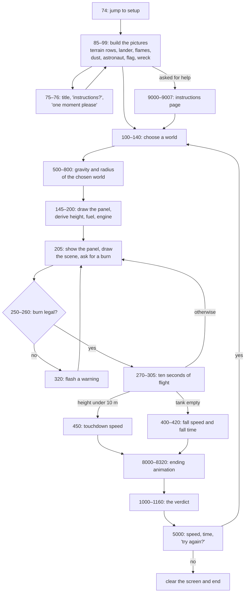

# Lander (LANDER.BAS): How the Original Works

This document takes the 1979 *Lander* (`lander.bas`) apart: how the 113 lines are organised, the numbers behind each world, the arithmetic of a turn, how the screen is drawn, how endings are judged, and the quirks and slips that shape the game. The formulas are written out as mathematics, not as the original code.

For background see [ABOUT.md](ABOUT.md). For playing it see [HOW-TO.md](HOW-TO.md). For the rebuild see [PORT-ARCHITECTURE.md](PORT-ARCHITECTURE.md).

## The shape of the program

The listing starts at line 74 and ends at line 9007. It jumps straight past a small title routine, builds all of its pictures, and then runs one loop per game.



The main variables:

| Variable | Meaning | Units |
|---|---|---|
| `G1` | Surface gravity of the chosen world | cm/s² |
| `A5` | Radius of the world | km |
| `G2` | Gravity in the game's own unit | km/h gained per second |
| `N3` | Height | km |
| `B2` | Speed at the start of a turn (positive = falling) | km/h |
| `B3` | Speed at the end of a turn | km/h |
| `N4` | Fuel left | fuel units (burn × seconds) |
| `G5` | Engine strength | |
| `F` | Burn rate for this turn | 0–100 |
| `B4` | Length of a turn | s |
| `T1` | Elapsed time | s |
| `V2` | Impact speed used for the verdict | km/h |

## The four worlds, from one recipe

Each world is only two numbers: its gravity and its radius.

| Choice | Gravity `G1` (cm/s²) | Radius `A5` (km) | Notes |
|---|---|---|---|
| 1 Earth | 980.7 | 6,371 | Real values |
| 2 Moon | 162 | 1,738 | Real values |
| 3 Mars | 374 | 3,380 | Close to the real 371 and 3,390 |
| 4 Asteroid Alpha | 17.5 | 195 | Invented; about the size of a large real asteroid |

Everything else is derived. With `g` the gravity in km/h per second:

```text
g  = G1 / 36
h0 = max(175, whole part of 100 × √g)          starting height, km
f0 = max(10000, whole part of 55 × h0)         fuel
T  = f0 × ln(G1) / 20 + 10000                  engine strength
```

| World | Gravity `g` | Start height `h0` | Fuel `f0` | Engine `T` |
|---|---|---|---|---|
| Earth | 27.2 | 521 km | 28,655 | 19,869 |
| Moon | 4.5 | 212 km | 11,660 | 12,966 |
| Mars | 10.4 | 322 km | 17,710 | 15,246 |
| Asteroid Alpha | 0.49 | 175 km (floor) | 10,000 (floor) | 11,431 |

Every flight starts at 5,000 km/h, straight down, with a turn length of 10 seconds. The dry lander has a mass of 15,000 in the same units as the fuel.

## One turn

You type a burn `b`. If `b` is 0 the turn simply runs. If `b` is below 0 or above 100 the program flashes a warning and asks again. Otherwise, if the tank can't feed that burn for a whole turn, the turn is shortened to `f / b` seconds; it is never lengthened again.

Then, with `Δ` the turn length, `h` the height, `v` the speed, `f` the fuel and `R` the radius:

```text
f' = f − b × Δ
a  = g × (1 − h / (2R)) − b × T / (15000 + f')
v' = v + a × Δ
h' = h − (v + v') × Δ / 6400
t' = t + Δ
```

So the engine's push shrinks as the lander gets heavier and grows as fuel is burnt, and gravity weakens slightly with height. The same thrust means more deceleration at the end of a flight than at the start.

After the turn:

- If `h'` is under 0.01 km (10 m), the lander has touched down.
- Otherwise, if `f'` is 0 or less, the tank is empty and the game ends at once.
- Otherwise the next turn begins.

### Touchdown

The impact speed is estimated from the last turn, with `h` and `v0` the height and speed at the start of that turn and `a` its acceleration:

```text
V = v0 + sign(a) × √(26 × |a| × h)
```

This is not the exact physics (which would combine the two speeds as `√(v0² + …)`), but it grows with speed and with height in the right direction. With a strong final burn it can dip a hair below zero, which counts as an excellent landing.

### Running dry

If the fuel runs out first, the program works out the rest of the fall in one go:

```text
V  = √(v'² + 5650 × g × h')
t += ln(V × 10000/3600 × h' × 10000 / G1)
```

The fall speed is a free-fall formula with a rounded constant. The fall "time" is a logarithm with no physical meaning; it only makes the clock move on a little.

## The verdict

| Impact speed (km/h) | Headline | Second line | Animation |
|---|---|---|---|
| under 2 | landed | excellent | cheer, astronaut, flag |
| 2 to under 5 | landed | not too bad | cheer, astronaut, flag |
| 5 to 19 | landed | rough | cheer |
| over 19, under 20 | landed | rough | **wreck** |
| 20 to under 30 | crashed | module destroyed | wreck |
| 30 to under 45 | crashed | module destroyed, pilot injured | wreck |
| 45 to under 100 | crashed | no survivors | explosion, then wreck |
| 100 to under 250 | disintegrated | | explosion, then wreck |
| 250 to under 5,000 | a new crater | | explosion, then wreck |
| 5,000 and up | struck oil | | explosion, then wreck |

The verdict text and the animation are chosen by two separate chains of comparisons, and they disagree about 19 to 20 km/h. Exactly 5 km/h also gets both the "rough" line and the flag.

The final screen prints the absolute impact speed and the elapsed time, then asks whether to try again.

## The screen

The TRS-80 screen has 64 × 16 character cells. Each cell can instead hold a 2 × 3 block of "pixels", giving 128 × 48 in all. The program uses both: text for the panel and messages, and graphics characters for everything else.

- **The panel** is a frame drawn pixel by pixel with `SET` in the top-right corner (about columns 43 to 63, rows 0 to 5). The time, height, speed and fuel are printed inside it, and the burn prompt sits just below.
- **The world's name** is printed on the bottom row.
- **Sprites** (the lander, its flames, the dust, the astronaut, the flag and the wreck) are single strings of graphics characters with cursor codes in between: move down one row, move left, move up. One `PRINT` draws a shape several rows tall. A matching string of spaces erases it.

### The ground rises to meet you

The program keeps six pictures of the ground (built from seven strings) and picks one by height:

| Height | Ground drawing | Where the lander is |
|---|---|---|
| 100 km and up | a thin strip of rubble on the bottom row | fixed near the top |
| 50–100 km | two rows: rubble over a solid line | fixed near the top |
| 25–50 km | a flat plain beside rough ground | fixed near the top |
| 10–25 km | hills with a gap where you'll land | fixed near the top |
| 1–10 km | big features over a two-row base | fixed near the top |
| under 1 km | a close-up: a stepped hill and the landing strip | **moves down the screen** |

The first three drawings are made of random rubble, chosen once when the program starts. Every game in a session therefore sees the same random ground.

Below 1 km the lander finally moves, in six steps: at 800, 600, 300, 200 and 100 m it jumps to a lower row, until it sits just above the strip. In that last step, burning kicks up two clouds of dust on either side.

### Animations

- **Flames:** after each turn the flame under the lander flickers once for every 5 units of burn.
- **Wreck:** a wreck is drawn on the ground and single pixels rise from it and vanish, like sparks, nine times over.
- **Explosion:** rows of vertical bars flash across the lower screen twenty times, then the wreck.
- **Cheer:** a message of congratulations, and the lander redrawn on the ground. At 5 km/h or less an astronaut appears beside it, a flagpole is drawn pixel by pixel, and the flag and the astronaut's arm alternate between two poses 45 times.

## Quirks, slips and bugs

1. **Oil for doing nothing.** All flights start at 5,000 km/h and the oil verdict starts at 5,000. A flight with no burns hits at about 10,670 km/h on Earth, 5,562 on the Moon, 6,773 on Mars and 5,046 on the asteroid, so it always strikes oil.
2. **Two cut-offs for one landing.** 19 km/h for the picture, 20 for the text.
3. **The clock carries over.** Starting a new game resets height, speed, fuel and turn length, but not the elapsed time. The previous game's last speed also carries over, though it can only matter if a game ended in its first turn.
4. **Gravity converted the wrong way.** Dividing cm/s² by 36 gives 27.2 for Earth; converting to km/h per second properly (multiplying by 0.036) gives 35.3. Every world's gravity is 77% of what it should be.
5. **A distance factor of 3,200.** The height change uses 6,400 for the sum of two speeds, which works out as 3,200 seconds per hour instead of 3,600. The lander covers 12.5% more ground than its speed says.
6. **Weak height correction.** Real gravity falls off as roughly `1 − 2h/R` near the surface; the program uses `1 − h/(2R)`, four times weaker. On paper gravity even turns negative above `2R` (390 km on the asteroid), but no flight has the fuel to get there.
7. **Approximate endings.** The touchdown speed adds a braking term to the starting speed instead of combining them properly, and the out-of-fuel "fall time" is a logarithm.
8. **Dead code.** One statement after the fuel check can never run, line 460 is never reached, and two picture strings are built and never used. A variable first holds a graphics string and is then overwritten with the world's name.
9. **A label in the data.** One terrain string contains the text `<16>` where the screen layout needs a single character: probably a byte (16) written out by whatever converted the file to text.

## How hard is it? Simulating the original

For this project the turn arithmetic above was run in a script, and a search looked for the gentlest landings. All four worlds can be landed at under 2 km/h:

| World | Coast turns | Turns in all | Fuel left | Burn that holds speed near the ground |
|---|---|---|---|---|
| Earth | 10 | 36–45 | 14–22% | about 28 |
| Moon | 7 | 20–24 | 16–18% | about 6 |
| Mars | 11 | 27–30 | 26–28% | about 14 |
| Asteroid Alpha | 6 | about 28 | about 11% | about 0.7 |

The best flights all follow the same pattern: coast, brake at 100 for many turns, then taper the burn down while hovering towards the ground. The asteroid has the least spare fuel, and the finest control: a burn of 1 is already too strong to hover.

The same arithmetic, turn for turn, drives Don't Crater's 1979 mode (`lib/lander/original.ts`), and `scripts/check-lander.ts` checks it against these results.
