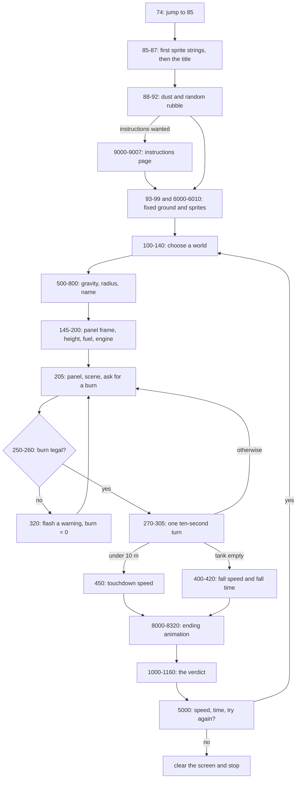

# Lander (LANDER.BAS): how the original works

*Lander* (`lander.bas`, Simutek, 1979) is a 113-line program in TRS-80 Level II BASIC for a 16K Model I or Model III. This chapter takes it apart: how the lines are organised, the numbers behind each world, the arithmetic of a turn, how the screen is drawn, how endings are judged, the quirks that shape the game, and how to play it today. Formulas are written out as mathematics, not as the original code, and the program's own messages are described rather than quoted.

For the program's history, see [ABOUT.md](ABOUT.md). For what Don't Crater kept and changed, see [CHANGES-FROM-ORIGINAL.md](CHANGES-FROM-ORIGINAL.md). The evidence for each fact below, with line numbers, is in [NOTES.md](NOTES.md).

## At a glance

| | |
|---|---|
| Size | 113 lines, numbered 74 to 9007 |
| Dialect | TRS-80 Level II BASIC (16K, Microsoft-derived, in ROM) |
| Machine | TRS-80 Model I or Model III, 16K |
| Input | Typed numbers, one `INPUT` at a time: instructions yes or no, a world, a burn rate every turn, try again |
| Output | The 64 × 16 text screen, plus the 128 × 48 block graphics built from character codes 128 to 191 |
| Players | One |
| Time | Turn-based: each answer plays ten seconds of flight |

## Line map

| Lines | What they do |
|---|---|
| 74 | Jumps straight to the setup at 85 |
| 75–76 | A small subroutine: the title in big letters, the "instructions?" question, then a request to wait |
| 85–87 | Graphics-character table, the flame and eraser strings, then the title (a call to 75) |
| 88–92 | The dust strings and three rows of random rubble; the instructions page (a call to 9000) if asked for |
| 93–99 | The fixed ground pictures, then a call to 6000 for the rest of the sprites |
| 100–140 | The world menu: clear the screen, list the four worlds, read a choice |
| 145–200 | Draw the panel frame, derive height, fuel and engine from gravity, reset speed and turn length |
| 205–315 | The turn loop: show the panel and scene, read a burn, work out ten seconds |
| 320 | Refused burn: flash a warning, reset the burn to 0, ask again |
| 400–430 | Out of fuel: the fall speed and a fall "time" in one step |
| 450 | Touchdown: the impact speed |
| 460 | A clock correction that nothing ever reaches |
| 500–800 | Gravity, radius and name of each world |
| 1000–1160 | The verdict text |
| 5000 | Impact speed, elapsed time, "try again?" |
| 6000–6010 | More sprite strings: the close-up ground, the lander, the astronaut, the flag frames, the wreck |
| 7000–7270 | The scene for this turn: pick the ground picture, place the lander, flicker the flame or the dust |
| 8000–8320 | Ending animations: explosion, wreck with sparks, cheer, astronaut and flag |
| 9000–9007 | The instructions page and a second request to wait |

## Control flow

The listing starts at line 74 and jumps past the title routine. It builds every picture once, then runs one loop per game and one inner loop per turn.



In pseudo-code, in our own words:

```text
build every picture; show the title; show the instructions if the answer was 1
repeat (one game):
    ask for a world until the answer is 1 to 4
    work out gravity, starting height, fuel and engine from the world's gravity
    speed = 5000 km/h, turn = 10 s          (the clock is not reset)
    repeat (one turn):
        show the panel and the scene; ask for a burn
        if the burn is below 0 or above 100: flash a warning, burn = 0, ask again
        if the tank can't feed the burn for a whole turn: shorten the turn
        work out the whole turn in one jump
        if the height is under 10 m: estimate the impact speed, leave the loop
        if the tank is empty: estimate the fall, add a fall "time", leave the loop
    play the ending for the impact speed; print the verdict, the speed and the clock
    ask to try again: 1 goes back to the world menu, 2 clears the screen and stops
```

The main variables:

| Variable | Meaning | Units |
|---|---|---|
| `G1` | Surface gravity of the chosen world | cm/s² |
| `A5` | Radius of the world | km |
| `G2` | Gravity in the game's own unit | km/h gained per second |
| `N3` | Height | km |
| `B2` | Speed at the start of a turn (positive = falling) | km/h |
| `B3` | Speed at the end of a turn | km/h |
| `N4` | Fuel left | fuel units (burn × seconds) |
| `G5` | Engine strength | |
| `F` | Burn rate for this turn | 0–100 |
| `B4` | Length of a turn | s |
| `T1` | Elapsed time | s |
| `V2` | Impact speed used for the verdict | km/h |

## The interesting parts

### The four worlds, from one recipe

Each world is only two numbers: its gravity and its radius.

| Choice | Gravity `G1` (cm/s²) | Radius `A5` (km) | Notes |
|---|---|---|---|
| 1 Earth | 980.7 | 6,371 | Real values |
| 2 Moon | 162 | 1,738 | Real values |
| 3 Mars | 374 | 3,380 | Close to the real 371 and 3,390 |
| 4 Asteroid Alpha | 17.5 | 195 | Invented; about the size of a large real asteroid |

Everything else is derived. With `g` the gravity in km/h per second:

```text
g  = G1 / 36
h0 = max(175, whole part of 100 × √g)          starting height, km
f0 = max(10000, whole part of 55 × h0)         fuel
T  = f0 × ln(G1) / 20 + 10000                  engine strength
```

| World | Gravity `g` | Start height `h0` | Fuel `f0` | Engine `T` |
|---|---|---|---|---|
| Earth | 27.2 | 521 km | 28,655 | 19,869 |
| Moon | 4.5 | 212 km | 11,660 | 12,966 |
| Mars | 10.4 | 322 km | 17,710 | 15,246 |
| Asteroid Alpha | 0.49 | 175 km (floor) | 10,000 (floor) | 11,431 |

Every flight starts at 5,000 km/h, straight down, with a turn length of 10 seconds. The dry lander has a mass of 15,000 in the same units as the fuel. Heavier worlds start higher, carry more fuel and get a stronger engine: the same lander is 74% more powerful on Earth than on the asteroid.

### One turn

You type a burn `b`. If `b` is 0 the turn simply runs. If `b` is below 0 or above 100 the program flashes a warning and asks again. Otherwise, if the tank can't feed that burn for a whole turn, the turn is shortened to `f / b` seconds; it is never lengthened again in that game.

Then, with `Δ` the turn length, `h` the height, `v` the speed, `f` the fuel and `R` the radius:

```text
f' = f − b × Δ
a  = g × (1 − h / (2R)) − b × T / (15000 + f')
v' = v + a × Δ
h' = h − (v + v') × Δ / 6400
t' = t + Δ
```

So the engine's push shrinks as the lander gets heavier and grows as fuel is burnt, and gravity weakens slightly with height. The same thrust means more deceleration at the end of a flight than at the start. The fuel is taken out before the push is worked out, so each turn is judged with the lighter, end-of-turn lander.

After the turn:

- If `h'` is under 0.01 km (10 m), the lander has touched down.
- Otherwise, if `f'` is 0 or less, the tank is empty and the game ends at once.
- Otherwise the next turn begins.

#### Touchdown

The impact speed is estimated from the last turn, with `h` and `v0` the height and speed at the start of that turn and `a` its acceleration:

```text
V = v0 + sign(a) × √(26 × |a| × h)
```

This is not the exact physics (which would combine the two speeds as `√(v0² + …)`), but it grows with speed and with height in the right direction. With a strong final burn it can dip a hair below zero, which counts as an excellent landing.

#### Running dry

If the fuel runs out first, the program works out the rest of the fall in one go:

```text
V  = √(v'² + 5650 × g × h')
t += ln(V × 10000/3600 × h' × 10000 / G1)
```

The fall speed is a free-fall formula with a rounded constant. The fall "time" is a logarithm with no physical meaning; it only makes the clock move on a little.

### The verdict

| Impact speed (km/h) | Headline | Second line | Animation |
|---|---|---|---|
| under 2 | landed | excellent | cheer, astronaut, flag |
| 2 to under 5 | landed | not too bad | cheer, astronaut, flag |
| 5 to 19 | landed | rough | cheer |
| over 19, under 20 | landed | rough | **wreck** |
| 20 to under 30 | crashed | module destroyed | wreck |
| 30 to under 45 | crashed | module destroyed, pilot injured | wreck |
| 45 to under 100 | crashed | no survivors | explosion, then wreck |
| 100 to under 250 | disintegrated | | explosion, then wreck |
| 250 to under 5,000 | a new crater | | explosion, then wreck |
| 5,000 and up | struck oil | | explosion, then wreck |

The verdict text and the animation are chosen by two separate chains of comparisons, and they disagree about 19 to 20 km/h. Exactly 5 km/h also gets both the "rough" line and the flag, and exactly 45 km/h gets the "no survivors" line with only the wreck.

The final screen prints the absolute impact speed and the elapsed time, then asks whether to try again.

### The screen

The TRS-80 screen has 64 × 16 character cells. Each cell can instead hold a 2 × 3 block of "pixels", giving 128 × 48 in all. The program uses both: text for the panel and messages, and graphics characters for everything else.

- **The panel** is a frame drawn pixel by pixel with `SET` in the top-right corner (about columns 43 to 63, rows 0 to 5). The time, height, speed and fuel are printed inside it, and the burn prompt sits just below.
- **The world's name** is printed on the bottom row.
- **Sprites** (the lander, its flames, the dust, the astronaut, the flag and the wreck) are single strings of graphics characters with cursor codes in between: move down one row, move left, move up. One `PRINT` draws a shape several rows tall. A matching string of spaces erases it.

The program relies on these features of the machine:

- `PRINT @` places text at one of the screen's 1,024 character positions (64 columns by 16 rows).
- `SET` and `RESET` switch single "pixels" of the 128 × 48 block graphics on and off.
- Character codes 128 to 191 are 2 × 3 blocks of those pixels. The program builds its pictures out of them.
- `CHR$(23)` switches the screen to 32 big characters per line, which the title screen uses.
- The cursor-control codes 24, 26 and 27 move the print position left, down and up.

#### The ground rises to meet you

The program keeps six pictures of the ground (built from seven strings) and picks one by height:

| Height | Ground drawing | Where the lander is |
|---|---|---|
| 100 km and up | a thin strip of rubble on the bottom row | fixed near the top |
| 50–100 km | two rows: rubble over a solid line | fixed near the top |
| 25–50 km | a flat plain beside rough ground | fixed near the top |
| 10–25 km | hills with a gap where you'll land | fixed near the top |
| 1–10 km | big features over a two-row base | fixed near the top |
| under 1 km | a close-up: a stepped hill and the landing strip | **moves down the screen** |

The first three drawings are made of random rubble, chosen once when the program starts. Every game in a session therefore sees the same random ground.

Below 1 km the lander finally moves, in six steps: at 800, 600, 300, 200 and 100 m it jumps to a lower row, until it sits just above the strip. In that last step the flame is no longer drawn; instead, burning kicks up two clouds of dust on either side.

#### Animations

- **Flames:** after each turn the flame under the lander flickers once for every 5 units of burn.
- **Dust:** in the last step above the strip, the dust flickers twice for every unit of burn.
- **Wreck:** a wreck is drawn on the ground and single pixels rise from it and vanish, like sparks, nine times over.
- **Explosion:** rows of vertical bars flash across the lower screen twenty times, then the wreck.
- **Cheer:** a message of congratulations, and the lander redrawn on the ground. At 5 km/h or less an astronaut appears beside it, a flagpole is drawn pixel by pixel, and the flag and the astronaut's arm alternate between two poses 45 times.

All the timing comes from empty `FOR` loops, so the pace of every animation is the speed of the 1.77 MHz Z80 running BASIC.

## Quirks and bugs

1. **Oil for doing nothing.** All flights start at 5,000 km/h and the oil verdict starts at 5,000. A flight with no burns hits at about 10,670 km/h on Earth, 5,562 on the Moon, 6,773 on Mars and 5,046 on the asteroid, so it always strikes oil.
2. **Two cut-offs for one landing.** 19 km/h for the picture, 20 for the text.
3. **The clock carries over.** Starting a new game resets height, speed, fuel and turn length, but not the elapsed time. The previous game's last speed also carries over, though it can only matter if a game ended in its first turn.
4. **Gravity converted the wrong way.** Dividing cm/s² by 36 gives 27.2 for Earth; converting to km/h per second properly (multiplying by 0.036) gives 35.3. Every world's gravity is 77% of what it should be.
5. **A distance factor of 3,200.** The height change uses 6,400 for the sum of two speeds, which works out as 3,200 seconds per hour instead of 3,600. The lander covers 12.5% more ground than its speed says.
6. **Weak height correction.** Real gravity falls off as roughly `1 − 2h/R` near the surface; the program uses `1 − h/(2R)`, four times weaker. On paper gravity even turns negative above `2R` (390 km on the asteroid), but no flight has the fuel to get there.
7. **Approximate endings.** The touchdown speed adds a braking term to the starting speed instead of combining them properly, and the out-of-fuel "fall time" is a logarithm.
8. **Dead code.** One statement after the fuel check can never run, and neither can lines 210, 460, 7010 and 7150. Two picture strings are built and never used, and a variable first holds a graphics string and is then overwritten with the world's name.
9. **A label in the data.** One terrain string contains the text `<16>` where the screen layout needs a single character: probably a byte (16) written out by whatever converted the file to text.
10. **One line out of place.** The "no survivors" line is printed in the middle of the screen, above the wreck, while every other second line sits just under the headline.

Each one is traced to its lines, with a note on whether Don't Crater keeps it, in [NOTES.md](NOTES.md#quirks-and-bugs).

## Playing the original

### The rules in one paragraph

You start high above a world, falling at 5,000 km/h. Every ten seconds you choose a burn rate from 0 to 100. The engine slows you down in proportion to the burn, and uses that much fuel for every second it runs. Reach the ground slower than 20 km/h to survive; at 5 km/h or less you also get to watch the flag go up. Run out of fuel and you fall the rest of the way.

### Running it today

`lander.bas` is a plain-text listing for a **TRS-80 Model I or III with Level II BASIC**. It will not run in GW-BASIC or other PC BASICs: it depends on the TRS-80's screen, its block graphics and its cursor codes.

1. Use a TRS-80 emulator that can type or load a BASIC listing (for example *trs80gp* or *sdltrs*, or an online Model I/III emulator). Choose a Model I or III with Level II BASIC and at least 16K of memory.
2. Load the listing as BASIC text, or paste it into the emulator's keyboard buffer, then type `RUN`.
3. The listing contains the label `<16>` inside one terrain string. On a real machine that was a single character. Replace the four characters with one space (or join a `CHR$(191)` block in its place), or the ground on that screen will be shifted by three characters.

On the original hardware the program came on cassette and was loaded with `CLOAD`.

### Screen by screen

1. **Title.** A big-letter title and the publisher's copyright, then a question: do you want instructions? Answer `1` for yes; any other number means no.
2. **A pause.** While a message asks you to wait, the program builds its pictures: the lander, the flames, the dust, the astronaut, the flag and six versions of the ground. On a 1.77 MHz Z80 this took a noticeable moment. If you asked for instructions, a page of them appears here, followed by a second pause.
3. **Choose a world.** `1` Earth, `2` the Moon, `3` Mars, `4` Asteroid Alpha. Anything else clears the screen and asks again.
4. **The flight screen.** A framed panel at the top right shows the elapsed time, height (km), speed (km/h, positive means falling) and fuel. Below it the program asks for a burn rate. Your lander sits near the top of the screen; the ground is at the bottom, with the world's name under it.
5. **Each turn.** Type a number and press ENTER. The flame under the lander flickers, more times for bigger burns, and ten seconds of flight are worked out at once. The panel updates and the ground is redrawn if you have passed a height mark (100, 50, 25, 10 and 1 km). Below 1 km the lander steps down the screen towards the landing strip, and near the ground its exhaust kicks up dust.
6. **The ending.** At touchdown (or when the fuel runs out) an animation plays, then the verdict appears at the top left: what happened, your impact speed and the elapsed time. The program asks whether to try again: `1` goes back to the choice of world, `2` clears the screen and ends the program. Anything else asks again.

### What the program accepts

| You type | What happens |
|---|---|
| A number from 0 to 100 | Used as this turn's burn. Decimals such as 37.5 are fine. |
| 0 | No burn: you fall freely for ten seconds. |
| A negative number, or more than 100 | Refused. A warning flashes twenty times, the burn is reset to 0, and you are asked again. No time passes. |
| Text | Level II BASIC's own input check rejects it (with `?REDO`) before the program sees it. |
| Just ENTER | Level II BASIC keeps the variable's previous value, so the last burn is used again (0 at the start of a game and after a refused burn). This is how we understand Level II's `INPUT`; we have not yet checked it in an emulator. |

### How a game ends

The verdict depends only on the speed at impact:

| Speed at impact | Verdict | Animation |
|---|---|---|
| Under 2 km/h | Landed, excellent | A cheer, then the astronaut and flag |
| 2 to 5 km/h | Landed, not bad | A cheer, then the astronaut and flag |
| 5 to 19 km/h | Landed, rough | A cheer |
| 19 to 20 km/h | Landed, rough | **A wreck with rising sparks** (the two use different cut-offs) |
| 20 to 30 km/h | Crashed: module destroyed | A wreck with rising sparks |
| 30 to 45 km/h | Crashed: module destroyed, pilot hurt | A wreck with rising sparks |
| 45 to 100 km/h | Crashed: no survivors | Flashing explosion, then the wreck |
| 100 to 250 km/h | Disintegrated | Explosion and wreck |
| 250 to 5,000 km/h | A new crater | Explosion and wreck |
| 5,000 km/h and up | Struck oil | Explosion and wreck |

If the fuel runs out before touchdown, the program immediately works out how fast you would hit the ground from where you are, adds an estimated fall time to the clock, and gives the verdict for that speed.

The elapsed time is **not** reset when you try again, so the time reported after your second flight includes the first.

### How to land every time

The fuel-cheapest way down is to fall freely for as long as possible and then brake flat out, so that your speed reaches zero just as you reach the ground. Rockets that land upright today use the same idea (a "hoverslam").

1. **Coast.** Enter 0 for the first several turns: about 10 on Earth, 7 on the Moon, 11 on Mars and 6 on the asteroid.
2. **Brake hard.** Then burn 100 turn after turn. Watch the speed fall: you want it near zero when the height is a few hundred metres (a fraction of a kilometre on the panel).
3. **Ease down.** Near the ground, use the burn that just holds your speed steady, then a little less to sink slowly.

Simulating the program's own arithmetic, a search for the gentlest landings found that all four worlds can be landed at under 2 km/h:

| World | Coast turns | Turns in all | Fuel left | Burn that holds speed near the ground |
|---|---|---|---|---|
| Earth | 10 | 36–45 | 14–22% | about 28 |
| Moon | 7 | 20–24 | 16–18% | about 6 |
| Mars | 11 | 27–30 | 26–28% | about 14 |
| Asteroid Alpha | 6 | about 28 | about 11% | about 0.7 |

The best flights all follow the same pattern: coast, brake at 100 for many turns, then taper the burn down while hovering towards the ground. The steady burn creeps down as the tank empties, because the lander gets lighter. The asteroid has the least spare fuel and needs the finest control: a burn of 1 is already too strong to hover, and only decimals will do. Whole-number flights that land on every world are listed in [NOTES.md](NOTES.md#simulations).

Two warnings:

- **Burning too early** wastes fuel on slowing down high up, and you may run dry before the end.
- **A big burn close to the ground** can stop you and send you back up (the speed turns negative). You then have to fall back down, which costs more turns and fuel.

Don't Crater's **1979 mode** replays the original turn for turn, with the same arithmetic and the same quirks; [HOW-TO-PLAY.md](HOW-TO-PLAY.md) explains how to play it and [CHANGES-FROM-ORIGINAL.md](CHANGES-FROM-ORIGINAL.md#faithful-modes) what it reproduces exactly.

## Sources

- The listing itself, `lander.bas`, read in place outside the repository. Every number, formula and line reference in this chapter comes from it.
- The turn arithmetic was re-run in TypeScript (`lib/lander/original.ts`), and `scripts/check-lander.ts` checks it against the results above.
- How Level II BASIC treats `INPUT`, `ON … GOTO`, `PRINT @`, `SET`, `RESET`, the graphics characters and the cursor codes is taken from general knowledge of the machine. It has not been checked in an emulator for this project; see the open questions in [NOTES.md](NOTES.md#open-questions).
- For the publisher and the catalogue, see the sources in [ABOUT.md](ABOUT.md#sources).
