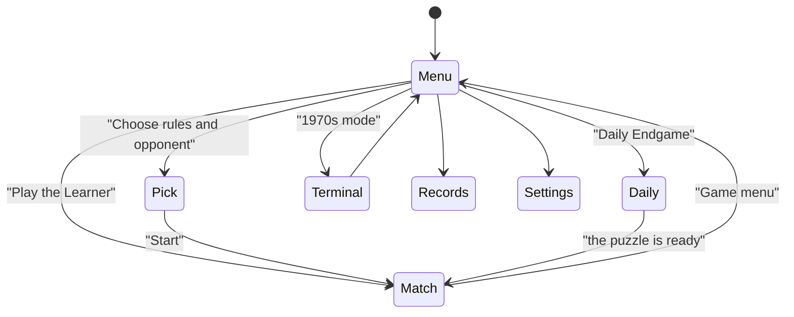
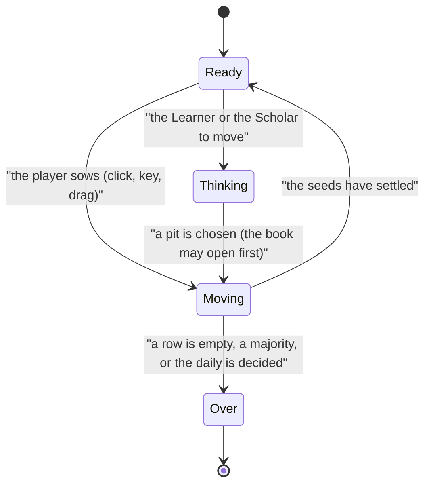

# Same Trick Twice: how the rebuild works

The game is a pure TypeScript engine in `lib/long-memory/` (rules, the 1978 program, the Learner, the Scholar, the
solver, the dailies) and a React layer in `components/long-memory/` around one WebGL2 board scene. The id is
`long-memory` everywhere (storage, Keyring, docs); the title is Same Trick Twice.

## Module map

| File | Owns |
|---|---|
| `lib/long-memory/board.ts` | The fourteen holes, numbered as the 1978 program numbered them (0–5 yours, 6 your store, 7–12 north, 13 north's store) |
| `lib/long-memory/rules/` | `types.ts` (Position, MoveOutcome, Rules), `awari1978.ts`, `oware.ts`, `kalah.ts`, `index.ts` (the registry) |
| `lib/long-memory/original.ts` | The 1978 program as a machine, variable for variable: sowing (600), recording (200–210), the choice (800–890), the crash (30) |
| `lib/long-memory/learner.ts` | The Learner as the game plays it: the 1978 choice plus a saved, unlimited book of lessons |
| `lib/long-memory/scholar.ts` | Negamax search with alpha-beta, a transposition table and iterative deepening; three levels |
| `lib/long-memory/solver.ts` | Exact values for small positions: best margin, fastest win, the best defence |
| `lib/long-memory/daily.ts` | The Daily Endgame: a self-played game cut short, checked by the solver |
| `lib/long-memory/match.ts` | One game as data: legal moves, play, undo, Oware's repetition, the result |
| `lib/long-memory/awards.ts` | What a finished game changes: records, the book, keycaps |
| `lib/long-memory/progress.ts` | The kit store `anykey.long-memory.save` and the progress bridge |
| `lib/long-memory/thinking.ts`, `ai.worker.ts` | Questions for the computer and the worker that answers them |
| `lib/long-memory/share.ts`, `manifest.ts` | The share text; the game's manifest |
| `components/long-memory/SameTrickTwice.tsx` | The root: the shell, the screens, the one canvas behind them |
| `components/long-memory/MatchScreen.tsx` | A game or the Daily Endgame: turns, the opponent, input, results |
| `components/long-memory/PitLayer.tsx` | Invisible buttons over the pits: click, keys, drag |
| `components/long-memory/hud/BoardHud.tsx` | Counts, store totals, the match line, the turn line, the memory callout |
| `components/long-memory/Menu.tsx`, `Pick.tsx`, `Daily.tsx`, `MemoryBook.tsx`, `RulesCard.tsx`, `Records.tsx`, `GameSettings.tsx`, `Terminal1978.tsx` | The other screens |
| `components/long-memory/scene/` | The board scene: see *Drawing* |
| `components/long-memory/sound.ts` | Synthesised sounds |
| `components/long-memory/cheat.ts` | The owner's hidden help: see *The hidden help* |
| `components/previews/LongMemoryPreview.tsx` | The Hall card: the board playing itself |
| `scripts/check-long-memory.ts` | The checks: see *Tests* |

## State machines

A match moves through four phases:

The board scene only acts out moves the engine has already decided. `match.ts` plays the move, `BoardScene.animate`
flies the seeds, and after they settle the scene checks that its seeds agree with the engine's board (and lays the
position out again if they ever don't).

## The engine

All of it is pure TypeScript with no DOM, seeded with the kit RNG, and deterministic.

- **Rules.** A `Rules` object gives `start`, `legal` and `play`. `play` returns a `MoveOutcome`: every hole a seed
  went to, captures (with the pits they came from), whether the mover sows again, an end-of-game sweep and how the
  game ended. To add a rule set: write `rules/<id>.ts` with those three functions, add it to `RULES` and `RULE_ORDER`,
  add a rules card in `RulesCard.tsx` and hand-worked cases to the check script. The solver needs rules without
  cycles; the Scholar works with any.
- **The 1978 program.** `Original1978` keeps the program's variables (`b`, `f`, `n`, `c`, `e`, Q and A) and steps
  through its flow. `chooseMove1978` is lines 800–890 with Q and A passed in and out. `forLoops` chooses between
  1970s Microsoft BASIC ("run-once") and GW-BASIC ("skip").
- **The Learner's memory.** A `Lesson` is `{ code, opening, learned, you, learner }`: `code` is the 1978 base-6 number
  (the first eight moves, both players, pit 1–6 as 0–5), `opening` the same moves as holes, `learned` a local date key.
  `LearnerMind` adds Q and A. It lives in the progress store (`mind`), or for "as in 1978" in a module variable that
  dies with the page.
- **The daily.** `dailyPuzzleFor(date)` self-plays a game from the date's seed with an easy Scholar, stops at 7–11
  seeds left, and accepts it only if the solver says the goal is reachable, at most half the first moves reach it,
  and some first move loses. Days alternate the rule set and the goal; a fixed fallback order covers rare days.

## AI

- **The Learner** (1978 Awari only): one move deep, exactly as in 1978, including the leftover Q and A. When the book
  changes its mind, `learnerMove` reports the pit it turned away from and the lessons that warned it, and the screen
  plays the remembering moment.
- **The Scholar**: Easy (depth 2, 4,000 nodes, noisy), Normal (depth 6, 60,000 nodes, a little noise), Hard (up to
  depth 16, 300,000 nodes). It runs in the worker; a minimum thinking time keeps it from answering instantly.
- **The defence** in the Daily Endgame: the solver's best reply (`Solver.defend`), never wrong.

## The hidden help

A cheat for the owner, kept out of the game on purpose: no button, no setting, no line in How to play or the
shortcuts sheet. **Ctrl+Alt+C**, anywhere in the game, turns it on; the same keys turn it off. While it is on, the
pit the computer would sow gets a green double ring whenever a person is to move: the player against the Learner or
the Scholar, either player in a game between two. It lasts until the page is left and is never saved.

- `cheat.ts` holds the on/off state (`useCheat`) and listens for the keys (`useCheatKey`, mounted by
  `SameTrickTwice.tsx`). It matches the physical C key, so any keyboard layout works.
- `MatchScreen.tsx` asks the worker for a `hint` (`thinking.ts`) each time it is the person's turn: the Hard
  Scholar's move in a normal game, and in the Daily Endgame the solver's move that keeps the goal surest (fewest
  sowings to a win, or the widest margin). A hint for a position that has since changed is dropped.
- `BoardScene` draws it as the `hint` mark; `PitLayer` adds ", suggested" to that pit's label for screen readers.
- Games played with the help count like any other: records, the book, keycaps and the Daily's share text.
- The 1970s terminal is the original program and gets no help.

## Drawing

Everything is drawn with WebGL2 in one canvas, without libraries (ADR 0006). `components/long-memory/scene/`:

| File | Draws or does |
|---|---|
| `layout.ts` | The board in centimetres: hollows, rims, the roundover, the side profile; heights and the distance field the physics uses |
| `boardMesh.ts` | The board mesh: a fine grid for the top face, a swept band for the sides |
| `shaders.ts` | All GLSL: noise, the lighting model, the wood, the table (stone by day, cloth by night), the seeds, the book, the light effects |
| `Renderer.ts` | The passes (shadow depth, then the picture), the two lightings, the camera fit, instancing |
| `seeds.ts` | Seed shapes and colours, and the physics (position-based, fixed steps) |
| `choreography.ts` | Lifting, flying, pouring, carrying by hand; counts as seeds land |
| `memory.ts` | The remembering moment: the book's pose, the ghost seeds, the halo and motes |
| `book.ts`, `pages.ts` | The Memory Book's geometry, and its pages painted with Canvas 2D |
| `trails.ts` | The trails of light behind flying seeds, and the ripples where they land |
| `BoardScene.ts` | Ties it together for the screens: animate a move, marks, hit-testing, drag, the loop |

To change a look: the wood is `woodAlbedo` in `shaders.ts` (ring spacing, colours, streaks), the lighting is `DAY`
and `NIGHT` in `Renderer.ts`, seed colours are `PALETTE` in `seeds.ts`, and the HUD's colours are the tokens in
`SameTrickTwice.module.css` and `hud/BoardHud.module.css`. Reduced motion lands every move at once.

### Two levels of detail

The full board is a height grid of some 136,000 vertices, drawn twice a frame (the shadow map, then the picture),
with procedural wood, a 12-tap soft shadow and seed occlusion in every pixel. A graphics card draws that at 60
frames a second; a browser that draws WebGL on the processor (SwiftShader, llvmpipe: no card, or one it won't use)
managed under one frame a second, and the page stopped answering. `DETAIL` in `Renderer.ts` therefore has a
second level, `light`:

| | full | light |
|---|---|---|
| Board grid | 0.1 cm (136,000 vertices) | 0.52 cm (5,200 vertices) |
| Shadow map | 2048² | 1024² |
| Pixels | device pixels | 60 % of them, scaled up |
| Shading | 4-octave noise, 12 shadow taps, seed occlusion, leaf dapple | 2 octaves, 4 taps, neither of the others (`uLight`) |
| Drawing | every frame | only while something changes, at most about 30 a second |
| Game menu | the board sows at a relaxed pace | moves land at once, as with reduced motion |

The renderer picks `light` only when the WebGL renderer's name says it is software. Any graphics card, however
slow, keeps `full`: a sharp board at a lower frame rate beats a blurred one. (An earlier version also switched to
`light` after a few slow seconds; on a laptop running Chrome on its integrated GPU, or on the dev server, that
blurred the board for players who had a card.) The canvas carries `data-detail="full"` or `"light"`, so the level
can be checked in the browser's tools. On the light board the loop draws only when seeds or the camera move,
trails fade, the book is at work or a mark changes, so between moves the processor is the player's. Choosable pits
stop pulsing there for the same reason.

Shaders compile in the background where the browser offers `KHR_parallel_shader_compile` (`Program.ready()` in
`gl.ts`), so a first visit answers at once; the canvas fades in (`data-ready`) with its first frame. Instance
buffers grow when a big sweep puts more seeds and sparks in the air than usual, and the frame loop books its next
frame first, so one failed frame cannot freeze the board.

## Sound

`components/long-memory/sound.ts`, all synthesised on the collection's effects bus: a seed on bare wood (a low
knock, lower in a store), a seed on seeds (a short bright click), a handful lifting (a whisper of noise), a page
turning, and the faint ring of a remembered loss. The physics reports impacts with their speed; quiet ones are
thinned out. The game menu's board plays in silence.

## Kit integration

- **Manifest** `lib/long-memory/manifest.ts`: eleven achievements, the daily epoch 2026-10-09, the emblem.
- **Shell**: `usePlayScreen` from the match, the daily and the terminal, with their own pause items (start again,
  take back, the Memory Book). Results use the kit's `Results`, with Share for the daily.
- **Store** `anykey.long-memory.save`, version 1: settings, the Learner's mind, records, openings that beat it,
  dailies, terminal counts, rules cards seen. Achievements live in the Keyring through `createProgress`.

## Tests

| Command | Proves |
|---|---|
| `npx tsx scripts/check-long-memory.ts` | The three rule sets on hand-worked positions; the 1978 module against recordings of the original (`tests/fixtures/long-memory-1978.json`); the game's Learner equals the 1978 module; the Scholar's levels; 45 dailies; the learning numbers in NOTES.md |
| `npx tsx scripts/check-long-memory.ts --full` | The same with a year of dailies and Hard against Normal |
| `npx vitest run tests/unit/long-memory.test.ts` | Rules facts, random games that keep every seed and end, the Learner's lesson and its turning away, the keycaps (none for a friend), Daily Endgame #1 pinned, a full Kalah sweep landing at once, the hidden help's suggestions |
| `npx playwright test --config playwright.long-memory.config.ts` | Every rule set and opponent by mouse and by keyboard, the Memory Book and its persistence, the daily, the terminal, settings, every way out, Ctrl+Alt+C (port 3219, after `npx next build`) |

## Known limits

- The Scholar's Hard level thinks for about half a second a move; on slow machines more.
- Without a graphics card the light board is coarser (faceted pit rims, a toothed front edge) and sows at about
  10 frames a second.
- Without WebGL2 the board cannot be drawn; the terminal still works.
- Oware is a theoretical draw: no setup can be a forced win for the player against perfect play.
