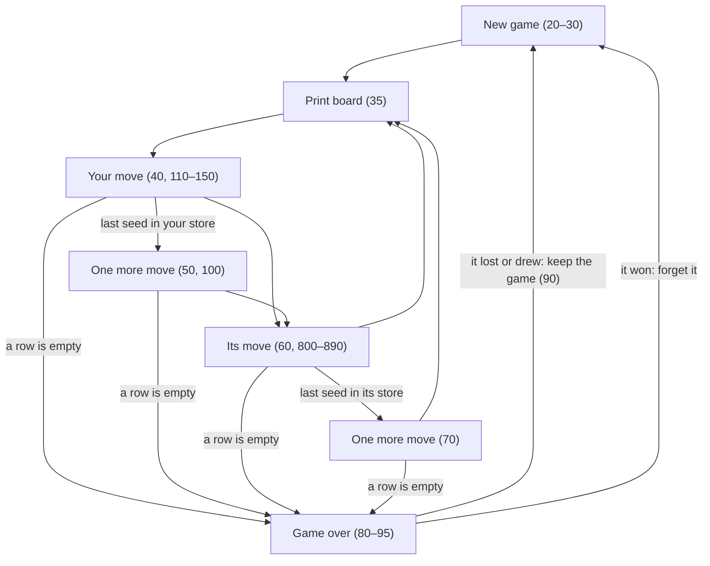
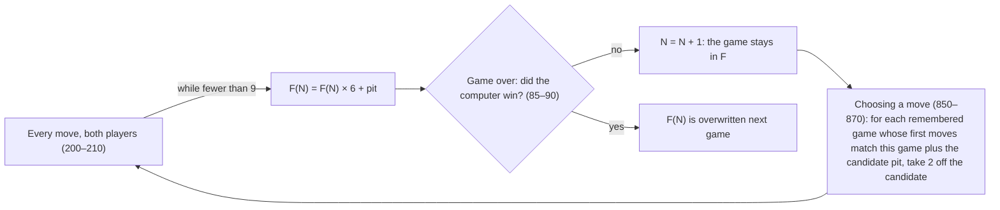

# Awari (AWARI.BAS): how the original works

Seventy lines of Microsoft BASIC from *BASIC Computer Games* (Creative Computing, 1978): a text-only mancala
game against a computer that learns from the openings of the games it fails to win. It runs unchanged in GW-BASIC
(PC-BASIC), which is how we tested everything below.

## At a glance

| | |
|---|---|
| Lines | 70 numbered lines, 2 KB |
| Dialect | Microsoft BASIC (1970s home computers); runs in GW-BASIC |
| Input | `INPUT`: a pit number, 1 to 6 |
| Output | The board as three rows of numbers, the computer's moves, the result |
| State | `B(13)` the board, `F(50)` the memory, `N` lessons, `C` moves this game, `Q` and `A` never cleared |

## Line map

| Lines | What they do |
|---|---|
| 5–15 | Title; arrays; N (lessons) read from a DATA line as 0 |
| 20–30 | A new game: three seeds in each pit, stores empty, move counter and this game's memory cleared |
| 35–75 | One round: board, your move (and one extra), its move (and one extra), until a row is empty |
| 80–95 | The result; a game the computer did not win is kept (N goes up) |
| 100–150 | Reading your move, refusing a bad one, playing it, printing the board |
| 200–235 | After any move: write it into the memory (first eight only), check whether a row is empty |
| 500–585 | Printing the board |
| 600–625 | Sowing from a pit, and the capture |
| 800–890 | The computer's choice |
| 900 | A leftover debugging line nothing reaches |

## Control flow

In words: a game begins at once and ends when either row of pits is empty, after anyone's move. You sow first. A
last seed in your own store gives one more move, never two, and the same goes for the computer. When a game ends,
the next begins without asking.

## The interesting parts

### Sowing and capturing (600–625)

Seeds go one by one into every hole after the pit, all fourteen in turn, both stores included. If the last seed lands
in a hole that was empty, not a store, and the hole straight across has seeds, the mover's store takes both. This
works on either side of the board.

### The learning loop

The memory is one number per game: its first eight moves as base-6 digits. To compare, the program divides a stored
number by a power of six to cut it down to the length of the game so far plus one move, and checks it against the
current game's number with the candidate pit added. Each matching game costs the candidate 2 points.

### The evaluation (800–885)

For each of its non-empty pits, the computer plays the move on the board, scores it as its store minus yours, and
subtracts the best capture it thinks you could answer with. It judges your answers roughly: for each of your pits,
where the last seed would land, and what it would take. Then it restores the board and moves on. The best score
wins, and ties go to the higher pit.

## Quirks and bugs

- **Q is never cleared**: the line meant to reset it clears `G` instead, so every pit's score leans on the last one.
- **A is never cleared**: if no pit scores above −99, it plays whatever it chose last time.
- **The ninth move** reads the memory with an off-by-one and penalises its first pit.
- **The +.1** in the memory test rounds some stored openings up by one and warns it off the wrong pit.
- **The table holds 51 games**; the 52nd game stops the program with a subscript error.
- **A loop that never should run** runs once in 1970s Microsoft BASIC and reads the current game as a lesson.
- **Typing**: a decimal is accepted; a bad move is followed by the extra-move prompt.
- **The last board twice** when your move empties the computer's row.

Evidence, measurements and the effect of each: [NOTES.md](NOTES.md).

## Playing the original

The listing runs unchanged in PC-BASIC, a free GW-BASIC interpreter: load it and `RUN`. You see the title, the board
as two rows of numbers with the stores at the ends, and a question mark waiting for a pit, 1 to 6, counted from your
left. The computer's moves follow, named 1 to 6 from its own left. Games follow one another until you stop the
program, or until its memory fills after the 51st game it fails to win. Our 1970s mode plays the same program's
decisions with every quirk, in our own words.

## Sources

- The listing, `AWARI.BAS`, read line by line, and runs of it in PC-BASIC (GW-BASIC semantics).
- *Altair BASIC Reference Manual* (MITS, 1975): FOR loops always run their body once.
- Digital Equipment Corporation, *101 BASIC Computer Games*, March 1975 printing, pp. 19–21: the author's credit.
