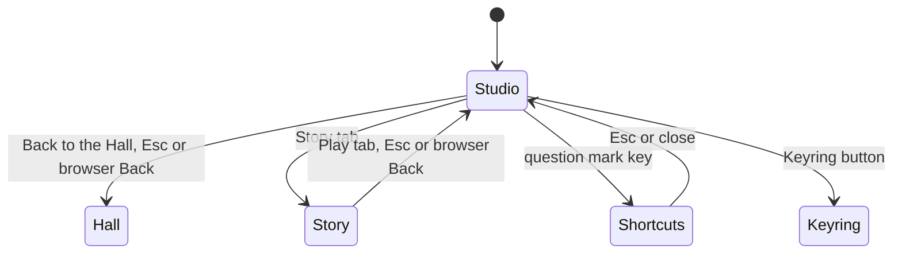
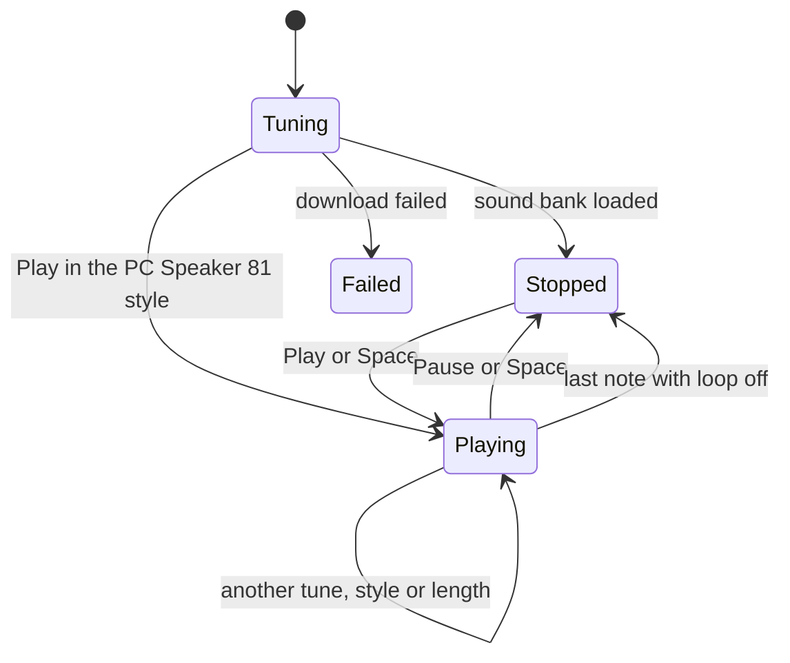
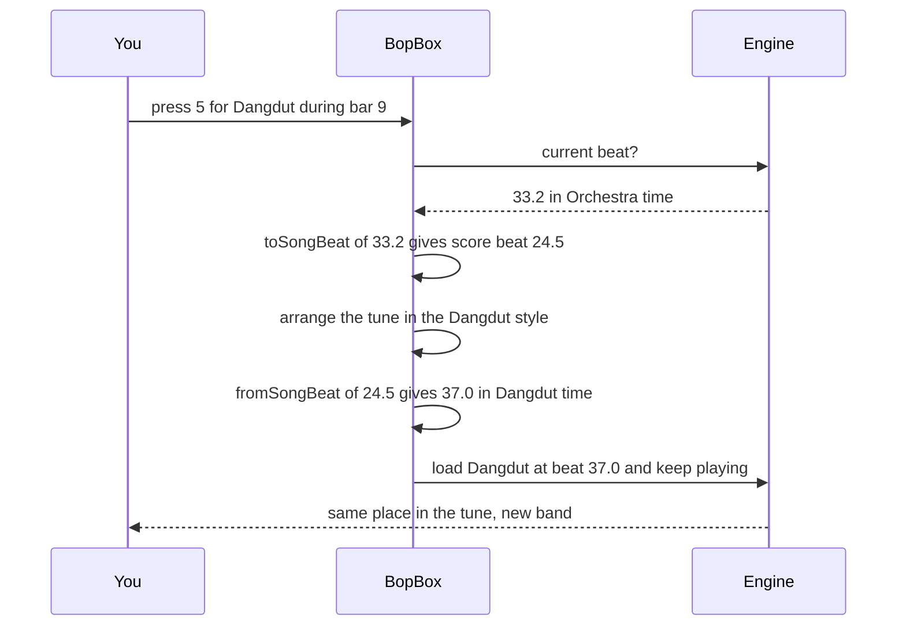

# Bop Box: how the rebuild works

**Bop Box** is the Any Key rebuild of IBM's 1981–82 *MUSIC* sample program. In code it is a pipeline with one end in text and the other in sound. Eleven tunes are written as lead sheets in our own notation (`lib/music/songs.ts` and `lib/music/full/`); a parser turns each into a score; a rule-based arranger (`lib/music/arrange/`) turns a score and a style into an arrangement, a list of tracks of notes; and the engine (`lib/music/engine.ts`) plays that arrangement through a SoundFont synthesiser, or through a model of the 1981 PC speaker. Every visual reads the same arrangement and the same clock. The studio screen (`components/bopbox/`) sits inside the collection's shared `GameShell`, and everything it remembers goes through the kit's stores and the Keyring.

This page is for programmers who will change the game. For what a player sees, see [HOW-TO-PLAY.md](HOW-TO-PLAY.md); for the original program, see [ABOUT.md](ABOUT.md) and [ORIGINAL-ARCHITECTURE.md](ORIGINAL-ARCHITECTURE.md). What we kept from the original and what we changed is now in [CHANGES-FROM-ORIGINAL.md](CHANGES-FROM-ORIGINAL.md).

## Provenance and licences

- **No IBM code or data is used.** The melodies are public-domain compositions, transcribed for this project in our own notation (see *The score format* below). We chose excerpts that match what the 1981 program played, so the tunes are recognisably "the same eleven", but the notes, rhythms, chord charts and arrangements are ours.
- **The full versions** come from public-domain editions of each piece, listed in *Where the full versions come from* below. Every composer here died long ago (Sousa, the most recent, in 1932), and the folk tunes are traditional. One source asks for credit: Gaylon Babcock's engraving of Mozart's score is shared under Creative Commons Attribution 4.0, and is credited wherever the tune is shown. The Original Score also plays every part of three scores: Mozart's (Babcock, CC BY 4.0), Gounod's (Lopez, dedicated to the public domain) and Sousa's (the United States Marine Band's edition, a work of the US government and in the public domain). The parts in `lib/music/original/data/` are our reading of those editions, not copies of their files.
- **Instruments** come from *MuseScore General* (MIT licence; FluidR3 by Frank Wen and later work by Michael Cowgill, S. Christian Collins and others). The full licence ships next to the sound bank in `public/soundfont/`. This sound bank is the collection's one approved audio exception to the drawn-in-code rule.
- **Libraries:** SpessaSynth (`spessasynth_lib`, `spessasynth_core`, Apache-2.0) plays the sound bank. VexFlow (MIT) engraves the sheet music. Mermaid (MIT) draws these diagrams, and marked (MIT) renders these docs.
- **Pictures:** every icon (instruments, styles, the transport) is SVG drawn in code; no image files and no emoji.
- **AI Remix:** the owner asked Claude to do the remixing. Every remix is composed as notes by Claude inside `lib/music/arrange/remixes.ts`, not generated audio. That is also why the sheet music and keyboard stay in sync with it.

## Module map

```mermaid
flowchart LR
    SRC["songs.ts: 11 tunes, 1981 excerpts"] --> COMPILE["compileSong in score.ts"]
    FULL["full folder: sections and a form per tune"] --> COMPILEF["compileFull in score.ts"]
    COMPILE --> SCORE[("Score: notes, chords, bars, keys, meters, tempos")]
    COMPILEF --> SCORE
    SCORE --> STUDIO["Studio in arrange/studio.ts"]
    STYLE["Style or remix recipe: styles.ts, hiphop.ts, remixes.ts"] --> STUDIO
    PARTS[("original/data: every printed part")] --> ORIG["Original Score: arrange/original.ts"]
    SCORE --> ORIG
    ORIG --> STUDIO
    STUDIO --> ARR[("Arrangement: tracks of notes")]
    ARR --> MIDI["toMidi in midi.ts"]
    MIDI --> SEQ["SpessaSynth sequencer and synthesiser"]
    SF[("bopbox.sf3: MuseScore General, trimmed")] --> SEQ
    ARR --> PC81["PC speaker model: square waves and ticks"]
    SEQ --> OUT(("Speakers"))
    PC81 --> OUT
    SEQ -. clock .-> VIEWS
    PC81 -. clock .-> VIEWS
    subgraph VIEWS["Visuals, one clock"]
        SHEET["Sheet music: VexFlow SVG"]
        FALL["Falling notes: Canvas"]
        ANGKA["Not angka: DOM"]
        STAGE["Stage: DOM buttons"]
        KEYS["Keyboard: SVG"]
    end
```



Everything musical happens *before* audio. A style never touches sound directly: it asks the Studio for tracks and fills them with notes. The result is an **Arrangement**, a list of tracks, each with an instrument, a colour and its notes in beats. That one object feeds the synthesiser, the MIDI and WAV downloads and every visual.

| Path | Job |
|---|---|
| `app/music/page.tsx` | The route. Loads the six doc chapters at build time (`loadProgramDocs("music")` in `lib/docs.ts`) and renders `BopBox` |
| `lib/music/manifest.ts` | The game's manifest: title, route, palette, emblem, stats, modes, moons, trivia and the eight achievements |
| `lib/music/badges.ts` | Which achievements a listen earns (`listened`, `heardToTheEnd`) |
| `lib/music/prefs.ts` | The save: the length switch and the listening lists, in the kit store `anykey.music.save` |
| `lib/music/theory.ts` | Pitches, chord parsing, voicings with smooth voice-leading, a seeded random generator |
| `lib/music/score.ts` | The text notation, its parser and bar checks |
| `lib/music/songs.ts` | The eleven tunes as the 1981 program played them: melody, chords, meter, tempo, key, colour, 1981 tick speed. Also the map between a 1981 beat and a full-version beat |
| `lib/music/full/` | The full-length versions, one file per tune, written as sections and a form |
| `lib/music/tempo.ts` | Beats to seconds and back through an arrangement's tempo changes; bar lookups |
| `lib/music/arrange/index.ts` | The twelve styles (`STYLES`: name, blurb, key) and `arrange()`, with a cache |
| `lib/music/arrange/studio.ts` | Meter mapping, intros and outros, repeats, drum/bass/chord/arpeggio/melody generators, swing |
| `lib/music/arrange/styles.ts` | The nine regular styles and PC Speaker ’81 |
| `lib/music/arrange/hiphop.ts` | The Hip-hop (trap) style |
| `lib/music/arrange/remixes.ts` | Eleven remix recipes, one genre per tune |
| `lib/music/arrange/original.ts` | The Original Score style for a composer's score: parts placed along the form, dynamics, pizzicato, the 1981 excerpt found inside the piece |
| `lib/music/arrange/patches.ts` | Instrument table (General MIDI numbers, each with an `InstrumentFamily`), drum map, solo instruments, role colours |
| `lib/music/arrange/types.ts` | `Patch`, `Track`, `Arrangement` and the `InstrumentFamily` list |
| `lib/music/original/scores.ts` | Which score each tune has, how its printed parts become instrument tracks, and the printed bars behind each part of the form |
| `lib/music/original/index.ts` | Loads a composer's parts on demand and tells subscribers when they arrive |
| `lib/music/original/data/` | Every part of the Mozart, Gounod and Sousa scores (generated from the reading, loaded on demand) |
| `lib/music/original/ours.ts` | Our own settings for the other eight tunes, for the instruments each belongs to |
| `lib/music/midi.ts` | Arrangement to Standard MIDI File |
| `lib/music/engine.ts` | Audio engine: SoundFont synth, sequencer, PC speaker model, mutes, speed, loop, WAV rendering |
| `lib/music/timeline.ts` | "What is sounding now?" lookups and keyboard geometry |
| `components/bopbox/BopBox.tsx` | The shell wrapper and the Studio: state, keys, the three panels |
| `components/bopbox/Transport.tsx` | Play, position, bar counter, back to start, loop, speed, MIDI and WAV |
| `components/bopbox/Keyboard.tsx` | The lit, playable keyboard, with the 1981 look and its "off the edge" signs |
| `components/bopbox/views/` | Sheet music, falling notes, numbers (*not angka*) and the stage |
| `components/bopbox/icons.tsx` | The SVG pictures for instrument families and styles |
| `components/previews/MusicPreview.tsx` | The animated card in the Hall |
| `scripts/` | Checks and the sound bank builder (see *Tests* below) |

## State machines

Bop Box has no rounds to win or lose. It is "all game menu": the studio is the game's start screen and its play screen at once. The shell therefore never sees a round, and the page has only these places:



The music itself has its own small machine, kept in the `Studio` component and the engine:



- **Tuning.** The engine starts downloading the sound bank as soon as the page mounts (`BopEngine.init`), with a progress bar on the play button. The PC Speaker ’81 style needs no sound bank, so its play button works while the rest of the band is still tuning.
- **Switching.** Every change of tune, style, Solo instrument or length builds a new arrangement (cached per tune, version, style and instrument) and loads it into the engine, playing if it was playing. A new style or length starts at the same place in the tune (see *Two maps back and forth*); a new tune starts at its top.
- **The Original Score loading.** A composer's parts load the first time the style is picked for that tune. Until they arrive, the Orchestra style stands in and the style chip says so; `useSyncExternalStore` on `subscribeOriginal` swaps the real score in when it lands.
- **The end.** When an arrangement reaches its last note with loop off, the engine calls `onEnded`: the play button resets, the kit's stats count a play, and a full-length piece counts as heard (see *Kit integration*).

## The engine

All of this is pure TypeScript with no browser APIs, so the check scripts run it in Node. Anything that sounds random (small differences in velocity and timing) comes from a generator seeded by tune and style (`seeded(hashString("<tune>/<style>"))` in `theory.ts`), so every play of a given arrangement is identical.

### The score format

Each tune is written like a lead sheet, one bar at a time:

```text
melody: "D4e D4e D4e | G4q. B4q D4e D4e D4e | G4q. B4q. rq | ..."
chords: "D7 | G | G | D7 | ..."
```

A token is a pitch (`G4`, `F#5`, `Bb3`, `Bbb5` for B double flat) or `r` for a rest, followed by a duration: `w` whole, `h` half, `q` quarter, `e` eighth, `s` sixteenth, `t` thirty-second. A trailing `.` dots the note and `~` ties it to the next one. `@96` sets the tempo from that point. The parser checks that every bar adds up to the meter (the first bar may be a pickup), so a typo fails loudly instead of sounding wrong. Spellings are kept (`C#4` stays C sharp), so the sheet music uses the right accidentals.

#### Full versions: sections and a form

A whole piece changes key, meter and tempo along the way, and repeats strains. So a full version is written as named **sections**, each with its own optional meter, key and tempo, and a **form** that lists them in playing order:

```text
sections: { first: {…}, second: {…}, trio: { key: "Ab", … }, … }
form:     ["intro", "first:1", "first:2", "second:1", "second:2", "trio", …]
```

A strain that repeats is written once. `first:1` and `first:2` play the same strain with its first and second endings, the way a printed score does it. A section may start with a **pickup**. The pickup completes the bar the previous section left open, so repeats that wrap around a bar line compile into whole bars. Every section has as many bars of chords as of melody, and a mismatch fails the build. Each full version also names the stretch of its form that the 1981 program played (`excerpt`), so the length switch can carry a position from one version to the other (`mapVersionBeat` in `songs.ts`).

The compiled score keeps a list of **measures** (each with its start, length, meter, key and tempo) and a **tempo map**. The Studio, the sheet music and the numbers view all read these, so key signatures, time signatures and tempo marks appear where they change.

#### Where the full versions come from

| Tune | The full version | Notes taken from | Licence |
|---|---|---|---|
| Funeral March of a Marionette | Gounod's orchestral version (1879): the puppet breaks, a long pause, the Adagio, the march (its big tutti played twice), the trio in D major (twice), the return and the coda. 212 bars, about 5 minutes | Oscar Lopez's engraving of the orchestral score (IMSLP), checked against Lemoine's 1873 printing of Gounod's piano original | Public domain (dedicated) |
| The Stars and Stripes Forever | The whole march: fanfare, both strains twice, the trio, the break strain and the grandioso trio, twice. 212 bars | Sousa's piano edition (John Church, 1897) as engraved by the Mutopia Project (LilyPond and MIDI) | Public domain |
| Symphony No. 40 | The whole first movement: exposition, development, recapitulation. 299 bars; the exposition repeat is left out, as in many recordings | Gaylon Babcock's engraving of the full score (IMSLP) | CC BY 4.0 |
| Mexican Hat Dance | The hat theme, the chromatic strain, a trio in C, and back | Traditional; the theme and strain are the 1981 program's, the trio our transcription | Public domain |
| Humoresque | The whole piece in Dvořák's key of G♭, at his marking (crotchet = 72) | Simrock's first edition (Berlin, 1894), a scan on IMSLP | Public domain |
| La Cucaracha | The chorus the 1981 program played and the verse it left out, three choruses in all | Traditional; our transcription | Public domain |
| Pop! Goes the Weasel, Yankee Doodle, Sakura | These tunes are already whole in 1981. The full version plays them the way they are performed: three times through (Sakura's two verses) with a closing phrase | The 1981 lead sheets | Public domain |
| The Blue Danube | The whole concert waltz as Strauss scored it: the Andantino introduction, the Tempo di valse, all five waltzes with their second strains and da-segno returns, and the coda (a new theme, then waltzes 2, 4 and 1 again, a quiet farewell and the final rush). About 690 bars, 13¾ minutes at our steady waltz pace. The short "Coda I" written for choir performances is left out, as the score directs for orchestra | Breitkopf & Härtel's full score (about 1920), a scan on IMSLP | Public domain |
| Scales | All twelve major keys round the circle of fifths, then the chromatic run home | Written for Bop Box | none |

**How the notes were read.** Three kinds of source needed three methods:

- **Engraved PDFs** (Lopez's Gounod, Babcock's Mozart) store every notehead, rest and accidental as a character of a music font, with its exact position. We read those positions directly: staves and barlines from the drawn lines, pitch from each notehead's height and the clef, key and accidentals, durations from flags, beams, dots and tuplet numbers. Simultaneous notes line up vertically across the whole system, which separates two voices on one staff. Every bar of every part is checked to add up to its time signature.
- **Mutopia's LilyPond edition** of the Sousa already is text; its MIDI gave the notes, bar by bar.
- **Scans** (Dvořák, Strauss) were read by eye from high-resolution crops with each staff line and space labelled. A small notehead finder helped with the crowded 20-staff pages of the Strauss: it measures each head against the staff lines right around it, so a slightly tilted scan doesn't shift the pitch. For the Dvořák an optical music recognition draft (Audiveris) served as a first pass. Every bar was checked against the page.

**Which line is the tune.** A lead sheet has one melody line. In an orchestral piece the tune moves around, so we chose the instrument that carries it phrase by phrase: the clarinet's solo in Gounod's cortège, the oboes, the violins, the cellos' bass line an octave up; in Mozart the first violins, handing over to the clarinet and bassoon when they pass the opening motif between them, and to the basses in the development's fugato. In the Blue Danube the horn opens the introduction, the cellos and flute share the second waltz and the coda's farewell, and the first violins carry the rest. The **chords** are our reading of the whole orchestra, half a bar at a time, with the harmony checked by ear and by eye where it is chromatic (Gounod's Adagio uses a German augmented sixth, written here as B♭7).

### From one tune to twelve styles

#### Meter mapping

Grooves like House or Dangdut live in 4/4, but the Blue Danube is a waltz and Pop! Goes the Weasel is in 6/8. The Studio has two policies:

- **keep:** Orchestra, Jazz waltzes, Solo and the Space Waltz remix play the tune in its own meter.
- **four:** everything else maps the tune onto a 4/4 groove.
  - A **3/4** bar stretches its downbeat, so beat 1 lasts two beats and beats 2–3 follow. The waltz lilt survives as a long–short–short feel. Hip-hop instead folds a waltz bar into two beats of triplets.
  - A **6/8** bar becomes two plain beats, so the dotted quarter becomes the beat and the eighths become triplets. The tune keeps its speed and gains a shuffle.
  - **2/4** bars simply pair up.
  - **Cut time (2/2)** counts in half notes, so each half note is one beat of the groove.

The mapping is worked out **bar by bar**, so a piece that changes meter (the Blue Danube's 6/8 introduction before the waltzes) keeps every bar right. Groove bars follow the written ones; where an odd bar would break the groove's four-beat bar, that bar is simply shorter.

**Tempo changes.** Orchestra and Solo follow the score's tempo: Gounod's Allegro, the long pause and the Adagio before the march, Sakura's slower close. The arrangement carries a tempo map, the MIDI file gets tempo events, and the clock converts beats to seconds through it. Groove styles keep their own steady tempo.

**Long pieces and "second passes".** Some styles play a short tune twice (House, most remixes) and change something the second time: a key change, a drop. A full piece is never repeated; it is split into that many parts at section boundaries instead, so the drop still arrives about halfway through.

Fixed-tempo styles (House at 124 BPM, Dangdut at 128, Koplo at 152, Lo-fi at 80) also get a **time scale**. A slow tune such as Sakura is played at half speed over the groove, and a fast tune plays as written, so the melody always feels natural.

#### Two maps back and forth

Every arrangement carries `toSongBeat()` and `fromSongBeat()`. The sheet music and *not angka* views use the first to follow the tune (they always show the tune as written, even when the groove has stretched it). Style switching uses both:



The length switch adds one step in the middle: `mapVersionBeat` moves the score beat between the 1981 excerpt and the stretch of the full piece it came from. A place outside that stretch has no 1981 equivalent, so switching to 1981 there starts the excerpt from its top.

#### Generators

A style is a short recipe. It calls a handful of generators on the Studio:

| Generator | What it writes |
|---|---|
| `lead()` | The tune, with articulation, octave, accents and ornaments: suling grace notes and vibrato, mandolin tremolo, jazz grace notes |
| `harmony()` | A second voice a third or sixth below the tune, using chord tones |
| `comp()` | Chords in a rhythm pattern, voiced close together and moving as little as possible |
| `pad()` | Sustained chords, one per chord change |
| `arp()` | Arpeggios from a pattern of chord-tone indexes |
| `bass()` | Bass from a pattern (`R` root, `5` fifth, `8` octave, `A` approach note…) |
| `walkingBass()` | Jazz walking lines that lead into the next chord |
| `drums()` | Kit patterns per meter, fills every four or eight bars, crashes on new sections |
| `roll()` | A snare roll that speeds up and swells: the build before a drop |
| `sidechain()` | Volume ducks on every beat, the "pumping" sound of House and EDM |

Patterns are sixteenth-note strings, easy to read and tweak. This is a four-on-the-floor House groove:

```text
kick   X...X...X...X...
clap   ....x.......x...
hat    ..x...x...x...x.
```

#### The styles

| Style | Key | Band | Groove |
|---|---|---|---|
| Orchestra | 1 | Depends on the tune: trumpet and tuba for marches; strings, pizzicato and harp for waltzes; bassoon for the spooky Gounod; driving eighth-note strings for Mozart | Tune's own meter and tempo, timpani on phrase starts |
| Pop | 2 | Soft synth lead, piano, pad, bass guitar, drum kit | 3-3-2 piano pushes, tempo folded towards 108 BPM |
| Jazz | 3 | Tenor sax (or muted trumpet), piano, upright bass, brushes | Swing (0.64), walking bass, sevenths on every chord, jazz waltz for 3/4 |
| House | 4 | Super-saw lead, house piano, polysynth pad, synth bass, drum machine | 124 BPM, four on the floor, offbeat hats, sidechain, a snare roll into the tune |
| Dangdut | 5 | Suling, mandolin tremolo, kendang, ketipung and tambourine, bass, guitar chops, keyboard strings | 128 BPM. The kendang "dhut" is a low drum whose pitch sags right after the hit (pitch-bend automation) |
| Koplo | 6 | Suling, keyboard, busier kendang, splash, bass, muted guitar | 152 BPM, dense kendang koplo pattern |
| Lo-fi | 7 | Vibraphone, electric piano with jazz chords, upright bass, soft kit | 80 BPM, lazy swing, vinyl crackle |
| Hip-hop | = | Trap flute on the tune, music-box bells a third above, dark choir, piano chops, an 808 | 140 BPM with the clap on beat 3 (half-time feel). The 808 slides into its next note (pitch-bend glides), hi-hats stutter into 32nd-note and triplet rolls, everything drops in together after a two-bar intro. Waltzes and 6/8 tunes ride in triplets |
| Solo | 8 | The tune alone on one of 18 instruments | Tune's own meter and tempo |
| PC Speaker ’81 | 9 | One square wave | Timed in 1981 timer ticks (see below) |
| AI Remix | 0 | Different for every tune (see below) | Different for every tune |
| Original Score | - | The orchestration written for the tune (see below) | Every part as printed, at the score's tempos, with its dynamics |

General MIDI has no kendang or suling. The kendang is built from a melodic tom with pitch bends plus congas and bongos. The suling is a shakuhachi with grace notes and vibrato. This is an approximation, and it is the style that most needs a listening check from people who know the genre.

#### The AI Remix

| Tune | Genre | Idea |
|---|---|---|
| Funeral March of a Marionette | Phonk | Cowbell melody, 808 bass slides, hi-hat rolls |
| Stars and Stripes Forever | Stadium EDM | Piano breakdown, snare build, super-saw drop |
| Symphony No. 40 | Liquid Drum & Bass | Strings at 174 BPM over breakbeats, then a synth lead |
| Mexican Hat Dance | Reggaeton | Dembow rhythm, kalimba pluck, 808 |
| Humoresque | Bossa Nova | Nylon guitar, brushes, flute, vibraphone harmony |
| La Cucaracha | Cumbia | Accordion in thirds, güiro, congas |
| Pop! Goes the Weasel | Chiptune | Square waves, fake echo, fast arpeggios, a key change |
| Yankee Doodle | Country Hoedown | Fiddle, banjo rolls, train beat |
| Sakura Sakura | Future Bass | Koto, then wobbling super-saw chords |
| The Blue Danube | Space Waltz | Choir, glockenspiel, pads and the famous timpani boom-boom |
| Scales | Trance | 138 BPM, trance gate, rolling bass, a key change at the peak |

#### The Original Score

The other styles build a band around the tune. This one plays what the composer wrote for every instrument, where a full score survives in a free edition:

| Tune | What plays | From |
|---|---|---|
| Funeral March of a Marionette | Gounod's orchestra of 1879: piccolo, flute, oboes, clarinets, bassoons, horns, trumpets, three trombones, ophicleide (a tuba plays it), timpani and strings; 16 printed parts on 14 tracks | Oscar Lopez's engraving, dedicated to the public domain |
| The Stars and Stripes Forever | Sousa's band: piccolo, flutes, oboes, five clarinet parts, bassoons, three saxophones, four cornet parts, four horns, trombones, euphonium, tubas, harp, bells and drums; 26 printed parts on 14 tracks | The United States Marine Band's edition (2016), public domain |
| Symphony No. 40 | Mozart's orchestra: flute, oboes, clarinets, bassoons, two horns and strings | Gaylon Babcock's engraving, CC BY 4.0 |

- **Reading the parts.** The same vector reader that took the tunes out of these PDFs (see *How the notes were read*) keeps every part: each staff's notes, chords and ties, plus the words printed under it (*p*, *ff*, *cresc.*, *dim.*, *sfz*, *pizz.*, *arco*). A bar in which two players share a staff and the reader's rhythm doesn't add up is re-timed from where its notes sit on the page, using the other parts' notes at the same place. The result is written to `lib/music/original/data/`, 40–120 KB per piece, which the Studio loads only when you pick the style.
- **Following the form.** `scores.ts` lists, for each section of the full version's form, the printed bars that make it: `"5-19,21"` is the first strain with its second ending. Repeats are played as the form says. The check script confirms that every section's printed bars fill exactly the beats the lead sheet gives it, and that 98.5–99.6 % of the lead sheet's notes start at the same moment in some part of the score.
- **Playing the parts.** Players of the same instrument share one track (General MIDI gives 15 melodic channels): Sousa's five clarinet parts are one "Clarinets" track, the two horn parts one "Horns" track. Transposing instruments are written at concert pitch. Dynamics become note velocities: a step at each marking, a ramp for *cresc.* and *dim.* towards the next marking, and a push for *sfz*. Strings marked *pizz.* switch to the plucked sound until *arco*. The Marine Band edition's directions for the repeats are followed too: the grandioso trio is played softly the first time, and the trombones' countermelody, the oboes and the first cornets join only on the repeat.
- **The 1981 excerpt.** With the 1981 length chosen, the style plays the same stretch of the score the 1981 program played. The excerpt is found by matching its first twelve notes against the full version (allowing a different key and, for Sousa, the 1981 program's doubled note values), then refined bar by bar where the 1981 program shortened a bar. 93–99 % of the excerpt's notes then sound in the orchestra; the rest are where the 1981 program simplified the tune.

For the other eight tunes there is no full score to play: folk songs never had one, Humoresque and Scales are piano music, and the Blue Danube's only public-domain full score is a worn scan that can't be read part by part reliably. For those the style plays **our own setting for the instruments the tune belongs to**, and says so on screen:

| Tune | Setting |
|---|---|
| The Blue Danube | Strauss's instruments for each strain, as read from his score: the horn's call in the introduction, the cellos and horns for the first waltz, the flute over the cellos in the second and in the farewell, the first violins elsewhere; violas and horns on the after-beats, harp and timpani. The parts around the tune are ours |
| Yankee Doodle | A fife and drum corps of the 1770s: fifes in two parts, snare and bass drum, a drum call before the tune |
| Mexican Hat Dance | A mariachi with the harp of the old jarabe bands: violins, trumpets in harmony, vihuela, guitarrón |
| La Cucaracha | A mariachi with the trumpets on the tune |
| Sakura Sakura | Two kotos (one tremolos the tune) and a shakuhachi |
| Pop! Goes the Weasel | A small London dance band of the 1850s: violin, cornet, clarinet, piano, bass, triangle and woodblock |
| Humoresque | Violin and piano, the way the world came to know the piece; the left hand skips like Dvořák's |
| Scales | A piano, both hands an octave apart, and a ticking metronome |

### The PC Speaker ’81 model

This style reproduces how MUSIC.BAS sounded instead of just sounding "retro". The arrangement is built by `pc81()` in `styles.ts`; the sound is made by `Pc81Speaker` and `pc81Frequency()` in `engine.ts`.

1. **Timing.** Each note lasts a whole number of timer ticks (1/18.2 s): its written length times the tune's `ticksPerBeat`, rounded, at least one. A one-tick gap follows every event, rests included. The arrangement's clock runs in ticks, so the visuals stay in step with the stretched rhythm. A full version that changes tempo changes its ticks per beat with it, still in whole ticks.
2. **Pitch.** The frequency is computed the way the program did it. The piano key number is *n* = MIDI − 20. The program's table gives round(36.8 × 2^((n − 6)/12)) Hz. The PC's timer then divides 1,193,180 Hz by the whole-number divisor ⌊1,193,180 / table⌋. For A4 that gives 441 → divisor 2705 → **441.1 Hz**.
3. **Sound.** A square wave from the browser's oscillator, with 2 ms ramps at each end to avoid clicks, at a fixed low level, and nothing else. Clicking the on-screen keyboard in this style plays the same square wave.
4. **Look.** The stage turns CGA blue in a red frame, the keyboard shrinks to the original 26 keys (B3–C6, MIDI 59–84), and notes outside it light an "off the edge" sign.

Where this differs from the 1981 program, and why, is in [CHANGES-FROM-ORIGINAL.md](CHANGES-FROM-ORIGINAL.md#faithful-modes); the measurements are in [NOTES.md](NOTES.md).

## Drawing

Everything on the page is drawn in code: SVG, Canvas 2D and CSS. There are no image files.

- **Views** (`components/bopbox/views/`). Each runs its own `requestAnimationFrame` loop that asks the clock for the current beat; React re-renders only when you change a tune, a style or a setting.
  - *Sheet music* (`SheetView.tsx`): VexFlow engraves the notes, but every note is then placed at exactly *beat × 110 px*, and bar widths are chosen so each downbeat keeps that spacing. The score scrolls at one constant speed with no lurch at bar lines, and whatever note is under the playhead is the one you hear. During an intro the score waits three beats ahead of the playhead, then glides in so the first note lands on time. A long piece is drawn a stretch at a time, just ahead of the music.
  - *Falling notes* (`FallingView.tsx`): a Canvas where every track's notes rain down onto the keyboard in the track's colour.
  - *Numbers* (`AngkaView.tsx`): *not angka*, the numbered notation taught in Indonesian schools, as plain DOM text; a long piece is split into runs of bars that share a key and meter.
  - *Stage* (`StageView.tsx`): one button per musician, with its instrument icon and the note it is playing; pressing one mutes or unmutes that track.
- **Keyboard** (`Keyboard.tsx`): an SVG sized to each arrangement's range (`keyboardRange` in `timeline.ts`: whole octaves, at least three), lit per frame in each sounding track's colour. It plays a grand piano (or the square wave in PC Speaker ’81) when pressed.
- **Icons** (`icons.tsx`): `InstrumentIcon` draws one 24×24 stroke picture per `InstrumentFamily` (keys, bowed, brass, woodwind, drums, speaker and so on). Every `Patch` in `patches.ts` names its family, so the mixer, the stage and the Solo list pick the right picture without a table of their own. `StyleIcon` uses a family picture for styles best told by their lead instrument (Orchestra is a bowed string, Jazz a sax) and a picture of its own for the rest (House, Koplo, Lo-fi, Hip-hop, AI Remix, Original Score).
- **Colours.** Each style sets `--accent` and `--accent-2` on the root (`.app[data-style="…"]` in `BopBox.module.css`). The two are registered CSS properties (`@property` in `app/globals.css`), so the whole page, the shell's top bar included, glides from one style's colours to the next. The tunes keep their own colour from `songs.ts`; tracks get role colours from `patches.ts`.
- **Light and dark.** The centre stage follows the theme through a small set of stage colour tokens (`--stage-ink`, `--stage-well`, `--stage-accent`…). Bright role colours are darkened a little on the light stage so they read on white keys. PC Speaker ’81 stays CGA blue in both themes, as the 1981 screen did.
- **Motion.** The colour glides and other CSS transitions follow the collection's motion setting through `app/globals.css`. The scrolling score, the falling notes and the lit keys are the music's own timing and keep moving.

## Sound

- **Engine.** `BopEngine` creates one `AudioContext`, loads the SpessaSynth worklet from `public/spessasynth/`, downloads the sound bank with a progress bar and starts a `Sequencer`. Each arrangement is written to MIDI and handed to the sequencer. Mutes use the synth's per-channel mute, the speed control sets the sequencer's playback rate, and a limiter sits before the output. The Lo-fi style adds a few seconds of generated vinyl crackle on a loop.
- **The collection's volume.** Bop Box's synthesiser needs its own audio context, so instead of the kit's shared effects bus it hangs `followMasterVolume()` (`lib/kit/sound.ts`) at the very end of its chain, after the limiter. The top bar's sound switch and the volume slider in the shared Settings therefore act on Bop Box live.
- **One clock.** The visuals never keep their own time. The audio clock (`AudioContext.currentTime`) only moves once per audio block, which makes scrolling stutter. The engine asks `getOutputTimestamp()` which sample is leaving the speakers right now and extrapolates from it with `performance.now()`. The visuals are then smooth (measured within 2 ms of a perfect line) and in step with what you actually hear, output latency included. Browsers without an output timestamp get a `performance.now()` clock that is nudged gently toward the audio clock.
- **PC speaker.** `Pc81Speaker` schedules one oscillator per note on the same context, after the same limiter and volume, and follows the speed and loop controls. It does not follow the Band's mute (see *Known limits*).
- **Downloads.** *MIDI* writes the arrangement directly. *WAV* renders it offline with a second SpessaSynth instance on an `OfflineAudioContext`, faster than real time (PC Speaker ’81 renders its square waves the same way).

### The sound bank

MuseScore General is 38 MB. `scripts/build-soundfont.mts` builds `public/soundfont/bopbox.sf3` (about 16.8 MB):

- It lists every instrument any arrangement uses (1981 and full versions, including the section sounds of the Original Score: first and second violins, violas, cellos, basses and their pizzicato) and keeps only those presets (74 of 309).
- It drops the piano's loud (FF) sample layer, so the mezzo-forte samples cover all velocities.
- It keeps only the left channel of the stereo piano samples and centres it.

```text
npm run build:soundfont -- path/to/MuseScore_General.sf3
```

## Kit integration

### The manifest and the Hall

`lib/music/manifest.ts` exports `musicManifest`, the only thing the Hall, the shell and the Keyring read about the game: id `music`, title, route `/music`, the "inspired by" line (Music, MUSIC.BAS, IBM, 1981), palette and accent, a two-note emblem as SVG path data, three stats, the twelve styles as mode chips, the eleven tunes as the Orbit hall's moons, four trivia lines and eight achievements. `lib/catalog.ts` lists it first in the Hall. The Hall's card animation is `components/previews/MusicPreview.tsx` (chosen by `components/previews/ProgramPreview.tsx`): a short motif of our own, not from MUSIC.BAS, scrolls across a staff and lights its key on a small keyboard below.

### The shell

`BopBox` wraps the studio in `GameShell` (`components/kit/GameShell.tsx`), which draws the top bar (Back to the Hall, the title and inspired-by line, Play / Story, Keyring, sound, appearance), the Story tab at `/music#story` with the six chapters, and the How to play, Settings and Shortcuts sheets. Bop Box passes:

- `dataset={{ style }}`, so its style colours the shell's root and top bar too;
- `shortcuts`, the studio's rows for the `?` sheet;
- `escHint="back to the Hall"`, for the first-visit hint.

Bop Box never reports a round with `usePlayScreen`, so the shell treats it as a game menu for the whole visit: there is no Pause button and no pause menu, and Esc goes back to the Hall (`docs/NAVIGATION.md`). One consequence: the How to play and Settings sheets open only from a pause menu, so in Bop Box the manual is read in the Story tab and the volume and motion settings live on the Keyring page.

**Keys.** The studio's `keydown` listener ignores presses with Ctrl, Alt or Meta and presses in text fields (`hasModifier`, `isTypingTarget` in `lib/kit/keys.ts`), and calls `preventDefault()` on every key it uses. The shell acts on its own keys only when nobody has claimed them (`whenUnclaimed`), so K picks Scales here instead of opening the Keyring, while `?` and Esc still reach the shell.

**Accessibility.** Every key has a visible control: tunes, style cards, the length switch, the view tabs, the Band chips and the transport are real buttons (the speed and the Solo instrument are native selects, the position bar a slider that takes the arrow keys and Home), with focus rings for keyboard users only. The piano plays when clicked or tapped, and the stage's players are buttons too.

### Achievements and stats

- **Declared** in the manifest: eight keycaps (four common, three rare, one legendary, none secret).
- **Decided** in `lib/music/badges.ts`. `listened(record, songId, styleId)` adds the tune and style to the lists and returns First Note, plus Beep Beep for PC Speaker ’81, Whole Jukebox once all eleven tunes are in the list and Style Hopper once all twelve styles are. `heardToTheEnd(record, songId)` adds a full piece and returns The Long Version, plus Concert Hall once every tune with a full version (`FULL_PIECES`, all eleven today) has been heard to the end.
- **Wired** in `BopBox.tsx`. A listen is recorded whenever the music is playing and the tune or the played style changes, so switching style mid-song counts. A full piece counts as heard when the engine's `onEnded` fires with loop off. `earn()` saves the updated lists to `bopStore` and passes the returned ids to `unlock()` in `lib/kit/achievements.ts`. Band Leader is unlocked in `toggleMute` when a muted track is brought back; Take It Home when the MIDI button is used.
- **Stored** by the Keyring (`/keyring`), the single source of truth for unlocks. `unlock()` writes to the Keyring store, does nothing for an id already unlocked, and announces new ones through the `anykey:unlock` window event, which the keycap toasts (`components/kit/KeyringToasts.tsx`, mounted in `app/layout.tsx`) listen for.
- **Stats.** Each time an arrangement plays to its end, `recordPlay(musicManifest.id, {})` (`lib/kit/stats.ts`) counts a play and the date. There is no win and no score. Nothing on screen shows these counts yet.

### The save

`lib/music/prefs.ts` creates `bopStore` with the kit's `createStore` (`lib/kit/save.ts`):

| | |
|---|---|
| Key | `anykey.music.save`, holding `{ version, data }` |
| Version | 2 |
| Data | `version` (the length switch, `"short"` or `"full"`), `tunesPlayed`, `stylesTried`, `fullHeard` |
| Legacy | `anykey.bopbox.v1` (from `LEGACY_SAVES` in `lib/kit/legacy.ts`), counted as version 1 |
| Normalise | Fills missing lists with empty ones and coerces the length to `"short"` unless it is `"full"` |

On the first load with nothing under the new key, the store reads the legacy key once, normalises it (version 1 only knew the length switch, so the lists start empty) and writes the new key. The old key is never written or deleted by the migration, so going back to an older build still finds it; `lib/kit/legacy.ts` marks the table for removal in the first release after the retrofit. "Forget my Bop Box data" on the Keyring removes both keys. `useBopPrefs()` reads the store with `useSyncExternalStore` and renders the defaults on the server. Another tab's save reloads the store through the `storage` event. The tune, style, view, speed, loop and mutes are not saved: every visit opens on the Blue Danube in the Orchestra style.

## Tests

| Command | What it proves |
|---|---|
| `npx tsx scripts/check-songs.ts` | Every tune, 1981 and full, parses: the parser throws on any bar that doesn't add up, a chord chart that doesn't cover the melody, a form naming a missing section, or a pickup that can't complete its bar. Prints each version's meters, bars, beats, range, chord count, keys, sections and length in seconds |
| `npx tsx scripts/check-arrangements.mts` | Every style on both versions builds with valid notes (pitch 0–127, positive length, inside the arrangement), the bars tile the arrangement, the tempo map starts at zero, and `toSongBeat(fromSongBeat(x)) = x` everywhere in the tune. For each composer's score: its printed bars fill every section of the form exactly, at least 90 % of the lead sheet's notes start in some part at the same moment, and the 1981 excerpt is found inside the piece with at least 8 of its first 12 notes matching |
| `npx tsx scripts/check-1981.mts` | The 1981 arrangements have not changed: 319 fingerprints (every style plus Solo on each of its 18 instruments, for each of the eleven tunes) match `scripts/bopbox-1981.fingerprints.json`. How an instrument is pictured (`family`) is left out of the hash, so a new icon can't fail it. `--write` stores new fingerprints after a deliberate change |
| `npx tsx scripts/render-check.mts 8` | Renders the first 8 seconds of every style but PC Speaker ’81, on both versions, offline with the real sound bank, and flags silence (peak below 0.02), clipping (peak above 0.99) or missing presets |
| `npm run check:music` | The first three, in order |
| `npm run check:audio` | The render check, 8 seconds per arrangement |
| `npm test` | Unit tests. `tests/unit/migration.test.ts` loads a version-1 save from `anykey.bopbox.v1` and expects the length switch kept and the lists empty; `tests/unit/manifest.test.ts` checks Bop Box has six to eight achievements with unique ids and known tiers |
| `npm run e2e` | Browser tests after a production build. `keyring.spec.ts`: pressing 9 and Play unlocks First Note and Beep Beep with their toasts. `navigation.spec.ts`: K picks a tune and stays on `/music`, `?` opens the shortcuts. `first-visit.spec.ts`: the hint says Esc goes back to the Hall. `story.spec.ts`: every Story chapter renders and every Mermaid diagram draws |

The latest results and what they measured are in [NOTES.md](NOTES.md).

## Known limits

- Kendang and suling are General MIDI approximations (see *The styles*).
- The sheet music shows the tune and its chords, not every part of the arrangement, even in the Original Score.
- A full version is a lead sheet: one melody line and its chords, which every style except the Original Score arranges. The Original Score plays every part only for Gounod, Sousa and Mozart; the Blue Danube is our setting after Strauss's scoring.
- The score reader is not a musician: a handful of bars where two players share a staff may still have a note a little early or late. The checks above keep this to under 2 % of the tune's notes.
- A few transitional bars in the Blue Danube's coda are hard to read in the only public-domain full score we could use (a scan); they follow our best reading of the page.
- The Mexican Hat Dance as danced in Jalisco is a longer medley of *sones*. We play the strains that are well documented, not the whole folk medley.
- The first visit downloads about 17 MB of instruments; later visits use the browser cache.
- Arrangements are rule-based. They can sound mechanical in places, and each style is a starting point to refine by ear.
- PC Speaker ’81 plays our transcription, not IBM's note data, and does not model the original's exception for one-tick rests; see [CHANGES-FROM-ORIGINAL.md](CHANGES-FROM-ORIGINAL.md#faithful-modes).
- In PC Speaker ’81, muting the one "PC speaker" track in the Band greys it out and unlights the keys, but the square wave keeps sounding: `BopEngine.setMuted` only reaches the SoundFont synth's channels.
- Hip-hop and the Original Score have no accent colours of their own in `BopBox.module.css`, so the page keeps the default gold when they are picked.
- "Less motion" stops the CSS transitions but not the scrolling score or the falling notes.
- The How to play and Settings sheets can't be opened from the studio, because they live in the pause menu and Bop Box has none.
