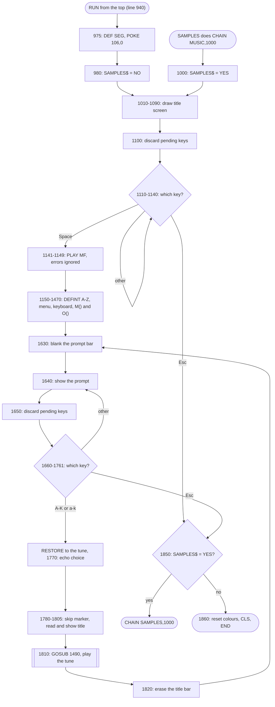
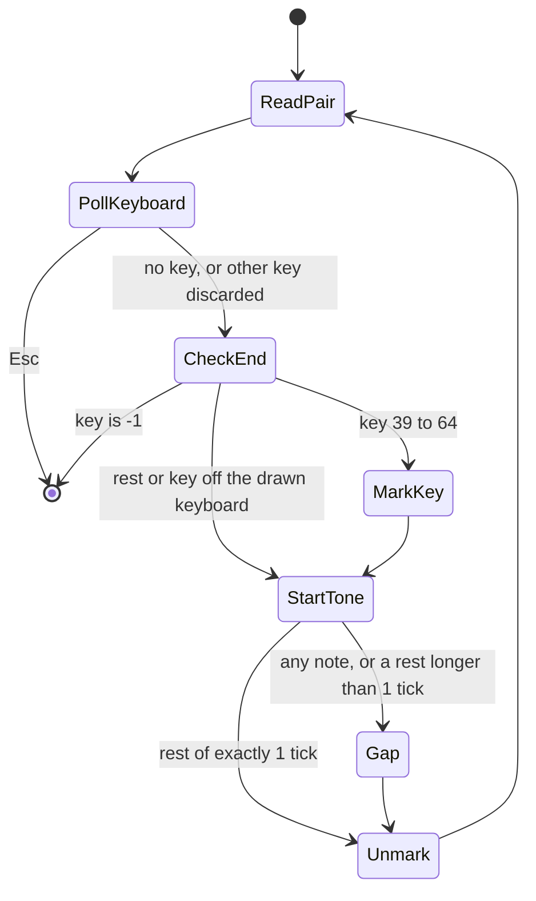
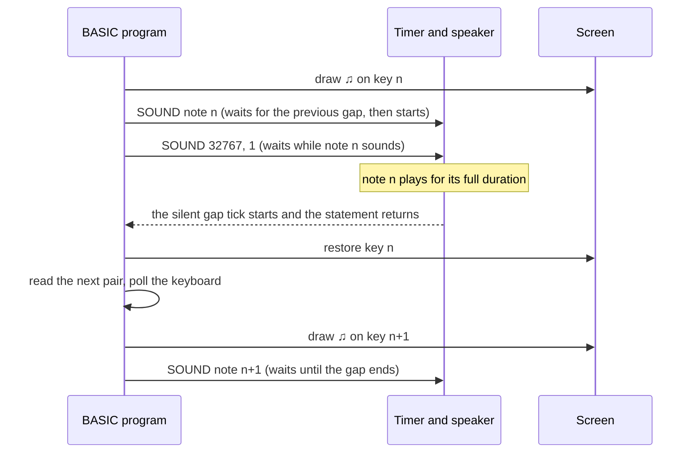

# Inside MUSIC.BAS (version 1.10)

This document explains how IBM's 1982 *MUSIC* program is built. It covers the flow of control, how the screen and keyboard are drawn, the note-data format, the frequency table, and the loop that plays one tune. Line numbers refer to the version 1.10 listing, which is about 210 lines long. The program's code, remarks and tune data are IBM's property and are not reproduced here: this document describes them in its own words, and the pseudo-code is paraphrased. For history and usage see [ABOUT.md](ABOUT.md) and [HOW-TO.md](HOW-TO.md).

## Map of the listing

| Lines | Role |
|---|---|
| 940–960 | Header remarks: title, version, licence |
| 975 | Keyboard housekeeping (`DEF SEG: POKE 106,0`) |
| 980–1000 | Two entry points that set the `SAMPLES$` flag |
| 1010–1140 | Title screen, then wait for Space or Esc |
| 1141–1149 | Try `PLAY "mf"` inside an error trap |
| 1150–1360 | Main screen: `DEFINT A-Z`, menu text, keyboard, frame, `DIM M(88),O(70)` |
| 1370–1380 | Build the frequency table `M()` |
| 1390–1470 | Build the screen-column map `O()` |
| 1490–1620 | Subroutine that plays one tune |
| 1630–1769 | Menu prompt and key dispatch |
| 1770–1830 | Echo the choice, show the title, play, clean up, loop |
| 1840 | `END`, never reached |
| 1850–1860 | Exit |
| 3000–3020 | "Music Scroll" header remarks (version 1.00, 1981) |
| 3200–4550 | Eleven tunes stored as `DATA` |

## Control flow



### Two entry points and the `SAMPLES$` flag

- **Run directly.** Execution starts at the header, performs the keyboard housekeeping at line 975, sets `SAMPLES$` to `"NO"` at line 980, and jumps over line 1000.
- **Started from IBM's `SAMPLES` menu.** That menu does `CHAIN "MUSIC",1000`, so execution starts at line 1000, which sets `SAMPLES$` to `"YES"`. Line 975 is skipped, so the `POKE` at line 1520 relies on the default segment still being BASIC's own data segment.
- **On exit (line 1850).** The flag decides the destination. With `"YES"` the program chains back to `SAMPLES` at that program's line 1000, which jumps to its menu. Otherwise line 1860 resets the colours, clears the screen and ends. It does not restore `WIDTH 80` or `KEY ON`.

## Screen construction

### Title screen (lines 1010–1090)

`KEY OFF` hides BASIC's function-key line, `SCREEN 0,1` selects colour text, and `WIDTH 40` selects 40 columns. The first `LOCATE` passes 0 as its cursor argument, which hides the cursor. The name box uses code page 437 box characters, which have double horizontal lines and single vertical lines: ╒ (213), ═ (205), ╕ (184), │ (179), ╘ (212) and ╛ (190). The text uses bright white (15), light green (10) and yellow (14). The same layout appears in the other IBM sample programs.

### Main screen layout

| Rows | Content |
|---|---|
| 4–13 | Keyboard in a red frame (columns 4–37) |
| 15–19 | Selection list, white on blue |
| 21 | Prompt bar, black on light grey, columns 5–36 |
| 23 | Tune title, white on red, centred using the title's length |

Line 1150 sets `COLOR 15,1,1`, which gives a blue background and border.

### Drawing the keyboard (lines 1200–1360)

- **White keys.** Sixteen keys are drawn, each two columns wide and nine rows tall (rows 5–13). Key *i* starts at column 5 + 2*i*, so the keys cover columns 5–36. Each key is a full block █ (219) followed by a left-half block ▌ (221), drawn in white on black. The black right half of the ▌ forms the thin seam between neighbouring keys.
- **Black keys.** These are drawn over rows 5–9. The loop walks 13 candidate seams, from the one between C4 and D4 to the one between A5 and B5. At seam *i* it prints a space (a solid black cell) at column 8 + 2*i*, followed by a right-half block ▐ (222). The result is a black key 1.5 cells wide, centred on the seam. Gaps 2, 6 and 9 are skipped because they are the E–F and B–C positions, which have no black key. The test also names gap 13, but the loop stops at 12, so that check never fires.
- **Frame.** Rows 4 and 13 are filled with red full blocks. Row 13 therefore covers the bottom row of the white keys. The left and right edges are red half blocks at columns 4 and 37.

The drawn range is **B3 to C6**: 16 white keys and 10 black keys, which are piano keys 39–64.

### The column map `O()` and the `SCREEN()` trick

Lines 1390–1470 fill `O(key)` with the screen column of each key. Within an octave the columns follow a fixed rhythm. Measured from C, the offsets are C +0, C♯ +1, D +2, D♯ +3, E +4, F +6, F♯ +7, G +8, G♯ +9, A +10, A♯ +11, B +12, and the next C +14. Some examples: C4 is column 7, A4 is column 17, and C6 is column 35.

When a note plays, the program has to know whether its key is white or black. It works this out from the screen itself. It reads the character at row 5 of the key's column with the `SCREEN(row, col)` function. A space (32) means a black key, and anything else (the █ of a white key) means a white key. The marker is character 14, ♫:

- On a white key, it is drawn at row 11, below the black keys, in black on light grey (colour 7). The marked cell therefore looks slightly dimmer than the bright-white key around it. Afterwards the program redraws █.
- On a black key, it is drawn at row 7 in white on black. Afterwards it redraws a space.

`O()` is dimensioned to 70 and filled up to key 70, but lines 1560 and 1600 only draw markers for keys 39–64. The extra entries could never have worked on this screen. Key 69's entry breaks the octave rhythm (it gives column 40 where the pattern predicts 41), and key 70's entry is column 42, beyond the 40-column screen. Why they exist is unknown. They may be left over from an earlier layout, but that is unverified.

## The frequency table `M()`

- **Integer arrays.** `DEFINT A-Z` runs at line 1150, before the `DIM` at line 1360, so both `M()` and `O()` are integer arrays. Version 1.00 got the same result from a narrower `DEFINT M,N,O,P` placed on line 1360 itself.
- **The formula.** For keys 7 to 88, line 1370 stores **36.8 × 2^((n − 6)/12)**. The keys are numbered like the 88 keys of a piano: key 1 is A0, key 40 is middle C (C4), key 49 is A4, and key 88 is C8. Assigning a fractional value to an integer rounds it to the nearest whole number, as the IBM manual documents, so the table holds whole hertz.
- **Keys 0–6.** These are set to 32767. Key 6 would come out at 36.8 Hz, below `SOUND`'s minimum of 37 Hz. Key 0 serves as the rest.
- **Why everything is sharp.** The anchor, 36.8 Hz for key 6 (D1), is a rounded version of the equal-tempered 36.708 Hz. That alone makes the whole table about 4.3 cents sharp. Rounding to whole hertz then adds or removes a little on each note. The rounding would happen even without `DEFINT`, because `SOUND` converts its frequency argument to an integer before use. Microsoft's published GW-BASIC source does this, and the ROM routine compares and divides the frequency as a 16-bit integer.

### What the timer really plays

The speaker tone comes from channel 2 of the 8253 timer. The timer divides its 1,193,181.67 Hz input clock by a 16-bit divisor. The routine that computes the divisor was inspected in two places: the SOUND routine of the IBM ROM BASIC image hosted by PCjs, and the copy inside `BASICA.COM` 1.10 from the PC DOS 1.10 disk image. (`BASIC.COM` 1.10 has no copy of its own, so Disk BASIC uses the ROM's routine.) Both load the constant 1,193,180 and divide it by the integer frequency with the 8088's unsigned `DIV`, which **discards the remainder**. For A4 the calculation is:

> 1,193,180 ÷ 441 = 2705.6, truncated to **2705**; 1,193,181.67 ÷ 2705 = **441.10 Hz**, which is **+4.3 cents** above 440 Hz.

By coincidence, the truncation almost exactly cancels the earlier rounding. The result is the value the formula gave before rounding (441.102 Hz).

| Key | Note | Equal temperament | Formula | Stored | Divisor | Sounds at | Error |
|---|---|---|---|---|---|---|---|
| 30 | D3 | 146.83 | 147.20 | 147 | 8116 | 147.02 | +2.2 ¢ |
| 37 | A3 | 220.00 | 220.55 | 221 | 5399 | 221.00 | +7.9 ¢ |
| 40 | C4 | 261.63 | 262.28 | 262 | 4554 | 262.01 | +2.5 ¢ |
| 49 | A4 | 440.00 | 441.10 | 441 | 2705 | 441.10 | +4.3 ¢ |
| 52 | C5 | 523.25 | 524.56 | 525 | 2272 | 525.17 | +6.3 ¢ |
| 64 | C6 | 1046.50 | 1049.12 | 1049 | 1137 | 1049.41 | +4.8 ¢ |
| 66 | D6 | 1174.66 | 1177.60 | 1178 | 1012 | 1179.03 | +6.4 ¢ |

All frequencies are in Hz. Across every key used by the tunes (keys 30–66), the error runs from +0.2 cents (G3) to +7.9 cents (A3), with an average of about +4.6 cents. A3 at 221 Hz and A4 at 441 Hz make an octave about 3.5 cents narrow.

A rest is `SOUND 32767, n`. That gives a divisor of 36 and a tone of about 33.1 kHz, which is far above hearing. IBM's BASIC manual itself tells programmers to use 32767 to create silence.

## Note data format (lines 3000–4550)

Each tune is a run of `DATA` items:

1. The marker **−2**, followed by the **title string** that will be shown on screen.
2. Pairs of **(key, duration)**. The key follows the piano numbering above, and 0 means a rest. The duration is counted in timer ticks of 1/18.2 s, about 54.9 ms. The tunes use keys 30–66 and durations from 1 to 24 ticks.
3. The terminator **−1, −1**.

The −2 marker is left over from version 1.00. There, line 1790 checked it: if a tune file did not start with −2, the player rewound and played it without a title. Version 1.10 simply reads the marker into `D` and throws it away. Some titles carry trailing spaces, and the SCALES title is padded to 32 characters, so its red title bar is much wider than the word.

| Tune | Starts at line | Pairs | Notes | Rests | Range | Written ticks | Ticks as played | Time as played |
|---|---|---|---|---|---|---|---|---|
| MARCH | 4000 | 93 | 72 | 21 | D3–E5 | 283 | 376 | 20.7 s |
| STARS | 4100 | 82 | 73 | 9 | D4–G5 | 382 | 464 | 25.5 s |
| FORTY | 3700 | 88 | 80 | 8 | F♯4–C♯6 | 296 | 384 | 21.1 s |
| HAT | 4300 | 76 | 65 | 11 | A4–D6 | 184 | 260 | 14.3 s |
| HUMOR | 3500 | 70 | 48 | 22 | G4–A5 | 186 | 256 | 14.1 s |
| BUG | 3200 | 73 | 40 | 33 | D3–E5 | 126 | 177 | 9.7 s |
| POP | 3600 | 80 | 56 | 24 | D4–A5 | 188 | 268 | 14.7 s |
| DANDY | 3900 | 59 | 55 | 4 | D4–D♯5 | 192 | 251 | 13.8 s |
| SAKURA | 4500 | 40 | 36 | 4 | B3–C5 | 320 | 360 | 19.8 s |
| BLUE | 3300 | 150 | 102 | 48 | C♯4–D6 | 588 | 738 | 40.5 s |
| SCALES | 4400 | 57 | 56 | 1 | A♯3–C♯6 | 81 | 138 | 7.6 s |

"As played" includes the gap after each note (explained below). The times are nominal: they ignore the interpreter's own overhead.

## Menu dispatch with `RESTORE` (lines 1630–1830)

```text
blank and redraw the prompt bar
discard any waiting keys
wait for a key
Esc                       -> exit path (line 1850)
letter A..K, either case  -> set label; RESTORE to that tune's first DATA line
anything else             -> redraw the prompt and wait again
echo " <key>-<label>" after the prompt
read and discard the -2 marker; read the title; show it centred on row 23
GOSUB the play loop
blank row 23; back to the top
```

| Key | Label | `RESTORE` line |
|---|---|---|
| A | MARCH | 4000 |
| B | STARS | 4100 |
| C | FORTY | 3700 |
| D | HAT | 4300 |
| E | HUMOR | 3500 |
| F | BUG | 3200 |
| G | POP | 3600 |
| H | DANDY | 3900 |
| I | SAKURA | 4500 |
| J | BLUE | 3300 |
| K | SCALES | 4400 |

Version 1.00 used separate lines for upper and lower case (22 in all) and had no `RESTORE` targets. Instead, line 1770 loaded a tune file named after the label with `CHAIN MERGE … ,1780,ALL` and continued at line 1780. Every tune file used line numbers starting at 3000. Because `MERGE` only replaces lines with matching numbers, a longer tune's tail would have stayed in memory under a shorter one. That was harmless, since the new −1, −1 terminator came first. (This is inferred from how `MERGE` is documented; it was not observed on a running machine.)

## The play loop (lines 1490–1620)

```text
repeat:
    read key, ticks
    k = keyboard character, if any (does not wait)
    if k is Esc: return
    if k is any other key: cancel any pending function-key text (POKE 106,0)
    if key = -1: return
    col = O(key)
    if 39 <= key <= 64:
        if the character at row 5, column col is not a space:  draw ♫ black-on-white at row 11
        else:                                                   draw ♫ white-on-black at row 7
    SOUND M(key), ticks
    unless key = 0 and ticks = 1:  SOUND 32767, 1          ' the detached-note gap
    if 39 <= key <= 64: restore the key face (█ at row 11, or a space at row 7)
```



### Why the marker stays in step with the sound

In *music foreground* mode, a `SOUND` statement starts its tone and returns straight away. The next `SOUND` then waits until that tone has finished. The loop depends on this:



The marker for a note appears during the gap just before that note sounds, and it is removed at the start of the gap that follows it. The interpreter's work between notes normally fits inside the 55 ms gap, so the audio is not delayed. This was reasoned from the code and not measured on a real machine.

### The gap and the "staccato" exception

Every event is followed by `SOUND 32767,1`, one tick of silence, so every event takes **one tick longer** than written. A 1-tick note takes 2 ticks and a 3-tick note takes 4. The single exception is a **rest of exactly 1 tick**. That rest gets no extra tick, and the line carries the comment "SKIP NEXT FOR STACCATTO" (spelled that way in the source). Only *La Cucaracha* uses such rests, 22 of them. Its detached repeated notes, written as a 1-tick note plus a 1-tick rest, take 3 ticks instead of 4.

The gap changes the rhythm. In *Humoresque*, each beat is written as a 3-tick note, a 2-tick rest and a 1-tick note: 6 ticks, with a 5:1 swing. As played it becomes 4 + 3 + 2 = 9 ticks, a 7:2 swing (3.5:1). The dotted lilt is gentler, and each beat lasts 50 % longer. How much each tune stretches depends on how many short events it has: from ×1.12 for SAKURA to ×1.70 for SCALES.

## `PLAY "mf"` and its error trap (lines 1141–1149)

`PLAY` exists only in Advanced BASIC (`BASICA`). Under Disk BASIC (`BASIC`) it fails with error 73, "Advanced Feature". The program sets `ON ERROR` just before the `PLAY` and resumes past it if it fails, then switches trapping off with `ON ERROR GOTO 0`. The same program therefore runs under both interpreters.

The `MF` command selects *music foreground*, where `SOUND` and `PLAY` notes play one after another while the program waits. The alternative, `MB` (*music background*), queues up to 32 notes and lets the program run ahead. In background mode the markers would race ahead of the music and Esc would respond late. Foreground is BASIC's default, and `CLEAR` also resets it. The explicit `PLAY "mf"` is a safeguard so that the display and the sound stay in step.

## Keyboard housekeeping: `DEF SEG: POKE 106,0` (lines 975 and 1520)

`DEF SEG` with no address points `POKE` at BASIC's own data segment. IBM's `SAMPLES` program comments the same POKE as "CLEAR KYBD BUFFER". The precise meaning comes from the IBM ROM BASIC image hosted by PCjs; IBM never published source for it. In that image, the keyboard reader keeps a one-byte status counter at offset 106. While it is nonzero, `INKEY$` hands out characters from a function-key string (F1–F10) or from an Alt+letter keyword shortcut, instead of reading a new key from the BIOS. Setting it to 0 **cancels any half-finished expansion**. It does not empty the BIOS type-ahead buffer, which lives in low memory at segment 0040h.

MUSIC does this once at start-up and again at line 1520, whenever a key other than Esc is pressed during a tune. Pressing F1 in the middle of a tune therefore cannot drip the rest of "LIST " into later `INKEY$` calls.

## What happens beneath `SOUND`

In the ROM, `SOUND` rejects frequencies below 37 Hz and waits for any previous sound to finish. It then sets timer channel 2 to square-wave mode with the divisor described above, opens the speaker gate through port 61h, and stores the duration to be counted down. `BASICA.COM` 1.10 replaces this routine with one that adds the 32-note background queue. When it starts a sound, it also runs the system timer 32 times faster (about 583 Hz), so it can time notes in 1/32-tick steps. A 1985 PC Magazine memory map gives the same 1/583-second unit for BASICA 2.1. MUSIC only ever uses whole ticks.

## Behaviour a faithful port should keep

- The pitches: integer hertz from 36.8 × 2^((n − 6)/12), then truncation to a whole-number timer divisor. A4 comes out at about 441.10 Hz.
- One tick of silence after every event, except a 1-tick rest.
- The 18.2 Hz tick as the time unit.
- Markers only for keys 39–64, shown during the gap before each note.
- Esc handled once per note; every other key ignored.
- Upper and lower case letters both accepted.
- Esc at the title or the menu leaves the program.

## Sources

- IBM Personal Computer BASIC, Version 1.10 manual (May 1982): `SOUND`, `PLAY`, `CHAIN`, `DEF SEG`, `CLEAR`, `SCREEN` function, number conversion, and error 73: http://www.bitsavers.org/pdf/ibm/pc/languages/BASIC_1.1_May82.pdf
- PCjs – BASIC Programs for PC DOS 1.00 (MUSIC 1.00 and SAMPLES listings, used for the 1.00 comparison): https://www.pcjs.org/software/pcx86/app/ibm/basic/1.00/
- PCjs – IBM PC BASIC ROMs: https://www.pcjs.org/machines/pcx86/ibm/5150/rom/basic/
- PCjs – ROM BASIC image used for the SOUND and keyboard analysis: https://www.pcjs.org/machines/pcx86/ibm/5150/rom/basic/BASIC100.json5
- PCjs – PC DOS 1.10 disk image (source of `BASICA.COM` 1.10 and the tokenised `MUSIC.BAS`): https://diskettes.pcjs.org/pcx86/sys/dos/ibm/1.10/PCDOS110.json
- Microsoft GW-BASIC source, 1983 (`GWSTS.ASM` SOUND/PLAY code, `GIOKYB.ASM` soft-key expansion): https://github.com/microsoft/GW-BASIC
- PC Magazine's "POKEs & PEEKs" (1985), a BASICA data-segment map covering soft-key strings and music buffer units: http://petesqbsite.com/sections/tutorials/tutorials/peekpoke.txt
- Microsoft KB Q60140 – location of the BIOS keyboard buffer: https://jeffpar.github.io/kbarchive/kb/060/Q60140/
- Wikipedia – Intel 8253: https://en.wikipedia.org/wiki/Intel_8253
- Wikipedia – PC speaker: https://en.wikipedia.org/wiki/PC_speaker
- Wikipedia – Code page 437: https://en.wikipedia.org/wiki/Code_page_437
