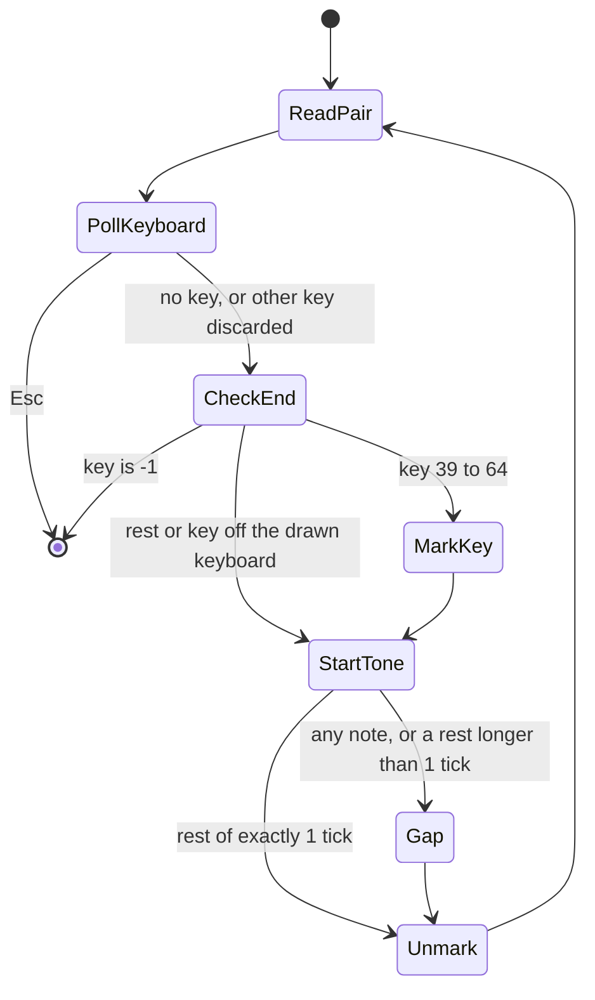
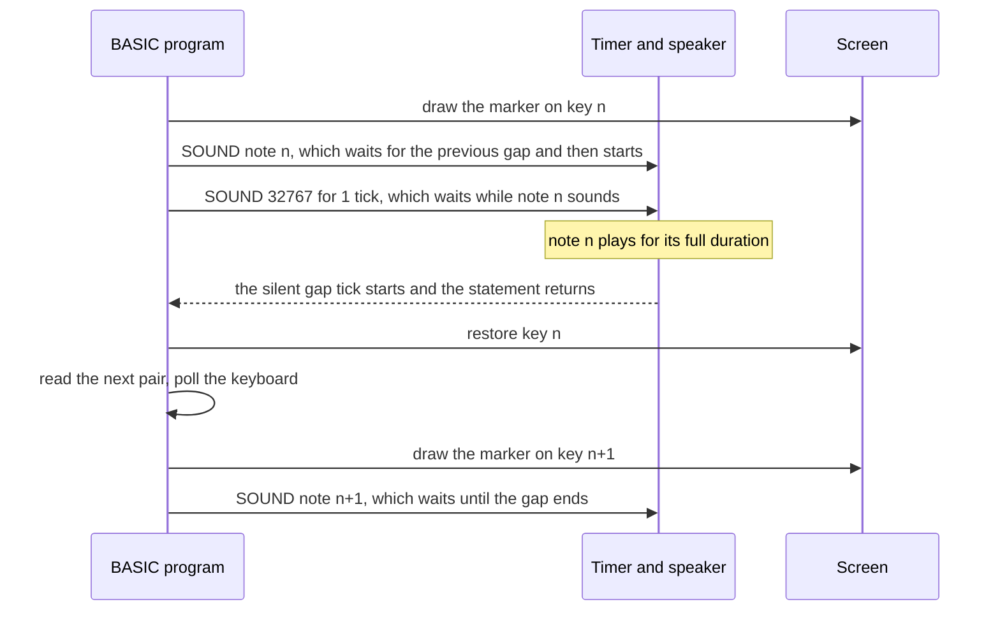

# Music (MUSIC.BAS): how the original works

*MUSIC* is a demonstration program of about 210 lines in IBM Personal Computer BASIC, version 1.10 (1982). It runs on the original IBM PC with the Color/Graphics adapter in 40-column text mode and plays eleven tunes, one note at a time, on the built-in speaker. This page explains how it is built: the flow of control, how the screen and keyboard are drawn, the note-data format, the frequency table and the loop that plays one tune. It ends with how to run the program today. Line numbers refer to the version 1.10 listing. The program's code, remarks and tune data are IBM's property and are not reproduced here: this page describes them in its own words, and the pseudo-code is paraphrased. For the program's history see [ABOUT.md](ABOUT.md); for the measurements behind the numbers below see [NOTES.md](NOTES.md).

## At a glance

| | |
|---|---|
| Program | The IBM Personal Computer Music, version 1.10 (1981, 1982) |
| Size | About 210 lines, numbered 940 to 4550; 8,704 bytes tokenised on the PC DOS 1.10 disk |
| Dialect | IBM Personal Computer BASIC 1.10. Runs under Disk BASIC (`BASIC.COM`) and Advanced BASIC (`BASICA.COM`) |
| Machine | IBM PC model 5150 with the Color/Graphics Monitor Adapter |
| Input | Single key presses read with `INKEY$`; no Enter key anywhere |
| Output | 40-column colour text, and the speaker through `SOUND` (one square-wave voice) |
| Data | Eleven tunes as `DATA` lines: a title, then pairs of piano key and duration in timer ticks |

## Line map

| Lines | Role |
|---|---|
| 940–960 | Header remarks: title, version, licence |
| 975 | Keyboard housekeeping (`DEF SEG: POKE 106,0`) |
| 980–1000 | Two entry points that set the `SAMPLES$` flag |
| 1010–1140 | Title screen, then wait for Space or Esc |
| 1141–1149 | Try `PLAY "mf"` inside an error trap |
| 1150–1360 | Main screen: `DEFINT A-Z`, menu text, keyboard, frame, `DIM M(88),O(70)` |
| 1370–1380 | Build the frequency table `M()` |
| 1390–1470 | Build the screen-column map `O()` |
| 1490–1620 | Subroutine that plays one tune |
| 1630–1769 | Menu prompt and key dispatch |
| 1770–1830 | Echo the choice, show the title, play, clean up, loop |
| 1840 | `END`, never reached |
| 1850–1860 | Exit |
| 3000–3020 | "Music Scroll" header remarks (version 1.00, 1981) |
| 3200–4550 | Eleven tunes stored as `DATA` |

## Control flow


In paraphrased pseudo-code:

```text
remember whether the SAMPLES menu started us
draw the title screen; throw away any waiting keys
wait for Space (go on) or Esc (leave)
ask for music in the foreground, ignoring the error if PLAY is missing
draw the menu and the keyboard; build the pitch table and the column map
loop:
    wait for a key at the prompt
    Esc       -> leave
    A..K      -> show the tune's title, play it, erase the title
    otherwise -> ask again
leave: back to SAMPLES if it started us, otherwise reset the screen and end
```

### Two entry points and the `SAMPLES$` flag

- **Run directly.** Execution starts at the header, performs the keyboard housekeeping at line 975, sets `SAMPLES$` to `"NO"` at line 980, and jumps over line 1000.
- **Started from IBM's `SAMPLES` menu.** That menu does `CHAIN "MUSIC",1000`, so execution starts at line 1000, which sets `SAMPLES$` to `"YES"`. Line 975 is skipped, so the `POKE` at line 1520 relies on the default segment still being BASIC's own data segment.
- **On exit (line 1850).** The flag decides the destination. With `"YES"` the program chains back to `SAMPLES` at that program's line 1000, which jumps to its menu. Otherwise line 1860 resets the colours, clears the screen and ends. It does not restore `WIDTH 80` or `KEY ON`.

## The interesting parts

### Screen construction

#### Title screen (lines 1010–1090)

`KEY OFF` hides BASIC's function-key line, `SCREEN 0,1` selects colour text, and `WIDTH 40` selects 40 columns. The first `LOCATE` passes 0 as its cursor argument, which hides the cursor. The name box uses code page 437 box characters, which have double horizontal lines and single vertical lines: ╒ (213), ═ (205), ╕ (184), │ (179), ╘ (212) and ╛ (190). The text uses bright white (15), light green (10) and yellow (14). The same layout appears in the other IBM sample programs.

#### Main screen layout

| Rows | Content |
|---|---|
| 4–13 | Keyboard in a red frame (columns 4–37) |
| 15–19 | Selection list, white on blue |
| 21 | Prompt bar, black on light grey, columns 5–36 |
| 23 | Tune title, white on red, centred using the title's length |

Line 1150 sets `COLOR 15,1,1`, which gives a blue background and border.

#### Drawing the keyboard (lines 1200–1360)

- **White keys.** Sixteen keys are drawn, each two columns wide and nine rows tall (rows 5–13). Key *i* starts at column 5 + 2*i*, so the keys cover columns 5–36. Each key is a full block █ (219) followed by a left-half block ▌ (221), drawn in white on black. The black right half of the ▌ forms the thin seam between neighbouring keys.
- **Black keys.** These are drawn over rows 5–9. The loop walks 13 candidate seams, from the one between C4 and D4 to the one between A5 and B5. At seam *i* it prints a space (a solid black cell) at column 8 + 2*i*, followed by a right-half block ▐ (222). The result is a black key 1.5 cells wide, centred on the seam. Gaps 2, 6 and 9 are skipped because they are the E–F and B–C positions, which have no black key. The test also names gap 13, but the loop stops at 12, so that check never fires.
- **Frame.** Rows 4 and 13 are filled with red full blocks. Row 13 therefore covers the bottom row of the white keys. The left and right edges are red half blocks at columns 4 and 37.

The drawn range is **B3 to C6**: 16 white keys and 10 black keys, which are piano keys 39–64.

### The column map `O()` and the `SCREEN()` trick

Lines 1390–1470 fill `O(key)` with the screen column of each key. Within an octave the columns follow a fixed rhythm. Measured from C, the offsets are C +0, C♯ +1, D +2, D♯ +3, E +4, F +6, F♯ +7, G +8, G♯ +9, A +10, A♯ +11, B +12, and the next C +14. Some examples: C4 is column 7, A4 is column 17, and C6 is column 35.

When a note plays, the program has to know whether its key is white or black. It works this out from the screen itself. It reads the character at row 5 of the key's column with the `SCREEN(row, col)` function. A space (32) means a black key, and anything else (the █ of a white key) means a white key. The marker is character 14, ♫:

- On a white key, it is drawn at row 11, below the black keys, in black on light grey (colour 7). The marked cell therefore looks slightly dimmer than the bright-white key around it. Afterwards the program redraws █.
- On a black key, it is drawn at row 7 in white on black. Afterwards it redraws a space.

`O()` is dimensioned to 70 and filled up to key 70, but lines 1560 and 1600 only draw markers for keys 39–64. The extra entries could never have worked on this screen. Key 69's entry breaks the octave rhythm (it gives column 40 where the pattern predicts 41), and key 70's entry is column 42, beyond the 40-column screen. Why they exist is unknown. They may be left over from an earlier layout, but that is unverified.

### The frequency table `M()`

- **Integer arrays.** `DEFINT A-Z` runs at line 1150, before the `DIM` at line 1360, so both `M()` and `O()` are integer arrays. Version 1.00 got the same result from a narrower `DEFINT M,N,O,P` placed on line 1360 itself.
- **The formula.** For keys 7 to 88, line 1370 stores **36.8 × 2^((n − 6)/12)**. The keys are numbered like the 88 keys of a piano: key 1 is A0, key 40 is middle C (C4), key 49 is A4, and key 88 is C8. Assigning a fractional value to an integer rounds it to the nearest whole number, as the IBM manual documents, so the table holds whole hertz.
- **Keys 0–6.** These are set to 32767. Key 6 would come out at 36.8 Hz, below `SOUND`'s minimum of 37 Hz. Key 0 serves as the rest.
- **Why everything is sharp.** The anchor, 36.8 Hz for key 6 (D1), is a rounded version of the equal-tempered 36.708 Hz. That alone makes the whole table about 4.3 cents sharp. Rounding to whole hertz then adds or removes a little on each note. The rounding would happen even without `DEFINT`, because `SOUND` converts its frequency argument to an integer before use. Microsoft's published GW-BASIC source does this, and the ROM routine compares and divides the frequency as a 16-bit integer.

### What the timer really plays

The speaker tone comes from channel 2 of the 8253 timer. The timer divides its 1,193,181.67 Hz input clock by a 16-bit divisor. The routine that computes the divisor was inspected in two places: the SOUND routine of the IBM ROM BASIC image hosted by PCjs, and the copy inside `BASICA.COM` 1.10 from the PC DOS 1.10 disk image. (`BASIC.COM` 1.10 has no copy of its own, so Disk BASIC uses the ROM's routine.) Both load the constant 1,193,180 and divide it by the integer frequency with the 8088's unsigned `DIV`, which **discards the remainder**. For A4 the calculation is:

> 1,193,180 ÷ 441 = 2705.6, truncated to **2705**; 1,193,181.67 ÷ 2705 = **441.10 Hz**, which is **+4.3 cents** above 440 Hz.

By coincidence, the truncation almost exactly cancels the earlier rounding. The result is the value the formula gave before rounding (441.102 Hz).

| Key | Note | Equal temperament | Formula | Stored | Divisor | Sounds at | Error |
|---|---|---|---|---|---|---|---|
| 30 | D3 | 146.83 | 147.20 | 147 | 8116 | 147.02 | +2.2 ¢ |
| 37 | A3 | 220.00 | 220.55 | 221 | 5399 | 221.00 | +7.9 ¢ |
| 40 | C4 | 261.63 | 262.28 | 262 | 4554 | 262.01 | +2.5 ¢ |
| 49 | A4 | 440.00 | 441.10 | 441 | 2705 | 441.10 | +4.3 ¢ |
| 52 | C5 | 523.25 | 524.56 | 525 | 2272 | 525.17 | +6.3 ¢ |
| 64 | C6 | 1046.50 | 1049.12 | 1049 | 1137 | 1049.41 | +4.8 ¢ |
| 66 | D6 | 1174.66 | 1177.60 | 1178 | 1012 | 1179.03 | +6.4 ¢ |

All frequencies are in Hz. Across every key used by the tunes (keys 30–66), the error runs from +0.2 cents (G3) to +7.9 cents (A3), with an average of about +4.6 cents. A3 at 221 Hz and A4 at 441 Hz make an octave about 3.5 cents narrow.

A rest is `SOUND 32767, n`. That gives a divisor of 36 and a tone of about 33.1 kHz, which is far above hearing. IBM's BASIC manual itself tells programmers to use 32767 to create silence.

### Note data format (lines 3000–4550)

Each tune is a run of `DATA` items:

1. The marker **−2**, followed by the **title string** that will be shown on screen.
2. Pairs of **(key, duration)**. The key follows the piano numbering above, and 0 means a rest. The duration is counted in timer ticks of 1/18.2 s, about 54.9 ms. The tunes use keys 30–66 and durations from 1 to 24 ticks.
3. The terminator **−1, −1**.

The −2 marker is left over from version 1.00. There, line 1790 checked it: if a tune file did not start with −2, the player rewound and played it without a title. Version 1.10 simply reads the marker into `D` and throws it away. Some titles carry trailing spaces, and the SCALES title is padded to 32 characters, so its red title bar is much wider than the word.

| Tune | Starts at line | Pairs | Notes | Rests | Range | Written ticks | Ticks as played | Time as played |
|---|---|---|---|---|---|---|---|---|
| MARCH | 4000 | 93 | 72 | 21 | D3–E5 | 283 | 376 | 20.7 s |
| STARS | 4100 | 82 | 73 | 9 | D4–G5 | 382 | 464 | 25.5 s |
| FORTY | 3700 | 88 | 80 | 8 | F♯4–C♯6 | 296 | 384 | 21.1 s |
| HAT | 4300 | 76 | 65 | 11 | A4–D6 | 184 | 260 | 14.3 s |
| HUMOR | 3500 | 70 | 48 | 22 | G4–A5 | 186 | 256 | 14.1 s |
| BUG | 3200 | 73 | 40 | 33 | D3–E5 | 126 | 177 | 9.7 s |
| POP | 3600 | 80 | 56 | 24 | D4–A5 | 188 | 268 | 14.7 s |
| DANDY | 3900 | 59 | 55 | 4 | D4–D♯5 | 192 | 251 | 13.8 s |
| SAKURA | 4500 | 40 | 36 | 4 | B3–C5 | 320 | 360 | 19.8 s |
| BLUE | 3300 | 150 | 102 | 48 | C♯4–D6 | 588 | 738 | 40.5 s |
| SCALES | 4400 | 57 | 56 | 1 | A♯3–C♯6 | 81 | 138 | 7.6 s |

"As played" includes the gap after each note (explained below). The times are nominal: they ignore the interpreter's own overhead.

### Menu dispatch with `RESTORE` (lines 1630–1830)

```text
blank and redraw the prompt bar
discard any waiting keys
wait for a key
Esc                       -> exit path (line 1850)
letter A..K, either case  -> set label; RESTORE to that tune's first DATA line
anything else             -> redraw the prompt and wait again
echo " <key>-<label>" after the prompt
read and discard the -2 marker; read the title; show it centred on row 23
GOSUB the play loop
blank row 23; back to the top
```

| Key | Label | `RESTORE` line |
|---|---|---|
| A | MARCH | 4000 |
| B | STARS | 4100 |
| C | FORTY | 3700 |
| D | HAT | 4300 |
| E | HUMOR | 3500 |
| F | BUG | 3200 |
| G | POP | 3600 |
| H | DANDY | 3900 |
| I | SAKURA | 4500 |
| J | BLUE | 3300 |
| K | SCALES | 4400 |

Version 1.00 used separate lines for upper and lower case (22 in all) and had no `RESTORE` targets. Instead, line 1770 loaded a tune file named after the label with `CHAIN MERGE … ,1780,ALL` and continued at line 1780. Every tune file used line numbers starting at 3000. Because `MERGE` only replaces lines with matching numbers, a longer tune's tail would have stayed in memory under a shorter one. That was harmless, since the new −1, −1 terminator came first. (This is inferred from how `MERGE` is documented; it was not observed on a running machine.)

### The play loop (lines 1490–1620)

```text
repeat:
    read key, ticks
    k = keyboard character, if any (does not wait)
    if k is Esc: return
    if k is any other key: cancel any pending function-key text (POKE 106,0)
    if key = -1: return
    col = O(key)
    if 39 <= key <= 64:
        if the character at row 5, column col is not a space:  draw ♫ black-on-white at row 11
        else:                                                   draw ♫ white-on-black at row 7
    SOUND M(key), ticks
    unless key = 0 and ticks = 1:  SOUND 32767, 1          ' the detached-note gap
    if 39 <= key <= 64: restore the key face (█ at row 11, or a space at row 7)
```



### Why the marker stays in step with the sound

In *music foreground* mode, a `SOUND` statement starts its tone and returns straight away. The next `SOUND` then waits until that tone has finished. The loop depends on this:



The marker for a note appears during the gap just before that note sounds, and it is removed at the start of the gap that follows it. The interpreter's work between notes normally fits inside the 55 ms gap, so the audio is not delayed. This was reasoned from the code and not measured on a real machine.

### The gap and the "staccato" exception

Every event is followed by `SOUND 32767,1`, one tick of silence, so every event takes **one tick longer** than written. A 1-tick note takes 2 ticks and a 3-tick note takes 4. The single exception is a **rest of exactly 1 tick**. That rest gets no extra tick, and the line carries the comment "SKIP NEXT FOR STACCATTO" (spelled that way in the source). Only *La Cucaracha* uses such rests, 22 of them. Its detached repeated notes, written as a 1-tick note plus a 1-tick rest, take 3 ticks instead of 4.

The gap changes the rhythm. In *Humoresque*, each beat is written as a 3-tick note, a 2-tick rest and a 1-tick note: 6 ticks, with a 5:1 swing. As played it becomes 4 + 3 + 2 = 9 ticks, a 7:2 swing (3.5:1). The dotted lilt is gentler, and each beat lasts 50 % longer. How much each tune stretches depends on how many short events it has: from ×1.12 for SAKURA to ×1.70 for SCALES.

### `PLAY "mf"` and its error trap (lines 1141–1149)

`PLAY` exists only in Advanced BASIC (`BASICA`). Under Disk BASIC (`BASIC`) it fails with error 73, "Advanced Feature". The program sets `ON ERROR` just before the `PLAY` and resumes past it if it fails, then switches trapping off with `ON ERROR GOTO 0`. The same program therefore runs under both interpreters.

The `MF` command selects *music foreground*, where `SOUND` and `PLAY` notes play one after another while the program waits. The alternative, `MB` (*music background*), queues up to 32 notes and lets the program run ahead. In background mode the markers would race ahead of the music and Esc would respond late. Foreground is BASIC's default, and `CLEAR` also resets it. The explicit `PLAY "mf"` is a safeguard so that the display and the sound stay in step.

### Keyboard housekeeping: `DEF SEG: POKE 106,0` (lines 975 and 1520)

`DEF SEG` with no address points `POKE` at BASIC's own data segment. IBM's `SAMPLES` program comments the same POKE as "CLEAR KYBD BUFFER". The precise meaning comes from the IBM ROM BASIC image hosted by PCjs; IBM never published source for it. In that image, the keyboard reader keeps a one-byte status counter at offset 106. While it is nonzero, `INKEY$` hands out characters from a function-key string (F1–F10) or from an Alt+letter keyword shortcut, instead of reading a new key from the BIOS. Setting it to 0 **cancels any half-finished expansion**. It does not empty the BIOS type-ahead buffer, which lives in low memory at segment 0040h.

MUSIC does this once at start-up and again at line 1520, whenever a key other than Esc is pressed during a tune. Pressing F1 in the middle of a tune therefore cannot drip the rest of "LIST " into later `INKEY$` calls.

### What happens beneath `SOUND`

In the ROM, `SOUND` rejects frequencies below 37 Hz and waits for any previous sound to finish. It then sets timer channel 2 to square-wave mode with the divisor described above, opens the speaker gate through port 61h, and stores the duration to be counted down. `BASICA.COM` 1.10 replaces this routine with one that adds the 32-note background queue. When it starts a sound, it also runs the system timer 32 times faster (about 583 Hz), so it can time notes in 1/32-tick steps. A 1985 PC Magazine memory map gives the same 1/583-second unit for BASICA 2.1. MUSIC only ever uses whole ticks.

### What a faithful port must keep

- The pitches: integer hertz from 36.8 × 2^((n − 6)/12), then truncation to a whole-number timer divisor. A4 comes out at about 441.10 Hz.
- One tick of silence after every event, except a 1-tick rest.
- The 18.2 Hz tick as the time unit.
- Markers only for keys 39–64, shown during the gap before each note.
- Esc handled once per note; every other key ignored.
- Upper and lower case letters both accepted.
- Esc at the title or the menu leaves the program.

How much of this Bop Box's PC Speaker ’81 style reproduces is set out in [CHANGES-FROM-ORIGINAL.md](CHANGES-FROM-ORIGINAL.md#faithful-modes).

## Quirks and bugs

- **Everything plays sharp.** A rounded anchor and two rounding steps put A4 at 441.10 Hz; every note is 0.2 to 7.9 cents high.
- **Every note is detached.** The one-tick gap stretches each tune by 12 to 70 % and softens dotted rhythms.
- **Notes off the drawn keyboard sound without a marker.** Six of the eleven tunes reach past B3–C6, and SCALES starts and ends one semitone beyond each edge.
- **Dead code.** The black-key loop tests a gap it never reaches, the column map holds entries for keys that can never be marked (two of them wrong or off the screen), and line 1840's `END` can never run.
- **Esc is slow.** It is noticed only when the current note ends, up to about 1.4 seconds later.
- **It leaves a mess behind.** Run on its own, it exits in 40-column mode with the function-key line still hidden.

The evidence for each, and whether Bop Box keeps it, is in [NOTES.md](NOTES.md).

## Playing the original

This section explains how the program behaves from the user's side: what each screen shows, which keys do what, and how the program exits. It then covers four ways to run the original today. All behaviour described here was checked against the version 1.10 listing.

### Starting the program

There are three ways to start it on an IBM PC with PC DOS 1.10 (or the PC DOS 2.00 supplemental diskette):

- From the DOS prompt, type `BASICA MUSIC`. `BASIC MUSIC` (Disk BASIC) also works, as the program is written to run without Advanced BASIC.
- From inside BASIC, type `RUN "MUSIC"`.
- Through IBM's sample menu: start `BASICA SAMPLES`, press the space bar, then press **A**.

The last route matters, because the program remembers how it was started. It uses that to decide where Esc takes you at the end (see *Leaving the program* below).

### Screen 1: the title screen

The program switches to 40-column colour text on a black background. It shows "IBM" and "Personal Computer" in bright white, a light-green box with the program name and "Version 1.10", a copyright line, and a yellow prompt at the bottom asking for the space bar.

| Key | Effect |
|---|---|
| Space | Continue to the main screen |
| Esc | Leave the program at once, without seeing the main screen |
| Anything else | Ignored |

Keys you pressed before the title appeared are thrown away first, so type-ahead cannot skip this screen.

### Screen 2: the keyboard and the menu

The screen turns blue. The top half shows a small piano keyboard in a red frame, with 16 white keys and 10 black keys running from B3 to C6. Below it is the list of selections, and below that is a light-grey prompt bar that asks for your choice.

| Key | Label | Tune |
|---|---|---|
| A | MARCH | Funeral March of a Marionette (Gounod) |
| B | STARS | The Stars and Stripes Forever (Sousa) |
| C | FORTY | Symphony No. 40, opening (Mozart) |
| D | HAT | Mexican Hat Dance (traditional) |
| E | HUMOR | Humoresque (Dvořák) |
| F | BUG | La Cucaracha (folk song) |
| G | POP | Pop! Goes the Weasel |
| H | DANDY | Yankee Doodle |
| I | SAKURA | Sakura (Japanese folk melody) |
| J | BLUE | The Blue Danube (Johann Strauss II) |
| K | SCALES | A chromatic scale up and down |
| Esc | – | Leave the program |

- **Case does not matter.** Both `A` and `a` work. Your choice is echoed on the prompt bar exactly as you typed it, for example `b-STARS`.
- **Other keys are ignored.** Pressing anything else simply shows the prompt again. There is no error message or beep.
- **Keys typed during a tune are discarded** before the menu reads its next key, so you cannot queue up the next selection in advance.

### While a tune plays

- The **full title** of the tune appears centred near the bottom of the screen, in white on a red bar.
- A **♫ marker** moves across the keyboard, sitting on the key that is sounding. On white keys it appears near the bottom of the key, in black. On black keys it appears in the middle, in white.
- **Notes outside B3–C6 have no marker.** They still play, but no key lights up. The tunes affected are:

  | Tune | Notes with no marker |
  |---|---|
  | MARCH | D3 and A3, including the tune's first two notes |
  | BUG | D3, G3 and A3 |
  | FORTY | C♯6 |
  | HAT | D6 |
  | BLUE | D6 |
  | SCALES | A♯3 and C♯6, the first and last notes of the scale |

  STARS, HUMOR, POP, DANDY and SAKURA stay entirely on the drawn keyboard.
- **Rests** show no marker.
- **Every note is detached.** A silence of about 1/18 of a second follows every note, apart from the very short rests in *La Cucaracha*. Tunes therefore sound slightly clipped and play more slowly than their written durations suggest.
- **Esc stops the tune.** The program checks the keyboard once per note, so Esc takes effect when the current note ends. That can take up to about 1.4 seconds during the longest note, in HUMOR. The marker is removed, the title bar disappears, and you return to the menu prompt.
- **Other keys are ignored** during a tune. If you press a function key, the program also cancels the text that BASIC would normally type for it (line 1520).
- **Ctrl+Break** stops BASIC itself, not just the tune. You land at BASIC's `Ok` prompt with a "Break in …" message and the screen still blue and 40 columns wide.

When a tune finishes normally, the title bar is erased and the prompt bar resets, ready for the next choice.

### Leaving the program

Press **Esc** on the title screen or at the menu. What happens next depends on how the program was started:

- **Started on its own** (`BASICA MUSIC` or `RUN "MUSIC"`). The screen is reset to grey on black and cleared, and you are back at BASIC's `Ok` prompt. The program does **not** restore the 80-column screen or the function-key line at the bottom. Type `WIDTH 80` and `KEY ON` to get them back, or `SYSTEM` to return to DOS.
- **Started from SAMPLES.** MUSIC chains back to `SAMPLES` at that program's line 1000, which jumps straight to its program menu and skips its title screen. `SAMPLES.BAS` must still be on the current drive.

### Running the original today

#### Option 1: PCjs (in the browser, with IBM's own disk)

PCjs emulates the IBM PC 5150 with IBM's ROM BASIC and hosts the original PC DOS diskettes, so you can run the genuine program without copying any files.

1. Open PCjs's "IBM PC (Model 5150) with Color Graphics" machine (its address is under *Sources*).
2. In the diskette controls, select drive A:, choose **PC DOS 1.10** from the list and click **Load**.
3. Restart the machine with its Reset button or Ctrl+Alt+Del, then press Enter at the date and time prompts.
4. At `A>`, type `BASICA MUSIC`. To use the original menu instead, type `BASICA SAMPLES` and choose A.

You can also use PC DOS 2.00. Its "Disk 2" (Supplemental Programs) holds a byte-identical `MUSIC.BAS`, but there it runs under BASICA 2.00 rather than 1.10.

Caveats:

- The PCjs page for PC DOS 1.10 embeds a machine with a **monochrome** display. MUSIC was designed for colour 40-column text, so use the CGA machine above. Exactly how it looks on a monochrome adapter was not tested.
- Browsers only allow audio after you interact with a page, so **click inside the emulator** before choosing a tune. PCjs plays the speaker through a Web Audio square-wave oscillator. It treats tones above 20 kHz as silence, so MUSIC's 32767 Hz "rests" are silent there. Whether sound is switched on depends on the machine's configuration. If you hear nothing, check that the tab isn't muted.

#### Option 2: PC-BASIC (free, cross-platform)

PC-BASIC is an open-source reimplementation of GW-BASIC and IBM BASICA that emulates the display and speaker.

1. Install it with a desktop installer from its GitHub releases (see *Sources*), or with `pip3 install pcbasic`.
2. Run the text listing with `pcbasic MUSIC.BAS --preset=basica`. The `basica` preset emulates IBM BASICA. Plain `pcbasic MUSIC.BAS` also works and emulates GW-BASIC on a VGA machine, which displays 40-column colour text fine.

Caveats:

- PC-BASIC accepts text files with either Unix (LF) or DOS (CR LF) line endings.
- It only emulates part of the PC's memory, and a `POKE` outside those areas does nothing. The program's `POKE 106,0` keyboard housekeeping (lines 975 and 1520) is therefore a no-op. That makes no visible difference.
- `PLAY "MF"` is accepted, so the program's error trap never fires.

#### Option 3: DOSBox with GW-BASIC

- **IBM's `BASIC.COM` and `BASICA.COM` will not run in DOSBox or on clones.** They depend on the Cassette BASIC in the IBM PC's ROM, which DOSBox does not provide. Use Microsoft's stand-alone GW-BASIC instead.
- Microsoft's open-source release of GW-BASIC on GitHub contains the 1983 **source code only, with no executable**. You need a GW-BASIC binary from a DOS distribution you are licensed to use.
- GW-BASIC only accepts text programs with **CR LF** line endings. A listing with Unix line endings will not load correctly; PC-BASIC's documentation says to expect "Line buffer overflow". Convert it first, for example with `unix2dos`.
- Start it with `GWBASIC MUSIC.BAS`. Setting `machine=cga` in `dosbox.conf` gives a more authentic look, although the default video card also handles 40-column text. DOSBox emulates the PC speaker.
- `POKE 106,0` writes one byte into BASIC's own data area. Its meaning in IBM BASIC is explained under *Keyboard housekeeping* above. Nobody has checked that GW-BASIC keeps the same variable at the same address, so its effect there is unverified.

#### Option 4: real hardware

Use an IBM PC 5150, or another IBM model with Cassette BASIC in ROM, fitted with a Color/Graphics adapter and a colour or composite monitor. The file is on the PC DOS 1.10 diskette, and the PC DOS 2.00 Supplemental Programs diskette carries an identical copy. The 1.10 `SAMPLES` menu lists MUSIC as a 48 KB program. PC DOS 2.10 ships a slightly edited text copy: the spelling of "Weasel" is fixed and the Mozart ending is changed. On compatibles without IBM's ROM BASIC, use GW-BASIC as in Option 3.

### Caveats at a glance

| Topic | What to expect |
|---|---|
| Disk BASIC vs BASICA | Both work. In Disk BASIC the `PLAY "MF"` statement raises error 73 ("Advanced Feature"), and MUSIC silently traps and ignores it. |
| GW-BASIC vs BASICA | GW-BASIC supports every statement MUSIC uses and does not need IBM's ROM. Only the effect of `POKE 106,0` is unverified. |
| 40-column mode | The program assumes colour 40-column text and leaves the screen in that mode when it exits. |
| Speaker emulation | Rests are really a 32767 Hz tone. The real PC produces about 33 kHz, far above hearing. Emulators may simply mute it, as PCjs does. |
| Pitch | Notes are 0.2–7.9 cents sharp by design. A4 sounds at about 441.1 Hz, so don't retune your emulator to "fix" it. |
| Timing | Durations are counted in 18.2 Hz timer ticks, plus one tick of silence after each note. If an emulated CPU is extremely slow, the screen updates between notes may no longer fit inside that gap. |
| Esc latency | Esc is noticed at the end of the current note, not immediately. |

## Sources

- IBM Personal Computer BASIC, Version 1.10 manual (May 1982): `SOUND`, `PLAY`, `CHAIN`, `DEF SEG`, `CLEAR`, `SCREEN` function, number conversion, and error 73: http://www.bitsavers.org/pdf/ibm/pc/languages/BASIC_1.1_May82.pdf
- PCjs – BASIC Programs for PC DOS 1.00 (MUSIC 1.00 and SAMPLES listings, including SAMPLES line 1000; used for the 1.00 comparison): https://www.pcjs.org/software/pcx86/app/ibm/basic/1.00/
- PCjs – IBM PC DOS 1.10: https://www.pcjs.org/software/pcx86/sys/dos/ibm/1.10/
- PCjs – IBM PC DOS 2.00: https://www.pcjs.org/software/pcx86/sys/dos/ibm/2.00/
- PCjs – IBM PC (Model 5150) with Color Graphics: https://www.pcjs.org/machines/pcx86/ibm/5150/cga/
- PCjs – IBM PC BASIC ROMs: https://www.pcjs.org/machines/pcx86/ibm/5150/rom/basic/
- PCjs – ROM BASIC image used for the SOUND and keyboard analysis: https://www.pcjs.org/machines/pcx86/ibm/5150/rom/basic/BASIC100.json5
- PCjs disk images (source of `BASICA.COM` 1.10, the tokenised `MUSIC.BAS`, SAMPLES 1.10 and the later MUSIC copies): https://diskettes.pcjs.org/pcx86/sys/dos/ibm/1.10/PCDOS110.json, https://diskettes.pcjs.org/pcx86/sys/dos/ibm/2.00/PCDOS200-DISK2.json, https://diskettes.pcjs.org/pcx86/sys/dos/ibm/2.10/PCDOS210-DISK2.json
- PCjs source, speaker emulation (`chipset.js`): https://github.com/jeffpar/pcjs/blob/master/machines/pcx86/modules/v2/chipset.js
- Microsoft GW-BASIC source, 1983 (`GWSTS.ASM` SOUND/PLAY code, `GIOKYB.ASM` soft-key expansion): https://github.com/microsoft/GW-BASIC
- PC Magazine's "POKEs & PEEKs" (1985), a BASICA data-segment map covering soft-key strings and music buffer units: http://petesqbsite.com/sections/tutorials/tutorials/peekpoke.txt
- Microsoft KB Q60140 – location of the BIOS keyboard buffer: https://jeffpar.github.io/kbarchive/kb/060/Q60140/
- PC-BASIC repository and README: https://github.com/robhagemans/pcbasic
- PC-BASIC documentation (presets, line endings, POKE, memory model): https://robhagemans.github.io/pcbasic/doc/2.0/
- PC-BASIC memory emulation source: https://github.com/robhagemans/pcbasic/blob/master/pcbasic/basic/memory/memory.py
- DOSBox wiki – Sound: https://www.dosbox.com/wiki/Sound
- DOSBox wiki – dosbox.conf (machine option): https://www.dosbox.com/wiki/Dosbox.conf
- Wikipedia – IBM BASIC: https://en.wikipedia.org/wiki/IBM_BASIC
- Wikipedia – Intel 8253: https://en.wikipedia.org/wiki/Intel_8253
- Wikipedia – PC speaker: https://en.wikipedia.org/wiki/PC_speaker
- Wikipedia – Code page 437: https://en.wikipedia.org/wiki/Code_page_437
