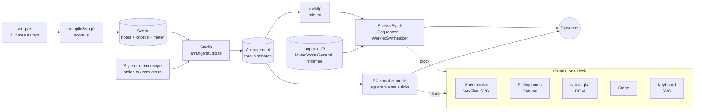
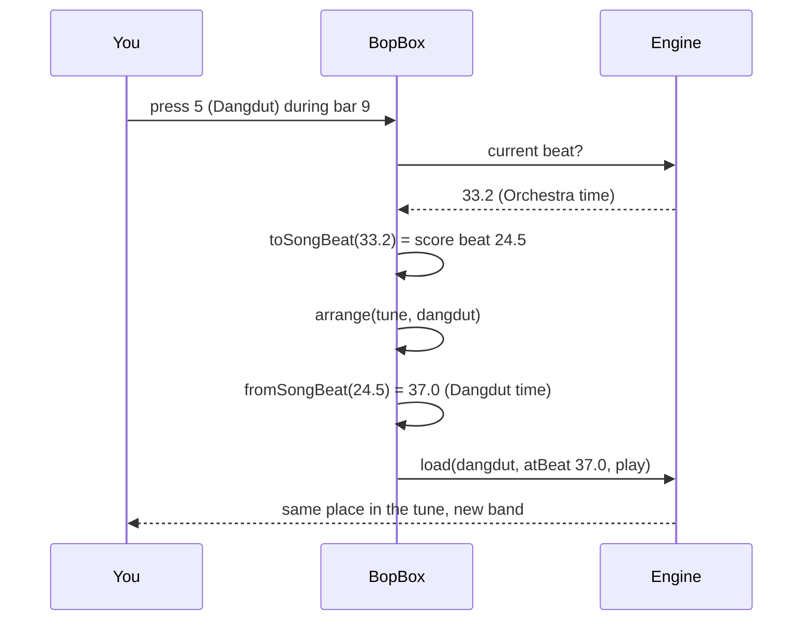

# Bop Box: how the rebuild works

**Bop Box** is the Any Key rebuild of IBM's 1981–82 *MUSIC* sample program. The original played eleven tunes on the PC's one-voice speaker and marked each note on a 26-key text-mode piano. Bop Box keeps that idea (pick a tune by letter, watch the keys light up) and grows it into a small music studio: ten ways to arrange every tune, live sheet music, falling notes, Indonesian numbered notation and a stage full of musicians.

This page explains how it is built. For the original program, see [ABOUT.md](ABOUT.md), [HOW-TO.md](HOW-TO.md) and [ORIGINAL-ARCHITECTURE.md](ORIGINAL-ARCHITECTURE.md).

## What we kept, what we changed

| The original | Bop Box |
|---|---|
| Eleven tunes on keys **A–K** | The same eleven tunes on the same letters. **F** is still the cockroach song |
| One square-wave voice | Ten styles: Orchestra, Pop, Jazz, House, Dangdut, Koplo, Lo-fi, Solo, PC Speaker ’81 and an AI Remix |
| A 26-key keyboard (B3–C6); notes outside it never lit up | A keyboard sized to each arrangement. The PC Speaker ’81 style brings back the 26-key look and flags notes that fall “off the edge” |
| Rhythms stretched by a one-tick gap after every note | Rhythms as written. The PC Speaker ’81 style reproduces the stretch on purpose |
| A = 441.1 Hz (a rounded table plus the timer's whole-number divider) | Concert pitch everywhere, except PC Speaker ’81, which recomputes the 1981 frequencies |
| No sheet music, no way to see the harmony | Sheet music with chord symbols, falling notes, *not angka* and a stage view |
| Esc stops the tune | Space plays and pauses; digits switch styles mid-song without losing your place |

## Provenance and licences

- **No IBM code or data is used.** The melodies are public-domain compositions, transcribed for this project in our own notation (see *The score format* below). We chose excerpts that match what the 1981 program played, so the tunes are recognisably “the same eleven”, but the notes, rhythms, chord charts and arrangements are ours.
- **Instruments** come from *MuseScore General* (MIT licence; FluidR3 by Frank Wen and later work by Michael Cowgill, S. Christian Collins and others). The full licence ships next to the sound bank in `public/soundfont/`.
- **Libraries:** SpessaSynth (`spessasynth_lib`, `spessasynth_core`, Apache-2.0) plays the sound bank. VexFlow (MIT) engraves the sheet music. Mermaid (MIT) draws these diagrams, and marked (MIT) renders these docs.
- **AI Remix:** the owner asked Claude to do the remixing. Every remix is composed as notes by Claude inside `lib/music/arrange/remixes.ts`, not generated audio. That is also why the sheet music and keyboard stay in sync with it.

## The big picture



Everything musical happens *before* audio. A style never touches sound directly: it asks the Studio for tracks and fills them with notes. The result is an **Arrangement**, a list of tracks, each with an instrument, a colour and its notes in beats. That one object feeds the synthesizer, the MIDI and WAV downloads and every visual.

## Code map

| Path | Job |
|---|---|
| `lib/music/theory.ts` | Pitches, chord parsing, voicings with smooth voice-leading, a seeded random generator |
| `lib/music/score.ts` | The text notation, its parser and bar checks |
| `lib/music/songs.ts` | The eleven tunes: melody, chords, meter, tempo, key, colour, 1981 tick speed |
| `lib/music/arrange/studio.ts` | Meter mapping, intros and outros, repeats, drum/bass/chord/arpeggio/melody generators, swing |
| `lib/music/arrange/styles.ts` | The nine regular styles |
| `lib/music/arrange/remixes.ts` | Eleven remix recipes, one genre per tune |
| `lib/music/arrange/patches.ts` | Instrument table (General MIDI numbers), drum map, solo instruments, role colours |
| `lib/music/midi.ts` | Arrangement → Standard MIDI File |
| `lib/music/engine.ts` | Audio engine: SoundFont synth, sequencer, PC speaker model, mutes, speed, loop, WAV rendering |
| `lib/music/timeline.ts` | “What is sounding now?” lookups and keyboard geometry |
| `components/bopbox/` | The Studio screen: tunes, styles, band, transport, keyboard, the four views, Story |
| `scripts/` | Checks and the sound bank builder (see *Testing* below) |

## The score format

Each tune is written like a lead sheet, one bar at a time:

```text
melody: "D4e D4e D4e | G4q. B4q D4e D4e D4e | G4q. B4q. rq | ..."
chords: "D7 | G | G | D7 | ..."
```

A token is a pitch (`G4`, `F#5`, `Bb3`) or `r` for a rest, followed by a duration: `w` whole, `h` half, `q` quarter, `e` eighth, `s` sixteenth. A trailing `.` dots the note and `~` ties it to the next one. The parser checks that every bar adds up to the meter (the first bar may be a pickup), so a typo fails loudly instead of sounding wrong. Spellings are kept (`C#4` stays C sharp), so the sheet music uses the right accidentals.

## From one tune to ten styles

### Meter mapping

Grooves like House or Dangdut live in 4/4, but the Blue Danube is a waltz and Pop! Goes the Weasel is in 6/8. The Studio has two policies:

- **keep:** Orchestra, Jazz waltzes, Solo and the Space Waltz remix play the tune in its own meter.
- **four:** everything else maps the tune onto a 4/4 groove.
  - A **3/4** bar stretches its downbeat, so beat 1 lasts two beats and beats 2–3 follow. The waltz lilt survives as a long–short–short feel.
  - A **6/8** bar becomes two plain beats, so the dotted quarter becomes the beat and the eighths become triplets. The tune keeps its speed and gains a shuffle.
  - **2/4** bars simply pair up.

Fixed-tempo styles (House at 124 BPM, Dangdut at 128, Koplo at 152, Lo-fi at 80) also get a **time scale**. A slow tune such as Sakura is played at half speed over the groove, and a fast tune plays as written, so the melody always feels natural.

### Two maps back and forth

Every arrangement carries `toSongBeat()` and `fromSongBeat()`. The sheet music and *not angka* views use the first to follow the tune (they always show the tune as written, even when the groove has stretched it). Style switching uses both:



### Generators

A style is a short recipe. It calls a handful of generators on the Studio:

| Generator | What it writes |
|---|---|
| `lead()` | The tune, with articulation, octave, accents and ornaments: suling grace notes and vibrato, mandolin tremolo, jazz grace notes |
| `harmony()` | A second voice a third or sixth below the tune, using chord tones |
| `comp()` | Chords in a rhythm pattern, voiced close together and moving as little as possible |
| `pad()` | Sustained chords, one per chord change |
| `arp()` | Arpeggios from a pattern of chord-tone indexes |
| `bass()` | Bass from a pattern (`R` root, `5` fifth, `8` octave, `A` approach note…) |
| `walkingBass()` | Jazz walking lines that lead into the next chord |
| `drums()` | Kit patterns per meter, fills every four or eight bars, crashes on new sections |
| `roll()` | A snare roll that speeds up and swells: the build before a drop |
| `sidechain()` | Volume ducks on every beat, the “pumping” sound of House and EDM |

Patterns are sixteenth-note strings, easy to read and tweak. This is a four-on-the-floor House groove:

```text
kick   X...X...X...X...
clap   ....x.......x...
hat    ..x...x...x...x.
```

Everything that sounds random (small velocity and timing differences) comes from a generator seeded by tune and style. Every play of a given arrangement is identical.

### The styles

| Style | Band | Groove |
|---|---|---|
| Orchestra | Depends on the tune: trumpet and tuba for marches; strings, pizzicato and harp for waltzes; bassoon for the spooky Gounod; driving eighth-note strings for Mozart | Tune's own meter and tempo, timpani on phrase starts |
| Pop | Soft synth lead, piano, pad, bass guitar, drum kit | 3-3-2 piano pushes, tempo folded towards 108 BPM |
| Jazz | Tenor sax (or muted trumpet), piano, upright bass, brushes | Swing (0.64), walking bass, sevenths on every chord, jazz waltz for 3/4 |
| House | Super-saw lead, house piano, polysynth pad, synth bass, drum machine | 124 BPM, four on the floor, offbeat hats, sidechain, a snare roll into the tune |
| Dangdut | Suling, mandolin tremolo, kendang, ketipung and tambourine, bass, guitar chops, keyboard strings | 128 BPM. The kendang “dhut” is a low drum whose pitch sags right after the hit (pitch-bend automation) |
| Koplo | Suling, keyboard, busier kendang, splash, bass, muted guitar | 152 BPM, dense kendang koplo pattern |
| Lo-fi | Vibraphone, electric piano with jazz chords, upright bass, soft kit | 80 BPM, lazy swing, vinyl crackle |
| Solo | The tune alone on one of 18 instruments | Tune's own meter and tempo |
| PC Speaker ’81 | One square wave | Timed in 1981 timer ticks (see below) |
| AI Remix | Different for every tune (see below) | Different for every tune |

General MIDI has no kendang or suling. The kendang is built from a melodic tom with pitch bends plus congas and bongos. The suling is a shakuhachi with grace notes and vibrato. This is an approximation, and it is the style that most needs a listening check from people who know the genre.

### The AI Remix

| Tune | Genre | Idea |
|---|---|---|
| Funeral March of a Marionette | Phonk | Cowbell melody, 808 bass slides, hi-hat rolls |
| Stars and Stripes Forever | Stadium EDM | Piano breakdown, snare build, super-saw drop |
| Symphony No. 40 | Liquid Drum & Bass | Strings at 174 BPM over breakbeats, then a synth lead |
| Mexican Hat Dance | Reggaeton | Dembow rhythm, kalimba pluck, 808 |
| Humoresque | Bossa Nova | Nylon guitar, brushes, flute, vibraphone harmony |
| La Cucaracha | Cumbia | Accordion in thirds, güiro, congas |
| Pop! Goes the Weasel | Chiptune | Square waves, fake echo, fast arpeggios, a key change |
| Yankee Doodle | Country Hoedown | Fiddle, banjo rolls, train beat |
| Sakura Sakura | Future Bass | Koto, then wobbling super-saw chords |
| The Blue Danube | Space Waltz | Choir, glockenspiel, pads and the famous timpani boom-boom |
| Scales | Trance | 138 BPM, trance gate, rolling bass, a key change at the peak |

## The PC Speaker ’81 model

This style reproduces how MUSIC.BAS sounded instead of just sounding “retro”:

1. **Timing.** Each note lasts a whole number of timer ticks (1/18.2 s), then the original's one-tick gap follows. The arrangement's clock runs in ticks, so the visuals stay in step with the stretched rhythm.
2. **Pitch.** The frequency is computed the way the program did it. The piano key number is *n* = MIDI − 20. The program's table gives round(36.8 × 2^((n − 6)/12)) Hz. The PC's timer then divides 1,193,180 Hz by the whole-number divisor ⌊1,193,180 / table⌋. For A4 that gives 441 → divisor 2705 → **441.1 Hz**.
3. **Sound.** A raw square wave with 2 ms edges to avoid clicks, and nothing else.
4. **Look.** The stage turns CGA blue in a red frame, the keyboard shrinks to the original 26 keys, and notes outside B3–C6 light an “off the edge” sign.

## Audio and sync

- **Engine.** `BopEngine` creates one `AudioContext`, loads the SpessaSynth worklet, downloads the sound bank with a progress bar and starts a `Sequencer`. Each arrangement is written to MIDI and handed to the sequencer. Mutes use the synth's per-channel mute, the speed control sets the sequencer's playback rate, and a limiter sits before the output.
- **One clock.** The visuals never keep their own time. Each view runs its own `requestAnimationFrame` loop that asks the engine for the current beat. React only re-renders when you change a tune, a style or a setting, not 60 times a second.
- **A smooth clock.** The audio clock (`AudioContext.currentTime`) only moves once per audio block, which makes scrolling stutter. The engine asks `getOutputTimestamp()` which sample is leaving the speakers right now and extrapolates from it with `performance.now()`. The visuals are then smooth (measured within 2 ms of a perfect line) and in step with what you actually hear, output latency included. Browsers without an output timestamp get a `performance.now()` clock that is nudged gently toward the audio clock.
- **Sheet music on a time grid.** VexFlow engraves the notes, but every note is then placed at exactly *beat × 110 px*, and bar widths are chosen so each downbeat keeps that spacing. The score scrolls at one constant speed with no lurch at bar lines, and whatever note is under the playhead is the one you hear. During an intro the score waits three beats ahead of the playhead, then glides in so the first note lands on time.
- **Light and dark.** The centre stage follows the theme through a small set of stage colour tokens (`--stage-ink`, `--stage-well`, `--stage-accent`…). Bright role colours are darkened a little on the light stage so they read on white keys. PC Speaker ’81 stays CGA blue in both themes, as the 1981 screen did.
- **Downloads.** *MIDI* writes the arrangement directly. *WAV* renders it offline with a second SpessaSynth instance on an `OfflineAudioContext`, faster than real time.

## The sound bank

MuseScore General is 38 MB. `scripts/build-soundfont.mts` builds `public/soundfont/bopbox.sf3` (about 16.6 MB):

- It lists every instrument any arrangement uses and keeps only those presets (63 of 309).
- It drops the piano's loud (FF) sample layer, so the mezzo-forte samples cover all velocities.
- It keeps only the left channel of the stereo piano samples and centres it.

```text
npx tsx scripts/build-soundfont.mts path/to/MuseScore_General.sf3
```

## Keyboard and accessibility

| Key | Action |
|---|---|
| A–K | Pick a tune (the 1981 letters) |
| 1–9, 0 | Pick a style |
| Space | Play / pause |
| ← / → | Jump a bar |
| V | Next view |

Every control is a real button with a visible focus ring. Tapping a musician on the Stage (or a chip under *Band*) mutes or unmutes them. The on-screen piano plays when clicked or tapped. The Studio follows the Any Key light and dark themes, and each style repaints the accent colours. Those colours are registered CSS properties, so they glide from one style to the next.

## Testing

| Script | Checks |
|---|---|
| `npx tsx scripts/check-songs.ts` | Every tune parses, every bar adds up, and prints ranges and lengths |
| `npx tsx scripts/check-arrangements.ts` | All 110 arrangements build with valid notes, and `toSongBeat(fromSongBeat(x)) = x` |
| `npx tsx scripts/render-check.mts 8` | Renders every style offline with the real sound bank and flags silence, clipping or missing instruments |

## Known limits

- Kendang and suling are General MIDI approximations (see above).
- The sheet music shows the tune and its chords, not every part of the arrangement.
- The first visit downloads about 17 MB of instruments; later visits use the browser cache.
- Arrangements are rule-based. They can sound mechanical in places, and each style is a starting point to refine by ear.
