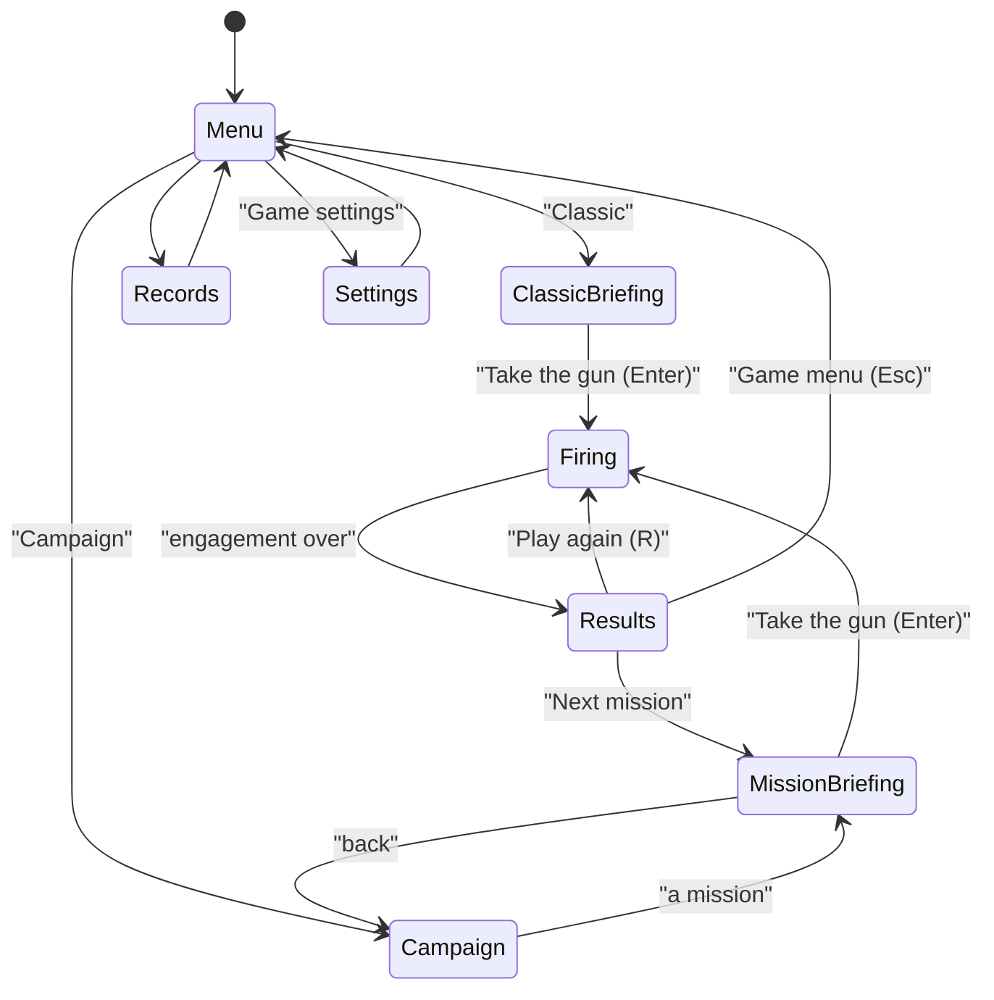
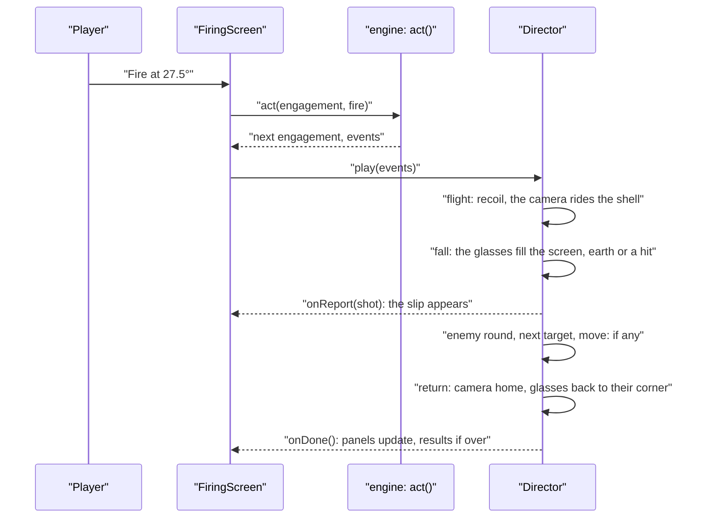

# Over / Short: how the rebuild works

Over / Short is three layers. The **engine** (`lib/over-short/`) is pure TypeScript: ballistic models, the
engagement (one gun, its targets, its rounds, turn by turn), the play styles that set engagements up, the Campaign's
missions as data, the bots that prove them, and the player's progress. The **battlefield** (`components/over-short/
scene/`, `play/director.ts`) paints what the engine decides, in Canvas 2D. The **era** (`components/over-short/eras/`)
supplies everything that is look, sound and words. The engine never sees an era, and the battlefield never decides a
shot.

## Module map

| File | Owns |
|---|---|
| `lib/over-short/ballistics.ts` | The textbook vacuum formulas: range, muzzle speed, flight, apex |
| `lib/over-short/models.ts` | The three ballistic models and the one integrator that flies every shell (`fly`), `positionAt`, `bestRange` |
| `lib/over-short/engagement.ts` | Rules, targets, the observer's verdict (`observe`), and `act`, which plays one order and returns the events |
| `lib/over-short/classic.ts` | Classic's setup and score |
| `lib/over-short/missions.ts` | The twenty Campaign missions as data, `buildMission`, medals, chapters |
| `lib/over-short/playstyles.ts` | The play-style layer: sessions, `engage`, `verdictOf` |
| `lib/over-short/bots.ts` | The simulated players and what they may see (`seen`) |
| `lib/over-short/original.ts` | Gunner's and Cannoneer's rules, quirks included |
| `lib/over-short/words.ts` | Units, and the observer's spoken numbers |
| `lib/over-short/progress.ts` | The saved progress, settings, records, the battery's range table, keycaps |
| `lib/over-short/manifest.ts` | The game's contract with the Hall |
| `components/over-short/OverShort.tsx` | The game menu and the screens it leads to |
| `components/over-short/Menu.tsx`, `Briefing.tsx`, `CampaignMap.tsx`, `Records.tsx`, `GameSettings.tsx` | The screens around a game |
| `components/over-short/Backdrop.tsx`, `scene/demo.ts` | The self-playing battlefield behind the menus and on the Hall card |
| `components/over-short/play/FiringScreen.tsx` | A game in progress: plays the engine, hands events to the director, keys, the shell |
| `components/over-short/play/director.ts` | Turns events into a sequence on screen: the shot, the fall of shot, a target going up, an enemy round, a move |
| `components/over-short/play/Battlefield.tsx` | The two canvases and the director's lifetime |
| `components/over-short/play/Hud.tsx`, `ElevationControl.tsx`, `ReportSlip.tsx`, `ObserverMap.tsx`, `FiringTable.tsx`, `Outcome.tsx` | The panels over the battlefield, and the results |
| `components/over-short/scene/side.ts` | The side view: parallax layers painted into tiles, the squeezed sky, flare light |
| `components/over-short/scene/front.ts` | The observer's view: a perspective ground painted per pixel, props, flare light |
| `components/over-short/scene/particles.ts`, `effects.ts` | Smoke, earth, fire and sparks, and the effects built from them |
| `components/over-short/scene/gunline.ts`, `detail.ts`, `paint.ts`, `noise.ts`, `color.ts` | Helpers: where the gun is drawn, how finely to paint, brushes, noise, colour |
| `components/over-short/eras/types.ts`, `eras/index.ts` | The `Era` interface and the list of eras |
| `components/over-short/eras/great-war/` | The Great War: palette, sky, land, observer's view, gun, targets, biplane, optics |
| `components/over-short/sound.ts` | Every sound, synthesised |
| `components/previews/OverShortPreview.tsx` | The game's card in the Hall |
| `app/over-short/page.tsx` | The route: reads the docs, renders the game |

## State machines

The screens:

One order on the firing screen. The engine answers at once; the director plays the answer, and the panels change
only when it is over, so nothing gives the result away early:

## The engine

### The ballistic models (`models.ts`)

One integrator flies every shell: fourth-order Runge–Kutta with a fixed step of 0.1 s, until the shell crosses the
ground on its way down, where the crossing is solved inside the step (a parabola, so a low round is placed to the
centimetre). The ground is a straight slope from the gun through the target, so a target on a hill and one in a
valley use the same code. The models differ only in the acceleration:

| Model | Acceleration | Used by |
|---|---|---|
| `vacuum` | gravity | Classic, Chapters 1–2 |
| `modified` | gravity, and a push along the line of fire of 0.04 m/s² for every m/s of wind | Chapter 3 |
| `air` | gravity and drag against the air: k times the speed through the air, times the velocity through the air, with k = 4 × 10⁻⁵ per metre | Chapters 4–5 |

With no drag and no wind the integrator lands exactly where R · sin 2θ says (the check finds no error at all over
1°–89°). `bestRange` finds the elevation that throws furthest by golden-section search, cached per gun.

### The engagement (`engagement.ts`)

An `Engagement` is a value: rules (model, gun, wind, what the briefing tells, the observer's reports and rounding,
ammunition, elevation limits, clock, counter-fire, moves), targets (kind, distance, height, speed, radius, hits) and
state (current target, time, shots, enemy rounds, gun position, outcome). `act(engagement, action)` returns the next
engagement and the events, in order: `shot`, `too-late`, `target-destroyed`, `next-target`, `enemy-round`,
`relocated`, `refused`, `over`. It never mutates its input, so the screen can hold the old one while the director
plays the new one.

- **Moving targets** are judged where they are when the round lands: game time moves on by the flight time plus the
  time to lay the gun again.
- **The clock**: a round landing after the limit ends the engagement as `out-of-time` and counts for nothing.
- **Counter-fire**: after each turn the enemy's round lands `first · closing^n` from the gun; at or under `lethal`
  the gun is lost. Moving the gun spends a turn, shifts it along the line of fire, and starts the enemy's count again.

### Play styles (`playstyles.ts`)

A play style is `{ id, title, engage(session), verdict(session, engagement) }`. Classic builds an engagement from a
seed (`classic.ts`); the Campaign builds one from a mission and a seed (`missions.ts`). The firing screen, the map,
the table and the results read only engagements and verdicts.

**To add a play style** (Field Artillery comes next): add its session type to `Session`, write its `engage` and
`verdict`, route them in `engage` and `verdictOf`, and give it a button and a briefing in the menu. If it needs a
new kind of order (elevation *and* charge, say), extend `Action` and handle it in `act`; if it needs sideways falls,
add a lateral miss to `Shot` and plot it on the map. Record either as an ADR.

### Missions as data (`missions.ts`)

Each `MissionSpec` gives bands, not numbers: the gun's vacuum range, target distances as shares of the gun's real
greatest range, heights, speeds, wind, plus ammunition, limits, clock, counter-fire and medal thresholds.
`buildMission(spec, seed)` turns one into an engagement with the kit RNG, so every attempt differs in its numbers but
never in its lesson. From Chapter 4 the gun is fixed (`BATTERY_GUN`), so the range table a player builds stays true.

### Progress (`progress.ts`)

`anykey.over-short.save`, version 1, through `createStore` and `createProgress`: settings, Classic's records, each
mission's tries, wins, best rounds and medal, and the battery's range table (rounds fired in Chapters 4 and 5 on level
ground in still air, newest per elevation, at most 40). `afterEngagement` is the pure function that records a game
and decides its keycaps. A mission played with the textbook hint earns silver at most.

## AI

There are no opponents to play against: the bots are simulated players for the checks (`bots.ts`). They see only
what the screen shows (`seen`): the briefing, the target's distance rounded as shown, the reports, how long each
round flew.

| Bot | How it lays the gun |
|---|---|
| `calculatorBot` | The 1973 formula, ½ · asin(T ÷ R) |
| `gunnerBot` | The "sensible gunner": every round with a reported distance becomes a row of its own range table; the next elevation comes from the two rows that straddle the target (or the two nearest, with a firm step where the curve is flat near the greatest range). It leads a moving target by its speed times the flight time, keeps to the low road, and moves the gun when the enemy's last round fell within 300 m. With direction-only reports it brackets |
| `bracketBot` | Directions only: steps 4° until one round is over and one short, then splits the difference |
| `halvingBot` | The first correction from the reported distance and a rule of thumb, then halves the correction at every flip |
| `naiveBot` | A degree at a time |

`asOriginalPlayer` runs the same bots at the 1973 programs' prompt. The numbers are in NOTES.md.

## Drawing

Canvas 2D throughout (see the ADR on rendering). Two views:

- **The side view** (`scene/side.ts`) slides parallax layers painted once into 768-pixel tiles (kept in a cache,
  evicted by age), over a sky painted once per size and appearance. Altitude is squeezed (`altitudeY`): a shell
  climbs fast near the ground and flattens high up, so a 4 km-high arc and a 13 km range fit the screen like a
  hand-drawn range diagram. At night each layer is painted twice, dark and as a star shell lights it, and the
  lights' reach is a mask over the lit painting. The gun and the targets are drawn far larger than life
  (`scene/gunline.ts`), so the muzzle smoke and the start of the arc are placed from where the gun is drawn.
- **The observer's view** (`scene/front.ts`) is a pinhole camera above the ground behind the target: the ground is
  painted pixel by pixel at half resolution from the era's ground colour at each point, props stand on it far to
  near, and effects are drawn in the same metres, so a round 300 m over bursts exactly where 300 m beyond the target
  is. Its canvas is always full size; in its corner it is only scaled down by CSS, so going full screen for the fall
  of shot costs no repainting. In the corner it is painted every other frame.

**Bursts in the side view.** The side view's land is kilometres across, so a shell burst at life size would be a
few pixels while the gun beside it is drawn many times larger than life. Its particle world therefore draws every
effect larger than life around the point where it started (`Particles.magnify`, set so a metre of burst is 0.75% of
the view's height; the motion itself is unchanged), and a round landing there gets its own `explosion` effect: a
white flash, a fireball of billows that burn yellow and red and roll up into black smoke, a jet of earth, chunks
flung out, dust racing along the ground and a pall that stays. The view shakes with it (the canvas is moved, so no
repainting) and a wash of heat crosses it; with less motion there is no shake. The main screen holds the burst for
1.4 s (a miss), 1.6 s (a hit) or 2 s (a target destroyed) before the observer's glasses come up on it, close.

The director (`play/director.ts`) owns both views and two particle worlds, the camera (riding with the shell unless
the player or reduced motion says otherwise), the star shells at night, the targets' looks (intact, damaged,
destroyed, with the time since the change for a falling mast), and a timer that runs in scene time so a pause holds
everything. Without a graphics card the canvases are painted at 0.6 of a pixel per pixel (`scene/detail.ts`); on a
real one, always at the screen's resolution.

Light and dark are two designed appearances: day is a pale overcast with wet fields and distant smoke; night is a
barrage under star shells with gun flashes along the horizon. The panels use the paper and ink tokens in
`ui.module.css`, cream and khaki by day, blackout and brass by night.

### The era layer

`eras/types.ts` defines `Era`: its words (target names, the observer, the line), the side view's sky and layers,
the observer's ground, sky, props and optic, the gun (drawing and muzzle position), the shell, its trail and the
flares, each target in both views in three states, the vehicles of a moving target, and the effects for a fall of
shot, a hit and the muzzle. `eras/great-war/index.ts` assembles the Great War from its modules.

**To add an era**: make `eras/<id>/` with modules for each part, assemble an `Era` in its `index.ts`, and add it to
`ERAS` in `eras/index.ts`. Nothing in `lib/` changes, and the existing checks must pass untouched: an era decides
how a shot looks, never where it lands.

### Where each visual lives

| What | Where |
|---|---|
| Colours of the war | `eras/great-war/palette.ts` |
| The sky, its clouds, the balloon and the biplane | `eras/great-war/sky.ts`, `biplane.ts` |
| The side-view land, its farms, woods, wire and trenches | `eras/great-war/land.ts`, `features.ts` |
| The observer's ground, skyline and trees | `eras/great-war/front.ts` |
| The field glasses | `eras/great-war/optics.ts` |
| The gun and crew | `eras/great-war/gun.ts` |
| The shell, its trail, the star shells | `eras/great-war/flight.ts` |
| The targets, both views | `eras/great-war/targets.ts` |
| Bursts (the side view's `explosion`, the glasses' `earthFountain`), fire, a dump going up, stonework | `scene/effects.ts` |
| The dial | `play/ElevationControl.tsx` |
| The observer's map | `play/ObserverMap.tsx` |

## Sound

`components/over-short/sound.ts` synthesises everything with Web Audio into the kit's effects bus, so the top
bar's mute and the volume apply. The firing screen maps the director's cues to it: `fire` (a crew call, the crack,
the thump, two echoes), `whistle` (climbing as the shell comes in), `impact`, `destroyed` (with secondaries for a
dump) and a cheer, `report` (the line crackling), `incoming` and the enemy's impact, `limber` for a move, and birds
now and then while all is quiet by day.

## Kit integration

- **Manifest**: `lib/over-short/manifest.ts`, with the emblem (an arc over a gun), palette, stats, modes, moons (the
  eras) and twelve keycaps.
- **Shell**: the firing screen reports `play` or `results` with `usePlayScreen`; its pause item is **New game** or
  **Restart the mission**; leaving asks first once a round has been fired. Results use the kit's `Results` card,
  with a **Next** mission as an extra action.
- **Progress**: `createStore` (version 1, no migrations yet) and `createProgress`, which sends new keycaps to the
  Keyring and finished games to the stats.

## Tests

| What | Command | Proves |
|---|---|---|
| Check script | `npm run check:over-short` | The originals' quirks, the drill under five kinds of player, the models against the formula, every mission won by the sensible gunner, every Chapter 5 twist necessary (NOTES.md) |
| Unit tests | `npx vitest run tests/unit/over-short.test.ts` | Reports, Classic's rules, the two-hit bridge, counter-fire and moving the gun, the clock, moving targets, missions from seeds, words |
| End to end | `npx next build`, then `npx playwright test --config playwright.over-short.config.ts` (port 3217) | Classic by keyboard and by mouse to the results, a direction-only mission won, the counter-battery finale, the firing table, settings across a reload, records, every way out |

## Known limits

- The observer looks along the line of fire, so a round far over is a small burst near the horizon and one far
  short can be very close to the glasses. The map always shows both.
- The side view squeezes heights: hills and valleys are told on the target card rather than drawn to scale.
- Field Artillery, the duel, the Daily and the 1970s terminals are prompt 07b; three more eras are 07c.
