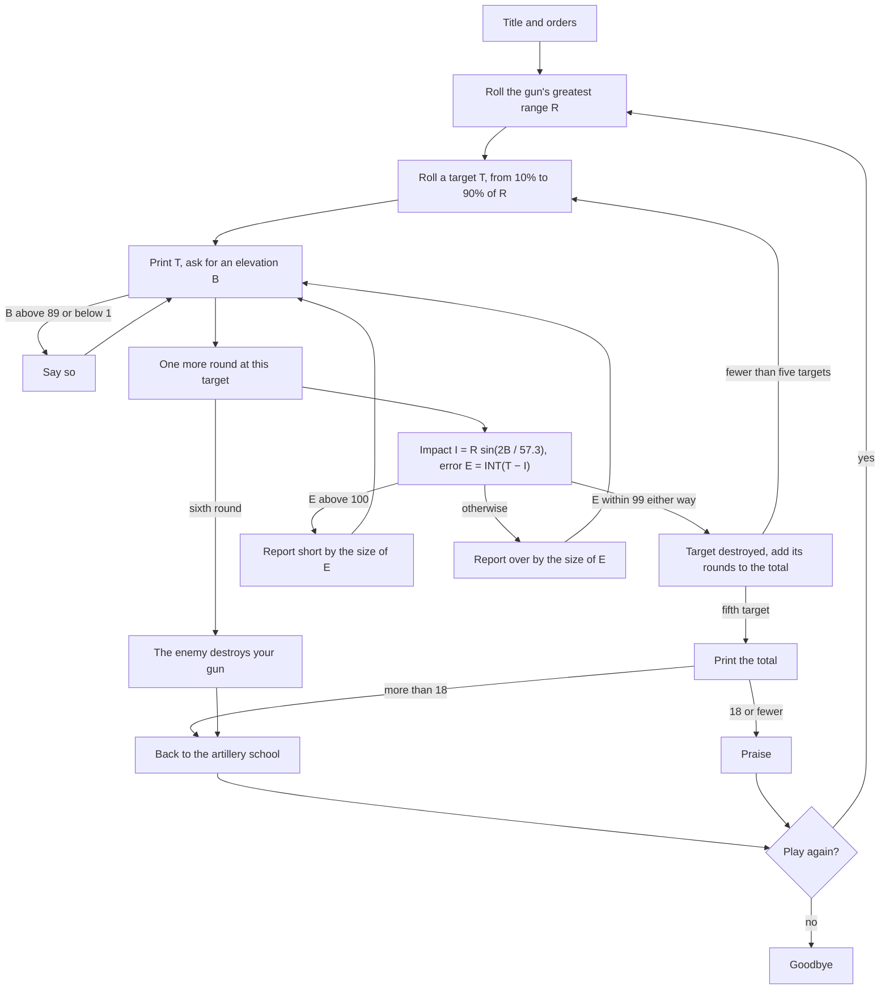

# Gunner (GUNNER.BAS) and Cannoneer (CANNON.BAS): how the originals work

Gunner is a 52-line program in the plain BASIC of the early 1970s: `PRINT`, `INPUT`, `IF … THEN` a line number,
`GOTO`, `INT`, `RND` and `SIN`, and nothing else. It runs on any BASIC of the day and talks to the player through a
teletype or a terminal. Cannoneer is the same program rewritten for the IBM PC's BASIC, 69 lines with the comments
and the sound. Neither has a single subroutine: both are one loop held together by `GOTO`s.

## At a glance

| | Gunner | Cannoneer |
|---|---|---|
| Lines | 52 | 69 |
| Dialect | 1970s minicomputer BASIC | IBM PC BASIC (BASICA or GW-BASIC) |
| Units | Yards | Metres |
| Gun | 20,000–59,999 yards | 10,000–13,999 metres |
| Input | An elevation in degrees; Y or N to play again | The same; lower-case y also plays again |
| Output | Printed lines | Printed lines and PC-speaker sound |

## Line map

| Gunner | Cannoneer | What it does |
|---|---|---|
| 10–160 | 10–90 | Title, and the standing orders. Cannoneer also sets the clock-tick rate for its sounds |
| 170–195 | 100–140 | Rolls the gun's greatest range, clears the target count and the round total |
| 200–220 | 150–170 | Rolls a target, clears the rounds fired at it, goes to print its distance |
| 230–300 | 180–250 | The messages for an elevation too low or too high, and for a round over or short, each going back to ask again |
| 320–360 | 260–370 | A target destroyed: adds its rounds to the total, and either starts the next target or ends the game. Cannoneer plays its fanfare here |
| 370–400 | 380–410 | Prints the target's distance and asks for an elevation |
| 420–446 | 420–540 | Refuses elevations above 89 and below 1; counts the round; on the sixth, the enemy wins. Cannoneer fires its sounds before the count |
| 450–480 | 550–580 | The ballistics and the observer's verdict |
| 490–520 | 590–680 | The end: the total, the verdict on it, and the question about another game |

## Control flow



The same loop in paraphrased pseudo-code:

```text
repeat while the player wants another game
  R = a whole number from the gun's band
  total = 0
  for each of five targets
    T = whole part of R × (0.1 + 0.8 × random)
    rounds = 0
    loop
      ask for elevation B; if B is outside 1..89, say so and ask again
      rounds = rounds + 1
      if rounds is 6: the enemy wins; jump to the verdict on the game
      E = whole part (towards minus infinity) of T − R × sin(2B / 57.3)
      if |E| < 100: target destroyed; leave the loop
      if E > 100: report short by |E|, else report over by |E|
    total = total + rounds
  verdict: more than 18 rounds sends you back to school, otherwise praise
```

## The interesting parts

### The ballistics

The whole physics is one line: a gun that throws a shell R units at 45° throws it R × sin 2θ at elevation θ. This
is the range of a projectile fired over level ground in a vacuum. R is the greatest range, so the muzzle speed is
implied, never stated. Degrees become radians by dividing by 57.3, an approximation of 180/π that was easy to type.

Two consequences shape the game. Every distance short of the greatest has two elevations, θ and 90° − θ, that land
on the same spot. And since the player is told both R and the target's distance T, the elevation ½ · asin(T ÷ R)
hits first time, every time.

### The verdict

The program truncates the error with `INT` before testing it, then checks three things in this order: under 100 in
size is a hit; above 100 is short; anything else is over. That ordering produces both of the programs' small bugs
(below).

### The rounds

A counter goes up for every elevation accepted. The test that ends the game sits *after* the counter and *before*
the ballistics, so the sixth elevation is counted but never fired. In Cannoneer the firing sounds come before that
test, so even the sixth round is heard.

### Cannoneer's sounds

IBM PC BASIC's `SOUND` takes a frequency and a duration in clock ticks, 18.2 to the second, and Cannoneer keeps
that number in a variable so its durations read in seconds. Each round fired is a short tone, a whistle sweeping
from 3,000 to 4,000 Hz in 101 steps of about 20 ms, and a low thud. A destroyed target gets five rapid rising
sweeps; your own destruction, a low drone.

## Quirks and bugs

- A round between 100 and 101 units short truncates to exactly 100, which is not a hit and not above 100: it is
  reported **over**.
- Truncating towards minus infinity makes the hit window lopsided by one unit: up to 100 short is a hit, but more
  than 99 over is not.
- 57.3 for 180/π shifts every round by up to 13.7 yards on Gunner's longest gun.
- Neither program seeds its random numbers, so under Microsoft BASIC every run rolls the same gun and the same
  targets.
- Gunner only plays again on a capital Y.

Details and evidence are in [NOTES.md](NOTES.md).

## Playing the original

Gunner runs in any BASIC that accepts its plain statements: a modern interpreter, or an emulated minicomputer or
early micro. Cannoneer needs IBM PC BASIC, today most easily GW-BASIC in DOSBox or a similar emulator, where its
sounds come from the emulated PC speaker. Both print their orders, the gun's greatest range and the first target's
distance, then ask for an elevation; the player types a number, reads "over" or "short" and a distance, and types
again. Five targets later, or five misses at one of them, the program gives its verdict and asks whether to play
again.

## Sources

- The listings themselves, read line by line.
- The IBM PC BASIC reference for `SOUND` (durations in clock ticks, 18.2 a second) and `RND` (any positive argument
  gives the next number).
