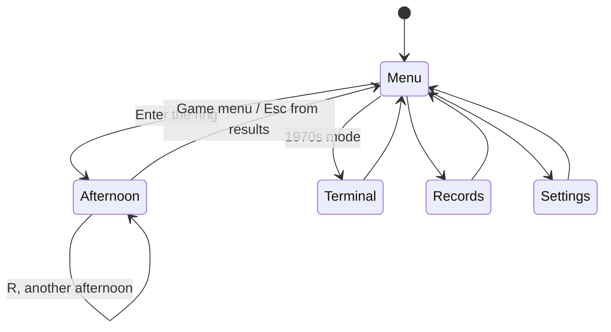

# Sol y Sombra: how the rebuild works

Three layers, each ignorant of the one above it. **The engine** (`lib/sol-y-sombra/`, pure TypeScript, seeded) decides everything that can be won or lost: the bull, the crews, every pass, the finish, the crowd's roll. **The rig** (`lib/sol-y-sombra/rig/`, pure TypeScript, no DOM) acts each decision out in 3D at 240 ticks a second: skeletons with inverse kinematics, a quadruped bull, a cloth cape, dust. **The style** (`components/sol-y-sombra/styles/`) draws what the rig holds, as a 1900s poster for now. The screens in `components/sol-y-sombra/` ask the player, tell the engine, and hand the result to the stage to play.

## Module map

| Where | What it owns |
|---|---|
| `lib/sol-y-sombra/rules.ts` | Every number of the Classic corrida: bull qualities and tells, the crews' work, the cape moves, the finishes, and the odds functions the cards and the engine share |
| `lib/sol-y-sombra/corrida.ts` | One afternoon: draws, passes, gorings, the finish, the meter; rolls only against the odds the cards show |
| `lib/sol-y-sombra/verdict.ts` | The crowd's meter, award thresholds, the band and the one roll |
| `lib/sol-y-sombra/bots.ts` | Five strategies that play the Classic corrida for the balance checks |
| `lib/sol-y-sombra/original.ts`, `originalSim.ts` | The 1978 program as a state machine, every random draw in its order, and its simulations |
| `lib/sol-y-sombra/traditions.ts`, `playStyles.ts` | The tradition and play-style registries (see below) |
| `lib/sol-y-sombra/progress.ts`, `awards.ts` | Settings, records per play style, the terminal's tally; keycaps from a finished afternoon |
| `lib/sol-y-sombra/plaza.ts` | The bullring as a place: sand, barrier, gates, rows, gallery, roof, and the sun's patch on the sand |
| `lib/sol-y-sombra/crowd.ts` | About 3,700 spectators as numbers (rise, arms, wave), and thrown flowers and hats |
| `lib/sol-y-sombra/rig/` | The rig (next section) |
| `components/sol-y-sombra/SolYSombra.tsx` | The game in its `GameShell`: one canvas, the menu, an afternoon, the terminal, records, settings |
| `components/sol-y-sombra/play/afternoon.ts` | An afternoon's sequence: asks the engine, plays the beats, says what the HUD shows |
| `components/sol-y-sombra/play/CorridaScreen.tsx` and `Hud`, `Choices`, `Verdict`, `icons` | The HUD: the bull's bill, the crowd's meter, the cards, the dial, keys, results |
| `components/sol-y-sombra/scene/stage.ts` | `CorridaStage`: a ring, the crowd, the director and a style; beats as promises; sound events |
| `components/sol-y-sombra/scene/director.ts` | Where the camera stands for each beat |
| `components/sol-y-sombra/scene/useCorridaStage.ts` | The canvas, its size, the animation loop, freezing |
| `components/sol-y-sombra/styles/style.ts` | The style interface and the frame every style draws |
| `components/sol-y-sombra/styles/poster/` | The Vintage Poster: palette, plaza and crowd painters, the frame and lettering, the painter |
| `components/sol-y-sombra/render/` | Style-neutral drawing helpers: the camera, the matador's and the bull's figures, shapes |
| `components/sol-y-sombra/sound.ts` | Every sound, synthesised |
| `components/sol-y-sombra/Terminal1970s.tsx` | 1970s mode |
| `components/sol-y-sombra/lab/`, `hero/`, `app/sol-y-sombra/lab/` | The motion lab, the hero frames and the lab's scenes (`/sol-y-sombra/lab`) |

## State machines

The game's screens:

An afternoon (`play/afternoon.ts`):

```mermaid
stateDiagram-v2
    [*] --> Intro: paseo, the bull enters, the crews work
    Intro --> Choose
    Choose --> Passing: 1, 2 or 3
    Choose --> Confirm: K before the third pass
    Confirm --> Choose: Esc
    Confirm --> Truth: K / Enter
    Choose --> Truth: K
    Passing --> Choose: clean or close
    Passing --> Down: gored
    Passing --> Verdict: seriously gored (helped to the infirmary)
    Down --> Passing: get up (rise, then back to passes or the finish)
    Down --> Verdict: retire (helped off)
    Truth --> Finishing: 1 or 2
    Finishing --> Verdict: the bull rests (the crowd rises, a salute)
    Finishing --> Truth: a miss
    Finishing --> Down: gored
    Finishing --> Verdict: third miss (the bull goes back to the pens)
    Verdict --> After: the needle lands
    After --> Results: the bull goes home; silence, a bow, a lap or the shoulders
```

## The engine

`Corrida` (`corrida.ts`) is seeded with the kit's RNG; the same seed and the same choices give the same afternoon. Each method checks the phase it may be called in and throws otherwise.

- **Odds are shared.** `moveOdds`, `finishChance` and `verdictOdds` return exactly what `makePass`, `tryFinish` and `decide` roll against. The cards call the same functions. The check script measures the engine against the cards over 20,000 passes.
- **The meter** (`verdict.ts`) adds bravery, artistry, the bull's credit, the risk taken, the finish and courage. The crowd's one roll lands within 3.5 of the meter's total; thresholds 8, 15, 22 separate silence, applause, a lap and the shoulders. Without a finish that worked the award is capped at applause.
- **Balance** is tuned in `rules.ts` and held by `scripts/check-sol-y-sombra.ts` against the bots in `bots.ts`: careful play is seldom hurt and earns applause; bravery fills the meter; every draw of bull and crews can reach the shoulders (the best bot does so at least 45% of the time in every draw). The numbers are in [NOTES.md](NOTES.md).
- **The 1970s program** (`original.ts`) is a separate module: `OriginalBull.start()` and `answer(typed)` return events the terminal words. `Mends` (comparison only) switches off each quirk to measure what it changed.

## The rig

Everything in `lib/sol-y-sombra/rig/` is plain TypeScript, unit tested, and draws nothing. Distances are metres, y up, a body's frame is x forward, y up, z right; a heading turns left as it grows.

- **People** (`human.ts`, `feet.ts`, `performer.ts`, `torero.ts`). A body is solved each tick from an `Intent` (heading, weight, crouch, hips, chest, arch, where the eyes look, where each hand goes) over its two feet. Feet move only inside booked steps (`Footwork`), so planted feet can't slide; a step peels off the toe, swings and lands heel first, with matched speeds at the joins. Two-bone IK with a soft reach places legs and arms. A `Performer` adds weight that travels from foot to foot with mass and a gaze that turns only so far. A `Torero` is a performer with a cape, knee tassels and shoulder fringes.
- **Acts** (`acts.ts`) are what a person is doing: watching (turning the feet when the bull goes round), walking or jogging to a spot, walking a route, sitting where the horn put him, getting up and picking up the cape, helping a hurt man off or being helped, saluting, bowing. Each books its steps when made and answers with an intent and a grip every tick. A new act blends in over half a second from wherever the last left the body.
- **The pass** (`choreography.ts`, `Pass`) is planned whole the moment it begins: the bull's run (`planTrack`: a path that aims at the cape, passes at the move's distance, curls away, brakes, turns on the hindquarters), then the cape's sweep a set angle ahead of the horns, the body's turn with it, and the footwork. Outcomes from the engine shape it: a close call brings the line in; a goring brings it in further and throws the matador; a finish that works ends with the bull lying down.
- **The bull** (`bull.ts`) is steered like a carriage and trailer: the withers go where the cue says, the hips follow at the body's length. A gait clock (walk, trot, gallop, blended by speed) times the legs; hooves land where the shoulder or hip will be and stay put. Moods (head carriage, braking, arousal, rest) ease through springs. `bullActs.ts` holds what it does between passes: watch, run a route, lie down, get up.
- **The cape** (`cloth.ts`) is a 17 × 12 Verlet cloth: stretch, shear and bend links, air drag on each face, wind, pinned to the fists with weights (a hand taking hold gathers the cloth rather than yanking it), colliding with the bodies and the horns.
- **The ring** (`ring.ts`) holds the matador, two crew, the bull and the dust, and plays **beats**: a pass (by anyone), a fall, getting up, being helped off, siting the bull, the paseo, the bull's entrance and exit, the crews' work, a salute, a bow, a lap. A beat hands acts to people and the bull, and says when it is over. The ring also chooses where the crew wait (away from the action) and sends them to the matador when he's down.

## Play styles, traditions and styles: how to add one

- **A play style** (`lib/sol-y-sombra/playStyles.ts`) decides how the player acts: Classic picks cards. Arena (11b) will hand the engine a timing quality: `moveOdds(move, timing)` and `makePass(move, timing)` already take it as a multiplier on the goring chance. To add one: an entry in `PLAY_STYLES` with `available: true`, a screen beside `play/CorridaScreen.tsx` that drives `Corrida` its own way, and a branch in `SolYSombra.tsx`. Records are kept per play style.
- **A tradition** (`lib/sol-y-sombra/traditions.ts`) decides what the afternoon is for: the moves offered and the finale. The Course Camarguaise and Recortes (11c) plug in with their own moves and a time finale; the verdict and the ring stay the same. To add one: its moves and finale in `TRADITIONS`, the ring beats its moves need (a new `PassKind` in `choreography.ts`, planned like the others), and the cards read from the tradition.
- **A style** (`components/sol-y-sombra/styles/style.ts`) draws a `RingFrame`: the people's skeletons and costumes, the bull's pose, the capes' cloth, dust, the crowd, the light and the lettering. It implements `RingStyle` (`resize`, `paint`); `createStyle` picks it from the player's setting. The Vintage Poster is a `PosterPainter` on Canvas 2D; the Stylized 3D style (11b) will be a WebGL `RingStyle` drawing the same frame. Nothing in the engine or the rig changes.

## Drawing

- **The camera** (`render/camera.ts`) is a pinhole projecting the rig onto the canvas; the director (`scene/director.ts`) aims it once per beat and holds it: a pass three-quarters on from the side the bull doesn't take, a fall from a little way off, the crowd from behind the matador, the lap from the middle of the ring. A spot beyond the barrier is pulled onto the sand.
- **The poster** (`styles/poster/`): `palette.ts` has the light (afternoon) and dark (evening festival) inks, one colour per surface for sun and for shade; `plazaPainter.ts` paints the bowl layer by layer from the outside in (the order that overlaps correctly from anywhere on the sand), one path per colour; `crowdPainter.ts` stamps the spectators; `frame.ts` draws the paper, the rules, the title, the ribbon and the stamped name; `PosterPainter.ts` composes the picture, sorting figures, the bull, capes, thrown flowers and dust by depth, inks across the shadow line in the shade's colours, and draws the nearest figures over the frame at big moments. The sky, stands, crowd and sand are cached in their own canvas, repainted when the camera moves or twelve times a second for the crowd. The bulls' door opens as the bull comes and goes.
- **Figures** (`render/matadorFigure.ts`, `bullFigure.ts`) turn skeletons and poses into outlined shapes; styles give them colours (`styles/poster/dress.ts` for the crew's suits).
- **The HUD** is HTML over the canvas: `play/play.module.css` places the cards inside the poster's window using `--u`, the poster's own unit, which the stage sets as it sizes the canvas.
- **Motion**: reduced motion keeps the crowd still, turns off slow motion and cuts the long walks short (`CorridaStage.cut`).

## Sound

`components/sol-y-sombra/sound.ts` synthesises everything on the kit's effects bus, so the top bar's mute and volume apply: the crowd's bed (noise that brightens as it swells), cheers, the wordless "olé" (noise and a low buzz through vowel formants gliding from o to e), hoofbeats (low thumps, louder at speed), the bull's snort before a charge, the cape's swish, a soft thud for a fall, and a short brass figure of our own for the paseo and the honours. The stage reports the moments (`StageEvent`: a hoof down, the closest moment of a pass, the cape whipping past a speed); the screen turns them into sound. The game's own switch is in the settings.

## Kit integration

- **Manifest**: `lib/sol-y-sombra/manifest.ts` (id `sol-y-sombra`, eight keycaps, one secret).
- **Shell**: the afternoon reports itself with `usePlayScreen` (pause item "Start a new afternoon"; leaving asks first once a pass has been made); results through the kit's `Results` (R another afternoon, H the Hall).
- **Progress**: `progress.ts` keeps `anykey.sol-y-sombra.save` (version 1): settings, records per play style, the terminal's tally. Keycaps are added by `awards.ts` inside `updateProgress` and reach the Keyring through the kit's progress bridge; a finished afternoon counts as played, and a lap or the shoulders as won.

## Tests

| What | Proves | Run |
|---|---|---|
| `tests/unit/sol-y-sombra-engine.test.ts` | The 1978 formulas and quirks; the Classic rules case by case | `npx vitest run tests/unit/sol-y-sombra-engine.test.ts` |
| `tests/unit/sol-y-sombra-rig.test.ts` | No foot or hoof slides; no joint jolts; horns clear of the body; cloth stable; IK exact | `npx vitest run tests/unit/sol-y-sombra-rig.test.ts` |
| `scripts/check-sol-y-sombra.ts` | The 1978 numbers, the cards against the engine, the bots' bands, every draw winnable | `npm run check:sol-y-sombra` |
| `tests/e2e/sol-y-sombra.spec.ts` | Afternoons by mouse and keyboard, a goring and getting up, retiring, the infirmary, the early truth, pausing and leaving, the terminal, settings | `npx next build`, then `npx playwright test --config playwright.sol-y-sombra.config.ts` (port 3221) |
| `tests/shots/shots.spec.ts` (Sol y Sombra block) | Screenshots of every screen in both appearances at 1280 × 720 and 1920 × 1080 | `npm run shots` |

`?seed=` in the address replays an afternoon (the e2e tests use it); `/sol-y-sombra/lab?scene=gored|help|retire|finish|miss|paseo` plays the beats between passes on their own.

## Known limits

- The bull's legs fold and unfold when it lies down, but it doesn't roll its weight onto one hip as a resting bull would.
- The crew carry their capes in front or gathered over an arm; they never fold them.
- The hurt matador walks between his helpers; nobody is carried on a stretcher.
- Figures are drawn over the cached stands, so a bull deep in the pens' doorway is drawn over the wall rather than inside it; the stage hides it once it has gone through.
- One matador, one bull per afternoon; a real corrida has six bulls and three matadors.
