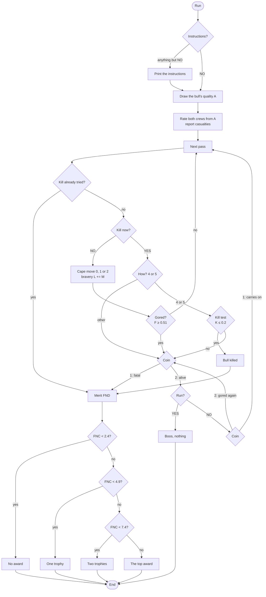

# Bull (BULLFGHT.BAS): how the original works

_Bull_ is a 193-line program in Microsoft BASIC, as printed in _BASIC Computer Games_ (Creative Computing, 1978). It runs on any home computer of the time with that BASIC and a terminal: it prints, asks a question, waits for a typed answer, and prints again. There is no screen layout and no graphics; everything happens in words and numbers. Facts on this page come from the listing; the measurements behind them are in [NOTES.md](NOTES.md).

## At a glance

| | |
|---|---|
| Lines | 193 numbered lines, 10 to 2030 |
| Dialect | Microsoft BASIC (`DEF FN`, `ON … GOTO`, `INPUT`, string variables) |
| Machine | Any machine with that BASIC; no machine-specific code |
| Input | `YES` or `NO` (exactly, in capitals) and numbers: a cape move 0–2, a way to kill 4 or 5 |
| Output | Printed lines: the bull's rating, the crews' work, each pass, the outcome, the crowd's award |
| Randomness | `RND(1)`, never seeded: every run on a freshly loaded interpreter deals the same afternoon |

## Line map

| Lines | What they do |
|---|---|
| 10–30 | The title, and a coin-toss function that returns 1 or 2 |
| 200–207 | Bravery starts at 1; the program asks whether to print the instructions, and prints them for any answer but exactly `NO` |
| 210–390 | The instructions: the three cape moves, the two ways to kill, the advice to wait until the seventh pass, a promise that good assistants help |
| 400–570 | The bull's quality is drawn (1 best and most dangerous, 5 worst), with a remark for the two extremes |
| 590–650 | Both crews are rated by the subroutine at 1610 and their ratings kept as `D(1)` and `D(2)` |
| 660–790 | The pass loop: count the pass; if the kill has been tried, go to the verdict; ask whether to kill now, worded one way for the first two passes and another way after |
| 800–930 | Ask for the cape move, refuse anything but a whole number 0–2, and add the move's daring to the bravery total |
| 940–960 | The goring test for this pass |
| 970–1120 | A goring: a coin decides death; alive, the matador is asked whether to run; staying, another coin either sends him back to the pass loop as a brave man or gores him again |
| 1130–1330 | The moment of truth: ask how to kill (4 or 5; anything else is a panic and a goring), test the kill, and send a failure to the goring lines |
| 1340–1410 | Running is booed and ends with nothing; the crowd's merit is defined; a brave return or a kill is cheered |
| 1420–1600 | The award: three comparisons, each with its own fresh random number |
| 1610–1920 | The crews' rating and the casualties a poor or awful job reports |
| 1930–2030 | The yes-or-no reader, and the end |

## Control flow



In words:

```
bravery = 1
ask for the instructions; print them unless the answer is exactly NO
A = a whole number 1..5                      # 1 the best bull, and the most dangerous
for each crew: rating C from 3/A × RND, cut into 0.1 (superb) .. 0.5 (awful); report casualties for a poor or awful job
loop:
    pass += 1
    if the kill has been tried: go to the verdict
    ask "kill now?" (two wordings: passes 1–2, and later)
    if yes:
        ask how: 4 or 5 (anything else: a panic, and a goring)
        K = (6 − A) × 10 × RND / ((D1 + D2) × 5 × pass)
        if K ≤ 0.2 (the test meant for 5; line 1240 checks a variable nothing sets, so 4 uses it too): killed, go to the verdict
        else: a goring
    else:
        ask the cape move E in 0..2; M = 3, 2 or 0.5; bravery += M
        F = (6 − A + M/10) × RND / ((D1 + D2 + pass/10) × 5)
        if F ≥ 0.51: a goring
    a goring: a coin; heads, fatal (D4 = 1.5), go to the verdict
              tails: ask "run?"; yes: booed, nothing, end
              no: a coin; carry on bravely (D4 = 2), or gored again
verdict: merit = 4.5 + bravery/6 − (D1 + D2) × 2.5 + 4·D4 + 2·D5 − pass²/120 − A
         each award test multiplies the merit by a fresh RND
```

## The interesting parts

### The crews come from the bull

Each crew's rating is drawn from `3/A × RND`, so a superb bull (A = 1) tends to come with superb crews and an awful bull with awful ones. The instructions never say so. Because of the inversion below, the link half-hides the inversion in play: the dangerous bulls are made more dangerous by their good crews, and the gentle bulls safer by their poor ones.

### The inversion

The instructions promise that good work by the assistants improves your chances. In both the goring test and the kill test the crews' ratings sit in the denominator, and a worse job has the larger rating: a poor crew makes every pass safer and every kill easier. For a fair bull's first veronica, two superb crews give a 76.8% chance of a goring, two awful ones 15.0%. Only in the crowd's merit do the ratings work as promised, subtracted, so good crews are worth applause and nothing else.

### Daring barely matters

A veronica adds 3 to bravery, a swirl 0.5, and the goring test adds only a tenth of that to its top: a veronica is barely riskier than a swirl (45.9% against 41.5% on a fair first pass). The later passes are what make the difference: the pass number joins the crews in the denominator, so every pass is safer than the last, which is why the instructions advise waiting for the seventh.

### The kill choice that isn't

Line 1240 tests a variable that nothing ever assigns, so both ways to kill face the same harsh test. Had it read the right variable, going over the horns would have been four times as forgiving. In 2,000 seeded games played twice, once with each choice, the two never differed.

### The crowd rolls three times

The merit is fixed, but each of the three award comparisons multiplies it by its own fresh random number. The result pulls the awards towards the middle: a merit of 11 gives the top award 14% of the time with three rolls, 33% with one.

## Quirks and bugs

- The inversion of the crews (above).
- The two kills are the same (above).
- A fatal goring goes to the verdict like any other ending: the crowd still gives awards, in 1,863 of 1,863 simulated fatal gorings.
- Gored at the moment of truth, staying and surviving sends the program back to the pass loop, which sees the kill already tried and goes straight to the verdict, with cheers, though the bull still stands.
- A poor job reports one man or none and then jumps past the only other line that could report a horse; an awful job's horse line does run.
- The instructions say 4 and 5 may be typed on any turn, but the cape question refuses them: the kill is only reached by answering yes first.
- `YES` and `NO` must be typed exactly so; `yes` is refused.
- With no `RANDOMIZE`, every run on a freshly loaded interpreter is the same afternoon.

## Playing the original

Any Microsoft-compatible BASIC runs it as listed (for example the PC-BASIC interpreter). Type `RUN`, answer `NO` to skip the instructions, and answer each question in capitals. An afternoon lasts a few minutes; it ends with the award (or the boos), and `RUN` starts the same afternoon again unless the interpreter has been used for something else in between. Our 1970s mode plays it question for question, with every quirk, in our own words.

## Sources

- The listing, `BULLFGHT.BAS` (read-only, outside this repository).
- _BASIC Computer Games_, ed. David H. Ahl, Creative Computing, Morristown, New Jersey, 1978.
- Microsoft BASIC reference manuals of the period, for how `INPUT` reads numbers and strings.
