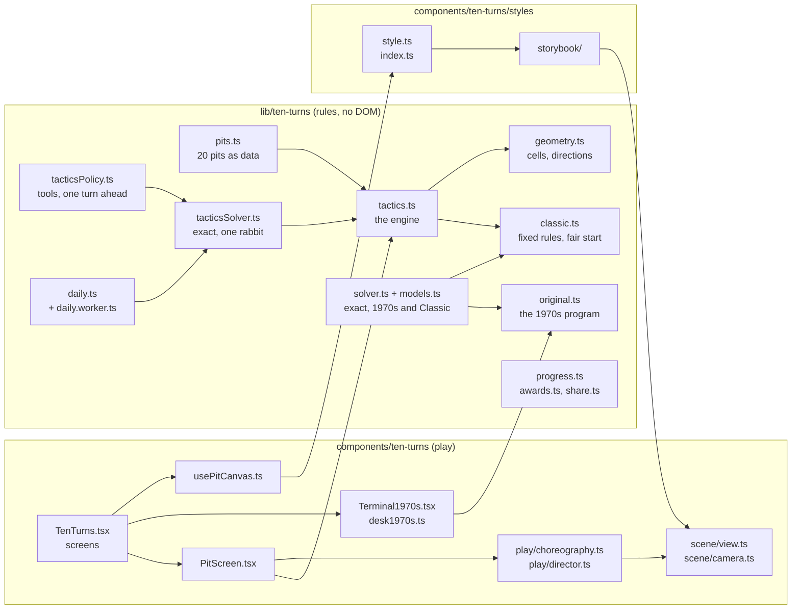
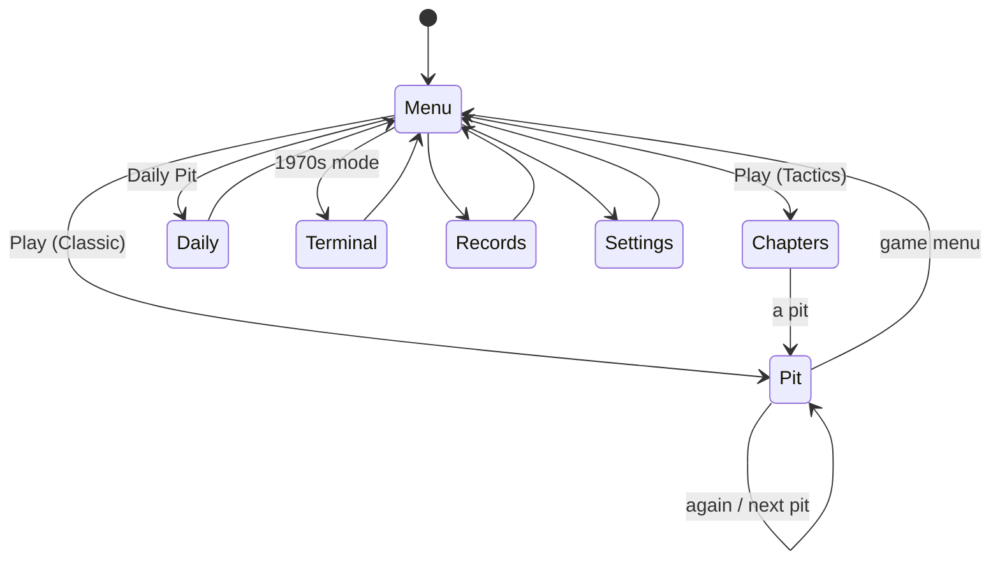
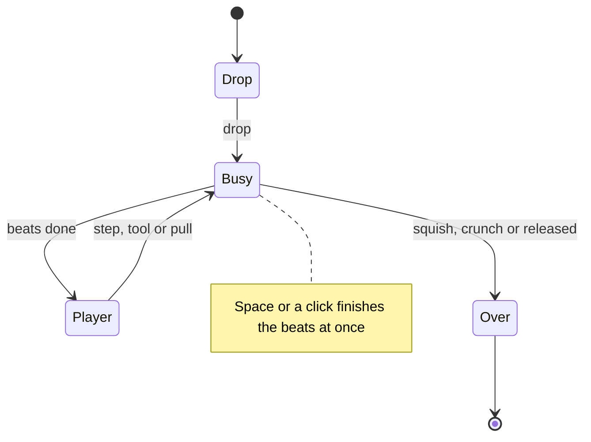

# Ten Turns in the Pit: how the rebuild works

Three layers that never reach into each other: **rules** (`lib/ten-turns/`, pure TypeScript, no DOM), **play**
(`components/ten-turns/`: screens, input and the choreography that turns a rules step into a few seconds of
animation) and **styles** (`components/ten-turns/styles/<style>/`: how a moment looks). A rules step produces a new
state and a list of hops; the choreography turns those into beats that move a `Scene`; every animation frame the
scene becomes a `SceneFrame`, and the chosen style draws it.

## Module map

| Path | What |
|---|---|
| `lib/ten-turns/geometry.ts` | Cells, the eight directions, the pit's cells, king distance |
| `lib/ten-turns/original.ts` | The 1970s program's rules, quirk for quirk, with switches for each quirk |
| `lib/ten-turns/classic.ts` | The fixed rules: the rabbit's step (swinging along the wall), chain odds, the fair start |
| `lib/ten-turns/tactics.ts` | The engine for Classic, Tactics and the Daily: drop, actions, the rabbits' turn, medals |
| `lib/ten-turns/pits.ts` | The five chapters and twenty pits, as data |
| `lib/ten-turns/solver.ts`, `models.ts` | Exact backward induction for the 1970s and Classic rules |
| `lib/ten-turns/classicTable.ts` | Classic's solution, solved once, for the fair start |
| `lib/ten-turns/tacticsSolver.ts` | Exact values for a Tactics pit against one rabbit (positions, hat, dazed) |
| `lib/ten-turns/tacticsPolicy.ts` | The playing policy used by the checks: solver values plus one turn of lookahead with tools |
| `lib/ten-turns/daily.ts`, `daily.worker.ts` | The Daily Pit generator, run in a Web Worker in the browser |
| `lib/ten-turns/progress.ts`, `awards.ts`, `share.ts` | The save, records and keycaps, the share line |
| `lib/ten-turns/manifest.ts` | The Hall card, keycaps, trivia |
| `components/ten-turns/TenTurns.tsx` | The game shell, its screens, the canvas, the menu's attract loop, ambience |
| `components/ten-turns/PitScreen.tsx` | A game in the pit: phases, input, pads, tools, HUD, results |
| `components/ten-turns/play/` | `choreography.ts` (beats for every moment), `director.ts` (the beat queue), `keys.ts`, `demo.ts` |
| `components/ten-turns/scene/` | `view.ts` (the `SceneFrame` contract), `camera.ts` (the pit's perspective) |
| `components/ten-turns/styles/` | `style.ts` (the interface), `index.ts` (the list), `storybook/` (the one style so far) |
| `components/ten-turns/Terminal1970s.tsx`, `desk1970s.ts` | 1970s mode: the terminal's words, big letters and plotter |
| `components/ten-turns/sound.ts` | Every sound, synthesised |
| `scripts/check-ten-turns.ts` | The regression checks (`npm run check:ten-turns`) |
| `scripts/detokenize-gwbasic.ts` | Our GW-BASIC detokenizer (a kit candidate) |

## State machines

The game's screens (`TenTurns.tsx`):

A game in the pit (`PitScreen.tsx`):

The rules have already decided everything by the time a beat starts: `act` then `rabbitsTurn` then `endTurn` run at
once, and the choreography only shows the result.

## The engine

`tactics.ts` holds a `TacticsState`: the plan, the turn, the player (or null before the drop), the rabbits (cell,
temperament, dazed), stones, carrots on the ground, open burrows, patches, tools, the hat, the locked first pounces
and the outcome. Everything is a pure function of the state and a `roll(chance)` callback, so the browser rolls with
the kit's seeded RNG, the checks with their own seeds and the solver with exact probabilities.

- `drop` places the player; landing on a rabbit is a squish. `dropClassic` does the same for Classic and places the
  rabbit afterwards (`rabbitAfterDrop` in `classic.ts`: on you 1 time in 317, otherwise any cell whose solved
  survival is at least `FAIR_FLOOR`, 0.4).
- `act` applies the player's action: a step (through a tunnel if it is a burrow), a carrot, a stone, digging, pulling
  a carrot, or waiting when there is no step. Climbing out of a burrow caves it in.
- `rabbitsTurn` runs every rabbit's chain. The first pounce goes for its lock (the cell you began the turn on, the
  clever rabbit's guess, or a carrot); later ones for `aimOf` (a carrot, the burrow it saw you enter, or you).
  `pounceTarget` decides where a pounce ends; it reports a bonk on a rock, a stone, the wall or another rabbit. A
  landing on you takes the hat if you still have it, otherwise it is a crunch.
- `endTurn` advances the turn, sets the next locks (`lockOn`) and releases you after the last one.
- `PitPlan.rules = "classic"` turns the same engine into Classic: no locks, no hat, the rabbit swinging along the wall
  (`rabbitStep` from `classic.ts`). The Tactics and Classic engines are one code path.

## The rabbit models

There are three sets of rules, each checked against the others where they overlap:

| Model | Where | Used by |
|---|---|---|
| **The 1970s program**, with each quirk a switch (`AS_WRITTEN`, `ALL_FIXED`) | `original.ts` | 1970s mode, the survival table in NOTES |
| **Classic**: the pounce rounded to 45 degrees as in the original, chain odds 1 in (k + 1), no quirks | `classic.ts`, `tactics.ts` with `rules: "classic"` | Classic |
| **Tactics**: locked first pounce, four temperaments, obstacles, the hat, dazed rabbits | `tactics.ts` | Tactics, the Daily Pit |

The temperaments differ only in `chainChance` and `pounceTarget`: plain 1/(k+1); jumper and clever 1/(⌈k/2⌉+1); the
stalker covers two cells in one pounce and never chains; the clever rabbit locks its first pounce on
`predictedEscape`, the free cell next to you that runs furthest from it.

## AI

Nobody plays against the player except the rabbit, whose rules are above. The AI is for proving pits fair:

- `solver.ts` solves the 1970s and Classic games exactly: backward induction from the last turn over every
  (player, rabbit) pair, with the chance of each chain worked out exactly. It gives best play's survival for every
  drop and start, and the best move.
- `tacticsSolver.ts` does the same for a Tactics pit against one rabbit, over (player, rabbit, hat, dazed), stored as
  `Float32Array`s; tools and carrots are left out. `scripts/check-ten-turns.ts` checks it against the engine at sampled
  positions.
- `tacticsPolicy.ts` plays real games: for every legal action (tools included) it runs the engine one turn ahead over
  every way the pounces can go, weighs each outcome by the solver's value, and adds a small credit for keeping a tool
  or the hat. Its survival rate is a lower bound on good play; every pit and Daily must clear a floor.
- `daily.ts` builds a Daily Pit from the day's number: the ground (rocks, burrows, tunnels, patches, tools, the kind of
  rabbit) is seeded, solved once, and then hiding places are tried in a seeded order until the best drop's solved
  survival falls between 0.70 and 0.92. It takes one to three seconds, so the browser runs it in a Web Worker and
  keeps the result for the day.

## Drawing

One canvas sits behind every screen (`usePitCanvas.ts`). The visible screen hands it a **painter**, a function called
every animation frame that returns either a `SceneFrame` (a moment in the pit) or a `ReleaseMoment` (the page after a
survived pit). The menu's painter is the attract loop (`play/demo.ts`), a play screen's is its scene. The Hall's card
(`components/previews/TenTurnsPreview.tsx`) runs the same attract loop on a canvas of its own, a little closer in. The
loop sleeps while the canvas is hidden.

**The style interface** (`styles/style.ts`): a `PitStyle` takes `resize`, `setNight`, `setBoard` (the pit's lasting
features), `render(frame)`, `renderRelease(moment)`, and answers `project(spot)` (where a floor spot is on screen, for
the pads laid over the canvas) and `cellAt(x, y)` (for clicks). A style decides nothing about rules; it is chosen in
Game settings and stored with the save, and records, pits and dailies never depend on it.

### The Spooky Storybook (`styles/storybook/`)

| File | What it draws |
|---|---|
| `StorybookStyle.ts` | The `PitStyle`: render order, the zoom for big moments, the actors' poses, the iris and burp of a crunch, the end page's picture |
| `pit.ts`, `floorStory.ts`, `flora.ts` | The meadow and the pit, painted once per size and appearance: walls with roots and pebbles, the floor with tracks and lost things, grass, flowers, mushrooms |
| `kid.ts` | The kid: bobble hat, coat, scarf, faces, poses, the climbing stride, the night lantern |
| `rabbit.ts` | The rabbit sitting, crouching, leaping, flattened, sulking, wearing the snatched hat |
| `props.ts` | Rocks, cairns, burrows and tunnel ribbons, carrot patches and carrots, rustling grass, cell rings, the intent arc |
| `fx.ts` | Soft shadows, landing shadows, dust, stars, motion lines, butterflies and fireflies, the paper finish |
| `page.ts`, `lettering.ts` | The page turn to "You are free!", the storybook shout letters |
| `release.ts` | The release: the rope ladder, the climb, the sun or moon rising, the sulking rabbit |
| `figure.ts`, `paint.ts`, `look.ts` | The inking technique (outline, fill, shade crescent, rim light), colour helpers and noise, the day and night palettes |

The camera (`scene/camera.ts`) is a small perspective camera looking down at 54 degrees. The backdrop is painted once
into an offscreen canvas per size, appearance and pit; every frame draws it, then the floor marks, then the upright
things sorted back to front, then effects. A big moment zooms in by stretching the painted backdrop for a moment and
repainting it sharp once the zoom holds still. No `ctx.filter` in the frame loop: soft shadows are radial gradients.

### How to add a style

1. Make `components/ten-turns/styles/<id>/` with a class that implements `PitStyle`. Draw from the `SceneFrame`
   alone; take its `board`, `kid`, `rabbits`, `marks` and `effects` as they are. `scene/view.ts` documents every field.
2. Give it a camera or layout that can answer `project` and `cellAt` for a pit of any radius.
3. Draw both appearances: `setNight` switches live.
4. Add it to `STYLES` in `styles/index.ts` with its `create` factory (the coming ones are listed there with
   `create: null`). Settings and the menu pick it up from that list.
5. Play the three signature moments (a pounce, a squish, a release) in both appearances at 1280 × 720 and
   1920 × 1080, add it to `npm run shots`, and check it holds 60 frames a second at 1920 × 1080.

### How to add a play style

A play style is a way of playing the same pit. Classic and Tactics share everything below the screens.

1. Add its name to `PlayStyle` in `lib/ten-turns/progress.ts`, with a record for it in `Progress` (keep old saves
   loading: give the new record a default).
2. If it is turn-based, add a value to `PitPlan.rules` and branch where the rules differ (`lockOn`, `pounceTarget`,
   `startPit` in `tactics.ts`), then give `PitGame` in `PitScreen.tsx` a kind for it. If it is real-time (the Arena,
   prompt 10b), give it its own screen beside `PitScreen.tsx` that builds `SceneFrame`s from its own clock: the style
   draws it unchanged.
3. Add it to the menu's list in `Menu.tsx` and the choice in `GameSettings.tsx`, and route it in `TenTurns.tsx`.
4. Record its games in `awards.ts`, add any keycaps to the manifest, and add a section to `check-ten-turns.ts` that
   proves it fair.

## Sound

`components/ten-turns/sound.ts` synthesises everything with WebAudio through the kit's effects bus, so the top bar's
mute and volume apply: a meadow bed (a moving breeze, birds by day, crickets by night) and the effects step, thump,
rustle, sting (before the first pounce of a turn), again (before each chained pounce), squish, crunch, chime, bonk,
toss, dig, pop and munch. The choreography cues them by name (`SoundName`), so a style never plays sound.

## Kit integration

- `GameShell`, `usePlayScreen`, the pause menu and `Results` from the kit, so the navigation standard holds: Back to
  the Hall, a visible pause button with an Esc hint, the fixed pause and results order.
- The save through `createStore` / `createProgress` (`anykey.ten-turns.save`), keycaps through the Keyring, the kit's
  daily numbering with the game's own epoch (2026-10-10 is Daily #1), `shareText` for the share line.
- Reduced motion through the kit's `useReducedMotion` (the device setting, or the collection's Motion setting): no
  camera moves, slow motion or shaking, quick fades instead.
- Kit candidates, written here first: the GW-BASIC detokenizer, the beat `Director`, the exact backward-induction
  solver shape.

## Tests

- `npm run check:ten-turns`: the 1970s module against the program's behaviour, the survival tables, Classic's fair
  start, the Tactics solver against the engine, every pit and 24 Daily Pits survivable by the policy. About 25 s on
  eight cores; `--quick` for less.
- `tests/unit/ten-turns-detokenize.test.ts`: the detokenizer.
- `tests/e2e/ten-turns.spec.ts` (config `playwright.ten-turns.config.ts`, port 3220): Classic and Tactics by mouse
  and by keyboard alone, tools, the drop, the Daily, the terminal, settings and every way out.
- `npm run shots` covers every screen at 1280 × 720 and 1920 × 1080 in both appearances.

## Known limits

- The Tactics solver ignores tools, carrots and second rabbits; the policy covers those with one turn of lookahead,
  so its survival rates are lower bounds.
- The Daily Pit is generated in the browser, one to three seconds in a Web Worker, then kept for the day in local
  storage. A browser without module workers can't open it.
- One style ships in 10a; the other three are listed as coming.
