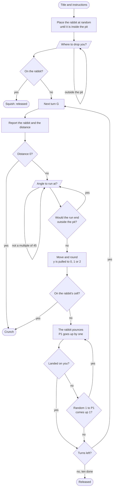
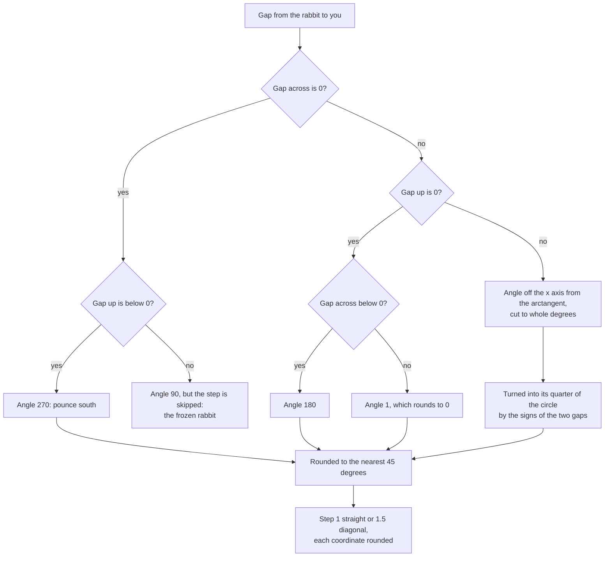

# Man-Eating Rabbit (RABBIT.BAS): how the original works

How the 1970s program is put together, read from our decoded listing of `RABBIT.BAS` (kept outside the repo). Line
numbers are the program's own. The numbers behind every claim are in [NOTES.md](NOTES.md).

## At a glance

- **82 numbered lines** of GW-BASIC, 2,304 bytes tokenized. No subroutines, no arrays that matter, no data.
- **State**: the rabbit at (`X`, `Y`), the player at (`X1`, `Y1`), the turn counter `G`, a step `X2`, `Y2` reused by
  both sides, the pounce angle `B`, the chain counter `P1`.
- **Flow**: a title and instructions, the rabbit placed at random, the drop, then a `FOR G = 1 TO 10` loop. Each pass
  reports, asks for an angle, moves the player, then runs the rabbit's chain of pounces with `GOTO`s until it stops.
- **Endings**: a squish at the drop, a crunch (landed on, or ran into the rabbit), or the loop running out: released.

## Line map

| Lines | What they do |
|---|---|
| 1–28 | Clear the screen, the title, the instructions |
| 40–46 | Seed from the clock, then draw whole-number coordinates from -10 to 10 for the rabbit until it is inside the circle |
| 47–60 | Ask where to drop the player; ask again if outside the circle |
| 65–69 | Dropped exactly on the rabbit: the squish, and the end |
| 70–91 | The turn loop: distance to the rabbit, a report, a crunch if the distance is 0 |
| 100–113 | Ask for an angle; refuse anything that isn't a multiple of 45; the step is longer on a diagonal |
| 120–126 | Work out the step with sine and cosine; refuse a run that ends outside the circle |
| 130–135 | Move the player and round to whole numbers (line 131 is the slip that pulls you to the middle) |
| 136–138 | Ran onto the rabbit's cell: a crunch |
| 140–152 | The pounce begins: count it, find the gap to the player, handle the straight lines first |
| 160–250 | The angle off the x axis, into its quarter, rounded to 45 degrees |
| 255–272 | The rabbit's step: 1 straight, 1.5 diagonal, rounded |
| 280–310 | Straight north, south, east or west of the rabbit (north skips the step) |
| 315–322 | Landed on the player? Otherwise roll for another pounce |
| 323–340 | The next turn; after ten, released. The crunch line and the end |

## Control flow

The crunch for a landing is not on the pounce's path: a landing only stops the chain, and the next turn's distance
check (line 90) declares it. After the tenth turn there is no next check, which is the last-turn loophole.

## The interesting parts

### The pounce angle (150–310)

The rabbit aims at the player through the gap between them, `X2 = X1 - X`, `Y2 = Y1 - Y`:

Cutting the angle to whole degrees before rounding moves the straight-or-diagonal boundary from 22.5 to 23 degrees.
A step of 1.5 on a diagonal works out to about 1.06 each way, which rounds to a whole cell across and a whole cell
up: the rabbit moves like a chess king. Nothing checks the circle, so it can step out of the pit.

### The chain of pounces (111, 140, 315–322)

`P1` starts each turn at 1 and goes up by one at every pounce, so it is 2 after the first. After a pounce that misses,
a random whole number from 1 to `P1` is drawn; a 1 means another pounce. The chances are 1 in 2, 1 in 3, 1 in 4,
and so on, which makes e − 1 pounces a turn on average.

### The run (110–135)

An angle is accepted if dividing it by 45 gives a whole number, so 360, 405 or -45 are all fine. The diagonal test is
"does the angle, cut to tens, differ from itself by 5", true for 45, 135, 225 and 315 and their relatives. The step is
then built with sine and cosine and a pi of 3.14159, added to the position and rounded. The wall check uses the
position before line 131's slip, so the slip can carry you past the wall.

## Quirks and bugs

The full table is in [NOTES.md](NOTES.md#quirks-and-bugs). The four that shape the game:

1. **The pull to the middle** (line 131): the new y is worked out from `INT(Y1+1000)/1000` where `INT(Y1*1000)/1000`
   was meant, so it is about 1 plus the step: 0, 1 or 2 after every run.
2. **The frozen rabbit** (line 281): straight north of the rabbit, the angle is set and the step skipped.
3. **The last-turn loophole** (lines 315 and 323): a landing in turn ten is never checked.
4. **The rabbit leaves the pit** (lines 270 and 271): its step is never checked against the circle.

## Playing the original

Our 1970s mode plays the program's rules exactly, from `lib/ten-turns/original.ts`, with every quirk switched on;
`scripts/check-ten-turns.ts` checks it against everything above. To run the original itself, decode it with
`npx tsx scripts/detokenize-gwbasic.ts RABBIT.BAS rabbit.bas` and load the text into any GW-BASIC (PC-BASIC is a
faithful one).

## Sources

- `RABBIT.BAS`, decoded with `scripts/detokenize-gwbasic.ts` (our own GW-BASIC detokenizer).
- David H. Ahl (ed.), *More BASIC Computer Games*, Creative Computing, 1979.
- PC-BASIC's documentation, for how GW-BASIC reseeds its generator.
