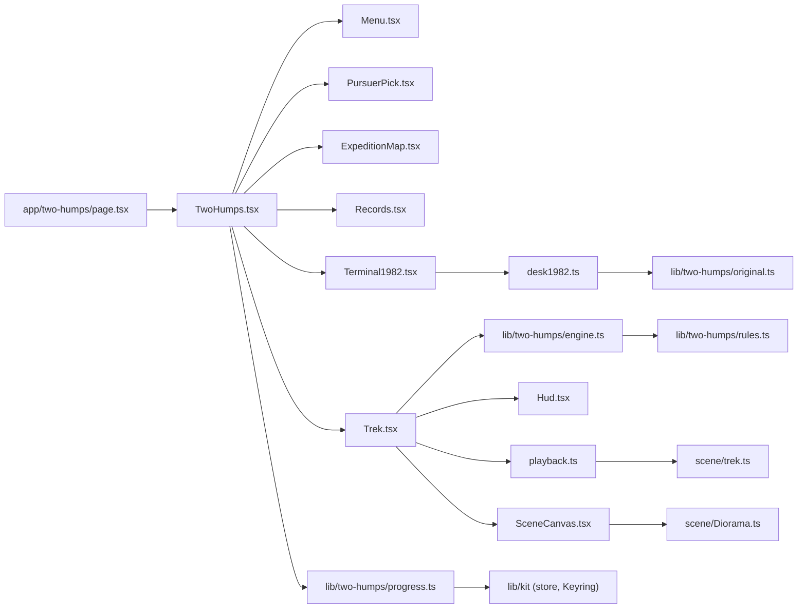
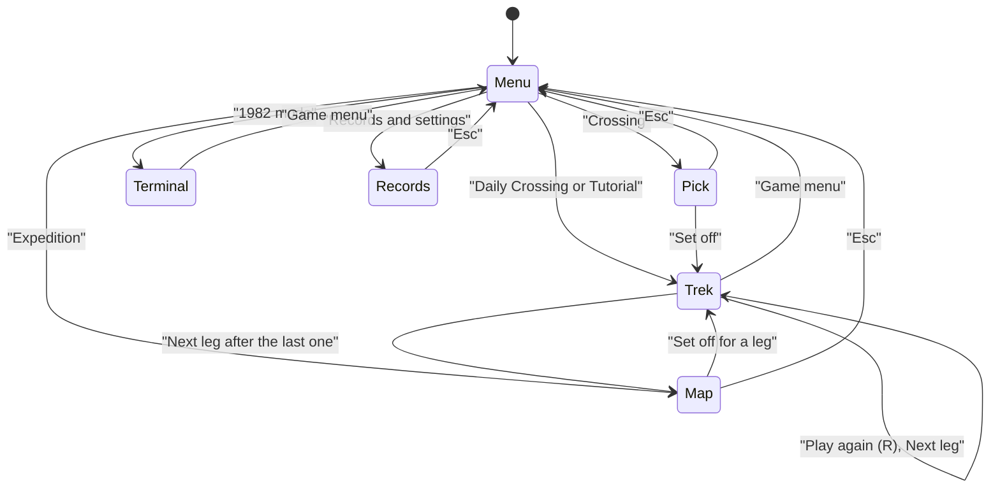
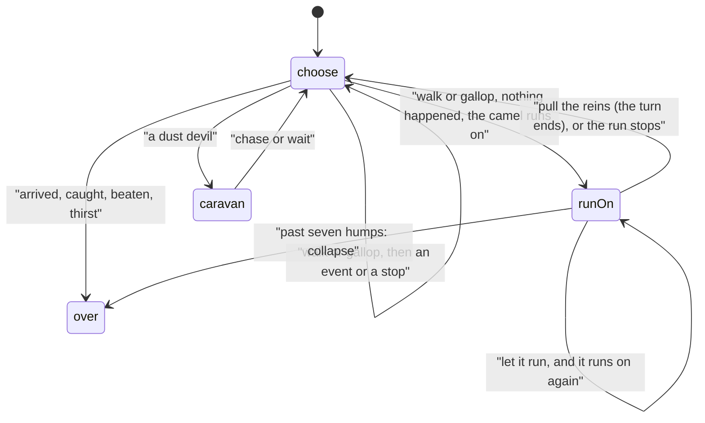

# Two Humps: how the rebuild works

Two Humps is a pure, seeded engine in `lib/two-humps/` (a `Trek` class, the 1982 program as a separate state
machine, bots, the Daily and the Expedition), and a set of screens in `components/two-humps/` that draw a Canvas 2D
diorama of the Gobi under a DOM HUD. The engine decides everything at once when a command is given; the screen then
plays out what happened, one happening at a time, and eases the picture towards the engine's numbers.

## Module map

| File | Owns |
|---|---|
| `app/two-humps/page.tsx` | The route: reads the six docs at build time and renders `TwoHumps` |
| `lib/two-humps/manifest.ts` | Title, palette, emblem, stats, places, trivia, the Daily's epoch, 15 achievements |
| `lib/two-humps/rules.ts` | Every number: goal, fatigue, thirst, the three difficulties, stride ranges, night pace, event odds, pursuer speeds and starts |
| `lib/two-humps/engine.ts` | `Trek`: state, previews, commands, the run-on, events, pursuers, endings, the diary, and the record the achievements read |
| `lib/two-humps/original.ts` | The 1982 program as a state machine, bugs and all; it produces happenings, not text |
| `lib/two-humps/bots.ts` | `play()`, and random, sensible, plan and routine policies for the simulations |
| `lib/two-humps/daily.ts` | `dailyFor(date)`: the day's number, key and crossing |
| `lib/two-humps/expedition.ts` | The five legs: place, pursuer, hour, twist, journal page, map position |
| `lib/two-humps/tutorial.ts` | The tutorial's crossing, with dice picked so the lesson always plays out |
| `lib/two-humps/share.ts` | Pursuer names and the Daily's share text (the only emoji in the game) |
| `lib/two-humps/progress.ts` | The progress store, `afterCrossing`, `afterLeg`, `earnedBy` |
| `lib/two-humps/noise.ts` | Hash and value noise for the scenery |
| `components/two-humps/TwoHumps.tsx` | The game shell and the screen machine; turns a finished trek into progress |
| `components/two-humps/Menu.tsx` | The game menu over a live panorama |
| `components/two-humps/PursuerPick.tsx` | Three pursuer cards with portraits, and the difficulty |
| `components/two-humps/Trek.tsx` | The play screen: diorama, HUD, cards, roll dial, events, seeds, tutorial coach, journal page |
| `components/two-humps/Hud.tsx` | Route strip, supplies, command cards, roll dial, event card |
| `components/two-humps/playback.ts` | What the canvas shows between the engine's jumps: easing, the clock, the ending's hour |
| `components/two-humps/ExpeditionMap.tsx` | The SVG map and the leg list |
| `components/two-humps/Records.tsx` | Records, keycaps and Two Humps' own settings |
| `components/two-humps/Terminal1982.tsx`, `desk1982.ts` | 1982 mode: the screen, and the desk that runs the program and writes its lines |
| `components/two-humps/SceneCanvas.tsx` | A canvas with a render loop that sleeps off screen and holds still for reduced motion |
| `components/two-humps/sound.ts` | Every sound, synthesised |
| `components/two-humps/icons.tsx` | The game's SVG icons |
| `components/two-humps/hooks.ts` | The live appearance, and the hour a trek sets off |
| `components/two-humps/scene/*` | The diorama and everything drawn in it (see [Drawing](#drawing)) |

## State machines

The screens. Everything but the trek and the terminal counts as the game menu for the shell, so `Esc` there goes
back to the Hall; the pick, map and records screens take `Esc` themselves and go back to the menu.

A trek's phases, in the engine:

## The engine

`Trek` (`lib/two-humps/engine.ts`) takes a `TrekConfig`: pursuer, difficulty, seed, the hour it sets off, and an
optional `Twist` for Expedition legs. It forks three random streams from the kit's `createRng`: `map` (oases and
terrain), `dice` (strides and events) and `pursuer` (its steps). Separate streams keep the map the same however
the player plays, which the Daily relies on.

- **`preview(command)`** says whether a command is legal and, if not, why; and what it can do: the miles range,
  fatigue after, the pursuer's gain range over the turn (or the whole night), the odds of help, the hours of
  sleep. The cards print these.
- **`act(command)`**, **`letRun()`**, **`pullReins()`**, **`chooseCaravan()`** and **`tossSeeds()`** change the
  state and return `Happening[]`, the list of things that happened in order: strides, events, pursuer steps,
  dawn and dusk, the end.
- **A turn** is two hours. `endTurn(steps)` adds the steps to the turn count, uses one turn of thirst, and moves
  the pursuer once per step; a night's sleep is several steps.
- **The run-on.** A stride with no event leaves the trek in `run-on` with a chance of
  `quiet odds × difficulty run-on rate`. `letRun()` takes another stride (miles and fatigue, no thirst, no time,
  no pursuer); `pullReins()` ends the turn. An oasis on the way stops the camel there.
- **Pursuers** (`pursuerStep`): each step's range comes from `stepRange(kind, clock, steps, difficulty, fed)` in
  the engine, from the tables in `rules.ts`. The rival dries every unused oasis it passes and wins at the goal;
  the gang does nothing until it sets off, hops at night, and skips a step after seeds.
- **The record** counts what the achievements need: gallops, the longest run, seeds thrown, night camps survived,
  oases reached before the rival, songs heard, fossils, reins pulled at six.

Starts depend on the hour (`pursuerStart`): from a dusk start the rival has already broken camp ahead of you and
the gang's burrows are behind. Without that, a dusk start gave a free night against the rival; see
[NOTES.md](NOTES.md).

The 1982 program (`lib/two-humps/original.ts`) is separate: `createOriginal(random)` returns a machine with
`command(value)`, `subcommand(value)` and `take()`. It follows the listing's line numbers in its comments and keeps
count of the hidden repeats and the return addresses left on the stack.

## AI

There are no opponents to think for, only pursuers that roll dice. The bots in `lib/two-humps/bots.ts` play the
engine for the simulations: `randomPolicy`, `sensiblePolicy` (the brief's: drink at the warning, camp at five,
gallop only fresh, reins at six), `planPolicy(plan)` for the grid search behind the "best" figures, and
`routinePolicy(order)` for the "no blind routine wins" check. `scripts/check-two-humps.ts` runs them all.

## Drawing

Everything is Canvas 2D (ADR 0005). `scene/Diorama.ts` draws one frame from a `DioramaFrame` (the hour on the
trek's clock, animation time, how far the ground has slid, how much the near ground is lifted) and a scene's
`SceneHooks` (`beforeLayer(index)`, `overlay`, `glowAt`).

| File | Draws | To change it |
|---|---|---|
| `scene/light.ts` | `lightAt(clock)`: sun height and side, sky colours, haze, starlight, moonlight, glow | The colour stops per sun elevation |
| `scene/sky.ts` | The sky gradient, the sun and its halo, `NightSky` (stars and the Milky Way turning round the pole) | Star counts, band tilt, glow colours |
| `scene/dunes.ts` | `GOBI_LAYERS`, six parallax layers with slip faces, brinks and wind ripples; `surfaceY` | Each layer's base, height, spacing, colour, haze, ripples and lift |
| `scene/camel.ts` | The rigged Bactrian camel: one silhouette for body, neck and head, legs by inverse kinematics, walk, gallop and rest, humps that sag with fatigue, the rider | `camelPaint`, the pose functions, `NECK_ROOT`, `POLL` |
| `scene/haboob.ts` | The storm wall (a half-size buffer of lit dust billows), blowing sand, the storm's shade | `DUST`, the billow counts, `reach` and `fury` |
| `scene/caravan.ts` | Captain Bluster's caravan: three camels, packs, pennant, dust plume, night camp | `rivalPaint` |
| `scene/jerboa.ts` | The jerboas: big ears, spring legs, tufted tails, the ladle, bibs, eyes in the dark | `drawJerboa` pose fields |
| `scene/camp.ts` | The campfire, firelight on the sand, the traveller | `FIRE`, `flickerAt` |
| `scene/ger.ts`, `scene/flora.ts` | Gers, lanterns, the cake table; saxaul and grass tufts | Their paint functions |
| `scene/trek.ts` | The trek: places everything by its mile so gaps on screen are gaps on the route; oases, the finish, the pursuer, the camel or the camp, effects | `placement`, `TrekView` |
| `scene/endings.ts` | The six ending scenes and the hour each is lit at | `endingScene`, `endingClock` |
| `scene/demo.ts`, `scene/portraits.ts` | The menu's endless trek (and the Hall's preview), and the pursuer cards' close-ups | `GAP`, `HOURS` |

**Light and dark.** The appearance colours the DOM chrome (tokens in `TwoHumps.module.css`: sun-bleached paper by
day, indigo with lantern accents by night) and sets the hour a Crossing or the tutorial sets off: dawn in light,
dusk in dark (`components/two-humps/hooks.ts`). The world's light always follows the trek's own clock.

**Motion.** `SceneCanvas` asks the kit whether to reduce motion; the playback then holds animation time at zero (no
drifting dust, no twinkle, no walk cycle) and jumps straight to each turn's result, and a short fade softens each
jump. The storm's flutter on the HUD is CSS and is turned off the same way.

**Performance.** The sky, the sun, the stars and the three farthest layers are painted into an offscreen backdrop
and repainted only when the clock or the far dunes move, or three times a second for the twinkle. The storm wall
is painted at half size (never wider than 960 pixels) at most 24 times a second. Measured with a GPU at
1920 × 1080: 60 frames a second on the menu and the trek; at 2560 × 1440, 53 to 56 (see [NOTES.md](NOTES.md)).

## Sound

`components/two-humps/sound.ts` makes every sound with WebAudio through the kit's effects bus, so the top bar's mute
and the volume setting apply: a looping wind bed whose level and pitch follow the storm's distance, footfalls in
pairs for a walk and a quick drum for a gallop, the dunes' hum (about 96 Hz, a sawtooth with a filtered noise
band), the storm's roar (62 Hz), a crackling campfire, a gust, water at an oasis, and squeaks for the gang. The
trek screen calls them as it plays out the happenings.

## Kit integration

- **Manifest**: `lib/two-humps/manifest.ts`, listed in `lib/catalog.ts`.
- **Shell**: `TwoHumps.tsx` wraps everything in `GameShell` with the game's shortcuts. The trek reports itself
  with `usePlayScreen`: one pause item ("Start this crossing again"), `losesProgress` once a turn has passed, and
  "this crossing" or "this leg" as the round's name. The terminal does the same for "this 1982 trek".
- **Results**: the trek's own journal page, with the standard actions in the standard order and keys (Play again
  `R`, Game menu `Esc`, Back to the Hall `H`), and Next leg and Share in their own row above.
- **Progress**: `twoHumpsStore` (`anykey.two-humps.save`, version 1) through `createProgress`, so new keycaps go
  to the Keyring, the Daily's first try marks the day as done, and every finished trek counts as a play.
- **Daily**: kit `dailyDate` with the game's epoch, 2026-10-09.

## Tests

| Test | Proves | Run |
|---|---|---|
| `tests/unit/two-humps-engine.test.ts` | Determinism, the run-on's costs, collapse, refusals, oases, seeds, the rival, the Daily, balance, every leg winnable, the tutorial's lesson | `npm test` |
| `tests/unit/two-humps-original.test.ts` | The 1982 facts, with scripted dice | `npm test` |
| `scripts/check-two-humps.ts` | Every balance target, the median crossing, routines, legs, the Daily, the 1982 figures | `npm run check:two-humps` |
| `tests/e2e/two-humps.spec.ts` | Every mode by mouse and by keyboard alone, the tutorial, the reins, seeds, every way out | `npx playwright test --config playwright.two-humps.config.ts` |
| `tests/shots/shots.spec.ts` | Screenshots of the menu, pick, trek, journal, map and terminal in light and dark at two sizes | `npm run shots` |

## Known limits

- The seed sack can be dragged onto the gang with a mouse or a finger, but the drop target is simply "left of the
  camel, low on the sand", not the jerboas themselves.
- On small portrait screens the HUD stacks and covers more of the scene; the game is playable but designed for
  landscape.
- The rival's distance on screen is drawn wider than true, so a close race still shows two caravans; the route
  strip has the exact miles.
- 1982 mode's `F1` to `F6` submit numbers, which the original's soft keys never did.
