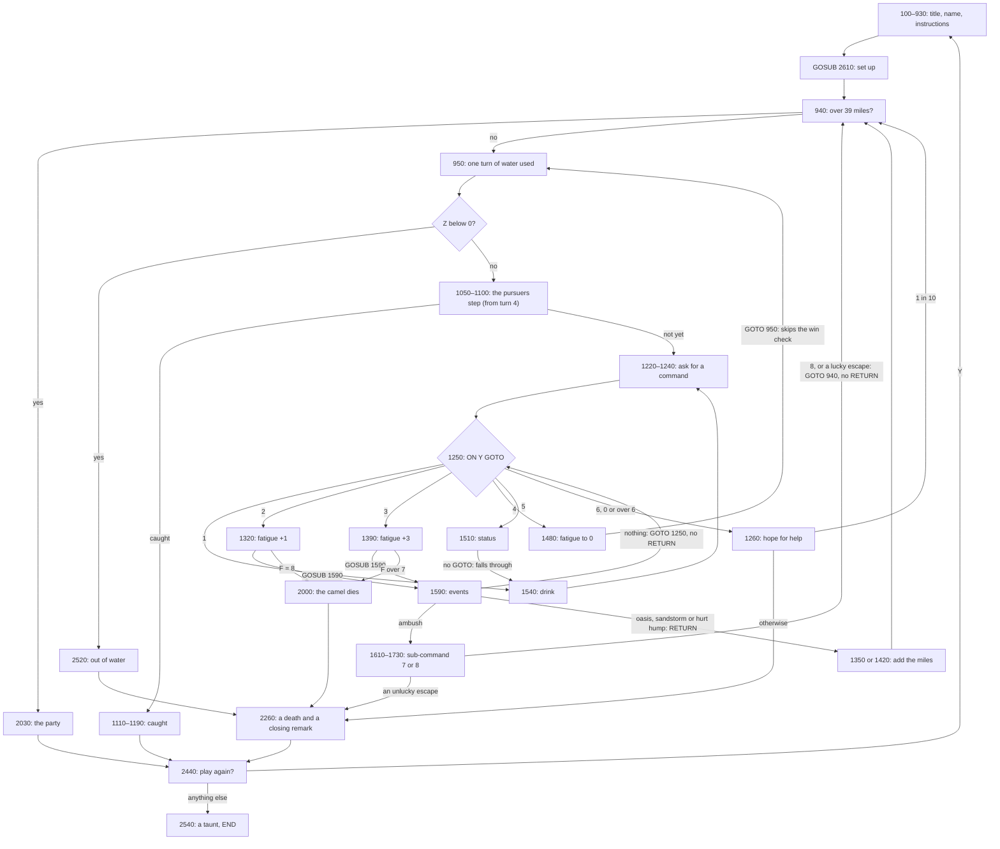

# Desert (DESERT.BAS): how the original works

`DESERT.BAS` is a 255-line program in IBM BASICA, the BASIC that came with the IBM Personal Computer in 1981. It
runs in the 80-column text screen, takes its commands from the function keys or the keyboard, and keeps the
whole game in a handful of numeric variables. Its control flow is a tangle of `GOTO`s with three subroutines, and
one of those subroutines leaves by a side door, which is where its most famous behaviour comes from.

## At a glance

| | |
|---|---|
| Lines | 255, numbered 100 to 2680 |
| Dialect | IBM BASICA (`KEY`, `COLOR`, `INKEY$`, `STRING$`, `CLS`) |
| Machine | IBM PC, 80 × 25 text, colour or monochrome |
| Input | `INPUT` of a number for each command; F1 to F6 are labelled with the commands |
| Output | Text only, with lines of box-drawing characters and busy-wait pauses |
| Randomness | `RND` without `RANDOMIZE`: the same sequence every time BASIC starts |

## Line map

| Lines | What they do |
|---|---|
| 100–230 | Title screen: a banner, the credits, wait for a key |
| 240–300 | Label the function keys F1 to F6 with the six commands, and blank F7 |
| 340–350 | Remarks: the program's name and "translated by IPCO", February 1982 |
| 360–560 | A second title, ask for the player's last name, ask whether to show instructions |
| 570–840 | The instructions: the goal, the pursuers, the water, the six commands and a warning about galloping |
| 850–930 | Start a game: a good-luck line, then the set-up subroutine |
| 940–1050 | The top of a turn: the win check, one turn of water used, the thirst warning, death by thirst, count the turn |
| 1060–1210 | The pursuers' step, the captive check, the catch, and the status lines |
| 1220–1250 | Ask for a command, and `ON Y GOTO` to it |
| 1260–1310 | Command 6, hope for help |
| 1320–1380 | Command 2, moderate speed |
| 1390–1470 | Command 3, full speed |
| 1480–1500 | Command 4, stop for the night |
| 1510–1530 | Command 5, status, which falls through into… |
| 1540–1580 | Command 1, drink |
| 1590–1930 | The event subroutine, part one: the ambush and its two sub-commands |
| 1940–1990 | Part two: the oasis |
| 2000–2020 | The camel dies |
| 2030–2090 | The win: a banner and the party |
| 2100–2200 | Part three: the sandstorm |
| 2210–2250 | Part four: the hurt hump, or the repeat |
| 2260–2430 | A death: pick one of five closing remarks |
| 2440–2510 | Play again? Only a capital Y goes back to 850 |
| 2520–2530 | Death by thirst |
| 2540–2600 | The parting taunt, and `END` |
| 2610–2680 | Set-up: six drinks, four turns of water, everything else zero |

## Control flow



In words:

```
set up: six drinks, four turns of water, miles, pursuers, fatigue, turn = 0
top of turn:
  if miles > 39: win
  water -= 1; warn at 1; if below 0: die of thirst
  turn += 1; roll the pursuers' step (2.5 to 11.5)
  from turn 4: pursuers += step; if pursuers >= miles: caught
  print the gap and the miles
ask:
  read a number Y and jump on it:
    1 drink: drinks -= 1 (below 0 is death); water = 4; ask again
    2 walk: fatigue += 1 (death at exactly 8); events; miles += 0..9; top of turn
    3 gallop: fatigue += 3 (death over 7); events; miles += 0,2..18; top of turn
    4 stop: fatigue = 0; top of turn, but past the win check
    5 status: print strength, drinks, water; then fall into drink
    anything else: help, 1 in 10, or die
events (a subroutine):
  6 in 100: ambush; ask 7 (run) or 8 (wait); go to the top of a turn, never returning
  else 3 in 10: oasis; refill; return
  else 6 in 100: sandstorm; miles ± 0..9; return
  else 6 in 100: hurt hump; pursuers += 1; return
  else: jump back to "jump on Y" without returning: the same command again
```

## The interesting parts

### The repeat

The heart of the program's character is four lines at the end of the event subroutine. When none of the four
events fires, line 2220 jumps straight to the dispatcher at 1250 instead of returning. The `GOSUB` that called
the subroutine is never answered, and the same `ON Y GOTO` sends the program back into the same command from its
first line: fatigue goes up again, the death check runs again, and the event subroutine is called again.

Two things follow. The miles are added after the subroutine returns (1350 and 1420 come after the `GOSUB`), so a
stride that repeats never adds its miles: only the stride that finally returns counts. And the repeats print
nothing, so the player only sees a camel that got tired too fast, or died. With 58.1% of event rolls ending in a
repeat, a gallop on a fresh camel (fatigue 0, then 3, 6, 9) dies whenever it repeats twice in a row: 33.8% of the
time.

### The stack

Every unanswered `GOSUB` leaves its return address on BASIC's stack, and so does every ambush, which leaves the
subroutine by `GOTO 940`. The program never clears them. In 40,000 simulated games the pile never passed 22
addresses, so it doesn't run out of room in practice; see [NOTES.md](NOTES.md).

### Status and drink

The status lines (1510–1530) end without a `GOTO`, so the program runs on into the drink at 1540. Asking for your
status costs a drink and resets your water, which is either a bug or a very dry joke.

### The dispatcher

`ON Y GOTO` with six targets does nothing for 0 or for numbers past 6, and the program simply carries on to the
next line, 1260, which is "hope for help". So every typo is a call for help. A negative number is an error that
stops BASIC itself. The sub-command, on the other hand, compares the answer to exactly 8: anything else, including
7.9, counts as a run for it.

### The captive flag

Line 1070 sends the program to the ambush prompt when the variable `Q` is above zero, as if a captured player
should stay captured from turn to turn. Nothing ever sets `Q` above zero (every line that touches it sets it to
0), so waiting for the ransom can never go wrong: either it's paid, or you're told to keep waiting and the next
turn starts as normal.

### Function keys

Lines 240–300 use `KEY n, text` to put the six commands on the soft-key line at the bottom of the screen. In
BASICA a soft key types its text when pressed, and these texts are words, not numbers, so pressing one at the
numeric `INPUT` would only get "?Redo from start". The line works as a reminder of which number is which, and
players typed the numbers. During an ambush, F7 and F8 are relabelled for the two sub-commands. (We have this from
reading the code and BASICA's documentation, not from running it.)

## Quirks and bugs

| Quirk | Lines | Effect |
|---|---|---|
| The repeat | 2210–2220, 1340–1350, 1410–1420 | Hidden extra strides that cost fatigue and add no miles |
| The stack | 1340, 1410, 1690–1930 | Return addresses pile up, harmlessly in practice |
| Status costs a drink | 1510–1580 | No `GOTO` after the status lines |
| Typos call for help | 1250–1260 | `ON` falls through for 0 and anything over 6 |
| Waiting is always safe | 1070, 1780, 1880 | The captive flag is never set |
| Hurt hump helps the pursuers | 2230 | Its message calls it luck, but the pursuers gain a mile |
| A sandstorm can push you below zero | 2130–2180 | Nothing clamps the miles |
| Drinking from an empty canteen kills | 1540–1550 | The count goes below zero and that is treated as death |
| Stopping skips the win check | 1500 | `GOTO 950`, not 940; harmless, since stopping doesn't move you |
| The same dice every time | — | No `RANDOMIZE` |

Each is checked, with how, in [NOTES.md](NOTES.md).

## Playing the original

The program needs IBM BASICA or a compatible BASIC (GW-BASIC runs it). Today the easiest way is
[PC-BASIC](https://robhagemans.github.io/pcbasic/), a free interpreter that behaves like GW-BASIC and BASICA and
shows the function-key line; or GW-BASIC inside DOSBox.

1. Load it with `LOAD "DESERT"` and start it with `RUN`.
2. Press a key at the title, type your last name, and answer the question about instructions.
3. Each turn, type a number from 1 to 6 and press Enter. The function-key line is a reminder of which is which.
4. At an ambush, type 7 to run or 8 to wait.
5. At the end, type a capital `Y` to play again.

Expect to lose: in our simulations a sensible player wins about 2% of the time and the best simple strategy about
6%. Since there is no `RANDOMIZE`, a freshly started interpreter replays the same desert, so the same answers
give the same game.

Two Humps' **1982 mode** plays these rules exactly, with new words and a panel that shows the hidden repeats.

## Sources

- `DESERT.BAS` itself, read line by line (kept outside the repository).
- IBM, *BASIC* reference manual for the IBM Personal Computer (1981–82): `ON … GOTO`, `GOSUB`/`RETURN`, `KEY`,
  `RND` and `RANDOMIZE`.
- [PC-BASIC documentation](https://robhagemans.github.io/pcbasic/doc/) for the behaviour of `ON … GOTO` out of
  range and of the function-key line.
- Our own module, `lib/two-humps/original.ts`, and its tests, for the simulated figures.
